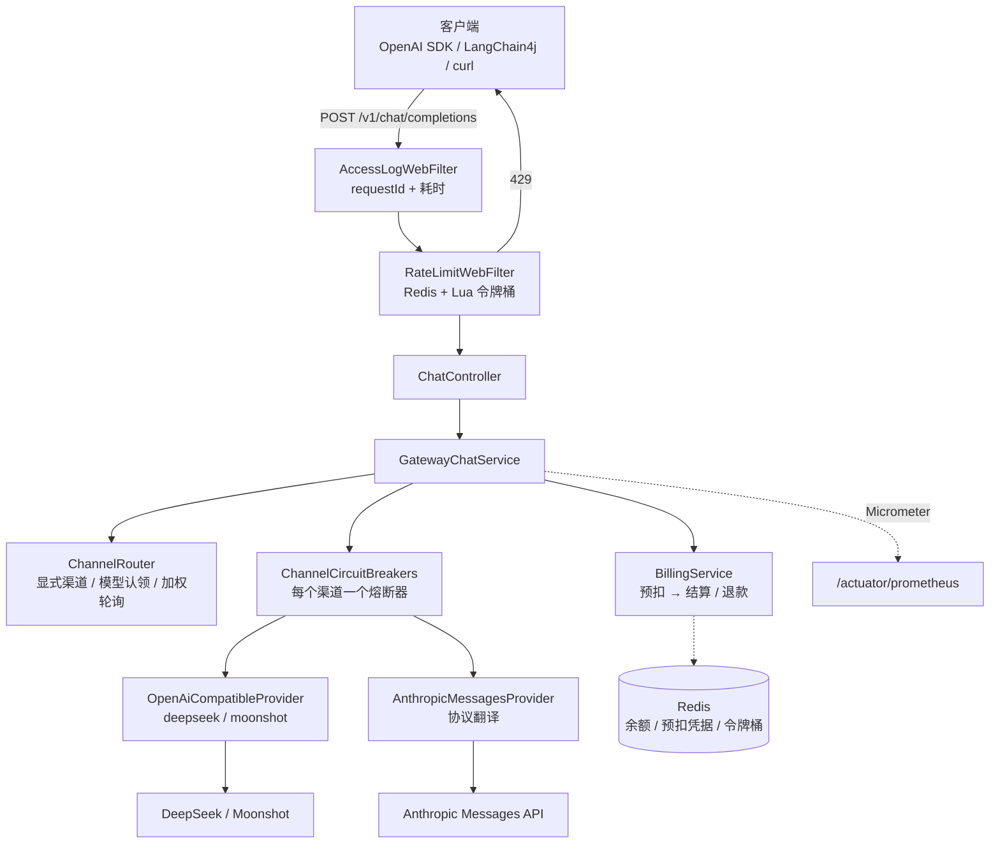

# LLM Gateway · 大模型统一接入网关

[](https://github.com/maixiaowen111/llm-gateway/actions/workflows/ci.yml)
[](LICENSE)
[](https://adoptium.net/)
[](https://spring.io/projects/spring-boot)

> 把「调用大模型」收拢到一个地方：业务侧只认一套 OpenAI 兼容接口，
> 厂商差异、密钥、限流、熔断、计费、观测全部关在网关门内。

**Java 17 · Spring Boot 3.5 · WebFlux (Reactor Netty) · Redis + Lua · Resilience4j · Micrometer**

48 个主类 / 约 6,300 行 · 18 个测试类（+1 辅助类）/ **65 个测试**（2026-10-21 全绿）

---

## 为什么需要它

假设订单平台、客服系统、Agent 三套业务都要调用大模型。如果各自直连厂商：

```text
订单平台 ──┐
客服系统 ──┼── 各自直连 ──→ DeepSeek / Moonshot / Anthropic
Agent   ──┘
```

| 问题 | 后果 |
|---|---|
| 每家厂商协议/字段不同 | 每个业务都要写一遍适配 |
| API Key 散落到 N 个项目 | 泄漏面 = N 倍 |
| 没人限流 | 某个业务写错循环，额度一夜刷爆 |
| 换厂商 | N 个系统一起改 |
| 花了多少钱 | 没人说得清 |

接入网关后，业务只改一个 `base_url`：

```text
订单平台 ──┐
客服系统 ──┼──→ LLM Gateway ──→ DeepSeek
Agent   ──┘     一套接口 + 一套账      ├→ Moonshot
                                      └→ Anthropic（协议翻译）
```

**网关的价值 = 把厂商差异关在门内，把风险和成本留在门内可见。**

---

## 核心能力

| 能力 | 状态 | 说明 |
|---|---|---|
| OpenAI 协议兼容 | ✅ | 客户端只改 `base_url`，OpenAI SDK / LangChain4j 可直接接入 |
| 非流式 / SSE 流式 | ✅ | `stream: true`，含 `[DONE]` 收尾、逐块空闲超时 |
| 取消传播 | ✅ | 客户端断开 → 上游连接关闭，停止推理、停止烧 token |
| Provider SPI | ✅ | 两家 OpenAI 兼容厂商共用 1 个实现类；Anthropic 走独立实现 |
| 多渠道 / 按模型路由 | ✅ | 渠道用 `models` 认领模型名，命中即优先 |
| 平滑加权轮询 | ✅ | Nginx 同款算法，5:1 权重下序列为 `A A A B A A` |
| 熔断 / 重试 / 故障转移 | ✅ | **按渠道隔离**熔断；**首字节之后禁止换渠道** |
| 限流 | ✅ | Redis + Lua 令牌桶，原子扣减，32 并发不超卖 |
| Token 计量与计费 | ✅ | 预扣 → 结算（多退少补）→ 退款；**断流也计费** |
| Function Calling 透传 | ✅ | `tools` / `tool_choice` / `response_format`，含流式 `delta.tool_calls` |
| 观测 | ✅ | Micrometer 指标、Prometheus 端点、访问日志、渠道健康检查 |
| 管理接口 | ✅ | 渠道启停、用量查询、充值；Token 鉴权，默认 fail-closed |
| Docker Compose | ✅ | 网关 + Redis 一键起，含健康检查与冒烟脚本 |

---

## 架构



关键分层：

- **SPI 层**：`Provider` 只承诺「一次性回答」和「逐字回答」，接口里不出现厂商名。
- **路由层**：`ChannelRouter` 输出**有序**候选列表，并过滤禁用/熔断的渠道。
- **保护层**：限流在过滤器中；熔断、重试、转移在服务层；计费在调上游之前。
- **观测层**：所有终态（成功 / 失败 / 取消）都汇入同一组指标。

---

## 快速开始

### 方式一：Docker Compose（推荐）

```bash
# 1. 可选：注入真实密钥；不填也能跑通健康检查、管理接口和 402 计费拦截
export DEEPSEEK_API_KEY=sk-xxx

# 2. 构建并启动（网关 + Redis）
docker compose up -d --build

# 3. 等健康检查变绿
docker compose ps

# 4. 冒烟测试
BASE_URL=http://localhost:8081 ADMIN_TOKEN=dev-admin-token ./scripts/smoke.sh
```

预期输出：

```text
== 1/5 健康检查 ==                ✅ 200
== 2/5 管理接口 fail-closed ==    ✅ 403
== 3/5 管理接口可用（带 token）== ✅ 200
== 4/5 计费拦截（不需要真实 Key）== ✅ 402
通过 4 项，失败 0 项
```

> **第 4 步不需要真实 API Key**：402 是预扣阶段拦下的，请求根本没打到上游。
> 这是刻意的设计 —— 核心链路应该能在离线、零成本的环境里被验证。

### 方式二：本地运行

```bash
# 环境：JDK 17+ / Maven 3.9+ / Redis 6+（限流和计费需要）
cp .env.example .env      # 填 DEEPSEEK_API_KEY
source .env

GATEWAY_RATE_LIMIT_ENABLED=true \
GATEWAY_BILLING_ENABLED=true \
GATEWAY_ADMIN_TOKEN=dev-admin-token \
mvn spring-boot:run
```

启动后：

```bash
curl http://localhost:8081/actuator/health
```

---

## 调用示例

### 非流式

```bash
curl -s http://localhost:8081/v1/chat/completions \
  -H "Content-Type: application/json" \
  -H "X-Client-Id: tenant-a" \
  -d '{
    "model": "deepseek-chat",
    "messages": [{"role": "user", "content": "用一句话解释什么是网关"}]
  }'
```

### 流式（注意 `-N` 关闭 curl 缓冲）

```bash
curl -N http://localhost:8081/v1/chat/completions \
  -H "Content-Type: application/json" \
  -d '{
    "model": "deepseek-chat",
    "stream": true,
    "messages": [{"role": "user", "content": "逐字讲一下 SSE"}]
  }'
```

### Function Calling

```bash
curl -s http://localhost:8081/v1/chat/completions \
  -H "Content-Type: application/json" \
  -d '{
    "model": "deepseek-chat",
    "messages": [{"role": "user", "content": "帮我查订单 A1001"}],
    "tools": [{
      "type": "function",
      "function": {
        "name": "queryOrder",
        "description": "按订单号查询订单",
        "parameters": {
          "type": "object",
          "properties": {"orderNo": {"type": "string"}},
          "required": ["orderNo"]
        }
      }
    }],
    "tool_choice": "auto"
  }'
```

网关只做搬运：`tools` 原样转发，`tool_calls` 原样返回，
流式 `delta.tool_calls` 的增量片段**不由网关拼装**（拼装是客户端的职责）。

### 管理接口

```bash
# 查看渠道（运行期状态，不是配置回显）
curl -H "X-Admin-Token: $TOKEN" http://localhost:8081/admin/channels

# 运行期摘掉一条渠道（不重启）
curl -X POST -H "X-Admin-Token: $TOKEN" -H "Content-Type: application/json" \
     -d '{"enabled": false}' \
     http://localhost:8081/admin/channels/moonshot/enabled

# 查余额与用量
curl -H "X-Admin-Token: $TOKEN" http://localhost:8081/admin/usage/tenant-a

# 充值（正数）或对账修正（负数）
curl -X POST -H "X-Admin-Token: $TOKEN" -H "Content-Type: application/json" \
     -d '{"amount": 100000}' \
     http://localhost:8081/admin/clients/tenant-a/credits
```

---

## 配置

全部配置在 `src/main/resources/application.yml`，密钥一律 `${ENV_VAR:}` 占位。

| 前缀 | 作用 | 关键项 |
|---|---|---|
| `gateway.providers` | 渠道定义 | `default-channel`、`channels.*`（type / base-url / api-key / group / weight / models） |
| `gateway.providers.routing` | 路由策略 | `auto-route`（默认 false）、`failover-enabled`、`failover-on-explicit` |
| `gateway.resilience` | 熔断与重试 | 失败率阈值、滑动窗口、半开探测数、重试次数与退避 |
| `gateway.billing` | 计费 | `enabled`、`fail-open`、单价、`default-max-tokens`、预扣 TTL |
| `gateway.rate-limit` | 限流 | 桶容量、每秒回填、`fail-open` |
| `gateway.upstream` | 超时 | connect 3s / read 30s / idle 20s |
| `gateway.admin.token` | 管理鉴权 | 不配置时 `/admin/**` 一律 403 |
| `spring.data.redis` | Redis | host / port（⚠️ Boot 3 前缀，不是 `spring.redis`） |

**新增一家 OpenAI 兼容厂商**，只需在 `channels` 下加一段，不写 Java 类：

```yaml
gateway:
  providers:
    channels:
      qwen:
        type: openai
        base-url: ${QWEN_BASE_URL:https://dashscope.aliyuncs.com/compatible-mode/v1}
        api-key: ${QWEN_API_KEY:}
        model: ${QWEN_MODEL:qwen-plus}
        group: default
        weight: 1
```

**协议不同**的厂商才需要新的 `Provider` 实现（见 `AnthropicMessagesProvider`）：
鉴权头、`system` 字段位置、必填字段、流式事件格式，没有一条能用配置表达。

---

## 关键设计

### 1. 一个实现类 × N 份配置，而不是 N 个类

`OpenAiCompatibleProvider` 描述「我能处理什么协议」，不是「我为谁服务」。
DeepSeek、Moonshot、通义、Ollama 的差异只有 `base-url / api-key / model` ——
这些是**数据**，不是代码。

```bash
grep -i "deepseek\|moonshot\|JsonNode" src/main/java/io/github/maixiaowen/gateway/controller/ChatController.java
# 无输出 = 抽象没有泄漏
```

### 2. 只有协议真的不同，才值得新写一个类

Anthropic 的 `x-api-key` + `anthropic-version`、顶层 `system`、
必填 `max_tokens`、`content_block_delta` 事件，
证明 `Provider` 抽象不是「一个接口一个实现」的形式主义。

### 3. 错误分类先于熔断：400 不重试、401 不换渠道

```text
超时 / 5xx        → 换渠道
429               → 同渠道退避重试，不行再换
400 / 422         → 直接透传（换一百个渠道还是 400，只会多花三份钱）
401 / 403         → 502 + 明确 code（能自动恢复的自动恢复，该喊人的喊人）
```

熔断器只给「超时 / 5xx / 429」计数。若把 400 也计数，
一个写错参数的客户端循环 10 次就能把健康渠道熔断 —— **一个坏客户端搞垮全站**。

### 4. 首字节之后，禁止换渠道

流式已吐 100 个字后上游断开，如果偷偷转到备份渠道重新生成：
用户会看到内容**从头再来一遍**，并且上游会对两份输出都计费。

规则：**转移判定只发生在首字节到达之前**，用每次订阅独立的
`AtomicBoolean` 表达「这次尝试吐没吐过字」。

### 5. 计费必须预扣，且预扣必须写在 Lua 里

`GET → 判断 → DECRBY` 三步分开执行必然超卖（大模型请求耗时长，并发窗口极宽）。
Lua 把「检查余额 + 扣减 + 写预扣凭据」合并成一次原子执行。

- 预扣额 = 输入 token + `max_tokens`（最坏情况）；
- 成功后有 `usage` → 按真实值多退少补；
- **已吐字后断流 → 按预扣额度收费**（上游可能已生成远超我们收到的内容）；
- 一个字没吐就失败 → 全额退款；
- 预扣凭据带 TTL：网关崩溃时最坏少收一次，而不是永久冻结用户的钱。

### 6. 默认值的方向，是业务判断

| | 失效后果 | 默认 |
|---|---|---|
| 限流 | 可能超卖几个请求 | `fail-open: true` |
| 计费 | 账目无法对账，钱收不回来 | `fail-closed: false`（拒绝 503） |
| 自动加权路由 | 悄悄改变老客户端行为 | `auto-route: false` |

**能改变行为的新配置，默认值必须是「保持旧行为」。**

### 7. 三层超时各管一段

| 超时 | 值 | 度量什么 |
|---|---|---|
| connect | 3s | TCP 建连 |
| read | 30s | 请求发出 → 收到**响应头** |
| idle | 20s | 流式**两个数据块之间**的间隔 |

流式响应头几十毫秒就回来，`read` 管不到中途停滞 —— 这是必须单独做 idle 超时的原因。

### 8. 「成功但不对」比报错更难查

接入项目一的 Agent 时发现：网关的请求 DTO 把 `tools` 当成未知字段**静默丢弃**，
请求仍然 200、延迟正常、成功率 100%，只是 Agent 再也调不动工具。

监控发现不了这种故障，**契约测试可以**：
断言上游真的收到了 `tools`，并且 `tool_calls` 真的回到了客户端。

---

## 测试

```bash
mvn test
# Tests run: 65, Failures: 0, Errors: 0, Skipped: 0
```

| 测试类 | 验证什么 |
|---|---|
| `ChatCompletionContractTest` | 对外 JSON 契约、字段归一、超时语义 |
| `StreamingContractTest` / `UpstreamStreamingTest` | SSE 分片、`[DONE]`、坏块跳过 |
| `CancelPropagationTest` / `IdleTimeoutTest` | 取消传到上游、块间空闲超时 |
| `ProviderRegistryTest` / `RoutingTest` / `WeightedRoutingTest` | 注册表 fail-fast、路由隔离、平滑加权 |
| `RateLimit*`（4 类） | 令牌桶换算、32 并发不超卖、429、fail-open |
| `ResilienceEndToEndTest` | 5xx 换渠道、400 不换、熔断后走备份 |
| `AnthropicProviderTest` | 协议翻译、流式事件 |
| `BillingEndToEndTest` | 预扣 / 结算 / 退款 / 断流 / 402 / 幂等 |
| `ObservabilityTest` | 指标、Prometheus、健康检查、requestId |
| `ToolCallingContractTest` | `tools` 透传、`tool_calls` 回传、流式片段 |
| `GatewayChatServiceTest` | 服务层单元行为 |

- 集成测试用 **WireMock**（假上游，动态端口）；
- 限流/计费用 **Testcontainers** 起真实 `redis:7` —— Lua 的原子性用 mock 测不出来；
- 冒烟脚本验证「部署后的真实接线」，20 秒内给出结论。

---

## 目录结构

```text
src/main/java/io/github/maixiaowen/gateway/
├── controller/     ChatController / AdminController / PingController
├── provider/       Provider SPI / ProviderRegistry / OpenAiCompatible / AnthropicMessages
├── routing/        ChannelRouter / SmoothWeightedRoundRobin / ChannelStateRegistry
├── resilience/     ErrorClassifier / UpstreamErrorKind / ChannelCircuitBreakers
├── billing/        BillingService / TokenEstimator / Reservation
├── limiter/        RateLimitWebFilter / RedisTokenBucketLimiter
├── service/        GatewayChatService（路由 → 计费 → 请求 → 结算的编排）
├── observability/  GatewayMetrics / AccessLogWebFilter / 健康检查
├── dto/            请求 / 响应 / 流式分片 / Tool / ToolCall
└── config/         Provider / Resilience / Billing / RateLimit / WebClient

src/main/resources/scripts/   billing_reserve.lua / billing_settle.lua / billing_refund.lua
scripts/smoke.sh              部署后冒烟
Dockerfile / docker-compose.yml
src/test/java/...             18 个测试类 + 1 个辅助类，65 个测试
```

学习文档：[docs/README.md](docs/README.md)（G1~G4 的实现讲解与踩坑记录）

---

## 安全说明

- API Key **只从环境变量读取**，YAML 中一律 `${ENV_VAR:}` 空默认值；
  `.env` 已加入 `.gitignore`，仓库只保留 `.env.example` 模板。
- `/admin/**` 默认 **fail-closed**：不配置 `gateway.admin.token` 时一律 403。
- `X-Request-Id` 做长度与字符集校验，防止日志注入；
  不合法时由网关生成并回传。
- 容器以非 root 用户运行。
- ⚠️ **当前未实现客户端鉴权**：`X-Client-Id` 由客户端自报，可伪造。
  计费和限流按它归属，属于「接入方身份体系」的职责，生产使用前必须补齐。

---

## 未实现 / 已知限制

| 项 | 状态 | 原因 |
|---|---|---|
| 客户端鉴权 / 租户体系 | ❌ | `X-Client-Id` 可伪造；身份体系属于接入方 |
| 多实例共享渠道状态 | ❌ | 运行期启停状态只在单实例内存，需要 Redis / 配置中心 + 版本号 |
| Anthropic 渠道的 Function Calling | ❌ | OpenAI tools ↔ Anthropic `input_schema` 需要整套翻译，当前无真实调用方 |
| Grafana 面板 / 告警规则 | ❌ | 已有指标和 Prometheus 端点，未做可视化与告警 |
| OpenTelemetry 链路追踪 | ❌ | 只有 requestId + 指标，没有跨服务 span |
| 会话 / 上下文存储 | ❌ | 网关无状态，多轮上下文由调用方管理 |

> 主动写清限制，而不是假装「全做了」——
> 面试官追问时，**说得出为什么现在不做**，比说「都做完了」更有说服力。

---

## 关联项目

- **项目一 · 订单 Agent 助手**：`order-agent-assistant`
  Agent 通过 `DEEPSEEK_BASE_URL=http://localhost:8081/v1` 接入本网关，
  工具调用经网关透传到 DeepSeek，再由网关完成计量与限流。

---

## License

[MIT](LICENSE) © 2026 任多志 (maixiaowen111)

可自由用于学习、二次开发和商业项目；如果你基于它做二次开发，欢迎在 Issue 里说一声，
我也想知道它被用到了哪里。
