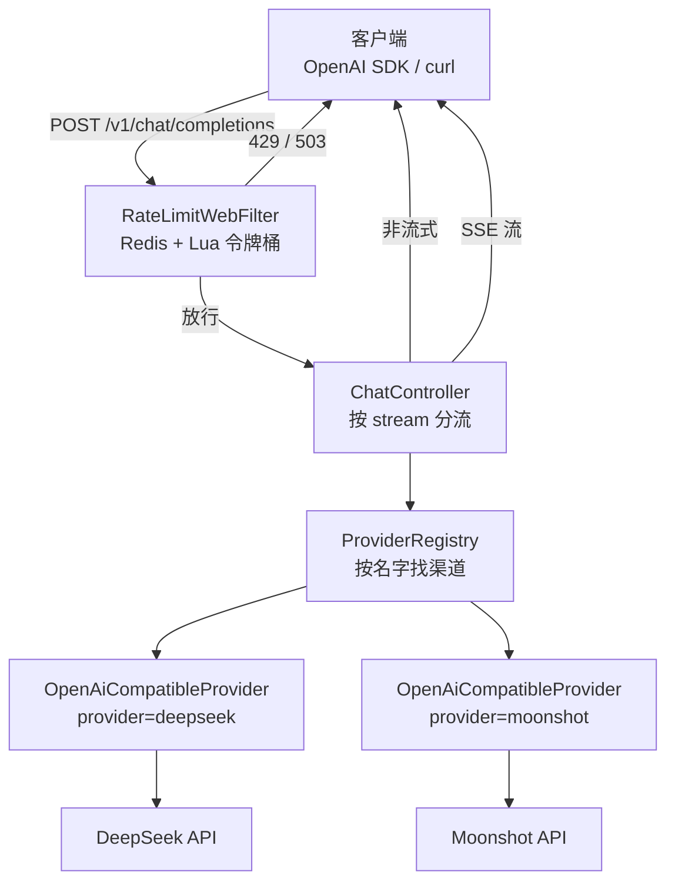

# LLM Gateway · 大模型统一接入网关

> 把「调用大模型」这件事收拢到一个地方:业务侧只认一套 OpenAI 兼容接口,
> 厂商差异、密钥、限流、超时、协议归一全部关在网关门内。

- **技术栈**:Java 17 · Spring Boot 3.5.5 · WebFlux(Reactor Netty)· Redis · Lua
- **规模**:21 个主类 / 约 2300 行 · 12 个测试类
- **对外端点**:`POST /v1/chat/completions`(OpenAI 兼容)、`GET /ping`
- **默认端口**:`8081`

---

## 为什么需要它

假设订单平台、客服系统、Agent 三套业务都要调用大模型。如果各自直连厂商:

```text
订单平台 ──┐
客服系统 ──┼── 各自直连 ──→ DeepSeek / Moonshot / 其他
Agent   ──┘
```

会同时出现五个问题:

| 问题 | 后果 |
|---|---|
| 每家厂商协议/字段有差异 | 每个业务都要写一遍适配 |
| API Key 散落到 N 个项目 | 泄漏面 = N 倍 |
| 没人限流 | 某个业务写错循环,额度被刷爆 |
| 换厂商 | N 个系统一起改 |
| 花了多少钱 | 没人说得清 |

接入网关后:

```text
订单平台 ──┐
客服系统 ──┼──→ LLM Gateway ──→ 渠道 A(DeepSeek)
Agent   ──┘     只认一套接口      └→ 渠道 B(Moonshot)
```

一句话:**网关的价值 = 把厂商差异关在门内。**

---

## 核心能力

| 能力 | 状态 | 说明 |
|---|---|---|
| OpenAI 协议兼容 | ✅ | 客户端只改 `base_url` 即可接入 |
| 多渠道 + 按请求路由 | ✅ | 请求体 `provider` 指定渠道,缺省走默认渠道 |
| 新增渠道 = 改配置 | ✅ | 一个实现类 × N 份 YAML,无需新增 Java 类 |
| 非流式 / SSE 流式 | ✅ | `stream: true` 走流式,含 `[DONE]` 收尾 |
| 取消传播 | ✅ | 客户端断开 → 上游连接关闭,停止计费 |
| 块间空闲超时 | ✅ | 上游卡住不吐数据时主动断开 |
| Redis + Lua 令牌桶限流 | ✅ | 原子「读-判-扣-写回」,并发不超卖 |
| 限流优雅降级 | ✅ | Redis 不可用时 fail-open / fail-closed 可配 |
| 熔断 / 重试 | ⬜ | 未实现 |
| Token 计量 / 计费 | ⬜ | `usage` 字段预留,未结算 |

---

## 架构



关键分层:

- **SPI 层**:`Provider` 接口只承诺「一次性回答」和「逐字回答」两件事,
  接口里不出现任何厂商名、`JsonNode` 或框架类型。
- **注册表层**:`ProviderRegistry` 启动时建立索引,配置错误直接 fail-fast。
- **入口层**:`ChatController` 只做 HTTP 层判断,路由决策交给注册表。
- **保护层**:限流是独立的 `WebFilter`,在 Controller 之前生效。

---

## 快速开始

### 1. 准备环境

- JDK 17+
- Maven 3.9+
- Redis 6+(限流启用时才需要)

### 2. 配置密钥

密钥**只通过环境变量注入,绝不写进 YAML 或 Git**:

```bash
cp .env.example .env
# 编辑 .env,填入:
# DEEPSEEK_API_KEY=你的密钥
```

方式一(命令行):

```bash
source .env && mvn spring-boot:run
```

方式二(IDE):把 `.env` 里的键值填进 Run Configuration 的 Environment variables。

### 3. 启动

```bash
mvn spring-boot:run
# 默认 http://localhost:8081
```

### 4. 请求

非流式:

```bash
curl -s http://localhost:8081/v1/chat/completions \
  -H "Content-Type: application/json" \
  -d '{
    "model": "deepseek-chat",
    "provider": "deepseek",
    "messages": [{"role": "user", "content": "用一句话解释什么是网关"}]
  }'
```

流式(注意 `-N` 关闭 curl 缓冲):

```bash
curl -N http://localhost:8081/v1/chat/completions \
  -H "Content-Type: application/json" \
  -d '{
    "model": "deepseek-chat",
    "stream": true,
    "messages": [{"role": "user", "content": "逐字讲一下 SSE"}]
  }'
```

健康检查:

```bash
curl http://localhost:8081/ping
```

---

## 配置

全部配置在 `src/main/resources/application.yml`,密钥用 `${ENV_VAR:}` 占位。

| 配置前缀 | 作用 | 关键项 |
|---|---|---|
| `gateway.providers` | 渠道定义 | `default-channel`、`channels.*`(base-url / api-key / model) |
| `gateway.upstream` | 传输超时 | connect 3s / read 30s / idle 20s |
| `gateway.rate-limit` | 限流 | enabled / capacity / refill-per-second / fail-open / timeout-millis |
| `spring.data.redis` | Redis 连接 | host / port / password |

**新增一家 OpenAI 兼容厂商**,只需在 `channels` 下加一段:

```yaml
gateway:
  providers:
    channels:
      qwen:
        base-url: ${QWEN_BASE_URL:https://dashscope.aliyuncs.com/compatible-mode/v1}
        api-key: ${QWEN_API_KEY:}
        model: ${QWEN_MODEL:qwen-plus}
```

不需要新增 Java 类。

---

## 关键设计

### 1. 一个实现类 × N 份配置

`OpenAiCompatibleProvider` 描述的是「我能处理什么协议」,不是「我为谁服务」。
DeepSeek、Moonshot、通义、Ollama 都提供 OpenAI 兼容接口,差异只有
`base-url / api-key / model` 三样 —— 这些是**数据**,不是代码。

**验收命令**:

```bash
grep -i "deepseek\|moonshot\|JsonNode" src/main/java/com/example/gateway/controller/ChatController.java
# 无输出 = 抽象没有泄漏
```

### 2. 三层超时各管一段

| 超时 | 值 | 度量什么 |
|---|---|---|
| connect | 3s | TCP 建连 |
| read(`responseTimeout`) | 30s | 请求发出 → 收到**响应头** |
| idle | 20s | 流式**两个数据块之间**的间隔 |

前两者是传输层,由 `WebClientCustomizer` 统一配置;idle 是业务语义,
按渠道注入。**流式响应头几十毫秒就回来,`responseTimeout` 管不到中途停滞** ——
这就是必须单独做 idle 超时的原因。

### 3. 限流:读-判-扣-写回必须原子

普通 `GET → 判断 → DECRBY` 在并发下会超卖。本项目用 Lua 脚本把四步合并成
一次 Redis 原子执行,令牌回填采用**惰性计算**(用 `redis.call('TIME')` 作为唯一时钟源)。

### 4. 取消必须级联

```java
.doFinally(signal -> {
    if (signal == SignalType.CANCEL) { /* 客户端主动中断 */ }
    else { /* 正常结束 */ }
});
```

客户端断开 → WebFlux 发 `CANCEL` → 信号沿操作符链上传 → 上游连接关闭 →
**上游停止推理,不再烧 token**。取消如果不级联,就只是「本地放弃」。

### 5. 自己的 bug 要炸,别人的问题要容错

- 上游单个流式分片解析失败 → 跳过该块并告警,**不中断整条流**。
- 网关自己的 DTO 序列化失败 → 抛出 `IllegalStateException`,**必须炸**。

两者混在一起,所有问题都会看起来像「上游抖动」,一个 5 分钟能修的 bug
会被当成运维问题查三天。

---

## 测试

```bash
mvn test
```

| 测试类 | 验证什么 |
|---|---|
| `ChatCompletionContractTest` | 对外 JSON 契约、字段归一 |
| `StreamingContractTest` / `UpstreamStreamingTest` | SSE 分片、`[DONE]`、坏块跳过 |
| `CancelPropagationTest` | 取消信号是否传到上游 |
| `IdleTimeoutTest` | 块间空闲超时的真实行为 |
| `ProviderRegistryTest` / `RoutingTest` | 注册表 fail-fast、路由隔离 |
| `RateLimitDecisionTest` | 令牌桶换算、`Retry-After` |
| `RateLimitConcurrencyTest` | 32 并发只放行 5 个 + 对照组证明超卖 |
| `RateLimitEndToEndTest` | 429、限流响应头、请求未打到上游 |
| `RateLimitFailOpenTest` | Redis 不可用时 fail-open / fail-closed |

部分测试依赖本机 Docker(Testcontainers 启动 Redis)和 WireMock。

---

## 目录结构

```text
src/main/java/com/example/gateway/
├── controller/     ChatController(唯一正式端点)/ PingController
├── provider/       Provider SPI / ProviderRegistry / OpenAiCompatibleProvider
├── ratelimit/      RateLimitWebFilter / RedisTokenBucketLimiter / RateLimitDecision
├── exception/      UpstreamExceptionHandler 及各业务异常
├── dto/            请求、响应、流式分片
└── config/         ProviderProperties / ProviderConfig / WebClientConfig / RateLimitConfig

src/test/java/com/example/gateway/    12 个测试类
docs/                                 56 页项目学习文档
```

**学习文档入口**:[docs/README.md](docs/README.md)

---

## 安全说明

- API Key **只从环境变量读取**,YAML 中一律 `${ENV_VAR:}` 空默认值。
- `.env` 已在 `.gitignore` 中,绝不提交;仓库只保留 `.env.example` 模板。
- 当前**未实现鉴权**:`/v1/chat/completions` 对调用方不做身份校验,
  生产使用前必须补 JWT / API Key 鉴权。

---

## 未实现 / 后续计划

按优先级:

1. **接入鉴权** —— 目前任何人都能调用网关。
2. **限流维度可信化** —— 现在 `X-Client-Id` 由客户端自报,可伪造;
   需要结合可信代理链或身份体系。
3. **熔断 + metrics** —— 现在只有超时,没有按渠道的失败率统计。
4. **Token 计量与成本核算**。
5. **Docker Compose 一键启动**。
