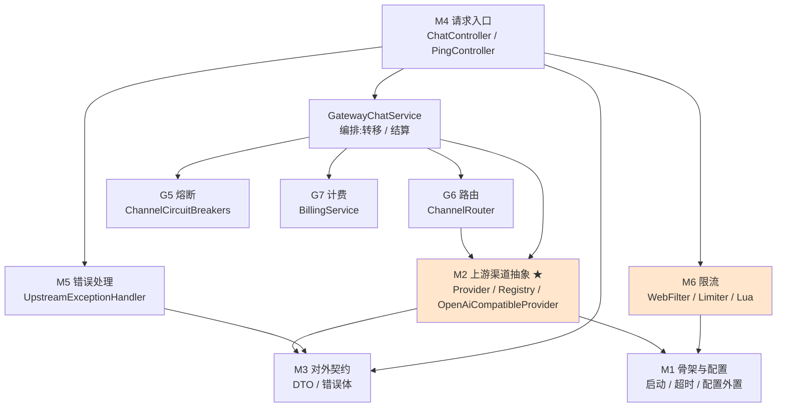

# 架构总览

> **本页速览**
> - 网关是**业务系统和上游大模型之间的唯一入口**,形态是"一层薄薄的适配 + 一道道闸门"。
> - 请求经过的闸门顺序固定:**限流 → 选渠道 → 转发 → 出错兜底**,顺序本身就是设计。
> - 模块之间是**单向依赖**:入口依赖渠道抽象,渠道抽象依赖契约,没有反向依赖。
> - 对外**只认 OpenAI 协议**,厂商差异全部关在 `provider/` 包里。
>
> **导航**:[← 上一页:项目地图](项目地图.md) ｜ [下一页:学习路线图 →](学习路线图.md) ｜ [回到 README](../README.md)

---

## 一、网关在整体架构里的位置

先看大局。这个网关在一个更大的系统里处于这个位置:

```text
┌──────────────────────────────────────────────────────┐
│  Vue 3 + TypeScript  前端                              │
└───────────────────────┬──────────────────────────────┘
                        │ HTTP
┌───────────────────────▼──────────────────────────────┐
│  Java 订单平台(业务真相 / 事务 / 权限 / Agent 编排)      │
└──────┬─────────────────────────────┬─────────────────┘
       │ OpenFeign / MCP             │ HTTP
┌──────▼──────────────┐   ┌──────────▼─────────────────┐
│  Python 智能侧翼      │   │  ★ LLM 模型网关(本项目)     │
│  (RAG / 文档处理)     │   │  限流 / 路由 / 熔断 / 计量   │
└─────────────────────┘   └──────────┬─────────────────┘
                                     │
                        ┌────────────┴────────────┐
                        ▼                         ▼
                   DeepSeek                   Moonshot ...
```

**为什么要单独拆一个网关出来,而不是让 Java 平台直接调 DeepSeek?**

因为下面这四件事,**每一件都不是业务逻辑**:

| 关注点 | 如果放在业务系统里会怎样 |
|---|---|
| 协议适配 | 每个业务系统都要写一遍"DeepSeek 的返回怎么转成统一格式" |
| 限流 | 没人知道全局用了多少,某个业务写错循环就把额度刷爆 |
| 熔断 | 上游挂了,每个业务系统各自超时、各自重试,把上游压得更死 |
| 计量 | 花了多少钱,没有一处说得清 |

**网关的本质:把"横切关注点"从业务代码里拔出来,集中到一处。**

> **类比**:这就像公司的前台。访客(业务系统)不直接进办公室找每个人,
> 而是统一走前台 —— 前台负责登记(限流)、指路(路由)、挡人(熔断)、记账(计量)。
> 办公室里的人(上游厂商)换了一批又一批,业务系统不用知道。

---

## 二、一次请求经过的闸门(顺序就是设计)

```mermaid
sequenceDiagram
    participant C as 业务系统
    participant F as RateLimitWebFilter
    participant Ctrl as ChatController
    participant Svc as GatewayChatService
    participant RT as ChannelRouter
    participant CB as 熔断器
    participant B as BillingService
    participant P as Provider
    participant U as 上游

    C->>F: POST /v1/chat/completions
    Note over F: ① 限流闸门<br/>转发之前判定
    alt 超限
        F-->>C: 429 + Retry-After
    else 放行
        F->>Ctrl: 继续过滤器链
        Ctrl->>Svc: complete / stream(clientId, request)
        Svc->>RT: candidates(request)
        RT->>CB: allows(channel)?
        Note over RT: ② 显式 / model / 加权<br/>禁用或熔断打开 → 移出候选
        RT-->>Svc: 有序候选列表
        Svc->>B: reserve(prompt 估算 + max_tokens)
        Svc->>P: 调主选渠道
        P->>U: WebClient POST(超时已装配)
        U-->>P: 响应 / 流式块
        P-->>Svc: 归一成 OpenAI 格式
        Svc->>B: 按真实 usage 结算(失败则退预扣)
        Svc-->>Ctrl: 结果
        Ctrl-->>C: 200
    end
    Note over P,U: 首字节前失败 → 同组转移;<br/>所有异常 → UpstreamExceptionHandler 统一格式
```

**三个顺序上的讲究:**

1. **限流在转发之前。** 如果放在转发之后,请求已经打到上游了才拒绝 ——
   钱已经花了,拒绝得毫无意义。**"拒绝得足够早"是限流的价值所在。**

2. **选渠道在转发之前。** 渠道名不合法(比如客户端传了个不存在的名字),
   应该在本地就返回 **400**,而不是硬着头皮转发到某个默认渠道再收一个 **502**。
   **错误的归因层次不能错**:用户传错了是 400,上游坏了才是 502。

3. **出错兜底在最外层。** 上游超时、上游返回错误、上游中途卡死,
   三种异常由同一个 `@RestControllerAdvice` 收口,**统一转成 OpenAI 的错误格式**。

---

## 三、模块依赖关系



**这张图的读法:箭头是"依赖",没有反向箭头。**

- `M4 请求入口` 依赖 `GatewayChatService` —— 选渠道/转移/结算在服务层,不在 Controller
- `GatewayChatService` 依赖 `ChannelRouter`、熔断器和计费 —— 但 **Controller 不知道这些**
- `M2` **不依赖** `M4` —— Provider 不知道谁在调它
- `M2`、`M6` **都不依赖** `M4` 和 `M5`

> **为什么单向依赖重要?**
> 如果 `Provider` 反过来要依赖 `ChatController`,那你就**没法单独测试 Provider** 了 ——
> 想测"渠道不存在返回什么",得先把整个 Web 层起起来。
> **单向依赖 = 每一层都能被独立测试。** 这不是洁癖,这是可测性的前提。

---

## 四、"三大抽象"——这个项目的设计骨架

整个项目其实就三个抽象,理解了它们就理解了 80%:

### 抽象 1:`Provider` —— 把"厂商"变成"接口"

```java
public interface Provider {
    String name();
    Mono<ChatCompletionResponse> chatCompletion(ChatCompletionRequest request);
    Flux<ChatCompletionChunk> chatCompletionStream(ChatCompletionRequest request);
}
```

**关键**:这个接口里**没有 `JsonNode`、没有 `Map<String,Object>`、没有任何厂商痕迹**。
入参和出参都是网关自己的 DTO。

- 如果这里出现了 `JsonNode`,说明"厂商的 JSON 结构"漏进了抽象层 →
  以后换厂商,所有调用方都要跟着改。
- 详细展开 → [02-上游渠道抽象](../01-modules/02-上游渠道抽象/_index.md)

### 抽象 2:`RateLimitDecision` —— 把"能不能过"变成"三态"

不是 `boolean`,而是 `ALLOWED / DENIED / UNAVAILABLE` 三种。

**为什么要三态?** 因为"被限流了"(429)和"限流器坏了"(503)是**两件完全不同的事**:

| 情况 | 谁的问题 | 客户端该怎么办 | HTTP |
|---|---|---|---|
| `DENIED` | 客户端请求太密 | **等一会再来**(`Retry-After`) | 429 |
| `UNAVAILABLE` | 网关自己的限流器坏了 | 重试没用,是服务端问题 | 503 |

用一个 `boolean` 表达,这两种情况就糊在一起了 —— 客户端会误以为"等一等就好"。
- 详细展开 → [06-限流](../01-modules/06-限流/_index.md)

### 抽象 3:配置外置 —— 把"值"变成"测试的开关"

假上游(WireMock)能顶替真上游,**全靠所有超时和地址都是 `${ENV:默认值}`**。
测试时用 `@DynamicPropertySource` 一改就行,**业务代码一行不动**。

> **反过来说**:如果有哪个值硬编码在 Java 里,那一处就永远测不了。

---

## 五、这张图之外的东西(边界)

| 图里没有 | 为什么 | 影响 |
|---|---|---|
| 熔断器 | ✅ **已实现**(`resilience/`) | 按渠道隔离;只有上游故障计数,400/401 不计数 |
| 加权路由 | ✅ **已实现**(`routing/`) | 平滑加权选主选;显式点名和 model 命中优先 |
| Token 计量 | ✅ **已实现**(`billing/`) | Redis + Lua 预扣,按真实 usage 多退少补 |
| 服务发现 / 注册中心 | 不需要 | 网关是**被调用方**,不是服务提供方 |
| 数据库 | 不需要 | 请求数据不落库;共享状态放 Redis |
| 客户端 API Key 鉴权 | ❌ **未实现** | `X-Client-Id` 由客户端自报,可伪造 |
| 多实例状态同步 | ❌ **未实现** | 渠道启停、熔断器状态在**单实例内存** |

> **大部分状态是刻意的无状态设计**:网关可以水平扩多份,不考虑会话粘滞;
> 限流令牌和计费余额放在 Redis,多实例才有一套统一的账。
> **但必须诚实**:运行期的渠道开关(`ChannelStateRegistry`)和 Resilience4j 熔断器
> 目前是**进程内状态** —— A 实例禁用一条渠道,B 实例不会知道。
> 真要上多实例,得把这份状态放进 Redis / 配置中心并带版本号,这是已知的下一步。

---

## 相关页

- 想知道每个模块里有哪些类 → [项目地图](项目地图.md)
- 想知道先读哪个 → [学习路线图](学习路线图.md)
- 三个抽象分别在 → [Provider](../01-modules/02-上游渠道抽象/类-Provider.md)
  ｜ [RateLimitDecision](../01-modules/06-限流/类-RateLimitDecision.md)
  ｜ [application.yml](../01-modules/01-骨架与配置/配置-application.yml.md)

> **导航**:[← 上一页:项目地图](项目地图.md) ｜ [下一页:学习路线图 →](学习路线图.md) ｜ [回到 README](../README.md)
