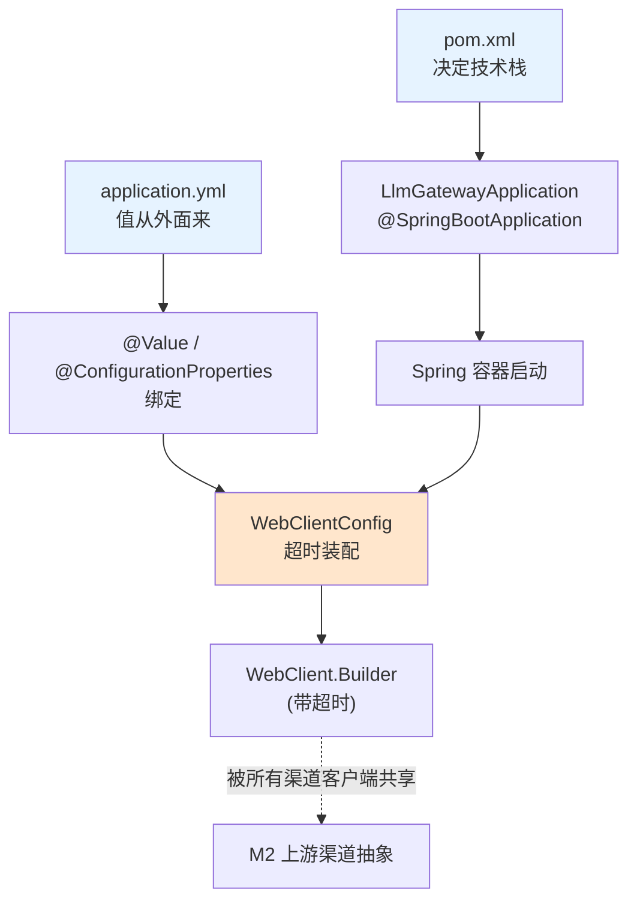
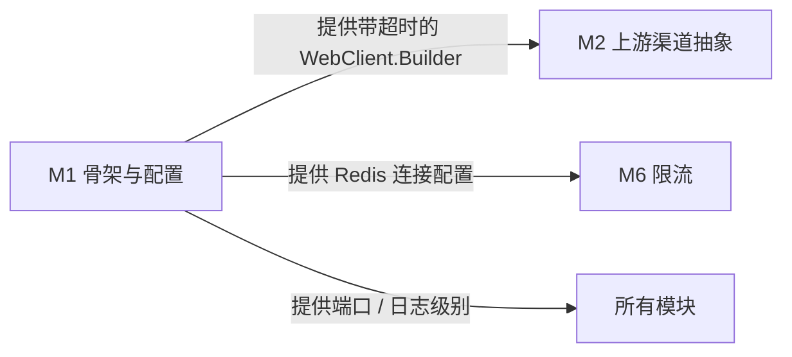

# M1 · 骨架与配置

> **本页速览**
> - 这个模块只有 **4 个东西**:启动类、超时装配、`pom.xml`、`application.yml`。
> - 它解决的核心问题是:**让所有会变的值(地址/密钥/超时)都可以从外面改**,这样测试才能顶替真上游。
> - 最该记住的一条:**不配超时 = 无限等**,而 WebFlux 下"等"住的是整条事件循环。
> - 这个模块**没有业务逻辑**,但这里埋了三个真实的坑(pom 两个、配置一个)。
>
> **导航**:[← 上一页:学习路线图](../../00-map/学习路线图.md) ｜ [下一页:类-LlmGatewayApplication →](类-LlmGatewayApplication.md) ｜ [回到 README](../../README.md)

---

## 这个模块解决什么问题

一个 Spring Boot 应用要跑起来,有三件事必须先定下来:

```text
① 用什么技术栈?        → pom.xml 决定(WebFlux vs MVC、阻塞 vs 响应式 Redis)
② 启动时装配什么?      → 启动类 + @Configuration 决定
③ 那些会变的值从哪来?   → application.yml 决定(超时、密钥、渠道地址)
```

**看起来都是"配置",但这三件事里每一件都能把项目搞死:**

- 依赖选错(`starter-web` 混进来)→ Tomcat 起来,你写的 `Mono`/`Flux` **全部白写**,
  而且**不报错**。
- 超时不配 → 上游假死,请求永远挂着 → 事件循环被占满 → 整个网关停止响应。
- 配置项名写错 → **不报错**,静默取默认值 → 线上行为和你想的完全不一样。

> **这个模块的主题词是「静默失败」。**
> 上面三种情况**没有一个会在启动时报错**,全都要等出事了才发现。
> 所以这个模块的每一页,讲的都是"怎么让静默失败变成响亮的失败"。

---

## 模块结构图



**读法**:`pom.xml` 和 `application.yml` 是"输入",启动类把它们变成容器,
`WebClientConfig` 是唯一有实际产出的地方 —— 它产出一个**带超时的 `WebClient.Builder`**,
后面 M2 的所有渠道客户端都用它。

---

## 类清单

| 类 / 文件 | 一句话职责 | 页 |
|---|---|---|
| `LlmGatewayApplication` | 启动类。**内容几乎为空,这是好事** | [类-LlmGatewayApplication](类-LlmGatewayApplication.md) |
| `pom.xml` | 决定技术栈。**埋了两个坑:webflux/web、阻塞 Redis** | [配置-pom.xml](配置-pom.xml.md) |
| `WebClientConfig` | ★ 给所有上游调用装配超时。**两种超时,量级差 10 倍** | [类-WebClientConfig](类-WebClientConfig.md) |
| `application.yml` | 所有会变的值。**注释比配置多** | [配置-application.yml](配置-application.yml.md) |

> 注意:`ProviderConfig` / `RateLimitConfig` 虽然也在 `config` 包里,
> 但文档把它们归到对应的业务模块 —— 见 [项目地图 §两处故意的错位](../../00-map/项目地图.md)。

---

## 模块内的关键流程

这个模块自己**没有完整流程**,它的产出被别的流程使用:

| 流程 | 在哪 | 本模块参与的部分 |
|---|---|---|
| 应用启动 | [02-flows/启动流程](../../02-flows/启动流程.md) | 启动类 → 容器 → 配置绑定 |
| 上游调用 | [02-flows/非流式请求处理流程](../../02-flows/非流式请求处理流程.md) | `WebClientConfig` 产出的超时在这里生效 |

---

## 与其他模块的交互



**M1 只出不进**:没有任何模块被 M1 依赖,反过来 M1 依赖所有模块的配置需求。
这是典型的"基础设施模块"形态 —— 它不认识任何人,所有人认识它。

---

## 本模块值得学习的设计点

### 1. `WebClientCustomizer` 而不是自己 `new WebClient.Builder()`

Spring Boot 自动装配了一个 `WebClient.Builder`,里面已经配好了编解码器、观察能力等。
如果你自己 `new` 一个,就把这些全丢了。

```text
❌ new WebClient.Builder()        → 顶掉自动装配,丢掉内置能力
✅ 注入 WebClient.Builder 改它    → 保留自动装配,只加一层
✅ 注册 WebClientCustomizer       → 所有注入的 builder 都自动带上这层
```

**为什么这个设计在这里特别重要**:G3 加了多渠道之后,每个渠道都要一个客户端。
用 Customizer 的话,**一次配置,所有渠道自动继承同一套超时** ——
不需要每个渠道各配一遍(那迟早会漏一个)。

> **通用规律**:配置要加在"**所有人都会经过的那个点**"上,而不是"每个使用者各加一遍"。

### 2. 所有会变的值都是 `${ENV:默认值}`

```yaml
connect-timeout-ms: ${GATEWAY_CONNECT_TIMEOUT_MS:3000}
```

这一行的含义:**环境变量优先,没有就用 3000**。

**为什么这么写**:测试里的 `@DynamicPropertySource` 能改的就是这种值。
如果写成硬编码的 `3000`,测试就没法把它改成 200ms 来快速验证超时逻辑 ——
那就得真的等 3 秒,测试会慢得没人愿意跑。

> **"配置外置不是洁癖,是让测试成为可能。"**

### 3. 密钥从不进配置文件

```yaml
api-key: ${DEEPSEEK_API_KEY:}     # 默认值是空
```

**默认值故意留空**,而不是写一个假 key。这样:
- 本地忘了配 → 上游返回 401,**你能立刻知道是密钥问题**
- 即使有人误提交了 `application.yml`,里面也没有真密钥

---

## 相关页

- 上一站 → [学习路线图](../../00-map/学习路线图.md)
- 下一模块 → [M2 上游渠道抽象](../02-上游渠道抽象/_index.md)
- 想知道容器怎么启动的 → [02-flows/启动流程](../../02-flows/启动流程.md)

> **导航**:[← 上一页:学习路线图](../../00-map/学习路线图.md) ｜ [下一页:类-LlmGatewayApplication →](类-LlmGatewayApplication.md) ｜ [回到 README](../../README.md)
