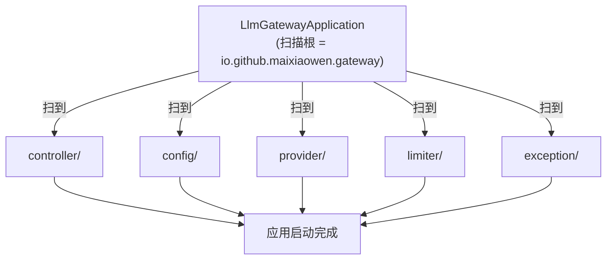

# LlmGatewayApplication

> **本页速览**
> - 全项目**最短的类**(19 行),**这是设计正确的信号,不是偷懒**。
> - `@SpringBootApplication` 是三个注解的合体:`@Configuration` + `@EnableAutoConfiguration` + `@ComponentScan`。
> - 它真正的职责只有一件事:**确定扫包范围是 `io.github.maixiaowen.gateway`**。
> - 这个类空不空,取决于你把多少逻辑塞进了 `@Configuration` 和组件里 —— 塞得越干净,它越空。
>
> **导航**:[← 上一页:M1 模块首页](_index.md) ｜ [下一页:配置-pom.xml →](配置-pom.xml.md) ｜ [所属模块:M1 骨架与配置](_index.md)

---

## 一句话职责

**启动 Spring 容器,并划定组件扫描的根包。** 除此之外什么都不做。

---

## 位置

```text
src/main/java/io/github/maixiaowen/gateway/LlmGatewayApplication.java     (19 行)
```

**注意这个位置**:它在 `io.github.maixiaowen.gateway` **这一层**,不在子包里。
这不是随便放的 —— 见下面「为什么需要这个类」。

---

## 为什么需要这个类

### 先问:一个"什么都没做"的类,为什么不能删?

因为 `@SpringBootApplication` **必须有一个类来承载**。它坐在包结构的根上,
决定了 Spring 去哪里找 `@Component` / `@Service` / `@Configuration`。

```java
@SpringBootApplication
public class LlmGatewayApplication {
    public static void main(String[] args) {
        SpringApplication.run(LlmGatewayApplication.class, args);
    }
}
```

整个类就这两行有效代码。但把注解展开看,它做了三件事:

| 展开后的注解 | 干什么 | 如果去掉会怎样 |
|---|---|---|
| `@Configuration` | 声明"这个类可以提供 Bean 定义" | 启动类不能被当作配置源 |
| `@EnableAutoConfiguration` | ★ **触发 Spring Boot 自动装配** | WebFlux、Redis、Jackson 全都不会自动配好,你得手写几百行 |
| `@ComponentScan` | 从**当前包**往下扫组件 | 你的 `@RestController` / `@Configuration` 全都不会被发现 |

### ★ 关键是第三件事:`@ComponentScan` 的扫描范围

`@SpringBootApplication` 默认扫**它自己所在的那个包及其子包**。

```text
io.github.maixiaowen.gateway/            ← 启动类在这,扫描根
├── controller/     ✅ 会被扫到
├── provider/       ✅ 会被扫到
├── limiter/        ✅ 会被扫到
└── ...
```

**所以这个文件的位置不是随意的**:

- 如果把它移到 `io.github.maixiaowen.gateway.config` 里 → 只能扫到 `config` 包,
  所有 Controller 全部失效,**而且启动不报错**,只是访问 404。
- 如果放到 `io.github.maixiaowen` 下(再往上一层) → 会把兄弟模块的组件也扫进来。

> **规律**:启动类永远放在**最外层业务包**。它的位置 = 组件扫描的边界。

---

## 关键方法

### `main(String[] args)`

| 项 | 说明 |
|---|---|
| **做什么** | 调 `SpringApplication.run()`,启动整个 Spring 容器 |
| **参数** | `args` —— 命令行参数,优先级**高于** `application.yml` |
| **返回值** | 无 |
| **被谁调用** | JVM(`java -jar` 或 IDE 的运行按钮) |
| **调用了谁** | `SpringApplication.run()` → 触发自动装配 → 加载所有 `@Configuration` |

**一行 `SpringApplication.run()` 背后发生的事**(顺序很重要):

```text
1. 创建 ApplicationContext
2. 扫描 LlmGatewayApplication 所在包及子包,发现所有组件
3. 执行自动装配(WebFlux 的 Netty 服务器就在这一步被配好)
4. 绑定 application.yml 到 @Value / @ConfigurationProperties
5. 实例化所有 Bean —— ProviderConfig / RateLimitConfig 的 @Bean 方法在这执行
6. 启动内嵌服务器(默认 Netty,监听 8081)
7. 跑所有 ApplicationRunner ← RateLimitConfig 的启动自检在这里
```

> **第 5 步和第 7 步值得记住**:渠道注册表的 fail-fast 在 5,
> Redis 启动自检在 7。**两者的时机不同,后果也不同** —— 详见
> [类-RateLimitConfig](../06-限流/类-RateLimitConfig.md)。

### 没有被调用但更重要的一行:类注释

```java
/**
 * <p>Gateway 在架构里的位置:所有上游大模型调用的唯一入口。
 * 业务侧不直连 DeepSeek / OpenAI,一律打到这里,由网关负责
 * 渠道路由、限流、熔断、Token 计量。
 */
```

**这段注释是这个项目唯一一处"集中声明架构意图"的地方。**
读一个陌生项目,先看启动类的注释,往往比读代码快。

---

## 这个类在项目中的角色



**它是"根",不是"中枢"** —— 它不调度任何东西,只划定边界。
真正的装配逻辑在 `config/` 包里,真正的业务在 `provider/` 和 `limiter/` 里。

---

## 值得学习的点

### 1. "空启动类"是一种设计成就,不是代码写得少

新手常见做法是在启动类里塞一堆 `@Bean`:

```java
// ❌ 反例
@SpringBootApplication
public class LlmGatewayApplication {
    @Bean public WebClient webClient() { ... }
    @Bean public ProviderRegistry registry() { ... }
    @Bean public RedisTokenBucketLimiter limiter() { ... }
    // ... 500 行
}
```

问题不在"能不能跑",在于:

| 问题 | 后果 |
|---|---|
| 启动类变成上帝类 | 每次加功能都改它 → 冲突热点 |
| 装配逻辑和启动逻辑混在一起 | 想单独测 `ProviderRegistry` 的装配,得把整个应用起起来 |
| 看不到边界 | 读代码的人不知道哪些是基础设施、哪些是业务 |

**这个项目的做法**:每个模块自己有一个 `@Configuration` 类管自己的装配 ——
`ProviderConfig` 管渠道、`RateLimitConfig` 管限流。启动类退化成纯粹的扫描根。

> **规律**:启动类的大小,和你的模块边界清晰度成反比。

### 2. 类注释写"为什么在这里",不写"这是什么"

对比两种注释:

```java
// ❌ 无信息量
/** 启动类。 */

// ✅ 有信息量(这个项目的写法)
/** Gateway 在架构里的位置:所有上游大模型调用的唯一入口。
 *  业务侧不直连 DeepSeek / OpenAI,一律打到这里。 */
```

第二种注释回答的是**读者真正会问的问题**:"这个东西在系统里是干嘛的?"
—— 而不是重复类名已经说清楚的事。

---

## 相关页

- 配置怎么绑到对象上 → [配置-application.yml](配置-application.yml.md)
- 容器启动后发生了哪些装配 → [02-flows/启动流程](../../02-flows/启动流程.md)
- 启动期 fail-fast 的两个例子 → [类-ProviderRegistry](../02-上游渠道抽象/类-ProviderRegistry.md)
  ｜ [类-RateLimitConfig](../06-限流/类-RateLimitConfig.md)

> **导航**:[← 上一页:M1 模块首页](_index.md) ｜ [下一页:配置-pom.xml →](配置-pom.xml.md) ｜ [所属模块:M1 骨架与配置](_index.md)
