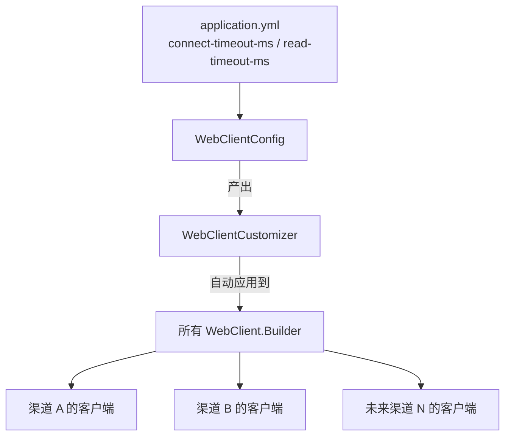

# WebClientConfig

> **本页速览**
> - 全项目**唯一一处配超时**的地方,共 59 行,但每一条线上事故都和它有关。
> - **不配超时 = 无限等**,而 WebFlux 下"等"住的不是一条线程,**是整条事件循环覆盖的所有连接**。
> - **两种超时量级差 10 倍**:连接超时 3s(TCP 握手),读超时 30s(等模型推理)。
> - 用 `WebClientCustomizer` 而**不是自己 `new Builder`** —— 后者会顶掉 Spring 的自动装配。
> - ⚠️ 它给流式留了一个**已知的洞**(`responseTimeout` 管不到中途停滞),由 G2 的空闲超时补上。
>
> **导航**:[← 上一页:配置-pom.xml](配置-pom.xml.md) ｜ [下一页:配置-application.yml →](配置-application.yml.md) ｜ [所属模块:M1 骨架与配置](_index.md)

---

## 一句话职责

**给所有发往上游的 HTTP 调用装配超时**,产出一个带超时的 `WebClient.Builder`,
供 M2 的所有渠道客户端共享。

---

## 位置

```text
src/main/java/com/example/gateway/config/WebClientConfig.java     (59 行)
```

---

## 为什么需要这个类

### 先问:不配超时会怎样?

**默认行为是无限等。**

```text
上游网络抖动 / 对方进程假死 / 机房丢包
   ↓
你的请求一直挂在那里,没有超时,永远不会失败
   ↓
WebFlux 的请求挂在事件循环上,不是挂在一条线程上
   ↓
挂住的不是一条线程,是这一整条事件循环覆盖的所有连接
   ↓
整个网关停止响应
```

> **这是全项目最该理解的一句话**。在传统的 Tomcat 模型里,
> 一个请求挂住 = 一条线程被占;线程池满了才开始拒绝新请求。
> 在 WebFlux 里,事件循环线程只有 CPU 核数那么多 ——
> **一条线程被阻塞,它负责的所有连接一起停摆**。
>
> 对比着记:
> | | 一条请求挂住,影响谁 |
> |---|---|
> | Tomcat(线程池) | 占用 1 条线程,池满才拒绝 |
> | **WebFlux(事件循环)** | **阻塞 1 条事件循环,它负责的几千条连接全停** |

**所以要配超时,而且必须配。**

---

## 关键方法

### `upstreamTimeoutCustomizer(...)` —— 唯一的 Bean

```java
@Bean
public WebClientCustomizer upstreamTimeoutCustomizer(
        @Value("${gateway.upstream.connect-timeout-ms}") int connectTimeoutMs,
        @Value("${gateway.upstream.read-timeout-ms}") long readTimeoutMs) {

    HttpClient httpClient = HttpClient.create()
            .option(ChannelOption.CONNECT_TIMEOUT_MILLIS, connectTimeoutMs)  // ①
            .responseTimeout(Duration.ofMillis(readTimeoutMs));              // ②

    return builder -> builder.clientConnector(new ReactorClientHttpConnector(httpClient));
}
```

| 项 | 说明 |
|---|---|
| **做什么** | 造一个配置好超时的 Reactor Netty `HttpClient`,包成 Customizer 返回 |
| **参数** | 两个超时值,从 `application.yml` 的 `${ENV:默认值}` 注入 |
| **返回值** | `WebClientCustomizer` —— 一个"给 Builder 加工"的函数 |
| **被谁调用** | Spring Boot 自动装配,在**每个 `WebClient.Builder` 被创建时**应用 |
| **调用了谁** | `HttpClient.create()`(Reactor Netty)→ `ReactorClientHttpConnector` |

**注意返回类型不是 `WebClient`** —— 它返回的是一个**加工函数**。
这一点是本页后半段"为什么用 Customizer"的关键。

---

## 两种超时的区别(面试常问)

### ① `CONNECT_TIMEOUT_MILLIS` —— 连接超时

```text
管的是:TCP 三次握手阶段
什么时候触发:对端 IP 可达,但端口没开 / 不回 SYN
典型值:1~3 秒
为什么这么短:它只该覆盖"网络能不能到达对端"这件事
```

### ② `responseTimeout` —— 读超时

```text
管的是:请求发出 → 收到响应头
什么时候触发:连上了,但对方迟迟不返回
典型值:30 秒(本项目)
为什么这么长:大模型推理本来就要几秒到几十秒,按业务定
```

### ★ 把两者设成同一个数是新手最常见的错

```text
连接超时 3s   ← 网络层的事
读超时   30s  ← 业务层的事(等模型思考)
```

**量级根本不是一回事。** 如果读超时也设 3 秒,所有正常的大模型调用都会失败 ——
因为模型思考 5 秒是**完全正常的**。

> **判断法则**:问自己"这一步在等什么?"
> 等网络 = 秒级;等业务处理 = 按业务定。

---

## ⚠️ 这个类给流式留的洞(已知的,故意的)

源码注释里写得很清楚:

```java
/**
 * <p><b>⚠️ 留给 G2 的坑</b>:{@code responseTimeout} 度量的是"请求发出 → 收到响应头"。
 * 非流式下响应头 = 全部内容,所以它安全。上了 SSE 流式之后,<b>响应头很早就回来了,
 * 内容却可能吐几分钟</b> —— 那时 {@code responseTimeout} 管不到中途的停滞,
 * 需要改用逐块的空闲超时({@code ReadTimeoutHandler})。G2 必须回来改这里。
 */
```

**用一张时间轴看这个洞**:

```text
非流式:
  ├─── 请求发出 ──── (等 5 秒) ──── 响应头+全部内容到达 ───┤
  └────────── responseTimeout 30s 覆盖全程 ✅ ───────────┘

流式(SSE):
  ├─ 请求发出 ─ (0.2秒) ─ 响应头到达 ─┬─ 块 ─┬─ 块 ─┬─── 卡死 60 秒 ───→
  └─ responseTimeout 30s ─┘           └──────┴──────┘
       ↑ 早就满足了,不再管        这段没人管 ❌
```

**所以流式需要第三条超时:逐块空闲超时** ——
量的是"两个数据块之间最长允许隔多久",由 G2 的 `ReadTimeoutHandler` 实现,
配置项是 `gateway.upstream.idle-timeout-ms`(默认 20s)。

> 为什么不能简单地把 `responseTimeout` 调大?
> 因为它量的是"到响应头为止"。流式的响应头**几十毫秒就回来了**,
> 调多大都管不到中途。

> 详见 → [流式请求处理流程](../../02-flows/流式请求处理流程.md)

---

## 为什么用 `WebClientCustomizer`,不自己 `new Builder`

```java
// ❌ 反例
@Bean
public WebClient webClient() {
    return WebClient.builder()          // 自己 new 一个
            .clientConnector(...)
            .build();
}
```

**问题**:Spring Boot 自动装配了一个 `WebClient.Builder`,里面已经配好了:

- 各种编解码器(Jackson、form data、multipart…)
- 观察能力(Observability / Metrics)
- 从 `application.yml` 读来的 `spring.webclient.*` 配置

自己 `new` 一个 = **把这些全丢了**,而且不报错 —— 又是一个静默失败。

**正确的两种姿势**:

```java
// ✅ 姿势 A:注入自动装配的 builder,在它基础上改
@Bean
public WebClient webClient(WebClient.Builder builder) {
    return builder.clientConnector(...).build();
}

// ✅ 姿势 B(本项目的选择):注册一个 Customizer
@Bean
public WebClientCustomizer upstreamTimeoutCustomizer(...) {
    return builder -> builder.clientConnector(...);
}
```

### 为什么这个项目选 B?

因为 G3 加了多渠道之后,**每个渠道都要一个客户端**。

| 做法 | 结果 |
|---|---|
| 姿势 A | 需要给每个渠道的 `WebClient` 各注入一次 builder、各改一遍 —— **迟早漏一个** |
| 姿势 B | Customizer 对**所有**注入的 `WebClient.Builder` 自动生效 —— **一次配置,全部继承** |

源码注释里就是这么写的:

> *"这样也保证了 **G3 的多个渠道客户端**只要用注入的 builder,
> 就自动继承同一套超时,不需要每个客户端各配一遍。"*

> **通用规律**:配置要加在"**所有人都会经过的那个点**"上。
> 这和 M1 首页里说的"配置外置"是同一条思路的两个面 ——
> 一个是"值集中在一处",一个是"行为集中在一处"。

---

## 这个类在项目中的角色



**它是"横切配置的注入点"** —— 不产出任何业务对象,
但所有上游调用的行为特征(超时)都由它决定。

---

## 值得学习的点

### 1. 用配置的"注入点"而不是"使用点"来集中横切逻辑

超时是**横切关注点**:所有上游调用都需要,但没有任何一个上游调用"拥有"它。
把它放在 `WebClientConfig` 而不是散在各个 Provider 里,好处是:

- 改一处,全局生效
- 新增渠道**自动继承**,不需要记得配
- 测试时可以只用一个 `@DynamicPropertySource` 改掉全部

### 2. 已知的洞要写进注释,并指明"谁来补"

这个类的注释没有假装自己完美,而是明确写了:

```text
"G2 必须回来改这里"
```

**这比"看起来完整"有价值得多**。读代码的人立刻知道:
- 这里有一个边界
- 边界在哪
- 谁负责补

> **规律**:技术债不可怕,**没被记录的技术债**才可怕。

### 3. 为什么超时值的单位写在配置名里

```yaml
connect-timeout-ms: 3000     ← 名字里带单位
read-timeout-ms: 30000
```

**理由**:`3000` 这个数字本身不说明单位。名字里带 `-ms`,
读配置的人不需要去翻 Java 代码确认。

> 这个惯例在 M6 里闹出过一个真实的坑(**`timeout-ms` 绑不上,静默取 0**),
> 详见 → [配置-application.yml](配置-application.yml.md)

---

## 相关页

- 这两个值配的是多少、为什么 → [配置-application.yml](配置-application.yml.md)
- 流式的第三条超时怎么回事 → [流式请求处理流程](../../02-flows/流式请求处理流程.md)
- 谁在用这个 builder → [类-OpenAiCompatibleProvider](../02-上游渠道抽象/类-OpenAiCompatibleProvider.md)

> **导航**:[← 上一页:配置-pom.xml](配置-pom.xml.md) ｜ [下一页:配置-application.yml →](配置-application.yml.md) ｜ [所属模块:M1 骨架与配置](_index.md)
