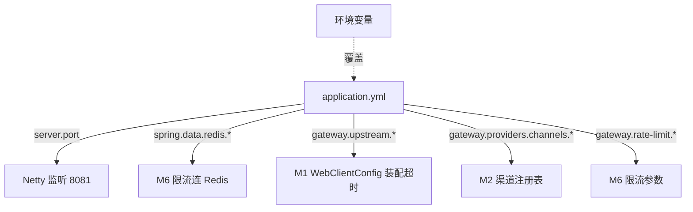

# application.yml

> **本页速览**
> - 133 行里,**注释比配置多** —— 每个默认值背后都是一条取舍,不是随手填的。
> - **所有会变的值都是 `${环境变量:默认值}`** —— 这是测试能用假上游顶替真上游的前提。
> - **坑①**:Boot 3 的 Redis 前缀是 `spring.data.redis.*`,写错**不报错,只是连不上**。
> - **坑②(★ 最阴)**:`timeout-ms` 因为宽松绑定规则**绑不上,静默取 0**,而缩进完全正确。
> - 限流**默认关闭**是刻意的:默认关但打 WARN,打开则必须连得上 Redis。
>
> **导航**:[← 上一页:类-WebClientConfig](类-WebClientConfig.md) ｜ [下一页:M2 上游渠道抽象 →](../02-上游渠道抽象/_index.md) ｜ [所属模块:M1 骨架与配置](_index.md)

---

## 一句话职责

**把所有会变化的值集中到一处,并给每一个默认值写清楚"为什么是这个数"。**

---

## 位置

```text
src/main/resources/application.yml     (133 行)
```

---

## 配置的整体结构

```yaml
server.port: 8081                  # 8080 被 order-system 占了

spring.data.redis.*                # G4 限流用
gateway.providers.*                # 渠道表(G1-1d 外置,G3b 改成"一张表")
gateway.upstream.*                 # 三个超时
gateway.rate-limit.*               # 限流五个旋钮

logging.level.io.github.maixiaowen.gateway: INFO
```

**注意分组方式**:自定义配置全部收在 `gateway.*` 下面,不和 `spring.*` 混。
这样一眼能分清"框架配置"和"本项目配置"。

---

## 配置项逐条解释

### 1. 端口

```yaml
server:
  port: 8081     # 8080 已被 order-system 占用,网关用 8081
```

**注释直接写了原因。** 一个端口号如果没有注释,后来的人看到 `8081`
会怀疑"是不是写错了",然后可能"顺手改回 8080"—— 而那样会起不来。

> **规律**:任何"看起来奇怪但正确"的值,都要写清楚**为什么奇怪**。

### 2. 三个超时(★ 关系最容易被搞错)

```yaml
gateway:
  upstream:
    connect-timeout-ms: ${GATEWAY_CONNECT_TIMEOUT_MS:3000}    # ① TCP 握手
    read-timeout-ms:    ${GATEWAY_READ_TIMEOUT_MS:30000}      # ② 到响应头为止
    idle-timeout-ms:    ${GATEWAY_IDLE_TIMEOUT_MS:20000}      # ③ 两个数据块之间
```

**三者的分工(用一条流式请求的时间轴看)**:

```text
├─ ① 连接超时 3s ─┤                                    ← TCP 握手
                  ├─ ② 读超时 30s ─┤                   ← 到响应头
                                    ├─③ 空闲 20s─┤      ← 每两块之间
                                    │            │
                                  响应头         块…块…块
```

| 超时 | 管哪一段 | 3 秒 / 30 秒的理由 |
|---|---|---|
| ① 连接超时 | TCP 三次握手 | **只该覆盖"网络能不能到达对端"**,秒级 |
| ② 读超时 | 请求发出 → 收到响应头 | 模型推理本来就要几十秒,**按业务定** |
| ③ 空闲超时 | 两个数据块之间的间隔 | 20s:正常模型不会 20 秒吐不出一个字 |

**⚠️ 注释里点名的一个常见错误**:

> *"这个值不能照着 ① 连接超时抄(3s)—— 模型思考时停顿几秒是正常的,
> 设太小会把健康的长回复杀掉,那是比超时更严重的生产事故。"*

**注意 ③ 不是"整条流最多活多久"**:

```text
✅ 正确理解:两个块之间最长允许隔多久
❌ 错误理解:整条流最长活多久

→ 健康的长回复(吐 5 分钟)不该被杀,只有"卡住不动"才该杀
```

> 详见 → [类-WebClientConfig](类-WebClientConfig.md) ｜ [流式请求处理流程](../../02-flows/流式请求处理流程.md)

### 3. 渠道表(★ 加厂商 = 改 4 行)

```yaml
gateway:
  providers:
    default-channel: ${GATEWAY_DEFAULT_CHANNEL:deepseek}

    channels:
      deepseek:
        base-url: ${DEEPSEEK_BASE_URL:https://api.deepseek.com}
        api-key:  ${DEEPSEEK_API_KEY:}
        model:    ${DEEPSEEK_MODEL:deepseek-chat}

      moonshot:                                     # ← G3b 新增的第二家
        base-url: ${MOONSHOT_BASE_URL:https://api.moonshot.cn/v1}
        api-key:  ${MOONSHOT_API_KEY:}
        model:    ${MOONSHOT_MODEL:moonshot-v1-8k}
```

**★ 注意 Moonshot 下面没有对应的 Java 类。** 这就是"一个实现类 × N 份配置":

> *"Moonshot 也是 OpenAI 兼容协议,差异只有 base-url / api-key / model 三样,
> 写类是没有意义的重复。"*

**加第三家厂商的动作 = 在 `channels` 下面加 4 行。**
不写 Java 类、不改 Controller、不碰注册表。

> 详见 → [流程-渠道路由](../02-上游渠道抽象/流程-渠道路由.md)

**为什么 `api-key` 的默认值是空**:

```yaml
api-key: ${DEEPSEEK_API_KEY:}     # ← 冒号后面什么都没有
```

不是写一个假 key,而是**故意留空**:
- 本地忘了配环境变量 → 上游返回 **401** → 你立刻知道是密钥问题
- 即使 `application.yml` 被误提交,里面也没有真密钥

> ★ **密钥永远不出现在这里、更不进 Git。**

### 4. 限流五个旋钮(G4)

```yaml
gateway:
  rate-limit:
    enabled:             ${GATEWAY_RATE_LIMIT_ENABLED:false}
    capacity:            ${GATEWAY_RATE_LIMIT_CAPACITY:20}
    refill-per-second:   ${GATEWAY_RATE_LIMIT_REFILL_PER_SECOND:10}
    fail-open:           ${GATEWAY_RATE_LIMIT_FAIL_OPEN:true}
    timeout-millis:      ${GATEWAY_RATE_LIMIT_TIMEOUT_MILLIS:200}
    key-prefix:          ${GATEWAY_RATE_LIMIT_KEY_PREFIX:gw:rl}
```

**三个默认值各自是一条取舍:**

| 配置 | 默认值 | 这是一条什么判断 |
|---|---|---|
| `enabled` | **false** | 打开它 = 网关多一个**必须活着**的外部依赖。默认关,但关着时打 WARN;一旦打开,启动时必须真连得上 Redis |
| `fail-open` | **true** | ★ **业务判断,不是技术判断**:大模型按 token 花钱,"成本优先"的公司应该改成 false。**真正错的做法是把它写死** |
| `timeout-millis` | **200** | 不设会出大事 —— Lettuce 默认命令超时是 **60 秒** |

> **关于 `fail-open` 的深层逻辑**:
> "挂掉" fail-open 能兜住,"**变慢**"只有超时能兜住。
> Redis 变慢时每个请求卡 60 秒,网关的并发能力被瞬间吃干 ——
> **那比限流失效严重得多**:限流器把网关自己拖死了。
>
> 详见 → [类-RateLimitProperties](../06-限流/类-RateLimitProperties.md)

---

## ★★ 两个"静默失败"的坑

### 坑①:Boot 3 的 Redis 前缀变了

```yaml
# ❌ Boot 2.7 的写法
spring.redis.host: localhost

# ✅ Boot 3 的写法
spring.data.redis.host: localhost
```

**写错的后果**:不报错,只是连不上 Redis。

> 项目一(Boot 2.7)就在同一个坑上栽过一次,所以这里特意留了注释。
> **对应环境变量也跟着变**:是 `SPRING_DATA_REDIS_HOST`,不是 `SPRING_REDIS_HOST`。

### 坑② ★ 最阴的一个:`timeout-ms` 绑不上,静默取 0

**现象**:同一个前缀下,`capacity` / `refill-per-second` / `key-prefix` / `fail-open`
**全都绑得上**,唯独 `timeout-ms` 绑不上,`long` 字段拿到默认值 **0**。
而 **YAML 缩进完全正确**。

**原因**:Java 侧字段名叫 `timeoutMillis`,Spring 的**宽松绑定**把它归一化成 `timeoutmillis`。
归一化规则是「**小写 + 去掉分隔符**」——

```text
配置里写     timeout-ms      → 归一化 →  timeoutms
Java 字段     timeoutMillis   → 归一化 →  timeoutmillis
                                          ↑ 对不上
```

**★ 关键**:归一化**不会把 `ms` 展开成 `millis`**。

**后果**:键被整个忽略 → 静默取 0 → 单次 Redis 调用超时变成 0(或走默认)。

**三个修法,选哪个都比"静默取 0"好**:

| 方案 | 做法 | 本项目 |
|---|---|---|
| ① | 配置键名跟着 Java 字段走(写 `timeout-millis`) | ✅ **选的这个**(字段名本身是清楚的) |
| ② | 把 Java 字段改名成 `timeoutMs` | ❌ 不符合"长整型字段带单位后缀"的惯例 |
| ③ | ★ 给 `@ConfigurationProperties` 加 `ignoreUnknownFields = false` | 更根本 —— 让**拼错的键直接变成启动失败** |

> ★ **这个坑真正值得学的不是配置写法,而是那个结论**:
> **"名字对不上 → 静默取默认值"** 是这个项目里反复出现的一类 bug。
> 从 G2 的线程名、到 Boot 3 的 Redis 前缀、到这个 `timeout-ms`,
> **全是同一个模式的三个实例**。
>
> 详见 → [类-RateLimitConfig](../06-限流/类-RateLimitConfig.md)

---

## 这个文件在项目中的角色



★ **`${ENV:默认值}` 的写法让测试可以完全顶替真上游**:
测试用 `@DynamicPropertySource` 把 `base-url` 指到本机的 WireMock,
**业务代码一行不改**。这是 M7 整套测试体系的地基。

---

## 值得学习的点

### 1. 配置文件的注释应该写"为什么",不写"是什么"

```yaml
# ❌ 无信息量
port: 8081     # 端口号

# ✅ 有信息量(本项目的写法)
port: 8081     # 8080 已被 order-system 占用,网关用 8081
```

第二种回答的是"**为什么不是默认的 8080**" —— 这才是读配置的人会问的问题。

### 2. 默认值是最难改的决策,值得写长注释

`fail-open: true` 这一条占了 5 行注释。因为写下这个值的人知道:

> *"真正错的做法是把它写死 —— 那等于替业务做了一个它没参与的决定。"*

**默认值会长期存在**(没人会去改它),所以它的注释要比代码详细。

### 3. 把"取舍"和"事实"分开写

看这两类注释的区别:

```text
事实型:"Lettuce 的默认命令超时是 60 秒"
取舍型:"我们默认 true,理由是保护性组件的失败不该升级成网关的失败"
```

**事实可以查证,取舍必须被解释。** 混在一起写,读的人分不清
"这是客观约束"还是"这是某人当时的选择"。

---

## 相关页

- 超时怎么被用起来 → [类-WebClientConfig](类-WebClientConfig.md)
- 渠道表怎么变成对象 → [类-ProviderProperties](../02-上游渠道抽象/类-ProviderProperties.md)
- 限流配置怎么被校验 → [类-RateLimitConfig](../06-限流/类-RateLimitConfig.md)
- 配置怎么让测试成为可能 → [M7 测试验证](../07-测试验证/_index.md)

> **导航**:[← 上一页:类-WebClientConfig](类-WebClientConfig.md) ｜ [下一页:M2 上游渠道抽象 →](../02-上游渠道抽象/_index.md) ｜ [所属模块:M1 骨架与配置](_index.md)
