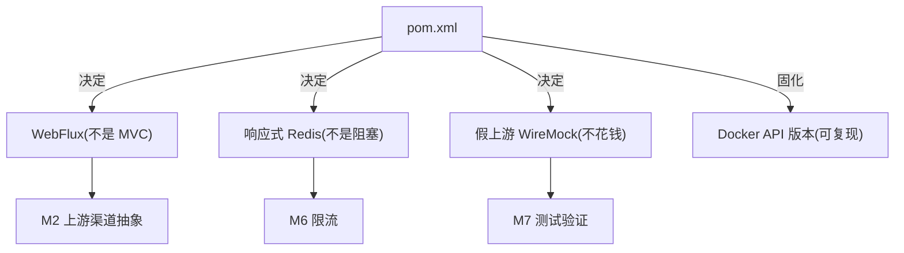

# pom.xml

> **本页速览**
> - 主依赖只有 **2 个**(WebFlux + 响应式 Redis),**没有 `starter-web`、没有 JDBC、没有 ORM**。
> - **坑①**:引入 `starter-web` 会拉进 Tomcat,Spring 优先起 MVC,**你写的 `Mono`/`Flux` 全部白写且不报错**。
> - **坑②**:用非 reactive 版 Redis = 在事件循环上做阻塞 IO,**几个并发就能让网关停止响应**。
> - **坑③**:`docker.api.version` 那个"**没有错误信息的 400**" —— 环境问题的排查范本。
>
> **导航**:[← 上一页:类-LlmGatewayApplication](类-LlmGatewayApplication.md) ｜ [下一页:类-WebClientConfig →](类-WebClientConfig.md) ｜ [所属模块:M1 骨架与配置](_index.md)

---

## 一句话职责

**决定这个项目"用什么技术栈"**,并且把环境相关的坑用配置固化下来,让它们能被提交、被 CI 复现。

---

## 位置

```text
D:\java\llm-gateway\pom.xml     (119 行)
```

---

## 为什么需要这个类(为什么是这几个依赖)

### 依赖清单

```xml
<parent>spring-boot-starter-parent 3.5.5</parent>   <!-- Java 17 -->

<dependencies>
    spring-boot-starter-webflux                      <!-- ① 唯一的 Web 栈 -->
    spring-boot-starter-data-redis-reactive          <!-- ② 唯一的 Redis 客户端 -->
    spring-boot-starter-test          (test)         <!-- ③ 测试基础 -->
    testcontainers:junit-jupiter      (test)         <!-- ④ 起真 Redis 做并发测试 -->
    reactor-test                      (test)         <!-- ⑤ StepVerifier,断言 Flux/Mono -->
    wiremock-standalone 3.13.2        (test)         <!-- ⑥ 假上游,不花钱不联网 -->
</dependencies>
```

**注意"没有"的东西** —— 这份清单里缺席的依赖同样在表达设计:

| 没有引入 | 为什么 |
|---|---|
| `spring-boot-starter-web` | 见坑① —— 会和 WebFlux 打架 |
| `spring-boot-starter-data-redis` | 见坑② —— 是**阻塞**版 |
| JPA / MyBatis / JDBC | 网关**无状态**,不需要数据库 |
| 任何 `*Provider` SDK(如 `deepseek-java-sdk`) | ★ 一旦引入就绑死厂商,违背整个 M2 的设计 |
| Spring Cloud Gateway | ★ 这不是一个"反向代理",是**有业务语义的适配层**,自己写更清楚 |

> **最后一条值得展开**:项目名叫 "gateway",但**它不是 Spring Cloud Gateway**。
> Spring Cloud Gateway 解决的是"把 HTTP 请求转发到另一个 HTTP 服务",
> 而这个项目解决的是"**把不同厂商的协议统一成一套**"。
> 前者是**网络层**的转发,后者是**语义层**的适配 —— 用前者需要写一堆自定义 Filter,
> 不但更绕,还把"协议归一"这个核心逻辑藏进了框架的扩展点里。

---

## 三个真实的坑(本页最值钱的部分)

### 坑①:引入 `starter-web` 会静默毁掉整个 WebFlux

**现象**:日志里处理请求的线程名是 `http-nio-8081-exec-1` 而不是 `reactor-http-nio-2`。

**后果**:

```text
你写:ChatController 返回 Mono<ResponseEntity<...>>
你期待:非阻塞,一个线程处理很多请求
实际:Spring 检测到有 Tomcat,优先启动 MVC 栈
      Mono 被当成一个普通对象,整个响应式链路退化成同步
      不报错、不警告,只是性能特征完全变了
```

**为什么会同时存在**:`starter-web` 会传递依赖引入 Tomcat。
Spring Boot 的 `WebApplicationType` 推断逻辑是:**只要 classpath 上有 Servlet 容器,就优先起 MVC**。

**怎么验证**(项目里就是这么自检的):

```bash
# 起服务后打 /ping,看日志里的线程名
# ✅ reactor-http-nio-2
# ❌ http-nio-8081-exec-1   ← 说明 starter-web 被误引进了
```

> **规律**:技术栈冲突最危险的地方不是"编译不过",而是"**编译过、能跑,但架构已经变形**"。

### 坑②:普通 Redis 客户端 = 在事件循环上做阻塞 IO

```xml
<!-- ❌ 错的 -->
<artifactId>spring-boot-starter-data-redis</artifactId>

<!-- ✅ 对的 -->
<artifactId>spring-boot-starter-data-redis-reactive</artifactId>
```

**为什么这是"架构被破坏"而不是"慢一点"**:

```text
WebFlux 的模型:
  少数几个线程(通常 = CPU 核数)跑事件循环,每个线程处理成千上万条连接

在事件循环线程上做阻塞调用(比如等 Redis 回包):
  这个线程被卡住 → 它负责的所有连接全部停摆
  → 不是"这个请求慢",是"这几千条连接一起卡住"
  → 几个并发请求就能让整个网关停止响应
```

**响应式版给的是 `ReactiveStringRedisTemplate`**,返回 `Mono`/`Flux`,**不阻塞**。
这个项目在 M6 限流里正是用它 → [类-RedisTokenBucketLimiter](../06-限流/类-RedisTokenBucketLimiter.md)。

> **判断法则**:在 WebFlux 项目里,**任何返回值不是 `Mono`/`Flux` 的 IO 调用,都要当成红灯**。

### 坑③:一个"没有错误信息"的 400(环境排查范本)

这一段和业务无关,但**排查方法值得单独记住**。

**现象**:Testcontainers 报

```text
Could not find a valid Docker environment
```

这个报错把人指向"**Docker 没装好 / 没启动**"。但事实是:`docker ps` 完全正常,容器都在跑。

**真相**:本机 Docker Engine 29.7.2 的**最低**支持 API 版本是 1.40,
而 Testcontainers 1.21.3 里 docker-java 的默认版本比它低 →
探测时收到一个 400,而且是:

```text
→ Error response from daemon: API returned a 400 (Bad Request)
  but provided no error-message          ← ★ 一个连错误信息都没有的 400
```

**三十秒定性**(比读半天源码快):

```bash
DOCKER_API_VERSION=1.32 docker info   # → 400,且没有错误信息
DOCKER_API_VERSION=1.44 docker info   # → 正常
```

**修复**:在 `pom.xml` 里显式声明版本,并且**同时铺两条路**:

```xml
<properties>
    <docker.api.version>1.44</docker.api.version>
</properties>

<plugin>maven-surefire-plugin
    <systemPropertyVariables>
        <api.version>${docker.api.version}</api.version>          <!-- 系统属性 -->
    </systemPropertyVariables>
    <environmentVariables>
        <DOCKER_API_VERSION>${docker.api.version}</DOCKER_API_VERSION>  <!-- 环境变量 -->
    </environmentVariables>
</plugin>
```

**为什么要铺两条**:docker-java 不同的调用路径读的是不同的那一个。

**为什么写在 pom 里而不是手动 `export`**:

> 手动 export 只存在于**某台机器的 shell 历史**里。
> 写在 pom 里,这个修复就能**被提交、被 CI 复现、被同事继承**。

> ★ **本页最该带走的一条**:
> **遇到"环境不对"的报错,先用底层工具验证一遍事实,再相信上层工具给出的诊断。**
> 上层工具的报错信息经常指向错误的方向 —— 它说"Docker 没装好",
> 而事实是"版本协商失败"。**先验证事实,再接受结论。**

---

## 这个文件在项目中的角色



**`pom.xml` 是这个项目里"影响面最大、改动最少"的文件** ——
它一旦定错,后面所有代码的表达方式都会跟着错。

---

## 值得学习的点

### 1. 依赖版本能交给 parent 托管就绝不手写

```xml
<!-- ✅ 由 spring-boot-starter-parent 托管 -->
<artifactId>junit-jupiter</artifactId>
<!-- 不写 <version> -->

<!-- 必须手写的才写 -->
<artifactId>wiremock-standalone</artifactId>
<version>3.13.2</version>
```

**理由**:手写版本号 = 给自己埋一个"两处版本不一致"的雷。
parent 托管的话,升级 Spring Boot 时这些版本一起动,不会漏。

### 2. 为什么选 `wiremock-standalone` 而不是普通 `wiremock`

standalone 版把 Jetty 等依赖**全部 relocate 进同一个 jar**,
不会和 Spring Boot 的依赖树打架。非 standalone 版很容易踩版本冲突。

**收益**:有了它,**跑测试不需要真实 API Key,也不烧钱** ——
这是整个 M7 测试体系能存在的前提。

### 3. `docker.api.version` 为什么必须进版本控制

看这段注释的设计意图:

```text
（写在 pom 里而不是让每个人手动 export:这个修复要能被提交、被 CI 复现,
  而不是只存在于某台机器的 shell 历史里。）
```

> **规律**:任何"我在本机改了一下才能跑"的东西,都是**债务**。
> 把它变成代码/配置,才算还清。

---

## 相关页

- 超时是怎么装配的 → [类-WebClientConfig](类-WebClientConfig.md)
- 这些配置的值从哪来 → [配置-application.yml](配置-application.yml.md)
- 依赖坑③的实际影响 → [测试-限流与并发](../07-测试验证/测试-限流与并发.md)

> **导航**:[← 上一页:类-LlmGatewayApplication](类-LlmGatewayApplication.md) ｜ [下一页:类-WebClientConfig →](类-WebClientConfig.md) ｜ [所属模块:M1 骨架与配置](_index.md)
