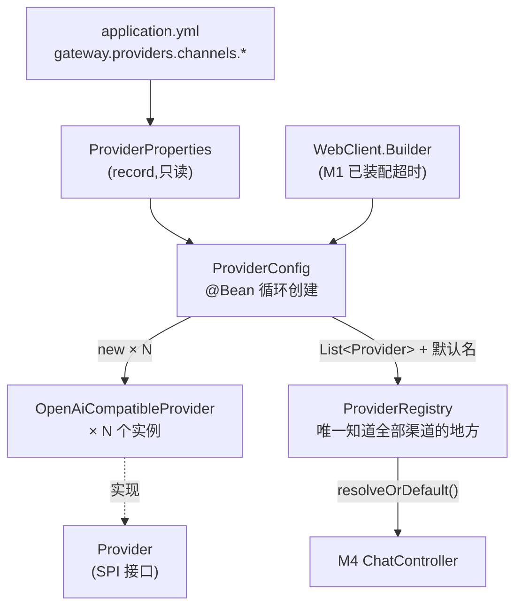
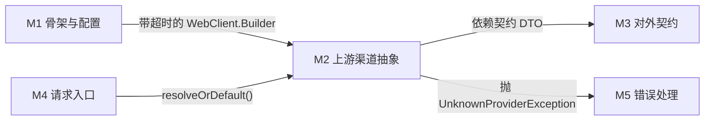

# M2 · 上游渠道抽象 ★

> **本页速览**
> - 这是全项目**最核心的模块**。它回答一个问题:**网关怎么做到"不认识任何厂商"**。
> - 核心公式:**一个实现类 × N 份配置 = N 个渠道**。加一家厂商 = **YAML 里加 4 行**。
> - `Provider` 接口里**不能出现任何厂商痕迹**(没有 `JsonNode`、没有厂商名)。
> - ★ 验收线:**在 `ChatController` 里搜 `DeepSeek`,零结果才算合格。**
> - 渠道不存在返回 **400**(调用方的 bug),不是 502(不是上游的问题)。
>
> **导航**:[← 上一页:配置-application.yml](../01-骨架与配置/配置-application.yml.md) ｜ [下一页:类-Provider →](类-Provider.md) ｜ [回到 README](../../README.md)

---

## 这个模块解决什么问题

### 先看没有它会怎样

假设没有这层抽象,`ChatController` 直接依赖一个具体的 `DeepSeekClient`。
现在要接第二家厂商,你只有两条路:

```text
路 1:复制一份 DeepSeekClient 改成 MoonshotClient,Controller 里写 if-else
      ↓
      接第三家 → 三分支;第四家 → 四分支
      ★ 这不是网关,是 if-else 堆

路 2:把两家的逻辑塞进一个类,用 if 区分
      ↓
      一个类里住着 N 家厂商的协议差异,谁都不敢改
```

**两条路都会导致同一个后果:每加一家厂商,改动都会扩散到已有代码里。**

### 这层抽象给出的答案

> **SPI 的价值一句话:加第三家的时候,不用改已有代码。**

新写一个 `XxxProvider` 实现接口、注册成 Bean,**就接完了** —— `ChatController` 一行不动。
(这就是开闭原则,但用具体场景讲出来比背定义有用得多。)

### 而实际的答案比这更好

真正的事实是:**DeepSeek、Moonshot、通义、智谱、SiliconFlow、本地的 Ollama / vLLM
—— 它们全都提供 OpenAI 兼容接口。**

同一个 `/chat/completions` 路径、同一个请求体结构、同一个响应结构。
**差别只有三样:`base-url`、`api-key`、`model`。**

```text
所以"一家厂商一个类"是把重复代码当成了架构 ——
抄 N 遍同样的翻译、归一、流式处理逻辑,然后每次修 bug 要改 N 个地方。

正确做法:
        一个实现类 (OpenAiCompatibleProvider)
      × N 份配置 (ProviderProperties)
      = N 个渠道
```

> ★ **这就是"加第二家厂商 = 在 YAML 里加 4 行"的原因。**

**那如果某家厂商协议真的不一样呢?**(比如用 `input` 而不是 `messages`)

那时**才需要新写一个类**实现 `Provider`,而 `ChatController` / 注册表 / 通用实现**全都不用改**。

> **"通用实现"和"专用实现"是并存的,不是二选一。**
> 这才是 SPI 真正的价值:**它允许你在 99% 的情况下用一份通用实现偷懒,
> 同时在剩下 1% 的情况下不受那份通用实现绑架。**

---

## 模块结构图



**读法(从左到右是一条装配链,从右到左是一条调用链)**:

| 方向 | 链路 |
|---|---|
| **装配**(启动时) | 配置 → `ProviderProperties` → `ProviderConfig` 循环 new → `ProviderRegistry` |
| **调用**(请求时) | `ChatController` → `ProviderRegistry` → `Provider` → WebClient → 上游 |

---

## 类清单

| 类 | 一句话职责 | 页 |
|---|---|---|
| `Provider` | ★ **SPI 接口,只有 3 个方法**。整个"不认识厂商"的设计压在这一个文件上 | [类-Provider](类-Provider.md) |
| `ProviderProperties` | 渠道配置的唯一声明处。**一个 record,只读** | [类-ProviderProperties](类-ProviderProperties.md) |
| `ProviderConfig` | ★ 把"N 份配置"变成"N 个对象"。**这十几行是 3b 的核心** | [类-ProviderConfig](类-ProviderConfig.md) |
| `ProviderRegistry` | **唯一知道全部渠道的地方**。三重 fail-fast | [类-ProviderRegistry](类-ProviderRegistry.md) |
| `OpenAiCompatibleProvider` | **一个类顶 N 家厂商**。协议归一、流式、取消传播全在这 | [类-OpenAiCompatibleProvider](类-OpenAiCompatibleProvider.md) |
| ↳ 同上(深入) | 取消传播、逐块空闲超时、坏块处理、三次改名 | [类-OpenAiCompatibleProvider-深入](类-OpenAiCompatibleProvider-深入.md) |

---

## 模块内的关键流程

| 流程 | 说明 |
|---|---|
| [流程-渠道路由](流程-渠道路由.md) | ★ 一次请求怎么找到对应的渠道、渠道不存在会怎样 |
| [02-flows/非流式请求处理流程](../../02-flows/非流式请求处理流程.md) | 把本模块和 M4 串成完整链路 |
| [02-flows/流式请求处理流程](../../02-flows/流式请求处理流程.md) | 流式版本的完整链路 |

---

## 与其他模块的交互



**注意箭头方向**:M2 依赖 M1 和 M3,**没有人反过来依赖 M2 的实现细节** ——
M4 只通过 `ProviderRegistry` 和 `Provider` 接口跟它打交道。

---

## 本模块值得学习的设计点

### 1. 抽象漏没漏,有一个可自检的判据

```text
★ 在 ChatController.java 里搜 "DeepSeek"
  → 零结果 = 抽象完整
  → 有任何结果 = 厂商细节漏到调用方了
```

**为什么这个判据有效**:如果上层需要知道"这是哪家厂商"才能工作,
那说明差异没有被关在门内。**抽象的质量是可以被一行 grep 验证的。**

### 2. "同一个事实只能有一个来源"

`Channel` record 里**没有 `name` 字段** —— 渠道名就是 `channels` 这个 map 的 **key**。

```yaml
channels:
  deepseek:            # ← 这个名字就是渠道名
    base-url: ...
```

**为什么不额外加一个 `name: deepseek` 字段**:
两份就可能对不上,而**对不上的时候你根本不知道该信哪个**。

### 3. fail-fast 要推到尽可能早

`ProviderRegistry` 在**构造器里**做三重校验(默认渠道存在 / 不重名 / 名字非空),
任意一条不满足就**让应用启动失败**。

```text
启动失败 = 可发现的事故    → 部署流程拦住,日志一眼看到
请求时报错 = 静默的灾难    → 服务看着健康、探针是绿的,但每个请求都 500
```

> **把错误推到尽可能早的地方,是配置类代码最重要的一条纪律。**

### 4. "不依赖框架"这个事实,会在你换掉创建方式时救你一次

`ProviderRegistry` 在 3a 时是 `@Component`(靠 Spring 集合注入),
3b 改成由 `ProviderConfig` 手工创建(因为数量由配置决定,而组件扫描是编译期固定的)。

**★ 它的构造器签名一个字没改** —— 它从来就不依赖 Spring,
只是之前借 Spring 的手拿参数而已。所以 **3a 写的 6 个单测一行都不用改**。

> 详见 → [类-ProviderRegistry](类-ProviderRegistry.md)

---

## 相关页

- 上一模块 → [M1 骨架与配置](../01-骨架与配置/_index.md)
- 下一模块 → [M3 对外契约](../03-对外契约/_index.md)
- 想知道这些设计怎么被证明的 → [M7 测试验证](../07-测试验证/_index.md)

> **导航**:[← 上一页:配置-application.yml](../01-骨架与配置/配置-application.yml.md) ｜ [下一页:类-Provider →](类-Provider.md) ｜ [回到 README](../../README.md)
