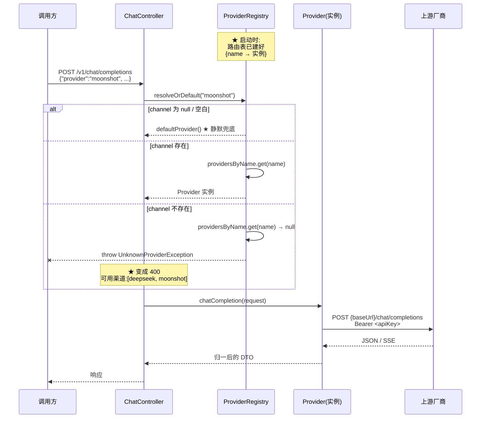

# 流程 · 渠道路由

> **本页速览**
> - 这个流程回答一个问题:**一次请求是怎么找到它要打的那个渠道的**。
> - 全部逻辑只有 3 行代码,但里面藏着**本项目最重要的一个设计判断**。
> - ★ **没指定渠道 → 静默用默认;指定了但不存在 → 400 报错**。绝不静默降级。
> - **加一家厂商**:YAML 里加 4 行 → 重启 → 完成。不写 Java 类、不改 Controller。
> - 返回 **400 不是 502**,因为这是**调用方的参数问题**,不是上游的问题。
>
> **导航**:[← 上一页:类-OpenAiCompatibleProvider-深入](类-OpenAiCompatibleProvider-深入.md) ｜ [下一页:M3 对外契约 →](../03-对外契约/_index.md) ｜ [所属模块:M2 上游渠道抽象](_index.md)

---

## 触发条件
**每一次**打 `/v1/chat/completions` 的请求都会先走这个流程 —— 不管非流式还是流式,不管有没有带 `provider` 字段。

```text
POST /v1/chat/completions
{"model": "deepseek-chat", "messages": [...], "provider": "moonshot"}   ← ★ 可选字段,本流程的主角
```

| 情况 | 走的分支 |
|---|---|
| 请求体里**没有** `provider` | 用 `gateway.providers.default-channel` 配的渠道 |
| `provider` 是 `""` 或全空格 | ★ 同上(等价于"没填") |
| `provider` 是**已配置**的名字 | 直接用那个渠道 |
| `provider` 是**未配置**的名字 | ★ **抛异常 → 400** |

---

## 步骤化讲解
### 第 0 步:启动时 —— 路由表就已经建好了
**关键认知**:路由**不是每次请求现算的**,而是在**启动时**就建好了一张表。

```text
启动:
  application.yml 的 channels 段 → ProviderProperties 绑定 → { deepseek: {...}, moonshot: {...} }
  → ProviderConfig 循环 new → [ OpenAiCompatibleProvider("deepseek",...), OpenAiCompatibleProvider("moonshot",...) ]
  → ProviderRegistry 构造器建索引 → { "deepseek" → 实例A, "moonshot" → 实例B } ★ 这就是路由表 + 校验:默认渠道存在、无重名、名字非空
```
> ★ 所以请求时的"路由"本质上就是一次 `Map.get()`:O(1),没有遍历,没有计算。
> **规律**:「**把计算从请求路径上挪到启动路径上**」—— 这是性能优化里最稳的一类,因为它**不改变语义,只改变时机**。
### 第 1 步:取出请求里的渠道名
```java
String requested = request.channel();     // 可能是 null / "" / "moonshot" / "gpt-4"
```
**注意此时不做任何判断** —— 判断全在下一步的一个方法里;**"取"和"判"分开**是为了让判断逻辑只有一个入口。
### ★★ 第 2 步:核心判断(全流程的重点)
```java
public Provider resolveOrDefault(String requestedName) {
    if (requestedName == null || requestedName.isBlank()) {
        return defaultProvider();          // ← 分支 A
    }
    return resolve(requestedName);         // ← 分支 B
}
```
#### 分支 A:`null` / 空白 → 静默用默认渠道
**为什么可以"静默"**:

```text
★ 调用方"没有表达意图" → 网关替他决定 —— 这是网关的职责
① 绝大多数调用方根本不知道"渠道"这个概念,打网关就是"问问题、拿答案"
② 向后兼容:G1 时代的客户端不发 channel 字段,到了 G3b 仍能正常工作
```
#### ★★ 分支 B:指定了但不存在 → **抛异常,绝不兜底**
**这是本项目最重要的一条设计判断。**

```text
调用方明确说了 "provider": "moonshot" → 如果网关"体贴地"改用 deepseek 兜底:
① 调用方以为自己在用 Moonshot(可能因为:合规 / 成本预算 / 特定模型能力)
② 实际用的是 DeepSeek
③ ★ 响应正常返回,内容看着也合理
④ 调用方永远不会发现 → 直到:合规审计、账单对不上、或发现输出风格完全不对
```

| | 报错(400) | 静默兜底 |
|---|---|---|
| 调用方知道吗 | ✅ 立刻知道 | ❌ **永远不知道** |
| 排查成本 | 5 秒 | 可能几周 |
| 责任归属 | 清晰 | **模糊** |

> ★★ **判据一句话**:**「用户没有表达意图」→ 可以替他决定;「用户表达了意图但做不到」→ 必须告诉他。**
> **规律**:「**静默降级比报错危险一个数量级**」—— 因为报错**会被发现**,降级不会。
### 第 3 步:查表
```java
Provider provider = providersByName.get(name);
```
### 第 4 步:查不到 → 抛 `UnknownProviderException`
```java
if (provider == null) {
    throw new UnknownProviderException(name, providersByName.keySet());
    //                                   ↑ 请求的名字  ↑ ★ 可用渠道列表
}
```
**★ 注意异常里带了"可用渠道列表"**:

```text
❌ 差的信息:"渠道不存在" → 读日志的人:那有哪些?去翻 YAML?YAML 里明明有 moonshot 啊
✅ 好的信息:"未知的渠道: gpt-4,可用渠道: [deepseek, moonshot]" → 一秒定位:哦,我把模型名当渠道名填了
```
> **规律**:「**错误信息要包含"排除法所需的信息"**」—— 只说"什么不对"不够,还要说"**那什么是对的**"。
### 第 5 步:异常变成 HTTP 400
| 异常 | HTTP 状态码 | 为什么是它 |
|---|---|---|
| `UnknownProviderException` | **400 Bad Request** | ★ **调用方的参数问题** —— 他写了一个不存在的渠道名 |
| | ❌ 不是 502 | 我们**根本没发出去**,不是上游的问题 |
| | ❌ 不是 500 | 代码**完全正常工作**,不是我们的 bug |

**为什么错误码必须"指向正确的一方"**:

```text
调用方通常会按状态码决定重试策略:
   收到 400 → 不重试(参数错了,重试还是错) ✅ 正确;收到 502 → 会重试 ❌ 无效重试,浪费配额
```
> **规律**:「**错误码是给机器读的,不只是给人读的**」。详见 → [流程-错误如何变成OpenAI格式](../05-错误处理/流程-错误如何变成OpenAI格式.md)
### 第 6 步:拿到 Provider,交给它去发请求
```java
Provider provider = registry.resolveOrDefault(request.channel());
// 之后:provider.chatCompletion(...) 或 provider.chatCompletionStream(...)
```
**★ 注意此时调用方拿到的是 `Provider` 接口,不是 `OpenAiCompatibleProvider`** —— 它不知道也不需要知道背后是哪个实现类、哪家厂商。

---

## 时序图

**读图注意两点**:

```text
① 前 4 步(取名字 → 判断 → 查表 → 抛异常)都在 REG 里,没有网络调用 ★ 全流程零 IO,"路由"本身不产生延迟
② 真正的网络调用从 CC->>P 才开始 —— 渠道名写错了,★ 一个包都不会发出去
```

---

## 涉及的类
| 类 | 在这个流程里做什么 | 页 |
|---|---|---|
| `ChatCompletionRequest` | 提供 `channel()` 字段 | [类-ChatCompletionRequest](../03-对外契约/类-ChatCompletionRequest.md) |
| `ProviderRegistry` | ★ 主角。持有路由表,提供 `resolveOrDefault()` | [类-ProviderRegistry](类-ProviderRegistry.md) |
| `Provider` | 返回值的类型(接口,不是实现) | [类-Provider](类-Provider.md) |
| `OpenAiCompatibleProvider` | 实际被选中的实例(运行时才确定) | [类-OpenAiCompatibleProvider](类-OpenAiCompatibleProvider.md) |
| `ProviderConfig` | ★ 启动时把配置变成路由表 | [类-ProviderConfig](类-ProviderConfig.md) |
| `UnknownProviderException` | 渠道不存在时抛 | [M5 错误处理](../05-错误处理/_index.md) |
| `ChatController` | 触发这个流程的地方 | [类-ChatController](../04-请求入口/类-ChatController.md) |

---

## ★ 加一家厂商要改什么(这个流程的验收标准)
**这是检验本模块设计是否成功的唯一标准。**
### 完整操作(假设加一家叫 `qwen` 的厂商)
**第 1 步** —— 在 `application.yml` 的 `channels` 下面加 4 行:

```yaml
gateway:
  providers:
    channels:
      # ... 已有的 deepseek / moonshot
      qwen:                                                    # ← 新增
        base-url: ${QWEN_BASE_URL:https://dashscope.aliyuncs.com/compatible-mode/v1}
        api-key:  ${QWEN_API_KEY:}
        model:    ${QWEN_MODEL:qwen-plus}
```
**第 2 步** —— 重启服务(或配合配置中心热更新);**第 3 步** —— 完成。

```text
POST /v1/chat/completions  {"provider": "qwen", "messages": [...]}   ← 现在能用
```
### ★ 确认一下:以下文件**一个都不用改**
| 文件 | 要改吗 | 为什么不用 |
|---|---|---|
| `ChatController.java` | ❌ 不用 | 它只认识 `ProviderRegistry` 和 `Provider` |
| `ProviderRegistry.java` | ❌ 不用 | 它在启动时从 `List<Provider>` 建索引,**数量无关** |
| `Provider.java` | ❌ 不用 | 接口没变,能力没变 |
| `OpenAiCompatibleProvider.java` | ❌ 不用 | ★ 它读的是构造参数,**不认识任何具体厂商** |
| `ProviderProperties.java` | ❌ 不用 | `Map<String, Channel>` 天然支持任意多个 |
| `ProviderConfig.java` | ❌ 不用 | 它是**循环**,不是 if-else |

> ★★ **这就是"一个实现类 × N 份配置"的完整意义:**新增的成本从"写一个类 + 改装配代码"降为"加 4 行配置"。
>
> 简历上可以这么写:
> ```text
> "以 SPI + 配置驱动的方式实现多厂商路由,新增厂商接入成本从'新增实现类并修改装配代码'降为'新增 4 行 YAML 配置'"
> ```
### ⚠️ 如果哪一天需要改上面某个文件,说明设计破了
| 症状 | 说明什么 |
|---|---|
| 需要在 `ChatController` 里加 `if (channel.equals("qwen"))` | ★ 抽象漏了 |
| 需要给 `Provider` 接口加方法 | 新能力不是"所有渠道都有"的 |
| 需要给 `Channel` 记录加一个 `name` 字段 | 出现了"两份可能不一致的事实" |
| 需要在 `ProviderConfig` 里加一个 `else if` | ★ 说明这家厂商**协议不兼容**,那就该**新写一个实现类**,而不是改循环 |

> **最后一条特别重要**:新写实现类**不等于设计破了** —— 那是 SPI 本来就设计好的扩展方式(见 [类-Provider](类-Provider.md))。**真正破了的信号是:为了兼容一家厂商,去改 `ChatController`。**

---

## 容易卡住的点
### 卡点 1:以为 `provider` 是必填的
**不是。** 不填就用默认渠道,这是**刻意设计**,为了让不知道"渠道"概念的调用方能直接用。

**什么情况下应该让它是必填的**:

```text
① 多租户场景:不同租户必须走不同渠道(如合规要求数据不出境)→ 应"不填就报错",而不是兜底
② 计费场景:渠道选择影响成本归属 → 同上
★ 判据:"用错渠道"成本低(只是慢一点/贵一点),兜底 OK;成本高(合规、数据主权),必须强制指定。
```
> **规律**:**"参数是否必填"是一个业务判断,不是技术判断。**
### 卡点 2:以为"渠道名"就是"模型名"
**它们完全不是一回事**:

```text
channel = "moonshot"        ← 打哪个上游(一个地址 + 一个密钥)
model   = "moonshot-v1-8k"  ← 用这个上游的哪个模型
```
**关系是"一对多"**:

```text
一个渠道 → 可以提供很多模型
   ↓ 同一个 channel 可以配 "moonshot-v1-8k" / "moonshot-v1-32k" ...
```
**本项目的简化**:`Channel` 里有一个 `model` 字段,作为**默认模型**;请求里也可以自己传 `model` 覆盖它(见 `resolveModel(request)`)。

> ⚠️ **本项目没做的事**:**校验"这个 model 在这个渠道下存不存在"** —— 各家模型列表 API 都不一样,校验成本远大于收益,交给上游报错(它会返回明确的"模型不存在")更简单。**这类"知道自己没做"的边界,应该写进文档而不是假装做了。**
### 卡点 3:以为路由是"按权重/负载均衡"的
**当前不是。** 当前是"**点名制**":

```text
调用方点名要哪个 → 给哪个
调用方没点名     → 给默认的那个
```
**没有实现的**(所以不要以为有):

| 能力 | 状态 |
|---|---|
| 加权随机 / 轮询 | ⬜ 未实现 |
| 按健康度自动切换 | ⬜ 未实现(这就是"熔断降级",G5 之后) |
| 按成本/延迟自动选 | ⬜ 未实现 |

> ★ **诚实标注很重要**:[README](../../README.md) 里专门有一张"当前实现了什么、没实现什么"的表 —— **面试时把"没做的"说清楚,比把"做了的"说满更可信。**
### 卡点 4:以为"改了 YAML 会自动生效"
**不会,需要重启。** 因为:

```text
ProviderProperties 绑定一次 → ProviderConfig new 一次 → ProviderRegistry 建一次
   ↓ ★ 改 YAML 之后,内存里的对象一个都没变
```
**为什么不做热更新**:热更新要处理"正在飞的请求怎么办"(旧渠道实例要不要销毁、连接要不要关),复杂度远超收益。

**如果真要做**,标准做法是接入配置中心(Nacos / Apollo)的监听回调,**用"整体替换注册表引用"的方式实现原子切换**,而不是逐个改 Map 里的值 —— 后者会让正在处理的请求看到"半个新配置"。

---

## 相关页

- 主角类 → [类-ProviderRegistry](类-ProviderRegistry.md)
- 启动时路由表怎么建的 → [类-ProviderConfig](类-ProviderConfig.md) ｜ [02-flows/启动流程](../../02-flows/启动流程.md)
- 异常怎么变 400 → [流程-错误如何变成OpenAI格式](../05-错误处理/流程-错误如何变成OpenAI格式.md)
- 这个流程的测试 → [测试-路由与注册表](../07-测试验证/测试-路由与注册表.md)
- 完整请求链路 → [02-flows/非流式请求处理流程](../../02-flows/非流式请求处理流程.md)

> **导航**:[← 上一页:类-OpenAiCompatibleProvider-深入](类-OpenAiCompatibleProvider-深入.md) ｜ [下一页:M3 对外契约 →](../03-对外契约/_index.md) ｜ [所属模块:M2 上游渠道抽象](_index.md)
