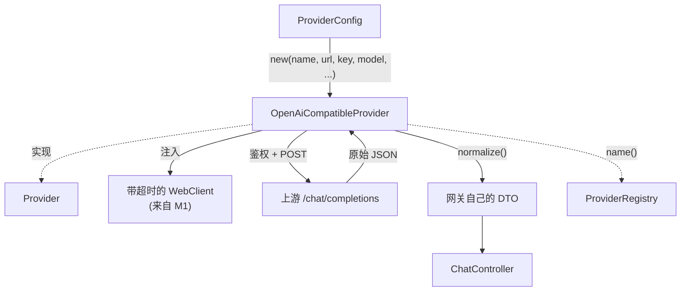

# OpenAiCompatibleProvider

> **本页速览**
> - 全项目**最大的类(372 行)**,但也是**最值的**:它一个类顶 N 家厂商。
> - 它的核心工作只有两个字:**归一**(把上游的 JSON 翻译成网关自己的 DTO)。
> - ★ 最重要的一行:`requestedModel` —— **信任我们请求的模型名,不用上游回的**。
> - 它**不是 `@Component`**,渠道名是**构造时传进来的数据**,不是常量。
> - 它实现了接口的 3 个方法,**但只有 2 个在接口上** —— 第 3 个是内部实现细节。
>
> **导航**:[← 上一页:类-ProviderRegistry](类-ProviderRegistry.md) ｜ [下一页:深入页 →](类-OpenAiCompatibleProvider-深入.md) ｜ [所属模块:M2 上游渠道抽象](_index.md)

## 一句话职责
**用一套代码,把任意"OpenAI 兼容协议"的上游渠道接进网关** —— 发请求、加鉴权、把上游的原始 JSON 翻译成网关自己的 DTO。

## 位置
```text
src/main/java/com/example/gateway/provider/OpenAiCompatibleProvider.java     (372 行)
```
**372 行,超过 4 屏**,所以拆成两页:

| 本页(主) | [深入页](类-OpenAiCompatibleProvider-深入.md) |
|---|---|
| 为什么需要它、构造器、`name()` | `chatCompletionStreamRaw` 的三件事 |
| `chatCompletion()` 非流式全流程 | `chatCompletionStream()` 的归并 |
| `normalize()` 归一的核心逻辑 | 坏块处理、三次改名史 |

## 为什么需要这个类(设计动机)
### ★ 前提事实:这些厂商的协议是一样的
```text
DeepSeek  https://api.deepseek.com/chat/completions
Moonshot  https://api.moonshot.cn/v1/chat/completions
通义      .../compatible-mode/v1/chat/completions
智谱      .../api/paas/v4/chat/completions
Ollama    http://localhost:11434/v1/chat/completions
vLLM      http://localhost:8000/v1/chat/completions
```

**路径都叫 `/chat/completions`,请求体都是 `{model, messages, stream}`,响应体都是 `{choices, usage}`** —— 这不是巧合而是行业事实:OpenAI 的接口事实上成了标准,所有厂商都提供"兼容模式"来降低用户的迁移成本。

```text
① base-url   ← 打哪儿
② api-key    ← 怎么证明身份
③ model      ← 用哪个模型(而且它能被请求覆盖)
```

### 于是"一家厂商一个类"变成了纯粹的重复
```text
❌ DeepSeekProvider.java   ← 发请求 + 加 Bearer + 解析 JSON
   MoonshotProvider.java   ← 发请求 + 加 Bearer + 解析 JSON(一模一样)
   QwenProvider.java       ← 又一遍
   ...
   ★ 修一个 bug 要改 N 个文件;改一处超时要改 N 遍
```
> ★ **判据**:如果一个"抽象"的产物是 **N 份逐字相同的代码**,那它**不是抽象,是复制粘贴**。真正的抽象应该让**重复的部分只写一遍**。

### 这个类的答案
```text
       一个实现类 (OpenAiCompatibleProvider)
     × N 份配置 (ProviderProperties)
     = N 个渠道
```
**而 372 行的体量也解释了这次"合并"为什么值**:里面的翻译、归一、流式处理逻辑相当多(后面逐段讲),按"一家厂商一个类"来写,这 372 行要抄 N 遍。

### ⚠️ 但它不假装"所有厂商都一样"
类名里的 **`OpenAiCompatible`** 是**限定词,不是修饰词**:
```text
✅ 这个实现只适用于"OpenAI 兼容协议"的渠道
❌ 不适用于协议完全不同的厂商
将来遇到不兼容的(比如某家用 input 而不是 messages):
   → 新写一个 XxxProvider implements Provider
   → ChatController / ProviderRegistry / 这个类 全都不用动
```
> ★ **这是 SPI 的完整价值**:它允许你在 **99% 的情况下用一份通用实现偷懒**,同时在 **1% 的情况下不被那份通用实现绑架**。—— 详见 [类-Provider](类-Provider.md) 的"最小接口"讨论。

## 构造器与关键属性
```java
public OpenAiCompatibleProvider(
        String name, String baseUrl, String apiKey,
        String defaultModel, long idleTimeoutMs,
        WebClient.Builder builder, ObjectMapper objectMapper) {

    this.name = name;
    this.defaultModel = defaultModel;
    this.idleTimeoutMs = idleTimeoutMs;
    this.objectMapper = objectMapper;
    this.webClient = builder.baseUrl(baseUrl).build();     // ★ 关键一行
}
```

| 参数 | 从哪来 | 变成什么 |
|---|---|---|
| `name` | YAML 的 **key** | `name()` 的返回值,**注册表的索引键** |
| `baseUrl` | YAML | `builder.baseUrl(...)` |
| `apiKey` | YAML(环境变量) | 存字段,发请求时拼进 `Authorization` 头 |
| `defaultModel` | YAML | 请求没指定 model 时用它 |
| `idleTimeoutMs` | `@Value` | 逐块空闲超时 |
| `builder` | ★ **容器里那个带超时的** | `build()` 出 WebClient |
| `objectMapper` | 容器 | JSON 解析 |

### ★ `builder.baseUrl(baseUrl).build()` 这一行
```java
this.webClient = builder.baseUrl(baseUrl).build();
//                       ↑ 设地址      ↑ ★ 立刻 build
```
**为什么必须立刻 `build()`**:`builder` 是**可变的**,而且是**所有渠道共享的**。`build()` 会当场拷贝配置生成新 `WebClient`,之后 builder 再被改也不影响它。

```text
✅ 每个渠道:设自己的 baseUrl → 立刻 build → 拿到自己的 WebClient
❌ 如果 build() 只调一次:所有渠道指向最后设置的那个地址
```
> ⚠️ 这是**全项目最容易埋雷的一行**,完整分析见 → [类-ProviderConfig](类-ProviderConfig.md) 的「循环里的 baseUrl」一节

### `name()` —— 一行,但很关键
```java
@Override
public String name() {
    return name;      // ← 返回构造时传进来的,不是常量
}
```

**为什么不用常量**:
```java
// ❌ 如果写成这样
public String name() { return "deepseek"; }

// 后果:Moonshot 的实例也返回 "deepseek"
// → ProviderRegistry 构造时检测到重名 → ★ 启动失败
```

> ★ **这是"一个类 × N 份配置"在代码里的落点**:凡是"每个渠道不同"的东西,都必须是数据,不能是代码。

## 关键方法:`chatCompletion()` —— 非流式全流程
```java
@Override
public Mono<ChatCompletionResponse> chatCompletion(ChatCompletionRequest request) {
    return webClient.post()
            .uri("/chat/completions")                        // ① 路径
            .header(HttpHeaders.AUTHORIZATION, "Bearer " + apiKey)   // ② 鉴权
            .contentType(MediaType.APPLICATION_JSON)
            .bodyValue(Map.of(                                // ③ 请求体
                    "model", resolveModel(request),
                    "messages", request.messages(),
                    "stream", false))                         // ★ 非流式
            .retrieve()
            .bodyToMono(JsonNode.class)                       // ④ 先拿原始 JSON
            .map(raw -> normalize(raw, resolveModel(request)));  // ⑤ 归一
}
```

| 步骤 | 做什么 | 为什么这么做 |
|---|---|---|
| ① URI | `/chat/completions` | **所有兼容渠道都是这个路径** —— 这是"一个类顶 N 家"的另一半原因 |
| ② 鉴权 | `Bearer <apiKey>` | 各家都用 Bearer Token |
| ③ 请求体 | 只有 3 个字段 | **最小化**:只发兼容层都认的字段,不赌厂商扩展 |
| ④ `bodyToMono(JsonNode.class)` | ★ **先解析成 JSON 树,不直接映射 DTO** | 见下 |
| ⑤ `.map(normalize)` | 翻译成网关自己的 DTO | 本页重点 |

### ★ ④ 为什么先拿 `JsonNode`,不直接 `.bodyToMono(ChatCompletionResponse.class)`
```text
看起来更简洁的写法:
    .bodyToMono(ChatCompletionResponse.class)     // ❌ 本项目没这么做

为什么不行:
  ① 各家的字段有细微差异(有的有 reasoning_content,有的没有)
  ② 有的字段名不同、有的多一层嵌套
  ③ 一旦直接映射,Jackson 会因为"未知字段"或"字段缺失"直接失败
     → 而且报错信息是 Jackson 的反序列化错误,看不出是"厂商差异"
  ④ 无法记录原始响应(排查问题时有价值)

第一段:上游 JSON → JsonNode(通用树,什么结构都收得下)
第二段:JsonNode → 网关 DTO(我们自己控制每个字段怎么取、缺了怎么办)
```

> ★ **规律**:「**边界处的数据,先转成中立形态,再转成内部模型**」。直接把外部数据映射成内部模型,等于**让外部格式决定你的代码结构**。

### ★★ ⑤ `normalize()` —— 本类的核心
**这是本页最值钱的一段**,签名就说明了一切:
```java
private ChatCompletionResponse normalize(JsonNode raw, String requestedModel)
//                                            ↑ 原始响应    ↑ ★ 我们请求的模型名
```

#### ★★★ 最值得记住的一行:用 `requestedModel`,不用 `raw.path("model")`
**为什么这是个坑**:上游返回的 `model` 字段,**可能和你请求的不是同一个字符串**。

```text
实际发生过的情况:
  我们请求:  "model": "deepseek-chat"
  上游返回:  "model": "deepseek-flash"      ← ★ 不一样!
```

**原因**:厂商内部会做模型别名 / 版本映射。`deepseek-chat` 可能是一个"指向当前最新版"的别名,实际执行的是 `deepseek-flash`。**这不是 bug,是厂商的正常行为。**

```text
调用方:我请求的 deepseek-chat,响应里怎么是 deepseek-flash?
        → 开始怀疑网关是不是搞错了渠道 / 是不是被降级了
        → ★ 一个"看起来像故障"的现象,实际啥事没有
        → 支持成本
```

```java
// ✅ 响应里的 model = 我们请求的那个,调用方看到的和发出的一致
responseModel = requestedModel;
```

> ★ **规律**:「**我们的响应应该反映我们的意图,而不是上游的实现细节**」。上游用了什么内部别名,是它的事;对调用方来说,契约是"你要什么就得到什么"。
> **这条也适用于别的字段**:错误码、版本号、请求 ID —— 该由网关自己决定的东西,就不要透传上游的。

#### `normalize()` 还做了三件事
```java
// ① 硬编码 object 类型
"object": "chat.completion"     // ← 不取上游的,固定写死

// ② 重建 choices[0].message(只挑我们要的字段)
{ "role": ..., "content": ... }  // ← 上游可能有 tool_calls 等,这里只保留核心

// ③ 重建 usage
{ "prompt_tokens", "completion_tokens", "total_tokens" }  // ← 归一字段名
```

**① 为什么硬编码 `"chat.completion"`**:这个字段是**协议约定的一部分**(告诉调用方"这是一个完整响应"),不是数据。上游万一拼错或者用变体,不该透传给调用方。
**② 为什么重建 message 而不是整个透传**:上游可能带 `reasoning_content`、`tool_calls`、`refusal` 等**网关没有承诺过**的字段。透传 = **你的对外契约被上游单方面改写** —— 上游加个字段,你的响应就变了。

> ★ **这是"对外契约"的核心纪律**:**网关对外返回的结构,应该由网关定义,不由上游定义。** 详见 → [M3 对外契约](../03-对外契约/_index.md)

## 这个类在项目中的角色


**它是"翻译官 + 适配器"**:
- 对**上游**:它说上游的话(OpenAI 协议 JSON)
- 对**网关内部**:它说内部的话(自己的 DTO)
- ★ **两个世界互不知道对方的存在** —— 这就是 `Provider` 接口要保证的事

## 值得学习的点
### 1. 类名里的限定词是有价值的
```java
OpenAiCompatibleProvider            // ✅ 诚实:我处理的是"OpenAI 兼容协议"
// 对比
UniversalProvider / AbstractProvider / ProviderImpl   // ❌ 假装自己能处理一切
```

**为什么重要**:类名里写了"OpenAiCompatible",将来遇到不兼容的厂商时,读代码的人**一眼就知道该新写一个类,而不是硬改这个类**。

> **规律**:**类名应该暴露它的适用范围,不只是它的功能。**

### 2. 372 行 vs "拆成小类"的权衡
**有人会想:372 行太长了,该拆啊。但要看它 372 行里装的是什么**:
```text
它不是"做了 372 行的杂事"
它是"做了 1 件事(协议归一)的完整实现"
   ├─ 非流式:请求 → 响应 → 归一
   ├─ 流式:请求 → 逐块 → 归一 → 坏块处理
   └─ 共享的归一小工具
★ 三块之间共享 normalize 的逻辑,拆开反而要来回跳
```

> **判据**:**按"变化的理由"拆,不按"行数"拆。** 如果这 372 行会**因为同一个原因一起改**(比如 OpenAI 协议变了),那它们就该在一起。

### 3. 私有辅助方法的分层是刻意设计的
```java
normalize(JsonNode, String)                  ← 非流式归一
normalizeChunk(JsonNode, String)             ← 单块归一
normalizeChunkSafely(JsonNode, String)       ← 加了容错的版本  ★
```

**注意 `normalizeChunkSafely` 这个名字里有 `Safely`** —— 它明确告诉你"**这个版本会吞掉异常**",这在方法名层面就是一个警告。

> ★ **规律**:「**同一个逻辑的不同容错策略,应该是不同的方法名**」。如果只有一个 `normalizeChunk`,那"它对坏数据什么态度"就得靠读实现才知道。—— 详见 [深入页](类-OpenAiCompatibleProvider-深入.md)

### 4. 这个类在简历上怎么说
```text
✅ 好:"设计并实现 OpenAI 兼容协议的统一适配器,以 1 个实现类
        + N 份配置支撑多厂商接入,新增厂商成本从'写一个类'
        降为'加 4 行 YAML'"

❌ 差:"实现了 DeepSeek 的调用"
   → 听起来就是个 HTTP 调用,没有设计含量
```

> **规律**:**简历上要写"设计",不只写"实现"。** 而这个项目里,"设计"具体是:**归一策略、请求模型名优先、透传边界**这几条判断。

## 相关页

- **深入页(流式、取消传播、坏块、改名史)** → [类-OpenAiCompatibleProvider-深入](类-OpenAiCompatibleProvider-深入.md)
- 它实现的接口 → [类-Provider](类-Provider.md)
- 它被谁创建、那个共享 builder 的坑 → [类-ProviderConfig](类-ProviderConfig.md)
- 它的输入输出结构 → [M3 对外契约](../03-对外契约/_index.md)
- 流式的完整链路 → [02-flows/流式请求处理流程](../../02-flows/流式请求处理流程.md)

> **导航**:[← 上一页:类-ProviderRegistry](类-ProviderRegistry.md) ｜ [下一页:深入页 →](类-OpenAiCompatibleProvider-深入.md) ｜ [所属模块:M2 上游渠道抽象](_index.md)
