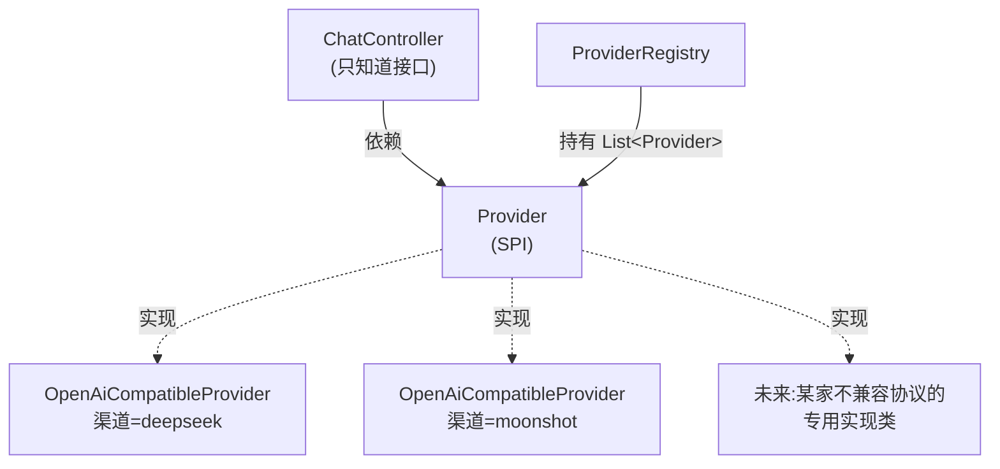

# Provider

> **本页速览**
> - 全项目**最重要的一个文件**,73 行,3 个方法,却决定了整个网关"不认识厂商"。
> - ★ 一条硬约束:**接口里不能出现任何厂商痕迹** —— 没有 `JsonNode`、没有厂商名。
> - **为什么只有两个业务方法?** 因为网关对外**只承诺两件事**:一次性回答、逐字回答。
> - 接口里**故意没有**"限流""熔断""重试" —— 那些是**外面的包装**,不是渠道的能力。
> - 流式方法有两条**契约**(逐块发出、不能吐 `[DONE]`),写在 Javadoc 里,不写在签名里。
>
> **导航**:[← 上一页:M2 模块首页](_index.md) ｜ [下一页:类-ProviderProperties →](类-ProviderProperties.md) ｜ [所属模块:M2 上游渠道抽象](_index.md)

---

## 一句话职责

**定义"一个上游大模型渠道"必须提供的能力**,并且把这句话限制到最小 ——
小到不含任何具体厂商的名字、协议、数据结构。

---

## 位置

```text
src/main/java/com/example/gateway/provider/Provider.java     (73 行)
```

---

## 为什么需要这个类(设计动机)

### 从一个具体的痛开始

假设没有这个接口,`ChatController` 直接 new 一个 `DeepSeekClient`。
加第二家厂商时,最自然的做法是:

```java
// ❌ 反例:Controller 里长出 if-else
if ("deepseek".equals(channel)) {
    return deepSeekClient.chat(request);
} else if ("moonshot".equals(channel)) {
    return moonshotClient.chat(request);
} else if ("qwen".equals(channel)) {      // 第三家
    ...
}
```

**问题不是"代码丑"**,而是:

| 问题 | 后果 |
|---|---|
| 每加一家厂商,都要改 `ChatController` | 改动扩散到**最核心**的那个类,回归风险最高 |
| Controller 必须知道所有厂商的名字 | 厂商细节**泄漏到了调用方**,分层失效 |
| 分支里的每个 client 返回类型可能不同 | Controller 要做 N 种适配 |

> **这就是"接口"要解决的问题**:让调用方只依赖**能力**,不依赖**实现**。

### 抽象漏没漏,有一条可自检的判据

```text
★ 在 ChatController.java 里搜 "DeepSeek"
  → 零结果 = 抽象完整 ✅
  → 有任何结果 = 厂商细节漏出来了 ❌
```

**为什么这条判据成立**:抽象的目的就是把差异关在门内。
如果上层**需要知道"这是哪家厂商"才能工作**,那门就没关上。

### 而"最小"比"抽象"更难做到

写接口最容易犯的错是**写得太大**。真实的失败长这样:

```java
// ❌ 一个"想得很周全"的接口
public interface Provider {
    String name();
    Mono<ChatCompletionResponse> chatCompletion(...);
    Flux<ChatCompletionChunk> chatCompletionStream(...);
    Mono<Boolean> healthCheck();                    // 加一个健康检查吧
    Mono<Usage> countTokens(List<Message> msgs);    // 加个 token 计量吧
    Map<String, Object> rawConfig();                // 加个原始配置吧
    Mono<Void> warmUp();                            // 加个预热吧
}
```

**每加一个方法,所有实现类都被迫加一份"我其实不需要"的实现。**
(这就是"接口污染 / 胖接口",也叫 ISP 违背。)

**这个项目的取舍**:

```text
网关对外承诺的能力 = 一次性回答 + 逐字回答
                   = chatCompletion + chatCompletionStream
                   → 所以接口就只该有这两个业务方法

至于"限流""熔断""重试""计量":
  它们是"包在渠道外面的东西",不是"渠道本身的能力"
  → 写在接口里 = 逼着 DeepSeek 的实现去实现一段跟 DeepSeek 无关的逻辑
  → 所以接口里故意没有它们
```

> ★ **Javadoc 里明确写了这条**:实现类**必须不做**限流、熔断 ——
> 那些由外层装饰器负责。详见 → [类-OpenAiCompatibleProvider](类-OpenAiCompatibleProvider.md)

---

## 关键方法

接口只有 3 个方法,全部列在这里。

### `String name()`

| 项 | 说明 |
|---|---|
| **做什么** | 返回这个渠道的名字,必须和 YAML 里的 key 一致(如 `"deepseek"`) |
| **参数** | 无 |
| **返回值** | 渠道名,非空 |
| **被谁调用** | `ProviderRegistry` 构造时(建索引 + 查重名) |
| **调用了谁** | 无 |

**注意名字的来源**:它不是硬编码在类里的常量,而是**构造时传进来的**:

```text
application.yml 里的 key "deepseek"
   ↓ ProviderConfig 读出来
   ↓ new OpenAiCompatibleProvider("deepseek", ...)
   ↓ name() 原样返回
```

**为什么要这样绕一圈**:因为**一个实现类要服务 N 个渠道**。
如果 `name()` 返回 `"deepseek"` 常量,那 Moonshot 实例返回的也是 `"deepseek"` ——
注册表直接查出重名,启动失败。

> ★ **这是"一个类 × N 份配置"在代码里的第一个落点**:名字是**数据**,不是代码。

### `Mono<ChatCompletionResponse> chatCompletion(ChatCompletionRequest request)`

| 项 | 说明 |
|---|---|
| **做什么** | **一次性**问完、一次性拿完整答案(非流式) |
| **参数** | 统一请求 DTO(见 [M3 对外契约](../03-对外契约/_index.md)) |
| **返回值** | `Mono`,零个或一个完整响应 |
| **被谁调用** | `ChatController` 的 `/v1/chat/completions`(非流式分支) |
| **调用了谁** | 实现类决定 —— 通常是 WebClient 打上游 `/chat/completions` |

**契约要点**:

```text
✅ 返回 Mono,不是阻塞的 ChatCompletionResponse
   → 这是 WebFlux 的底线,详见 M1 的配置-pom.xml(坑②)

✅ 上游返回 4xx/5xx 时,应该以 onError 结束,而不是塞进 response 里
   → "失败"和"成功但内容是错误信息"必须区分开

⚠️ 超时由 WebClient 层负责(M1 的 responseTimeout),实现类不重复做
```

### `Flux<ChatCompletionChunk> chatCompletionStream(ChatCompletionRequest request)`

| 项 | 说明 |
|---|---|
| **做什么** | **逐块**返回答案(SSE 流式) |
| **参数** | 同上 |
| **返回值** | `Flux`,可能 0 到 N 个数据块 |
| **被谁调用** | `ChatController` 的流式分支 |
| **调用了谁** | 实现类决定,通常是把上游 SSE 的每一行归一成一个 chunk |

**两条契约(写在 Javadoc 里,签名上看不出来)**:

#### 契约一:**必须真的逐块发**

```text
✅ 上游吐一块,我发一块
❌ 先 `.collectList()` 攒齐再一次发完
```

**为什么这条重要**:调用方选流式,就是为了**看到字一个个冒出来**。
如果实现类攒齐了再发,功能上"正确"(返回的内容一样),但**体验上完全退化成非流式**,
而**接口层面看不出任何异常** —— 又是一个"静默失效"。

> ★ 这条和 M1 的"starter-web 静默把 WebFlux 变成 MVC"是**同一类 bug**:
> **行为退化了,但没有任何报错。**

#### 契约二:**不能吐 `[DONE]` 哨兵**

```text
OpenAI 的 SSE 协议用一行 "data: [DONE]" 表示流结束
   ↓
但这个 [DONE] 是"对外协议的细节",不是"一个数据块"
   ↓
所以:实现类要把上游的 [DONE] 过滤掉
     由 ChatController 在流的末尾自己补上
```

**为什么要这样分工**(而不是让 Provider 原样透传):

| 做法 | 问题 |
|---|---|
| Provider 透传 `[DONE]` | 每个实现类都得记得发,漏一个就变成"流永远不结束" |
| **Controller 统一补** ✅ | 收尾是**协议层**的事,应该只有一个地方决定 |

> 实现细节详见 → [类-OpenAiCompatibleProvider](类-OpenAiCompatibleProvider.md)
> (它用 `.filter(chunk -> !DONE_SENTINEL.equals(chunk))` 一行完成)

---

## 这个类在项目中的角色



**它是"契约",不是"工具"**:

- 它**不提供任何实现**,一行逻辑都没有
- 它**不 import 任何厂商相关的东西**(连 Jackson 的 `JsonNode` 都没有)
- 它唯一做的事是**划一条线**:线内是"渠道的能力",线外是"网关的策略"

---

## 值得学习的点

### 1. 接口的"方法数量"是一个设计决策,不是自然结果

问自己一句:**"这个方法,是所有实现类都真的需要,还是只是某个实现需要?"**

```text
所有实现都需要        → 放进接口
只有部分实现需要      → 做成可选接口 / 能力探测(如 `instanceof XxxCapable`)
其实是"外面套的一层"  → 做成装饰器,不进接口
```

**这个项目的判断过程**:

| 候选方法 | 判断 | 结论 |
|---|---|---|
| `chatCompletion` | 所有渠道都提供 | ✅ 进接口 |
| `chatCompletionStream` | 所有渠道都提供(OpenAI 兼容协议都支持 SSE) | ✅ 进接口 |
| `name` | 所有实现都需要被注册表索引 | ✅ 进接口 |
| `healthCheck` | 各家探活方式不同,**且网关不承诺探活** | ❌ 不进 |
| `countTokens` | 各家分词器不同,**且网关不承诺计量** | ❌ 不进 |
| 限流 / 熔断 | **不是渠道的能力,是网关的策略** | ❌ 不进 |

> ★ **判据一句话**:**接口应该描述"这个东西是什么",而不是"我们打算怎么用它"。**

### 2. 契约里"不能做什么",和"能做什么"一样重要

Javadoc 里写了两条**否定式契约**:

```text
✗ 实现类不得吐 [DONE]
✗ 实现类不得做限流/熔断
```

**为什么否定式契约值得写**:因为它们是**最容易在"顺手"中被破坏**的规则 ——
一个新同事加限流时,最自然的动作就是在 `chatCompletion` 里加两行。
**写下来,才有拦住的可能。**

### 3. 接口里"没有的东西",往往比有的更能说明设计

再看一眼这个接口 import 了什么:

```java
import com.example.gateway.dto.ChatCompletionRequest;   // 自己的 DTO
import com.example.gateway.dto.ChatCompletionResponse;
import com.example.gateway.dto.ChatCompletionChunk;
import reactor.core.publisher.Flux;
import reactor.core.publisher.Mono;
// ★ 没有 import com.fasterxml.jackson.databind.JsonNode(虽然项目里到处在用它)
```

`JsonNode` 在这个项目里**被大量使用**(`OpenAiCompatibleProvider` 满篇都是),
但它**没有出现在接口的签名里**。

> **规律**:一个抽象的质量,**可以用"它 import 了什么"来快速判断**。
> 引入框架类型、引入厂商类型,都会把实现细节钉死在接口上。

---

## 相关页

- 它的实现类 → [类-OpenAiCompatibleProvider](类-OpenAiCompatibleProvider.md)
- 谁持有并查找它 → [类-ProviderRegistry](类-ProviderRegistry.md)
- 它的参数和返回值长什么样 → [M3 对外契约](../03-对外契约/_index.md)
- 谁在调用它 → [类-ChatController](../04-请求入口/类-ChatController.md)

> **导航**:[← 上一页:M2 模块首页](_index.md) ｜ [下一页:类-ProviderProperties →](类-ProviderProperties.md) ｜ [所属模块:M2 上游渠道抽象](_index.md)
