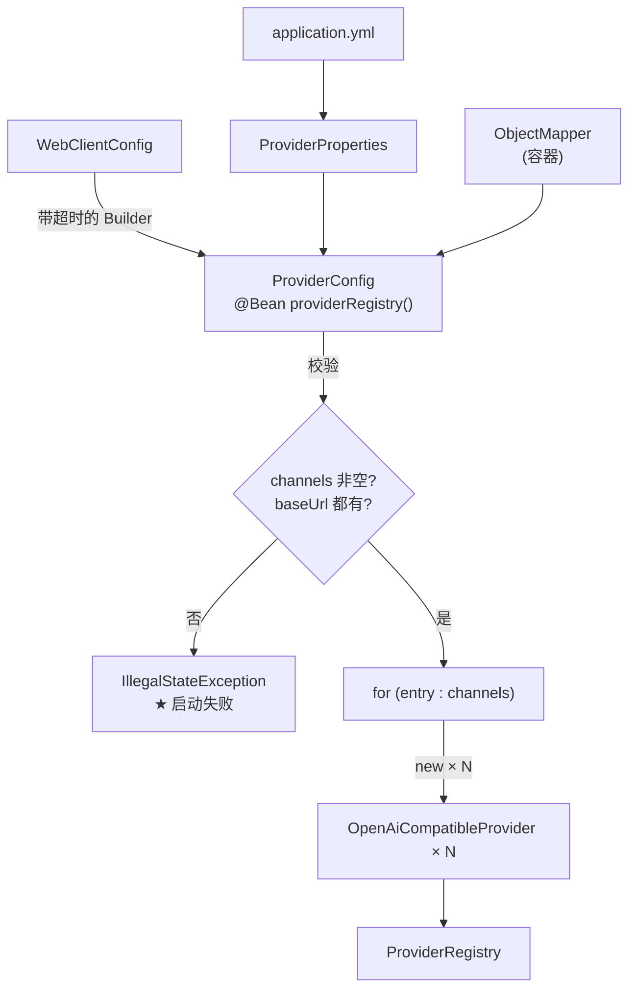

# ProviderConfig

> **本页速览**
> - **这十几行循环,就是 G3b「多渠道路由」的核心。** 全部精华在一个 `for` 里。
> - 三件事:校验配置 → **循环 new 出 N 个 Provider** → 交给 `ProviderRegistry`。
> - ⚠️ **最容易埋雷的一行**:在循环里对**共享的 Builder** 调 `baseUrl()`,依赖 `build()` 立刻拷贝。
> - **哪些配置问题该启动失败、哪些只警告**,这里做了明确区分(不是随便选的)。
> - `ObjectMapper` 从容器注入而不是 `new` —— 保证和 Spring 的 JSON 配置一致。
>
> **导航**:[← 上一页:类-ProviderProperties](类-ProviderProperties.md) ｜ [下一页:类-ProviderRegistry →](类-ProviderRegistry.md) ｜ [所属模块:M2 上游渠道抽象](_index.md)

---

## 一句话职责
**在启动时,把"N 份渠道配置"翻译成"N 个 `Provider` 实例",再交给 `ProviderRegistry`。**

---

## 位置
```text
src/main/java/io/github/maixiaowen/gateway/config/ProviderConfig.java     (112 行)
```
它在 **`config` 包**,不在 `provider` 包:
```text
config/ProviderConfig.java      ← 装配:读配置、造对象("怎么造")
provider/OpenAiCompatibleProvider.java  ← 实现:真的发 HTTP("是什么")
provider/ProviderRegistry.java  ← 索引:按名字查找("谁在哪")
```
> **规律**:**"怎么造"和"造出来是什么",分开放**——这样测 `OpenAiCompatibleProvider` 时不需要 Spring 容器。

---

## 为什么需要这个类(设计动机)
### 先看 3a 是什么样,再看 3b 为什么必须改
**3a 的做法**:
```java
@Component                       // ← 靠组件扫描
public class ProviderRegistry {
    public ProviderRegistry(List<Provider> providers, ...) { }
}

@Component                       // ← 靠组件扫描
public class DeepSeekProvider implements Provider { }
```
Spring 会把所有 `Provider` 类型的 Bean 收集成 `List` 注入。**很优雅。**
**但 3b 要"一个实现类 × N 份配置"**:
```text
组件扫描发现的是"类",不是"配置项"
   → 扫描到 1 个 OpenAiCompatibleProvider 类,但配置里有 2 个渠道需要 2 个实例
   → 而且第 2 个实例的参数来自配置,不是代码
```
**`@Component` 做不到这件事**,因为:

| | `@Component` | `@Bean` 方法 |
|---|---|---|
| 实例数量 | 由**类**决定(1 个类 = 1 个实例) | 由**方法逻辑**决定(可以循环 new N 次) |
| 参数来源 | 只能靠容器注入 | **可以传给构造器的任意值**(从配置循环里来) |
| 时机 | 编译期扫描 | 运行期执行 |

> ★ **所以 3b 必须从 `@Component` 换成 `@Bean` 方法**——不是"风格选择",而是**能力边界**:数量由数据决定的东西只能在**运行时**创建,组件扫描是**编译期**行为。
### 一个反面对比:如果硬用 `@Component` 会怎样
"给每个渠道写一个 `@Component` 子类不就行了":
```java
// ❌ 反例:又回到"一家厂商一个类"
@Component class DeepSeekProvider extends OpenAiCompatibleProvider { }
@Component class MoonshotProvider extends OpenAiCompatibleProvider { }
```
**这等于把"配置里的数据"重新写回代码**:
```text
加第三家 → 写第三个子类 → 编译 → 重新部署
★ 而我们想要的是:改 YAML → 重启 → 生效(甚至配合配置中心可以热更新)
```
> **规律**:「**数量由配置决定的实体,绝不能用编译期机制表达**」。看到"要为什么东西写 N 个子类",先想想它在配置里是不是一行数据。

---

## 关键方法
### `providerRegistry(...)` —— 唯一的 `@Bean` 方法
```java
@Bean
public ProviderRegistry providerRegistry(
        ProviderProperties properties,                 // N 份渠道配置
        WebClient.Builder webClientBuilder,            // ★ 已由 M1 装好超时
        ObjectMapper objectMapper,                     // Spring 的 JSON 配置
        @Value("${gateway.upstream.idle-timeout-ms}") long idleTimeoutMs) {
    ...
}
```

| 参数 | 从哪来 | 为什么需要 |
|---|---|---|
| `properties` | `@EnableConfigurationProperties` | 渠道表本体 |
| `webClientBuilder` | ★ Spring Boot 自动装配 | **关键**:已被 `WebClientConfig` 的 Customizer 加过超时 |
| `objectMapper` | Spring 容器 | 和 Spring 的 JSON 行为一致(时间格式、命名策略) |
| `idleTimeoutMs` | `@Value` | 流式逐块空闲超时,每个渠道实例都带着 |

> ★ `webClientBuilder` 是"所有渠道自动继承同一套超时"的传递路径。详见 M1 → [类-WebClientConfig](../01-骨架与配置/类-WebClientConfig.md)
**方法内部三步**:
```text
① 校验:channels 非空 + 每个渠道必须有 base-url
② 循环:每个 entry → new 一个 OpenAiCompatibleProvider
③ 返回:new ProviderRegistry(providerList, properties.defaultChannel())
```
### 校验环节:什么该"启动失败",什么只该"警告"
本类**最值得学的一处判断**,不是随便选的:

| 情况 | 处理 | 为什么 |
|---|---|---|
| `channels` 是空 Map | ★ **抛 `IllegalStateException`,启动失败** | 一个渠道都没有 = 网关**没有任何功能**,起来也是废的。**早点死,别占着端口** |
| 某渠道没配 `base-url` | ★ **抛 `IllegalStateException`,启动失败** | `base-url` 是**结构性**的:没它连"往哪发"都不知道。**这不是疏漏,是配置错误** |
| 某渠道 `api-key` 是空 | ⚠️ **只打 WARN,继续启动** | ★ **这是刻意的**,见下面 |

#### ★ 为什么 `api-key` 空只警告,不失败
三条理由,每条都成立:
```text
① 没有 key 也能"跑起来一部分"
   /ping、渠道列表、参数校验、错误格式转换都不需要 key,启动就死的话这些能力全测不了
② key 是"环境相关"的,base-url 不是
   开发机、CI、生产用不同的 key,CI 里没配 key 是常态,不该因此起不来
③ 失败信息由上游给出,而且很明确
   没 key → 上游返回 401 → 日志清清楚楚,比启动时一句 WARN 更好定位
```
> ★ **判据一句话**:**"缺了它整个服务就没意义" → 启动失败;"缺了它某些功能不可用" → 警告放行。** 这也是 "fail-fast" 易被误用的地方:**不是"什么都报错",而是"让不可恢复的错误尽早暴露,让可恢复的问题留下痕迹"**。
### ★★ 循环体:整个 G3b 的核心
```java
List<Provider> providers = new ArrayList<>();
for (Map.Entry<String, ProviderProperties.Channel> entry : properties.channels().entrySet()) {
    String channelName = entry.getKey();        // ★ 名字 = Map 的 key
    ProviderProperties.Channel channel = entry.getValue();

    providers.add(new OpenAiCompatibleProvider(
            channelName,                        // ← 名字是数据,不是常量
            channel.baseUrl(),
            channel.apiKey(),
            channel.model(),
            idleTimeoutMs,
            webClientBuilder,                   // ★ 共享的 builder
            objectMapper));
}
```

| 传进去的 | 来源 | 在 Provider 里变成什么 |
|---|---|---|
| `channelName` | Map 的 key | `name()` 返回值 → 注册表的索引键 |
| `baseUrl` | YAML | `builder.baseUrl(baseUrl).build()` 的目标地址 |
| `apiKey` | YAML(环境变量) | `Authorization: Bearer xxx` 头 |
| `model` | YAML | 请求体 `"model"` 字段默认值 |
| `idleTimeoutMs` | `@Value` | `Flux.timeout()` 的参数 |
| `webClientBuilder` | 容器 | 造出带超时的 `WebClient` |

---

## ⚠️ 最容易埋雷的一行:循环里的 `baseUrl()`
本类 Javadoc **专门用一段话警告**的地方,值得单独讲。
### 危险在哪
`WebClient.Builder` 是**可变**的:
```java
builder.baseUrl(url);      // ← 修改 builder 自己,并返回 this
```
**`build()` 时机不对,所有渠道会指向同一个地址:**
```java
// ❌ 灾难写法:先循环设置,最后统一 build
WebClient.Builder shared = WebClient.builder();
for (entry : channels) {
    shared.baseUrl(entry.getValue().baseUrl());   // 每次都覆盖同一个 builder
}
WebClient client = shared.build();                // ★ 只有最后一个是有效的 → N 个渠道全打到最后那个地址
```
**这个 bug 有多难查**:
```text
不报错、不警告,启动完全正常
请求也"成功"了 —— 只是所有渠道的响应都来自同一个上游
★ 账单上才会发现:Moonshot 的请求全打到了 DeepSeek
```
### 为什么现在的写法是安全的
```java
this.webClient = builder.baseUrl(baseUrl).build();
//                       ↑ 设一次      ↑ ★ 立刻 build
```
**关键**:`build()` 会**立刻把当前配置拷贝一份**生成新的 `WebClient`,之后 builder 再被改,已造出的 `WebClient` **不受影响**。所以安全性取决于一个顺序:
```text
✅ 安全:设 baseUrl → build()  → 下一次循环再设 → 再 build()
❌ 危险:设 baseUrl → 设 baseUrl → … → 最后 build() 一次
```
> ★ **Javadoc 里值得原样记下**:*"安全只是因为 `build()` 会立刻拷贝配置 —— 如果把 `build()` 移到循环外面,所有渠道会静默指向同一个地址。"* **规律**:共享**可变对象**时,"**什么时候把它变成不可变**"就是正确性的全部。这类 bug 的可怕之处:**错得很有秩序**——不崩、不报错,只是结果全错。
### 顺带一个更稳的写法(供思考)
```java
// 更稳:完全不共享可变 builder
this.webClient = webClientBuilder.clone()      // 不共享,避免"我改了别人也变"
        .baseUrl(baseUrl)
        .build();
```
本项目没这么做,因为**单线程 `@Bean` 方法里顺序调用**是安全的,注释已把风险写清。**但若在别处见到"共享 Builder 交给多线程用",那就是真的 bug 了。**

---

## 这个类在项目中的角色

**它是"装配车间"**——唯一一处知道"配置怎么变成对象"的地方,不参与任何请求处理,只在启动时跑一次。

---

## 值得学习的点
### 1. `@Configuration` 类应该是"无状态 + 只在启动跑一次"
```java
@Configuration
@EnableConfigurationProperties(ProviderProperties.class)
public class ProviderConfig {
    @Bean
    public ProviderRegistry providerRegistry(...) { ... }   // 启动时执行一次
}
```
**这个类里没有字段、没有 `@Autowired` 成员、没有可变状态。** 好处:
```text
✅ 方法可被调用多次(幂等),不污染状态
✅ 单测可直接 new ProviderConfig() 手动调 @Bean 方法
✅ 无并发问题(没有任何共享可变状态)
```
> **反例**:`@Configuration` 类里塞成员变量缓存、`@PostConstruct` 初始化逻辑、业务方法——会让"配置类"变成看不见的全局单例。
### 2. "校验放在哪"是一个架构决策
`ProviderConfig` 做了校验,但**不是唯一做校验的地方**:

| 校验 | 位置 | 时机 |
|---|---|---|
| `channels` 非空 / `baseUrl` 非空 | `ProviderConfig`(造对象前) | Bean 创建 |
| 默认渠道存在 / 无重名 / 名字非空 | `ProviderRegistry`(**构造器里**) | Bean 创建 |
| 请求里的渠道名是否存在 | `ProviderRegistry.resolve()` | **每次请求** |

**三层各有分工**:
```text
第 1 层:配置本身形状对不对     → 造对象前
第 2 层:这批对象作为"集合"合不合理 → 造完索引时
第 3 层:这一次请求合不合理      → 请求时
```
> ★ **规律**:**每层只校验"只有这层才知道的事"**。`ProviderConfig` 其实知道"默认渠道在不在",但它**不该**校验——那是"集合层面"的规则,属于 `ProviderRegistry`,放在那里才能保证**不管谁造它都被校验**。
### 3. 依赖注入的"来源"直接影响行为一致性
```java
ObjectMapper objectMapper,   // ✅ 从容器注入
ObjectMapper objectMapper = new ObjectMapper();   // ❌ 自己 new
```

**差别在哪**:

| | 容器注入 | 自己 new |
|---|---|---|
| 命名策略 | 跟随 Spring Boot 配置(`spring.jackson.*`) | 默认 |
| 时间格式 | 跟随配置(如 `LocalDateTime` 序列化) | 默认会抛异常 |
| 模块注册 | 含 JavaTimeModule 等自动注册的模块 | **缺模块,序列化直接失败** |

**自己 `new` 的后果**:只有一个类用它时看不出问题,一旦别处用了容器版本,**同一个对象序列化出两种 JSON**——又是静默不一致。
> ★ **规律**:**基础设施组件(Jackson / WebClient / RestTemplate)一律从容器拿,不要自己 new**。"我只需要一个简单的 ObjectMapper"这个念头,是 bug 的常见起点。

---

## 相关页

- 它读的配置结构 → [类-ProviderProperties](类-ProviderProperties.md)
- 它造出来的对象 → [类-OpenAiCompatibleProvider](类-OpenAiCompatibleProvider.md)
- 它交给谁 → [类-ProviderRegistry](类-ProviderRegistry.md)
- 那个带超时的 builder 从哪来 → [类-WebClientConfig](../01-骨架与配置/类-WebClientConfig.md)
- 加一家厂商要改什么 → [流程-渠道路由](流程-渠道路由.md)

> **导航**:[← 上一页:类-ProviderProperties](类-ProviderProperties.md) ｜ [下一页:类-ProviderRegistry →](类-ProviderRegistry.md) ｜ [所属模块:M2 上游渠道抽象](_index.md)
