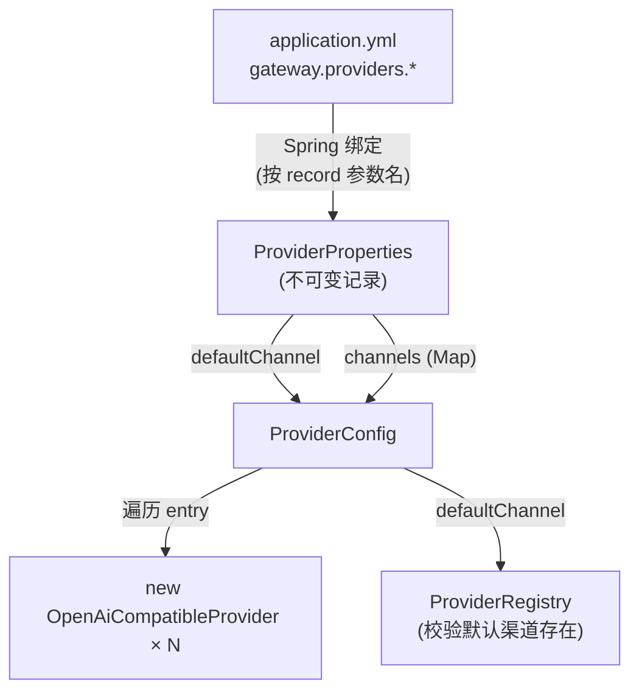

# ProviderProperties

> **本页速览**
> - 用一个 **record** 承载"N 个渠道"的配置,总共 76 行,其中一半是注释。
> - ★ 关键事实:**`Channel` 里没有 `name` 字段** —— 渠道名就是 `channels` 这个 Map 的 **key**。
> - 用 **record 而不是普通类**:配置一旦绑定完就**不该再变**,record 让"不可变"变成语言保证。
> - **紧凑构造器里做了 null 归一化** —— 让所有下游代码可以安全假设"这两个字段不为 null"。
> - ⚠️ 这里有一个**隐性契约**:record 的**参数名**必须和 YAML 的 key 对得上,改名 = 静默失效。
>
> **导航**:[← 上一页:类-Provider](类-Provider.md) ｜ [下一页:类-ProviderConfig →](类-ProviderConfig.md) ｜ [所属模块:M2 上游渠道抽象](_index.md)

---

## 一句话职责

**把 `application.yml` 里 `gateway.providers.*` 那段配置变成不可变 Java 对象**,供 `ProviderConfig` 读取并创建渠道实例。

---

## 位置

```text
src/main/java/com/example/gateway/config/ProviderProperties.java     (76 行)
```

---

## 为什么需要这个类(设计动机)

### 问题:配置从哪来、到哪去

```text
application.yml 是一堆文本
   ↓
ProviderConfig 需要"渠道名 → (baseUrl, apiKey, model)"这张表
   ↓
中间的这一步,就是 ProviderProperties
```

**为什么不让 `ProviderConfig` 直接读 `@Value`**:

```java
// ❌ 反例:数字号数不清,而且数量是变化的
@Value("${gateway.providers.channels.deepseek.base-url}") String dsBaseUrl;
@Value("${gateway.providers.channels.deepseek.api-key}")  String dsApiKey;
@Value("${gateway.providers.channels.deepseek.model}")    String dsModel;
@Value("${gateway.providers.channels.moonshot.base-url}") String msBaseUrl;
// ... 加一家厂商 = 加 3 行 @Value,还要再改一遍逻辑
```

**根本原因**:渠道数量是**配置里的数据**,`@Value` 是**编译期的符号** —— 数据会变,符号不会。

> ★ **规律**:凡是"数量由配置决定"的东西,都必须用 `@ConfigurationProperties` + `Map`/`List` 承载,不能用 `@Value` 一个个写。

### 为什么用 record 而不是普通类

record 在这里给出三个**语言级别的保证**:

| 保证 | 作用 |
|---|---|
| 所有字段 `final` | 绑定完成后**没人能改它** —— 不存在"某处偷偷把 baseUrl 改了" |
| 自动生成 `equals`/`hashCode` | 测试里可以直接断言两个配置对象相等 |
| 自动生成 `toString` | 打日志时不用手写(⚠️ 见下面「安全注意」) |

**配置对象应该是不可变的**,理由不是"教条":它是"全局共享的只读数据",若可变则任何拿到它引用的代码都能改;而它同时被 `ProviderRegistry`、N 个 `Provider`、可能还有监控端点持有 —— ★ 一个地方改了,影响面是"全项目",而且极难排查。

---

## 关键属性

```java
@ConfigurationProperties(prefix = "gateway.providers")
public record ProviderProperties(
        String defaultChannel,
        Map<String, Channel> channels
) {
    public record Channel(
            String baseUrl,
            String apiKey,
            String model
    ) { }
}
```

| 字段 | 类型 | 对应 YAML | 说明 |
|---|---|---|---|
| `defaultChannel` | `String` | `gateway.providers.default-channel` | 请求没指定渠道时用哪个 |
| `channels` | `Map<String, Channel>` | `gateway.providers.channels.<名字>` | ★ **key 就是渠道名** |
| `Channel.baseUrl` | `String` | `<名字>.base-url` | 上游根地址,如 `https://api.deepseek.com` |
| `Channel.apiKey` | `String` | `<名字>.api-key` | 密钥,**来自环境变量** |
| `Channel.model` | `String` | `<名字>.model` | 默认模型名,如 `deepseek-chat` |

### ★★ 最值得注意的一点:`Channel` 里**没有 `name`**

```yaml
gateway:
  providers:
    channels:
      deepseek:                    # ← 这个名字,就是渠道名
        base-url: ...
        api-key: ...
        model: ...
```

**渠道名 = Map 的 key**,不是 `Channel` 的一个字段。

**为什么不写成这样**:

```yaml
# ❌ 冗余写法
channels:
  deepseek:
    name: deepseek        # ← 和 key 重复
    base-url: ...
```

| 问题 | 后果 |
|---|---|
| **两份就可能对不上** | `key: deepseek` 但 `name: moonshot` —— **这时该信哪个?** |
| 注册表的查重逻辑要重写 | 得遍历 value 去比对 `name`,而不是直接看 key |
| `name()` 的实现变复杂 | 要多一层"取字段还是取 key"的判断 |

> ★ **一句话**:「**同一个事实只能有一个来源**」—— 两份数据一旦能不一致,就一定会不一致,只是时间问题。

---

## 关键方法

### 紧凑构造器(compact constructor)

```java
public ProviderProperties {
    if (defaultChannel == null || defaultChannel.isBlank()) {
        defaultChannel = "deepseek";
    }
    channels = (channels == null)
            ? Map.of()
            : Collections.unmodifiableMap(new LinkedHashMap<>(channels));
}
```

**紧凑构造器**:record 的写法 —— 只写 `public ProviderProperties {`,**不写参数列表**,Spring 就知道"请在赋值前插一段逻辑"。

| 做什么 | 三个归一化动作 |
|---|---|
| **① 默认渠道兜底** | 配置里没写 → `"deepseek"` |
| **② channels 兜底** | 配置里没有这个节点 → `Map.of()` 空 Map |
| **③ 包装成不可变 + 保序** | 见下面 |

**每一行的理由**:

#### ① 为什么给 `defaultChannel` 兜底

不兜底的话 `defaultChannel` 会是 `null`,`ProviderRegistry` 里"默认渠道必须存在"这条校验会**在启动时报一个语焉不详的错**。**兜底之后,错法变了**:

```text
不兜底:null → 报 "默认渠道不存在: null"     ← 看不出是"没配"
兜底后:"deepseek" → 如果真没配 deepseek,报 "默认渠道不存在: deepseek,可用: [moonshot]"
                                        ↑ 一眼看懂:哦,我把默认渠道配错了
```

> **规律**:**兜底值的作用,是让错误信息变得可读**,而不只是"防 NPE"。

#### ② 为什么 `channels` 兜底成空 Map(而不是报错)

**分工**:`ProviderProperties` 只负责"把 null 变成安全的形态",`ProviderConfig` 负责"判断是否合法,不合法就启动失败"。

**为什么不在这里直接抛异常**:配置类抛异常会得到一个 `BindException`,堆栈巨长、信息反而模糊;让 `ProviderConfig` 抛,错误信息能自己写。

#### ③ 为什么要 `unmodifiableMap` + `new LinkedHashMap<>(...)`

```java
Collections.unmodifiableMap(new LinkedHashMap<>(channels))
//                            ↑ 保序            ↑ 加只读壳
```

| 动作 | 为什么 |
|---|---|
| `new LinkedHashMap<>(channels)` | **复制一份 + 保留插入顺序**。Spring 绑出来的通常是 `LinkedHashMap`,但复制一遍能保证顺序,并且**切断和原 Map 的引用关系** |
| `Collections.unmodifiableMap(...)` | 加一层只读壳,任何人 `put` 会抛 `UnsupportedOperationException` —— **把"不许改"从注释变成运行时保证** |

**为什么要保序**:`ProviderRegistry` 遍历渠道打日志、报错时列出"可用渠道",顺序稳定的话两次启动日志能对比。这个理由和 `ProviderRegistry` 里用 `LinkedHashMap` 是**同一个动机**,详见 → [类-ProviderRegistry](类-ProviderRegistry.md)

---

## 这个类在项目中的角色



**它是"配置的形状"** —— 不校验业务规则、不创建对象,只回答一个问题:**"`gateway.providers` 这段配置应该长成什么结构?"**

---

## ★ 陷阱:record 参数名 = YAML key,改名就是静默失效

**绑定规则**:Spring 把 YAML 的 key 按**宽松绑定**规则归一化后,去匹配 **record 的组件名**(即构造器参数名)。

```text
YAML 里的        default-channel  → 归一化 →  defaultchannel
record 参数名    defaultChannel   → 归一化 →  defaultchannel
                                             ✅ 对得上

YAML 里的        default-channel
record 参数名    defaultChannel_   ❌ 对不上 → 该字段被忽略 → 静默取 null
```

**这是全项目反复出现的一类 bug 的又一个实例**:

| 出现的地方 | 现象 |
|---|---|
| M1 `application.yml` 的 `timeout-ms` | 键被忽略,**静默取 0** |
| Boot 3 的 `spring.data.redis.*` | 前缀写错,**静默连不上** |
| **这里**:record 参数改名 | 字段被忽略,**静默变 null → 走兜底值** |

> ★ **三个实例的共同模式**:「**对不上 → 不报错 → 用默认值**」。**三种治理手段,强度递增**:
> ```text
> ① 写测试断言配置真的绑上了(本项目:M7 的契约测试)
> ② 加 @ConfigurationProperties(ignoreUnknownFields = false)  → 拼错的键 = 启动失败
> ③ 用 @Validated + 校验注解,让"绑上了但值不对"也变成启动失败
> ```

**特别提醒**:因为紧凑构造器做了兜底,改名后的现象是"`defaultChannel` 悄悄变回 `deepseek`",**比报错更难发现** —— **兜底和静默失效是同一个机制的两面**。

---

## 值得学习的点

### 1. record 之于配置,不只是"少写代码"

| 普通类 + getter/setter | record |
|---|---|
| 12 个字段 = 12 个 setter = 12 个可变入口 | **零个可变入口** |
| `toString` 要手写,且容易漏字段 | 自动,**不会漏** |
| 相等比较要用 `equals` 且容易写错 | 自动,**按值比较** |

**最大的一条**:普通类里"配置被谁改了"这个问题无法回答;record 让这个问题**根本不存在**。

### 2. 嵌套 record 让结构自己说话

```java
Map<String, Channel> channels        // 结构一眼可见
record Channel(String baseUrl, String apiKey, String model)
```

对比注释描述同样的结构:

```java
// ❌ 结构藏在注释里
// channels: 一个 Map,key 是渠道名,value 是 {baseUrl, apiKey, model} 三个字段
Map<String, Object> channels;
```

> **规律**:**能用类型表达的,不要用注释表达** —— 注释会过期,类型不会(类型错了编译不过)。

### 3. ⚠️ 安全注意:`apiKey` 出现在 `toString()` 里

record 自动生成的 `toString()` **包含 `apiKey`**,所以:

```java
log.info("providers = {}", properties);     // ❌ 密钥进日志了
log.info("channels = {}", properties.channels().keySet());  // ✅ 只打渠道名
```

**本项目的实际做法**:`ProviderConfig` 打日志时**只打渠道名和 baseUrl**,`OpenAiCompatibleProvider` 把 key 存进去后**再也没打出来过**。

> ★ **规律**:任何"自动生成"的东西(toString、序列化、日志),用在**含密钥的对象**上之前,都要先确认它会把什么写出去。
> 这也是为什么 `application.yml` 里 `api-key` 的默认值是**空字符串**:宁可本地报 401,也不让密钥进 Git。详见 → [配置-application.yml](../01-骨架与配置/配置-application.yml.md)

---

## 相关页

- 谁读它、拿它造对象 → [类-ProviderConfig](类-ProviderConfig.md)
- 它描述的那个 YAML 段 → [配置-application.yml](../01-骨架与配置/配置-application.yml.md)
- 它产出的结果被谁持有 → [类-ProviderRegistry](类-ProviderRegistry.md)
- 用法示例(渠道名怎么被拿出来用) → [流程-渠道路由](流程-渠道路由.md)

> **导航**:[← 上一页:类-Provider](类-Provider.md) ｜ [下一页:类-ProviderConfig →](类-ProviderConfig.md) ｜ [所属模块:M2 上游渠道抽象](_index.md)
