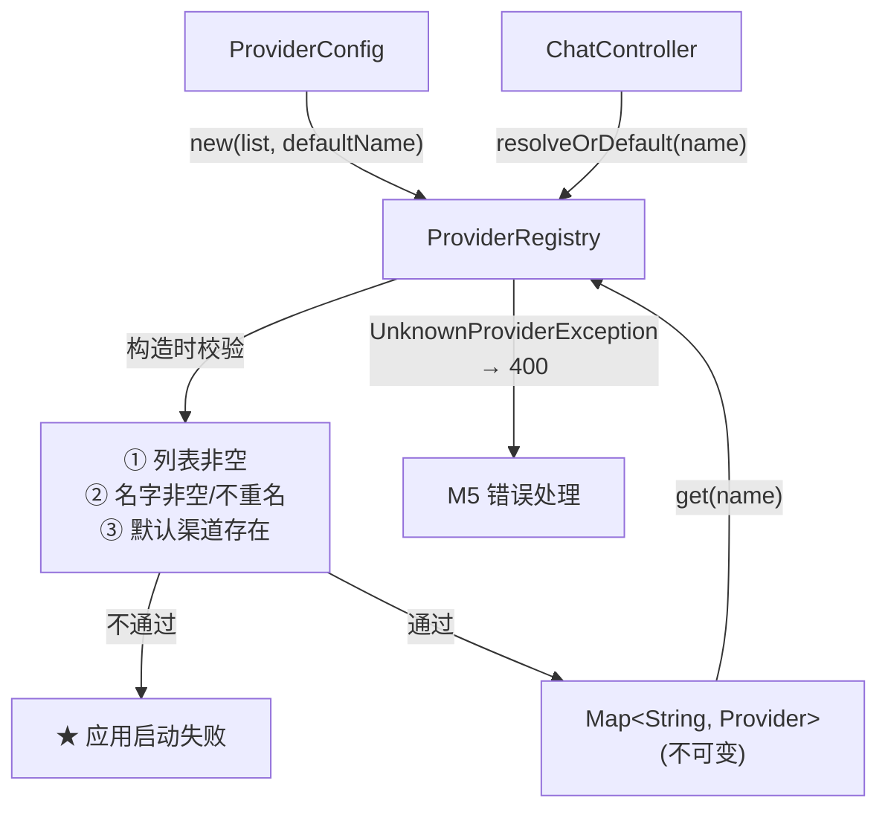

# ProviderRegistry

> **本页速览**
> - **唯一知道"总共有哪些渠道"的地方**。别的类只认识 `Provider` 接口,不认识"全部"。
> - ★ 三重 fail-fast **全在构造器里** —— 不满足就**让应用启动失败**,不留到运行时。
> - ★★ 核心设计:**没指定渠道 → 静默用默认;指定了但不存在 → 抛异常(400)**。
> - 从 `@Component` 改成手工创建,**构造器签名一个字没改** → 3a 的单测一行没动。
> - `LinkedHashMap` → 保序 → 报错时列出的"可用渠道"顺序稳定、两次启动能对比。
>
> **导航**:[← 上一页:类-ProviderConfig](类-ProviderConfig.md) ｜ [下一页:类-OpenAiCompatibleProvider →](类-OpenAiCompatibleProvider.md) ｜ [所属模块:M2 上游渠道抽象](_index.md)

## 一句话职责

**持有全部渠道实例,提供"按名字找渠道"的唯一入口**,并保证启动时渠道表是合法的。

## 位置

```text
src/main/java/io/github/maixiaowen/gateway/provider/ProviderRegistry.java     (166 行)
```

⚠️ **注意它不在 `config` 包**:

```text
provider/ProviderRegistry.java    ← 它在 provider 包
config/ProviderConfig.java        ← 造它的代码在 config 包
```

**为什么**:注册表是**运行时的查找服务**,和 `Provider` 同领域;`ProviderConfig` 只是"怎么把它造出来"。放不同包,依赖方向才看得清。

## 为什么需要这个类(设计动机)

### 问题:谁来回答"有哪些渠道"

一次请求带 `"provider": "moonshot"`,系统要回答两个问题:

```text
① 有没有叫 moonshot 的渠道?
② 如果有,给我那个实例
```

**没有注册表,这两个问题会散落各处**:

```java
// ❌ 反例:Controller 自己持有 List 并查找
List<Provider> all;
Provider found = all.stream()
        .filter(p -> p.name().equals(channelName))
        .findFirst()
        .orElseThrow(...);
```

| 问题 | 后果 |
|---|---|
| 查找逻辑重复 N 遍 | 一处改成"忽略大小写",别处没改 → 行为不一致 |
| `List` 查找是 **O(n)** | 渠道多了变慢(这里 n 很小,但模式是错的) |
| 无法集中查重 | "两个渠道同名"只能运行时才发现,且可能随机命中一个 |
| 报错信息无处统一 | "可用渠道有哪些"每个分支重写一遍 |

### 它给出的答案

```text
★ 把"全部渠道"收进一个对象。别的类只认识 Provider(单个),不认识 List<Provider>(全部)。
   → 查找逻辑只有一份 / 查重只有一处 / 报错信息只有一处 / 构造时就能校验合法性
```

> ★ **这是"注册表 / 目录 / 索引"这类模式的通用价值:把"集合"从数据结构升级成有行为、有不变量的对象。**

## 为什么不再用 `@Component`

**3a 的写法**:

```java
@Component                                    // ← 靠 Spring 收集
public class ProviderRegistry {
    public ProviderRegistry(List<Provider> providers,
                            @Value("${...default-channel}") String defaultProviderName) {
```

Spring 会把容器里所有 `Provider` 类型的 Bean 收集成 `List` 注入。**很优雅,但不够用**:

```text
依赖前提:每个渠道都是独立 Bean → G3b 事实:1 实现类 + N 份配置 = N 个实例(只能由 @Bean 循环创建,见 ProviderConfig)
   ↓ ★ "收集所有 Provider Bean"落空 → 改由 ProviderConfig 手工把 List 传进来
```

### ★ 关键:构造器签名**一个字都没改**

```java
// 3a 和 3b 完全一样
public ProviderRegistry(List<Provider> providers, String defaultProviderName) { }
```

**所以 3a 写的 6 个单元测试,一行都没改就继续通过。**

```text
ProviderRegistry 从来没有 import org.springframework.* → 它本来就"不认识 Spring"(之前"借 Spring 的手递参数",现在"借 ProviderConfig 的手")
   ↓ ★ 对构造器来说,递参数的手是谁,根本无所谓
```

## 关键属性

| 字段 | 类型 | 说明 |
|---|---|---|
| `providersByName` | `Map<String, Provider>` | 名字 → 实例,**不可变**,查找 O(1) |
| `defaultProvider` | `Provider` | 默认渠道的实例(构造时就解析好,不是每次查) |

#### ① 为什么用 `Map` 而不是 `List`

```text
List:遍历找 → O(n),而且"有没有重名"没法直接判断
Map :直接 get → O(1),而且 put 的时候天然能检测重名
```

#### ② 为什么 `defaultProvider` 是**预先解析好的实例**,不是"名字"

如果只存名字,每次用默认渠道都要 `resolve(name)` 一次 —— **多一次查找,还多一个"名字可能被改"的机会**。构造时解析成实例,之后就是**零成本**。

## 关键方法

### 构造器 —— 三重 fail-fast 都在这里

```java
public ProviderRegistry(List<Provider> providers, String defaultProviderName) {
    // ① providers 不能为空
    // ② 每个 Provider 的 name() 不能空、不能重名
    // ③ defaultProviderName 必须能在 providers 里找到
}
```

| 校验 | 失败信息里包含什么 | 为什么 |
|---|---|---|
| ① 列表非空 | —— | 空注册表 = 网关不可用,**启动就该失败** |
| ② 名字非空 | 具体是哪个实例 | 空名字 → 索引崩坏,而且查不到 |
| ② 不重名 | ★ **重名的那个名字 + 已有渠道列表** | 重名意味着"其中一个永远查不到",必须拦 |
| ③ 默认渠道存在 | ★ **默认渠道名 + 可用渠道列表** | 见下 |

**★ 为什么错误信息一定要带上"可用渠道列表"**:

```text
❌ 差:默认渠道不存在 → 那有哪些?去翻 YAML?YAML 里明明有 moonshot 啊
✅ 好:默认渠道不存在: deepseek,可用渠道: [moonshot] → 哦,我 YAML 写了 moonshot,默认却配 deepseek → 一秒定位
```

> **规律**:错误信息要包含"排除法所需的信息"——只说"什么不对"不够,还要说"**什么是对的**"。面试被问"怎么设计异常信息",这就是具体回答。

### `resolve(String name)` —— 严格模式

```java
public Provider resolve(String name) {
    Provider provider = providersByName.get(name);
    if (provider == null) {
        throw new UnknownProviderException(name, providersByName.keySet());
        //                                   ↑ 请求的名字  ↑ ★ 可用渠道列表
    }
    return provider;
}
```

| 项 | 说明 |
|---|---|
| **做什么** | 按名字查,查不到**抛异常** |
| **参数** | 渠道名(假定非空) |
| **返回值** | `Provider` 实例 |
| **被谁调用** | G6 起生产路径是 `ChannelRouter.candidates()` 的显式点名分支;`resolveOrDefault()` 保留给旧调用和单测 |
| **调用了谁** | `Map.get()` → 可能 `new UnknownProviderException(...)` |

异常类怎么变成 400 响应 → [流程-错误如何变成OpenAI格式](../05-错误处理/流程-错误如何变成OpenAI格式.md)

### ★★ `resolveOrDefault(String requestedName)` —— 核心设计

```java
public Provider resolveOrDefault(String requestedName) {
    if (requestedName == null || requestedName.isBlank()) {
        return defaultProvider();          // ← 静默用默认
    }
    return resolve(requestedName);         // ← 严格校验
}
```

| 输入 | 行为 | HTTP 结果 | 为什么 |
|---|---|---|---|
| `null` | 用默认渠道 | **200** | 见下面「为什么允许静默兜底」 |
| `""` / `"   "` | 用默认渠道 | **200** | 空白等价于"没填" |
| `"moonshot"`(存在) | 返回该渠道 | **200** | 正常 |
| `"gpt-4"`(不存在) | **抛 `UnknownProviderException`** | **400** | 见下面 |

#### 为什么"没指定"可以静默兜底

```text
绝大多数调用方根本不知道"渠道"概念 → 打网关就是想"问一个问题,拿一个答案" → 网关替他选默认渠道(这是网关的职责,不是调用方的负担)→ ★ 静默兜底 = 对"无知"的合理宽容
```

**这也让网关对旧客户端向后兼容**:G1 时代的客户端不发 `provider` 字段,G3b 之后仍然能正常工作。

#### ★ 为什么"指定了但不存在"必须抛异常,绝不能兜底

这是本页**最重要的一条设计判断**:

```text
调用方明确说了 "provider": "moonshot" → 若网关静默改用 deepseek 兜底:
   ↓ ① 调用方以为在用 Moonshot(数据合规/成本预算/模型能力) ② 实际用 DeepSeek,请求"成功"了
       ③ ★ 调用方永远不会发现 ④ 直到合规审计、账单对不上、或输出风格完全不对
```

> ★★ **这是典型的"静默降级",比直接报错危险一个数量级。**
>
> | | 报错(400) | 静默兜底 |
> |---|---|---|
> | 调用方知道吗 | ✅ 立刻知道 | ❌ **永远不知道** |
> | 排查成本 | 看响应体 5 秒 | 可能要几周 |
> | 责任 | 清晰(调用方参数写错) | **模糊** |
>
> **判据一句话**:
> **「用户没有表达意图」→ 可以替他决定;「用户表达了意图但做不到」→ 必须告诉他。**

**所以最终的返回码是 400 而不是 500 / 502**:

```text
400 Bad Request  → ★ 调用方的参数问题(他写了个不存在的渠道名)
502 Bad Gateway  → 不是上游的问题 —— 我们根本没发出去
500              → 不是我们的 bug —— 代码完全正常工作
```

> **规律**:错误码要指向"谁的错"——指向错了,调用方的重试策略就会做错(对 502 重试,对 400 重试是纯粹浪费)。详见 → [流程-渠道路由](流程-渠道路由.md)

## 这个类在项目中的角色



**它是"目录 + 门卫"**:

- 对**外部**:提供"按名字找渠道"的稳定入口
- 对**内部**:保证不合法的渠道表**根本活不到运行时**

## 值得学习的点

### 1. 构造器做校验,是"不可变对象"的标准姿势

```text
构造器是唯一能保证"每个实例都合法"的地方
   ↓ 校验放别处(@PostConstruct / init() 方法)→ 有"已创建但没校验"的时间窗口,且可被绕过(直接 new,没走 init)
   ↓ ★ 放进构造器:不合法 → 对象造不出来 → 不可能有"半成品"流出
```

**前提**:对象必须**不可变** —— 否则"构造时合法"不代表"现在合法"。

> 这三件事是**一套组合拳**,少一个就漏:不可变(final 字段/不暴露内部引用) + 构造器校验 + 防御性拷贝(`Map.copyOf`)

### 2. `Map.copyOf` vs `Collections.unmodifiableMap`

这个项目**两处都用了,而且是有意区分**:

| | 用在哪 | 特点 |
|---|---|---|
| `Collections.unmodifiableMap(new LinkedHashMap<>(...))` | `ProviderProperties` | ★ **保序** |
| `Map.copyOf(...)` | `ProviderRegistry` | 不可变 + 可能更省内存,**但不保证顺序** |

```text
为什么不要求顺序:channels 要遍历"插入顺序"创建对象 + 打日志;providersByName 主要用途是 get(),顺序不影响正确性。
怎么兼顾:① 用 LinkedHashMap 存(保序) ② 打日志/报错时用这个有序视图 ③ 最后 Map.copyOf 成对外不可变 Map
```

> ★ **规律**:「**顺序**」这类需求,如果只影响**日志/报错的可读性**,就在**产生可读输出的那一步**保证顺序,不必让整个数据结构都背上保序的负担。

### 3. 一条"不 import 框架"的设计纪律

```bash
grep -c "import org.springframework" ProviderRegistry.java
# → 0
```

**这个类不 import 任何 Spring 包** → 框架变化时能活下来。**改创建方式(3a → 3b)时**:

```text
依赖 Spring 的写法 → 可能要重写 @SpringBootTest;不依赖框架的写法 → 6 个纯 new 的单测,永远不受影响。
怎么自查:① 我能不能直接 new 出它来测? → 能 = 好  ② import 框架包了吗? → 没有 = 好  ③ 换框架(Quarkus/Micronaut)能活吗? → 能 = 好
```

> ★ 这也是**为什么"能不能写单元测试"经常是"设计好不好"的指示器**:**难测的类,通常是耦合太重的类。**

## 相关页

- 谁创建它、怎么创建 → [类-ProviderConfig](类-ProviderConfig.md)
- 它索引的对象 → [类-OpenAiCompatibleProvider](类-OpenAiCompatibleProvider.md)
- 用它做路由的完整流程 → [流程-渠道路由](流程-渠道路由.md)
- 渠道不存在的异常 → [M5 错误处理](../05-错误处理/_index.md)
- 它的单测(3a 写的、3b 没改) → [测试-路由与注册表](../07-测试验证/测试-路由与注册表.md)

> **导航**:[← 上一页:类-ProviderConfig](类-ProviderConfig.md) ｜ [下一页:类-OpenAiCompatibleProvider →](类-OpenAiCompatibleProvider.md) ｜ [所属模块:M2 上游渠道抽象](_index.md)
