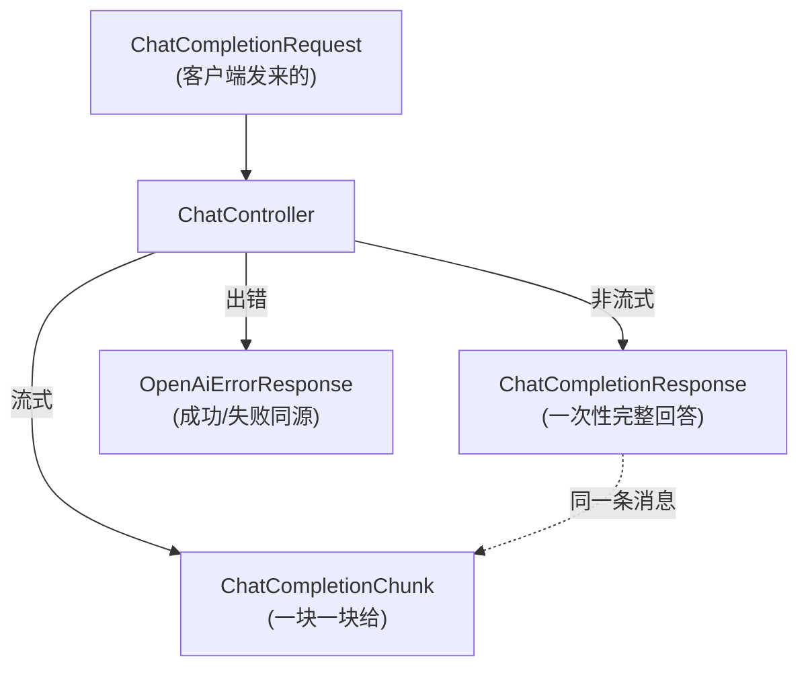
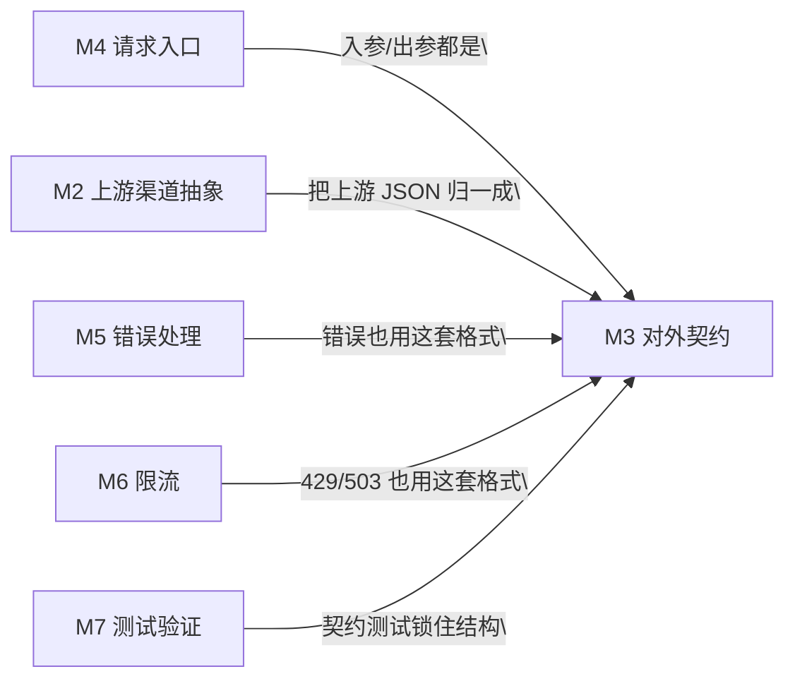

# M3 · 对外契约

> **本页速览**
> - 这 4 个 DTO 是**网关对外的承诺**。客户端只认它们,不认上游长什么样。
> - ★ 一句话铁律:**网关返回的结构由网关定义,不由上游定义。**
> - 路径 `/v1/chat/completions` 是 **OpenAI 官方路径** —— 换 baseUrl 就能用,客户端零改造。
> - `provider` 字段是**网关自己的扩展**,不是 OpenAI 协议的一部分 —— 标准 SDK 不发它也能用。
> - ★ 成功和失败的契约**必须同源**:要么都是我们的,要么都是标准的,不能一半一半。
>
> **导航**:[← 上一页:流程-渠道路由](../02-上游渠道抽象/流程-渠道路由.md) ｜ [下一页:契约-OpenAI兼容约定 →](契约-OpenAI兼容约定.md) ｜ [回到 README](../../README.md)

---

## 这个模块解决什么问题

### 场景:如果你想把 Agent 应用接到 DeepSeek 上

**没有网关时**,你的 LangChain4j / OpenAI SDK 长这样:

```java
OpenAiChatModel.builder()
    .baseUrl("https://api.deepseek.com")     // ← 写死了厂商
    .apiKey(System.getenv("DEEPSEEK_API_KEY"))
    .build();
```

**现在换一家厂商**,这行代码要改,`apiKey` 的环境变量名要改,重测。

**有了网关之后**:

```java
OpenAiChatModel.builder()
    .baseUrl("http://网关:8081")              // ← 只改这一行,而且以后不用再改
    .apiKey("网关自己的 key")
    .build();
```

> ★ **这就是"客户端零改造"**:客户端代码里**永远不出现厂商的名字**。
> 换厂商、加厂商、改模型 —— 全在网关的 YAML 里,客户端一行不动。

### 但要做到这一点,有一个硬前提

**网关的输入输出,必须长得和 OpenAI 一模一样。**

```text
客户端是 OpenAI SDK,它只会按 OpenAI 的协议说话:
  请求体:{ "model": ..., "messages": [...], "stream": ... }   ← snake_case
  响应体:{ "choices": [ { "finish_reason": ... } ] }          ← snake_case
  错误体:{ "error": { "message", "type", "code" } }           ← 固定的三层结构
  流式:  每个块一个 data: 行,结尾一个 data: [DONE]

★ 只要有一个字符对不上,SDK 就解析失败。
```

**所以本模块的 4 个 DTO,本质上是"把 OpenAI 协议用 Java 类型表达出来"。**

---

## 模块结构图



**注意 `ChatCompletionResponse` 和 `ChatCompletionChunk` 的关系**:

```text
它们不是"两种东西",是 ★ 同一条消息的两种交付形态
   ├─ 非流式:等模型写完整段,一把给你
   └─ 流式:  模型每写几个字就给你一块
→ 所以结构几乎一样,只有一个关键差别:
  message 变成了 delta(增量)
```

---

## 类清单

| 类 | 一句话职责 | 页 |
|---|---|---|
| —— | ★ **先读约定**:path / 命名 / 未知字段 / 成功失败同源 | [契约-OpenAI兼容约定](契约-OpenAI兼容约定.md) |
| `ChatCompletionRequest` | 网关**对外**的请求契约。含一个**非标准**的 `provider` 扩展字段 | [类-ChatCompletionRequest](类-ChatCompletionRequest.md) |
| `ChatCompletionResponse` | 非流式响应。★ **网关自己拼的,不是上游透传的** | [类-ChatCompletionResponse](类-ChatCompletionResponse.md) |
| `ChatCompletionChunk` | 流式响应块。★ `delta` 的 null 处理有一处容易踩的坑 | [类-ChatCompletionChunk](类-ChatCompletionChunk.md) |
| `OpenAiErrorResponse` | 错误契约。**为什么错误也要用 OpenAI 格式** | [类-OpenAiErrorResponse](类-OpenAiErrorResponse.md) |

---

## 与其他模块的交互



**它是一个"被依赖得最多"的模块** —— M2/M4/M5/M6 全都用它。
但它**不依赖任何模块**(除了 Jackson),因为它只是数据结构。

> ★ **规律**:一个纯数据模块如果开始 import 业务代码,说明它变成"有行为"了,
> 那时候它就不该叫 DTO 包了。

---

## 本模块值得学习的设计点

### 1. ★ "边界处的数据,先转成中立形态,再转成内部模型"

`OpenAiCompatibleProvider` 里没有直接

```java
.bodyToMono(ChatCompletionResponse.class)     // ❌ 本项目没这么做
```

而是

```java
.bodyToMono(JsonNode.class)                   // ✅ 先拿通用树
    .map(raw -> normalize(raw, requestedModel))   // ✅ 再自己翻译
```

**为什么**:

```text
直接映射的问题:
  ① 各家的字段有细微差异(有的有 reasoning_content,有的没有)
  ② 一旦直接映射,Jackson 会因为"未知字段/字段缺失"直接失败
     → 报错是 Jackson 的反序列化错误,看不出是"厂商差异"
  ③ 无法记录原始响应(排查时有价值)

两段式的好处:
  第一段:上游 JSON → JsonNode(什么结构都收得下)
  第二段:JsonNode → 我们的 DTO(每个字段怎么取、缺了怎么办,自己控制)
```

> **规律**:直接把外部数据映射成内部模型,等于
> **让外部格式决定了你的代码结构**。

### 2. ★ 命名策略不要改全局的

OpenAI 协议是 **snake_case**(`finish_reason` / `prompt_tokens`),
但 Java 惯例是 camelCase。

**最省事的做法**是改全局 Jackson 配置:

```java
// ❌ 看起来很香,实际是灾难
spring.jackson.property-naming-strategy=SNAKE_CASE
```

**为什么不能这么干**:

```text
全局生效 = 网关自己的所有接口也跟着变
   → /ping、将来的 /metrics、管理接口...全都变成 snake_case
   → 一个"为了对接一个外部协议"的改动,污染了整个项目的命名风格
```

**本项目的做法**:在需要的地方**逐个字段**钉:

```java
public record Usage(
        @JsonProperty("prompt_tokens") int promptTokens,
        @JsonProperty("completion_tokens") int completionTokens,
        @JsonProperty("total_tokens") int totalTokens
) { }
```

> ★ **规律**:「**为了适配一个外部系统,不要改全局约定**」。
> 局部显式,比全局隐式好 —— 因为局部的影响面是**你能看全的**。

### 3. ★★ 未知字段要"宽容地收下"

三个 DTO 上都挂了:

```java
@JsonIgnoreProperties(ignoreUnknown = true)
```

**为什么这是必须的**:

```text
真实的 OpenAI 客户端会带一堆我们不认识的字段:
   temperature / top_p / tools / tool_choice / stream_options
   / response_format / seed / logprobs ...

★ 少一个字段就 400,那不叫网关,那叫障碍。
```

**但同一个类里有一个"宽容"和"严格"的完美对照**,值得单独看 ——

```text
请求方向:客户端发来的 → @JsonIgnoreProperties(ignoreUnknown = true)  ← 宽容
                         因为客户端可能比我们新

Lua 脚本返回值:自己人给的 → 缺字段直接抛异常                      ← 严格
                         因为对不上说明"代码和脚本版本不一致",那是 bug

★ 合起来是一条完整原则:
  「多出来的字段可以容忍(附加是安全的),
     必需的字段绝不能缺席(缺失是危险的)。」
```

> 后者的完整案例(一个 `retryAfterMs` / `retryAfterMillis` 的字段名错位,
> 导致 `Retry-After: 0` 引发重试风暴) →
> [类-RedisTokenBucketLimiter](../06-限流/类-RedisTokenBucketLimiter.md)

### 4. ★ 成功和失败的契约必须同源

```text
✅ 都对:成功用我们的格式 + 失败也用我们的格式
❌ 一半一半:成功是 {"choices":[...]},失败是 Spring 默认的
            {"timestamp","status","path"}
```

**后者的实际后果**:

```text
客户端的 OpenAI SDK 是按 {"error":{"message","type","code"}} 解析错误的
   ↓
你返回 Spring 默认格式
   ↓
SDK 解析失败 → 用户看到的是"未知错误"
   ↓
★ 你精心写的错误提示("渠道 [x] 不存在,可用渠道: [a, b]")一个字都没传出去
```

> ★ **一句话判据**:
> **成功和失败的契约,要么都是我们的,要么都是标准的,不能一半一半。**

---

## 相关页

- 下一模块 → [M4 请求入口](../04-请求入口/_index.md)
- 谁把这些 DTO 翻译出来 → [类-OpenAiCompatibleProvider](../02-上游渠道抽象/类-OpenAiCompatibleProvider.md)
- 错误响应怎么产生 → [M5 错误处理](../05-错误处理/_index.md)
- 限流也用这套格式 → [类-RateLimitWebFilter](../06-限流/类-RateLimitWebFilter.md)

> **导航**:[← 上一页:流程-渠道路由](../02-上游渠道抽象/流程-渠道路由.md) ｜ [下一页:契约-OpenAI兼容约定 →](契约-OpenAI兼容约定.md) ｜ [回到 README](../../README.md)
