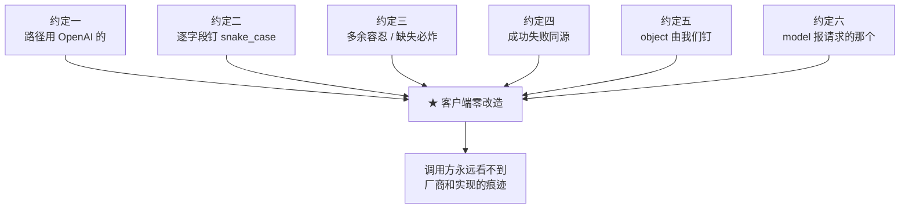

# 契约 · OpenAI 兼容约定

> **本页速览**
> - 这一页不讲某个类,讲**4 个 DTO 共同遵守的那几条规矩**。先读这页,再看具体的类。
> - ★ 路径 `/v1/chat/completions` 是 OpenAI 官方路径 —— **换 baseUrl 就能用,客户端零改造**。
> - 字段名是 **snake_case**,用 `@JsonProperty` **逐字段钉**,⚠️ 不改全局命名策略。
> - ★★ 一条完整原则:**多余的字段可以容忍(附加安全),必需的字段绝不能缺席(缺失危险)**。
> - ★ `provider` 字段**不是 OpenAI 协议的一部分** —— 标准 SDK 不发它,网关也不能因此报错。
>
> **导航**:[← 上一页:M3 模块首页](_index.md) ｜ [下一页:类-ChatCompletionRequest →](类-ChatCompletionRequest.md) ｜ [所属模块:M3 对外契约](_index.md)

---
## 为什么要有这一页

M3 的 4 个 DTO 里有几条规矩**不属于任何单个类**,属于"整个对外契约";分散在 4 个类页里各讲一遍会有 4 遍重复、还拼不出全貌,所以这一页把它们集中讲掉。

---
## 约定一:path 用 OpenAI 的官方路径

```java
@PostMapping("/v1/chat/completions")
```

**为什么必须是这个路径,不能自己起个名字**:

```text
任何 OpenAI SDK / LangChain4j,它的 baseUrl 是可配的
   ↓
它内部拼的路径是写死的 /v1/chat/completions
   ↓
★ 所以:把 baseUrl 从 https://api.deepseek.com
        改成 http://网关:8081
   → 其余代码一行都不用动
```

**如果自己起名叫 `/gateway/ask`**:

```text
客户端就必须写:baseUrl = "http://网关:8081/gateway",然后 SDK 拼出 /gateway/chat/completions ❌ 404
★ 或者更糟:客户端得自己包装一层,那就不是"零改造"了
```

> ★ **规律**:「**要替换一个东西,就要假装成它的样子**」。这在架构上叫**接口仿真(interface emulation)** —— 网关不需要和 OpenAI 有任何关系,只需要**在协议层面长得和它一模一样**。

---
## 约定二:字段名用 snake_case,但逐个字段钉

**矛盾在哪**:

```text
OpenAI 协议: snake_case   →  finish_reason / prompt_tokens / total_tokens
Java 惯例:   camelCase    →  finishReason / promptTokens / totalTokens
```

**最省事的解法**是改全局命名策略,但这**恰恰是坑**:

```java
// ❌ 看起来很香,实际是灾难
spring.jackson.property-naming-strategy=SNAKE_CASE
```

**为什么不能这么干**:

```text
全局生效 = 网关自己的所有接口也跟着变
   → /ping、/actuator/*、管理接口……全都变成 snake_case
   → ★ 一个"为了对接一个外部协议"的改动,污染了整个项目的命名风格
```

**本项目的做法** —— 在需要的地方**逐个字段**钉:

```java
public record Usage(
        @JsonProperty("prompt_tokens")     int promptTokens,
        @JsonProperty("completion_tokens") int completionTokens,
        @JsonProperty("total_tokens")      int totalTokens
) { }
```

**注意哪些字段需要钉、哪些不用**:

| 字段 | 需要 `@JsonProperty` 吗 | 为什么 |
|---|---|---|
| `id` / `object` / `created` / `model` | ❌ 不需要 | 本来就是全小写单词,**两种命名法一样** |
| `finishReason` | ✅ 需要 | 要变成 `finish_reason` |
| `promptTokens` | ✅ 需要 | 要变成 `prompt_tokens` |
| `choices` / `usage` / `message` / `delta` | ❌ 不需要 | 单词本身无大小写变化 |

> ★ **规律**:「**为了适配一个外部系统,不要改全局约定**」。局部显式优于全局隐式 —— 因为**局部的影响面是你能看全的**。

---
## ★★ 约定三:多余的能收,缺失的必炸(本页最重要)

这条原则在项目里有一组**完美的对照实验**,两个方向都出现了:

### 方向 A:来自外部的数据 → **宽容**

```java
@JsonIgnoreProperties(ignoreUnknown = true)
public record ChatCompletionRequest(...) { }
```

**为什么必须宽容**:

```text
真实的 OpenAI 客户端会带一堆我们不认识的字段:
   temperature / top_p / tools / tool_choice / stream_options
   / response_format / seed / logprobs / user ...

★ 少一个字段就 400,那不叫网关,那叫障碍。
```

**而且这条宽容还承担了一个额外职责** —— `provider` 是网关的**私有扩展字段**,标准 SDK 不认识它、不会发它。
靠"未知字段宽容 + 字段可空",**标准客户端不传 provider 也能正常工作**。详见 → [类-ChatCompletionRequest](类-ChatCompletionRequest.md)

### 方向 B:来自自己人的数据 → **严格**

`RedisTokenBucketLimiter` 里解析 Lua 脚本返回值时,三个字段**全部非空校验**,缺一个就抛异常。

**为什么对自己人反而更严**:

```text
脚本和 Java 代码是我们自己写的,它们"应该"永远对得上
   ↓
一旦对不上,说明:改了一边没改另一边,或者部署了旧的 jar
   ↓
★ 那是 bug,不是"配置问题" —— bug 必须炸出来,不能糊过去
```

### ★ 合起来是一条完整原则

> ```text
> 多出来的字段可以容忍(附加是安全的)
> 必需的字段绝不能缺席(缺失是危险的)
> ```

**为什么"缺失"特别危险**:因为**基本类型会静默兜底**。

```java
long retryAfterMillis;    // 字段缺失时 → 静默变成 0
boolean enabled;          // 字段缺失时 → 静默变成 false
```

```text
★ 而 0 和 false 在很多场景下都是"看起来正常"的值:
   retryAfterMillis = 0 → 发出 Retry-After: 0 → 语义是"立刻重试"
                          → 客户端真的立刻重试 → ★ 重试风暴
   enabled = false      → 功能悄悄关掉了,没有任何报错
换成装箱类型(Long / Boolean):
   字段缺失 → null → 我们才有机会拦下来
```

> ★ 这个坑在这个项目里**真的踩过**,而且是被一条断言"值应该落在 1~200 之间"抓住的 —— 不是被"断言不为 null"抓住的。
> 完整经过 → [类-RedisTokenBucketLimiter](../06-限流/类-RedisTokenBucketLimiter.md)

---
## ★ 约定四:成功和失败必须同源

```text
成功响应: {"choices": [...], "usage": {...}}
   ↓ 出错时
❌ Spring 默认格式: {"timestamp":..., "status":500, "path":"/v1/..."}
✅ 我们的格式:     {"error": {"message":..., "type":..., "code":...}}
```

**为什么 Spring 默认格式不行**:

```text
客户端的 OpenAI SDK 是按 {"error":{"message","type","code"}} 解析错误的
   ↓
你返回 Spring 默认格式
   ↓
SDK 解析失败 → 用户看到的是"未知错误"
   ↓
★ 你精心写的提示("渠道 [x] 不存在,可用渠道: [a, b]")一个字都没传出去
```

> ★ **判据一句话**:**成功和失败的契约,要么都是我们的,要么都是标准的,不能一半一半。**

**⚠️ 有一个地方差点破了这条规矩**,值得单独记住:

```text
WebFilter 里抛的异常,@RestControllerAdvice 管不到!
   因为 advice 的生效范围是「DispatcherHandler 调用的 handler 抛出的异常」
   而 filter 在 handler 之前,压根不在那条调用链上
   ↓
所以在 filter 里必须 ★ 手工写错误响应体
   ↓
否则:限流的 429 会变成 Spring 默认错误页,和别的错误格式不一致
```

> **规律**:「**你以为错误格式统一了,但总有一个入口从来没走过那条统一的路。**」详见 → [类-RateLimitWebFilter](../06-限流/类-RateLimitWebFilter.md)

---
## 约定五:`object` 字段由网关钉死,不由上游决定

```java
// 非流式
"object": "chat.completion"

// 流式
"object": "chat.completion.chunk"
```

**为什么这是"钉死"而不是"从上游读"**:

```text
它是协议约定的一部分 —— 告诉客户端"这是一个完整响应"还是"这是一个流式块"
   ↓
OpenAI SDK 就是靠这个值选解析路径的
   ↓
★ 上游万一拼错、或者用了一个变体,不该透传给客户端
   ↓
这是"我们对外承诺的结构",该由我们定义
```

> ★ **深层规律**:「**网关返回的结构由网关定义,不由上游定义**」。这条也是"why 不透传上游响应"的最短解释:
> ```text
> 透传 = 你的对外契约被上游单方面改写
>       上游加个字段,你的响应就变了
>       上游改个字段名,你的客户端就崩了
> ★ 你没有承诺过的东西,不该出现在你的响应里
> ```

---
## 约定六:`model` 报客户端请求的那个,不是上游实际用的

```text
我们请求:  "model": "deepseek-chat"
上游返回:  "model": "deepseek-flash"      ← ★ 实测出现过
```

**厂商内部会做模型别名 / 版本映射**,`deepseek-chat` 可能指向"当前最新版";**这不是 bug,是厂商的正常行为。**

**为什么要报我们请求的那个**:

```text
如果照抄上游:
   调用方看到"我请求的是 deepseek-chat,响应里怎么是 deepseek-flash?"
   → 开始怀疑网关搞错了渠道 / 被降级了
   → ★ 一个"看起来像故障"的现象,实际啥事没有 → 支持成本
```

> ★ **规律**:「**我们的响应应该反映我们的意图,而不是上游的实现细节**」。上游用了什么内部别名是它的事;对调用方来说,契约是"你要什么就得到什么"。

---
## 这几个约定串起来看



**这六条的共同目标只有一个**:

> ★ **让调用方永远不需要知道"背后是谁"。**
> 这也就是 M2 那条"在 `ChatController` 里搜 `DeepSeek`,零结果"的验收线,在**协议层面**的对应物。

---
## 相关页

- 具体的 4 个类 → [类-ChatCompletionRequest](类-ChatCompletionRequest.md) ｜
  [类-ChatCompletionResponse](类-ChatCompletionResponse.md) ｜
  [类-ChatCompletionChunk](类-ChatCompletionChunk.md) ｜
  [类-OpenAiErrorResponse](类-OpenAiErrorResponse.md)
- 谁负责把上游 JSON 翻译成这些约定 → [类-OpenAiCompatibleProvider](../02-上游渠道抽象/类-OpenAiCompatibleProvider.md)
- 谁在 filter 里手工写错误体 → [类-RateLimitWebFilter](../06-限流/类-RateLimitWebFilter.md)
- 这些约定怎么被测试锁住 → [测试-契约测试](../07-测试验证/测试-契约测试.md)

> **导航**:[← 上一页:M3 模块首页](_index.md) ｜ [下一页:类-ChatCompletionRequest →](类-ChatCompletionRequest.md) ｜ [所属模块:M3 对外契约](_index.md)
