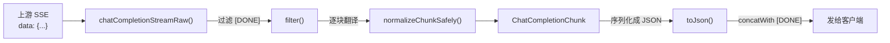

# ChatCompletionChunk

> **本页速览**
> - 流式响应契约。和 `ChatCompletionResponse` 是**同一条消息的两种交付形态**。
> - 唯一的**结构差别**:`message` 变成了 `delta`(增量)—— 每块只带"这一块新增的内容"。
> - ★★ 本页最值钱的一处:**`NON_NULL` 该加的地方加了,该不加的地方没加**,
>   而这个不对称是**刻意的、有协议依据的**。
> - `DONE_SENTINEL`(`[DONE]`)★ **不是数据块,连 JSON 都不是** —— 所以它不能被当 JSON 解析。
> - `object` 钉死为 `chat.completion.chunk` —— OpenAI SDK **靠这个值决定用哪条解析路径**。
>
> **导航**:[← 上一页:类-ChatCompletionResponse](类-ChatCompletionResponse.md) ｜ [下一页:类-OpenAiErrorResponse →](类-OpenAiErrorResponse.md) ｜ [所属模块:M3 对外契约](_index.md)

---

## 一句话职责

**定义流式回答里"每一块"的对外结构**,以及流结束的那个哨兵常量。

---

## 位置

```text
src/main/java/io/github/maixiaowen/gateway/dto/ChatCompletionChunk.java     (70 行)
```

---

## 为什么需要这个类

### 它和非流式响应是"同一条消息,两种交付"

```text
非流式:等模型写完整段 ────────────────→ 一把给你
流式:  模型每写几个字 ──→ 给你一块 ──→ 再一块 ──→ ... ──→ 完
```

所以**结构几乎一样**,只有一个关键差别:

| | 非流式 | 流式 |
|---|---|---|
| 装内容的字段 | `message` | ★ `delta` |
| 内容含义 | **完整答案** | ★ **这一块新增的部分** |
| 谁负责拼接 | 网关拼好了 | ★ **客户端自己拼** |

> ★ **"客户端要自己把它们拼起来才是完整回复"** —— 这是流式的本质:网关照原样转发增量,**拼接是客户端的事**。
> (网关不做拼接,因为一旦拼接就退化成非流式了 —— 那正是 [M1 的 pom.xml 坑①](../01-骨架与配置/配置-pom.xml.md) 说的"静默退化"。)

### 为什么必须自己定义,不能透传上游的块

**Javadoc 给的理由和 1c 一模一样,但多了一个实测证据**:

> *"上游的块里有厂商痕迹(比如**实测中 `model` 报的是 `deepseek-flash`**)。透传等于把「我们用了哪家模型、实际调了哪个版本」漏给客户端。**归一是每一层出口的责任,流式也不例外。**"*

> **规律**:「**流式不是归一的例外**」。有人会觉得"流式就是转发,不用翻译" —— 那正是厂商痕迹泄出去的地方。

---

## 关键属性

```java
public record ChatCompletionChunk(
        String id,
        String object,          // 固定 "chat.completion.chunk"
        long created,
        String model,           // ★ 报客户端请求的 model
        List<Choice> choices,
        @JsonInclude(NON_NULL)
        ChatCompletionResponse.Usage usage   // ★ G7：只出现在最后一帧
) { }
```

**和非流式响应比,`usage` 是可选字段**。

```text
为什么流式 usage 不能假设一定有?
   → token 数是"整段算完才知道"的
   → OpenAI 协议默认不在流里给,要请求方发
     stream_options: {"include_usage": true}
   → 部分第三方兼容实现根本不支持这个开关
```

**本项目的处理(G7)**:

```text
① 发往上游的请求由网关自己补 stream_options.include_usage=true
   （渠道配置 stream-usage，默认 true），不依赖客户端记得传
② 上游最后一块带的 usage 会被解析，写进对外块的 usage 字段
③ 如果上游始终没给（老实现 / 不支持的厂商）→ 按已累计内容估算 + 打 WARN
④ Anthropic 走另一条路：input_tokens 在 message_start，
   output_tokens 在 message_delta，Provider 内部拼成完整 usage
```

> ⚠️ **诚实标注**:流式计费**优先用上游真实 usage,估算只是兜底**。
> 估算对中文/英文/特殊 token 的偏差不可控,所以出现 WARN 的请求应当被当成
> "账可能不准"来对待,而不是当成正常路径。

### 两个常量

```java
public static final String OBJECT = "chat.completion.chunk";
public static final String DONE_SENTINEL = "[DONE]";
```

#### `OBJECT` —— 客户端靠它选解析路径

> *"`object` 钉死为 `chat.completion.chunk`:OpenAI 的流式协议就是靠这个值把'流式块'和'完整响应'区分开的,客户端(OpenAI SDK)会**据此选解析路径**。"*

```text
"chat.completion"        → 完整响应,SDK 走"一次性解析"路径
"chat.completion.chunk"  → 流式块,SDK 走"增量累加"路径
```

> ★ 这就是 [类-ChatCompletionResponse](类-ChatCompletionResponse.md) 里那条「**客户端会据此做判断的字段,所有权在网关手上**」的第二个实例。

#### ★ `DONE_SENTINEL` —— 它不是数据块,连 JSON 都不是

> *"**它不是一个数据块** —— 它压根不是 JSON,是协议约定的一串字面量。
> 客户端(OpenAI SDK)收到它才知道'流正常结束了,可以停止读取'。所以**它不能被塞进归一逻辑当 JSON 解析**,只能原样转发。"*

**这段注释解释了一个很容易踩的坑**:

```text
上游 SSE 的最后一行是:  data: [DONE]
   ↓
如果你把它当成一个数据块丢进 normalize():
   → objectMapper.readTree("[DONE]")   ❌ 解析失败(它不是合法 JSON)
   → ★ 整条流最后一刻报错 —— 前面 500 个字全白看了
```

**所以处理方式是"过滤掉,然后由 Controller 补上自己的"**:

```java
// OpenAiCompatibleProvider:把上游的摘掉
.filter(chunk -> !ChatCompletionChunk.DONE_SENTINEL.equals(chunk))

// ChatController:补上我们自己的
chunks.concatWith(Mono.just(ChatCompletionChunk.DONE_SENTINEL));
```

**为什么要"摘掉再补"这一趟,而不是直接透传**:

| 做法 | 问题 |
|---|---|
| 各 Provider 自己发 | 每个实现类都要记得发,漏一个 = 调用方永远等不到结束 |
| ★ **Controller 统一补** | 收尾是**协议层**的事,只有一个地方决定 |

> ★ **规律**:「**协议的收尾工作,应该由写响应的那一方统一负责**」。详见 → [类-ChatController](../04-请求入口/类-ChatController.md)

---

## ★★ 本页最值钱的一处:`NON_NULL` 的不对称

**先把两个嵌套类并排看**:

```java
public record Choice(
        int index,
        Delta delta,
        @JsonProperty("finish_reason") String finishReason   // ★ 这里【不加】NON_NULL
) { }

@JsonInclude(JsonInclude.Include.NON_NULL)
public record Delta(String role, String content) { }          // ★ 这里【加了】NON_NULL
```

**一个加了一个没加 —— 而这是刻意的。** 两段 Javadoc 分别解释了原因:

### `Delta` 为什么要加 `NON_NULL`

> *"OpenAI 的中间块长这样 `"delta":{"content":"你"}` —— **没有 role 字段**;而第一个块是 `"delta":{"role":"assistant","content":""}`。
> 如果让 `role=null` 也序列化出去,客户端会看到 `"role":null`,**严格的 SDK 会判为协议不符**。所以 null 字段直接不输出。"*

```text
第一块:  "delta": {"role":"assistant", "content":""}     ← role 有值
中间块:  "delta": {"content":"你"}                        ← ★ role 字段整个消失
                                                            而不是 "role": null
```

### `Choice.finishReason` 为什么**不能**加 `NON_NULL`

> *"只有最后一个块才非 null(stop / length)。中间的块全是 null —— 客户端靠它判断"流结束了"。
> 注意这里**不加 NON_NULL**:**OpenAI 协议里中间块的 `finish_reason` 就是显式的 null**。"*

```text
中间块:  "finish_reason": null      ← ★ 必须显式出现,不能省略
最后块:  "finish_reason": "stop"
```

### ★ 把两者放在一起看,规律就出来了

| | JSON 里"没有这个字段" | JSON 里"字段是 null" |
|---|---|---|
| `delta.role` | ★ **正确**(协议要求省略) | ❌ 协议不符 |
| `finish_reason` | ❌ **错误**(协议要求显式 null) | ★ **正确** |

> ★★ **同一份文档里的两个 null,一个必须省略,一个必须保留。**
> **而这两条规则都不是"我们觉得合理",是 OpenAI 协议规定的** —— 所以**不能凭直觉统一处理**。这类地方一旦想当然,表现是:
> ```text
> 客户端不报错,只是行为不对(比如流永远不结束、或者第一条消息丢了 role)
> ★ 又是"静默失效"
> ```

**怎么确认这种细节**:拿真实的 OpenAI 响应/SSE 抓包比对,或者读 SDK 的解析代码。**别猜 —— 猜错的成本是"看起来能用但不符合协议"。**

---

## 一个完整的流式序列(把这些细节串起来)

```text
data: {"id":"1","object":"chat.completion.chunk","model":"deepseek-chat",
       "choices":[{"index":0,"delta":{"role":"assistant","content":""},
                   "finish_reason":null}]}
                              ↑ Delta 有 role        ↑ 显式 null,必须出现

data: {...,"choices":[{"index":0,"delta":{"content":"你"},"finish_reason":null}]}
                                      ↑ Delta 没有 role(被 NON_NULL 省掉)

data: {...,"choices":[{"index":0,"delta":{"content":"好"},"finish_reason":null}]}

data: {...,"choices":[{"index":0,"delta":{},"finish_reason":"stop"}]}
                                                ↑ 最后一块 delta 是空的

data: [DONE]                                     ← ★ 不是 JSON,Controller 补的
```

**注意最后一块 `delta: {}`** —— 它没有任何内容,只为了承载 `finish_reason: "stop"`。

---

## 这个类在项目中的角色



**它既是"数据形状",也是"协议规则"的载体** —— `OBJECT` 和 `DONE_SENTINEL` 两个常量让"协议怎么规定的"变成了类型系统的一部分。

---

## 值得学习的点

### 1. "序列化的细节差异"值得写成注释

`NON_NULL` 是个注解,一行代码。但**为什么这里加、那里不加**,占了 15 行注释 —— **这个投入产出比极高**:

```text
不留注释的后果:
   后来的人看到"一个加了一个没加" → 认为是疏漏
   → "统一一下吧" → ★ 直接把流式协议改坏了
   → 而且这个改动在 code review 里看起来像是在"清理不一致"
```

> ★ **规律**:「**凡是"看起来像是做错了、其实是刻意的"写法,都必须留注释**」。否则它活不过下一个人。

### 2. `Delta` 的 `NON_NULL` 和 `ScriptResult` 的必填校验,是同一条原则的两面

回头对比两个类:

```text
Delta:        null 字段 → ★ 主动省略(推向客户端时)
ScriptResult: 字段缺失 → ★ 主动抛异常(从 Redis 收回来时)
```

**看起来相反,其实完全一致**:

```text
都是:★ 不允许"null 被静默当成一个值"
   ├─ 出方向:null 不输出(因为协议规定这里不该有)
   └─ 入方向:null 要炸(因为协议规定这里必须有)
```

> ★ 合起来就是 [契约-OpenAI兼容约定](契约-OpenAI兼容约定.md) 里那条:**「多余的可以容忍,必需的绝不能缺席」**。

### 3. `delta: {}` 这种"空对象"的意义

```text
最后一块的内容是空的,但 ★ 它必须发
   ↓
因为客户端等的是 finish_reason:"stop"
   ↓
★ "一块数据"的职责不只是"装内容",也可以是"装状态"
```

> **规律**:「**协议里的"块",不一定携带数据**」。把"块的职责"理解成"装内容",就会觉得最后一块是多余的。

---

## 相关页

- 非流式版本(结构只差一处) → [类-ChatCompletionResponse](类-ChatCompletionResponse.md)
- 约定总览(未知字段 / 命名) → [契约-OpenAI兼容约定](契约-OpenAI兼容约定.md)
- 谁翻译这些块 → [类-OpenAiCompatibleProvider-深入](../02-上游渠道抽象/类-OpenAiCompatibleProvider-深入.md)
- `[DONE]` 由谁补上 → [类-ChatController](../04-请求入口/类-ChatController.md)
- 流式端到端链路 → [02-flows/流式请求处理流程](../../02-flows/流式请求处理流程.md)

> **导航**:[← 上一页:类-ChatCompletionResponse](类-ChatCompletionResponse.md) ｜ [下一页:类-OpenAiErrorResponse →](类-OpenAiErrorResponse.md) ｜ [所属模块:M3 对外契约](_index.md)
