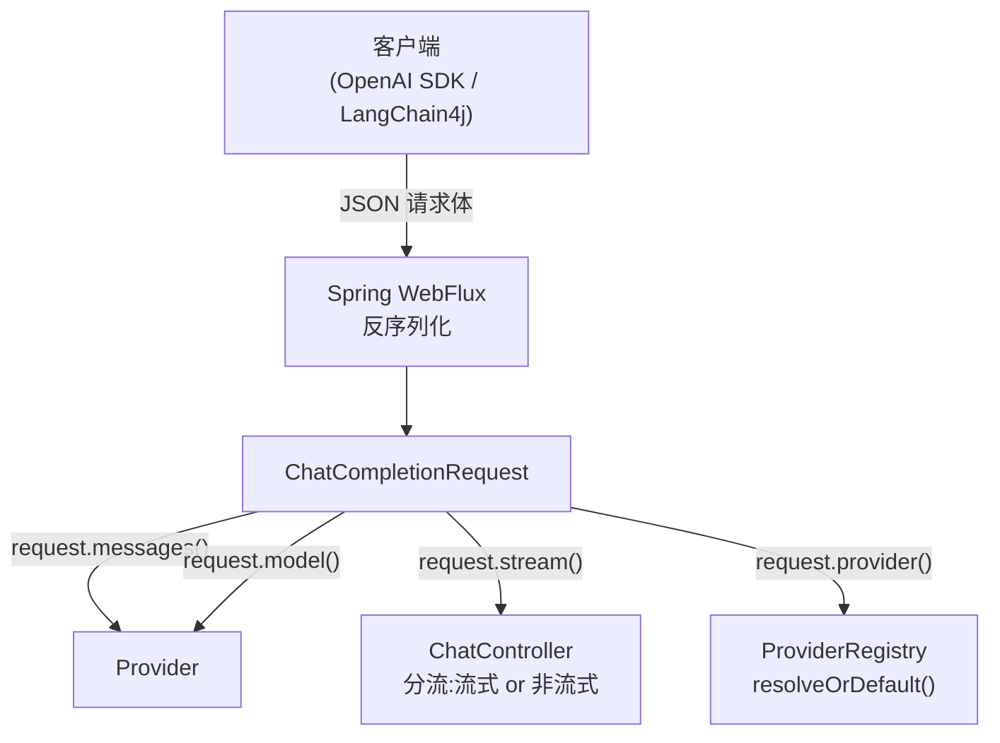

# ChatCompletionRequest

> **本页速览**
> - 网关**对外**的请求契约,网关收到的一切都反序列化成它。57 行,但有一半是注释。
> - 只有 4 个字段:`model` / `messages` / `stream` / `provider` —— **故意这么少**。
> - ★ `provider` **不是 OpenAI 协议里的字段,是网关的扩展** —— 而且它**必须可空**。
> - 为什么可空?因为「**没指定**」和「**指定了不存在**」是两种完全不同的事,见下。
> - ⚠️ 一个 3b **没做但要想清楚**的设计题:**为什么真实网关更主流的是"按 model 路由"**。
>
> **导航**:[← 上一页:契约-OpenAI兼容约定](契约-OpenAI兼容约定.md) ｜ [下一页:类-ChatCompletionResponse →](类-ChatCompletionResponse.md) ｜ [所属模块:M3 对外契约](_index.md)

---

## 一句话职责

**承载客户端发来的那一段 JSON**,并把它变成一个类型安全的 Java 对象。

---

## 位置

```text
src/main/java/com/example/gateway/dto/ChatCompletionRequest.java     (57 行)
```

> ⚠️ 注意包名是 **`dto`**,不是 `model`。项目里没有 `model` 包。

---

## 为什么需要这个类

**这份 Javadoc 里写着这个类存在的全部理由**:

> *"从这一刻起,**这个类就是网关对外的承诺**。客户端(项目一的 Agent、LangChain4j、任何 OpenAI SDK)只认这个结构。
> 以后接 DeepSeek 之外的厂商时,**改的是网关内部,改不到这里** —— 客户端零改造。"*

**展开成一条链**:

```text
如果没有这个类,直接收 JsonNode 或 Map:
   → 每个字段取值都要写 raw.path("model").asText(),拼错字段名不报错只拿到空串
   → "这个接口接受什么"这件事没有任何地方能表达
   → ★ 契约只存在于文档里,而文档会过期
```

**有了 record 之后**:字段名、类型、可空性,全部由 ★ 编译器 保证,接口的"形状"变成了可执行的代码,而不是一段会过期的说明。

---

## 关键属性

```java
@JsonIgnoreProperties(ignoreUnknown = true)
public record ChatCompletionRequest(
        String model,
        List<Message> messages,
        Boolean stream,
        String provider
) {
    @JsonIgnoreProperties(ignoreUnknown = true)
    public record Message(String role, String content) { }
}
```

| 字段 | 类型 | 对应 JSON | 说明 |
|---|---|---|---|
| `model` | `String` | `"model"` | 想用哪个模型。**注意它和"渠道"不是一回事** |
| `messages` | `List<Message>` | `"messages"` | 对话历史,每条 `{role, content}` |
| `stream` | `Boolean` | `"stream"` | `true` = 流式。**用包装类型,因为它是可空的** |
| `provider` | `String` | `"provider"` | ★ **网关扩展**:想走哪个渠道。**可空** |

### 两个"为什么用包装类型"的理由

```java
Boolean stream       // ← 不是 boolean
String  provider     // ← String 天然可空
```

**`stream` 为什么是 `Boolean`**:

```text
客户端可以不传这个字段(不传 = 不要流式)
   ↓ 用基本类型 boolean → 不传时静默变成 false,行为上"碰巧对了"
     ★ 但无法区分"客户端没传"和"客户端传了 false"
   ↓ 用 Boolean → 不传就是 null → 语义可见
```

**而代码里的用法正好体现了这一点**:

```java
if (Boolean.TRUE.equals(request.stream())) { ... }
//       ↑ 显式判 true,而不是 request.stream() 直接当条件
//         null 和 false 走同一条路,而且不会 NPE
```

> ★ **规律**:「**外部数据的字段,一律用包装类型**」。
> 基本类型会静默兜底成 0 / false,而那两个值在很多场景下都"看起来正常"。
> 这条和 [契约-OpenAI兼容约定](契约-OpenAI兼容约定.md) 的「缺失是危险的」是同一条。

---

## ★★ 重点:`provider` 字段的三个设计判断

### 判断一:它是**网关的扩展**,不是 OpenAI 协议的一部分

**这是一个刻意的、正确的选择**:

```text
标准 OpenAI SDK 不知道"渠道"这个概念 (对它们来说世界上只有一个 OpenAI)
   ↓ 所以它们 ★ 不会发这个字段
   ↓ 靠两件事让它们照样能用:
   ① @JsonIgnoreProperties(ignoreUnknown = true)  ← 多余的字段不报错
   ② provider 可空                              ← 缺了就走默认渠道
```

> ★ **这就是"扩展协议"的正确姿势**:**加字段不能让原有客户端失效**。否则你做的不是"兼容 OpenAI",而是"看起来像 OpenAI"。

### 判断二:那为什么还要有这个字段

**因为有些客户端确实需要指定**:

```text
① 项目一的 Agent 想让"便宜的批量任务"走便宜渠道、
   "需要长上下文的任务"走上下文长的渠道
② A/B 对比两家模型的效果
③ 合规要求:某类数据必须走境内渠道
```

**这些需求「用 model 表达不了」** —— 因为**同一个 model 名可能在多家都有**:

```text
"gpt-4" 这个名字:OpenAI 有、很多中转商也有
★ 光看 model,判断不出该走哪家
```

### ★★ 判断三:为什么必须可空(本页最重要)

```java
String provider      // ← 可空,而且刻意放在最后一位
```

**Java 源码注释里把这条讲透了**:

> *"`provider` 为什么可空 / 为什么在最后一位:见
> `ProviderRegistry#resolveOrDefault(String)` ——
> **'没指定'和'指定了不存在的'是两种完全不同的情况**,
> 前者正常回落、后者必须报错。**可空类型让这两种情况在类型层面就分得开。**"*

**展开成一个对照表**:

| 请求里的 `provider` | 类型上是什么 | 路由行为 | HTTP |
|---|---|---|---|
| 字段不存在 | `null` | 走默认渠道 | **200** |
| `""` / `"   "` | `String`,但空白 | 走默认渠道 | **200** |
| `"moonshot"`,存在 | `String` | 用 moonshot | **200** |
| `"gpt-4"`,不存在 | `String` | ★ **抛异常** | **400** |

> ★★ **「可空类型让这两种情况在类型层面就分得开」** —— 这句话是本页最值钱的一句。
>
> 如果 `provider` 是**必填**的:客户端不传 → 反序列化就 400 了,
>   → ★ 标准 OpenAI SDK 全部不可用 —— 直接毁掉"客户端零改造"这个核心卖点。
>
> 如果**用 `"deepseek"` 之类的默认值兜底**(而不是 null):客户端传了个不存在的渠道名 → 被悄悄改成默认值,
>   → ★ 静默降级,调用方永远不知道自己在用别的渠道(可能是合规事故)。
>
> **只有 `null` 才能表达"用户没有表达意图"** —— 而这是唯一可以替他决定的场景。
>
> 详见 → [流程-渠道路由](../02-上游渠道抽象/流程-渠道路由.md)

---

## ⚠️ 一个 3b 没做、但必须想清楚的设计题

**Javadoc 里主动写了一段"我为什么没做这个"**,这段比实现本身更值钱:

> *"真实网关里更主流的做法是**按 `model` 名字路由**(看到 `gpt-4` 就走 OpenAI、看到 `deepseek-chat` 就走 DeepSeek),因为客户端本来就只认识 model。
> 那样做需要额外一张「模型名 → 渠道」的映射表,而且**会有歧义**(多个渠道都有同名模型时怎么办?)。
> 3b 只做"显式指定 + 默认兜底"这一层,把"按 model 推断"留给 G6 的渠道路由一起做 —— **那时才有健康度和权重需要一起考虑。**"*

**把这两种方案摊开对比**:

| | 显式指定 `provider` | 按 `model` 推断 |
|---|---|---|
| 客户端要知道什么 | ★ 要知道"渠道"这个概念 | ✅ 只知道 model(它本来就知道) |
| 歧义 | 无 | ★ 同名模型在多渠道时无法判断 |
| 需要额外数据 | 无 | 一张"模型名 → 渠道"映射表 |
| 什么时候该用 | 需要精确控制、A/B、合规 | 想让客户端完全无感 |

> **规律**:「**一个"没做"的决定,如果写清楚了'为什么现在不做'和'什么时候做',它就不是技术债,而是一个排期**」。
> 这正是为什么这段注释值得读 —— 它展示的是**设计判断的过程**,而面试问的恰恰是这个过程,不是结论。

---

## 这个类在项目中的角色



**它是"入口的形状"** —— 所有请求都先变成它,才被处理。
注意它**不包含任何业务逻辑**,只是一个数据载体。

---

## 值得学习的点

### 1. `@JsonIgnoreProperties(ignoreUnknown = true)` 是网关的生存必需品

```java
@JsonIgnoreProperties(ignoreUnknown = true)
```

**这句话的分量**,看 Javadoc 里的原话:

> *"少一个字段就 400,那不叫网关,那叫障碍。"*

**而且它挂了两层**:外层 record 上有,**嵌套的 `Message` record 上也有**。

```java
public record Message(String role, String content) { }
//      ↑ 也有 @JsonIgnoreProperties(ignoreUnknown = true)
```

**为什么嵌套的也要挂**:

```text
客户端可能会发:{"role":"user","content":"...","name":"张三"}
                                                     ↑ 我们不认识
   ↓ 外层宽容只保护外层的字段,不保护 Message 内部的字段
   ↓ ★ 注解的作用域是"这一个 record",不会自动往下传递
```

> ★ **规律**:「**宽容要挂在每一个"外部数据进入的边界"上**」,不是在入口挂一次就够。

### 2. 类注释写"为什么这么设计",不写"这是什么"

对比两种写法:

```java
// ❌ 无信息量(重复类名已经说清的)
/** 聊天请求。 */

// ✅ 有信息量(本项目的写法)
/** 网关【对外】的请求契约(OpenAI 兼容)。
 *  为什么网关要定义"自己的"契约,而不是直接用上游的?……
 *  以后接 DeepSeek 之外的厂商时,改的是网关内部,改不到这里 —— 客户端零改造。 */
```

第二种回答的是**读者真正会问的问题**:"为什么要有这个东西?"

> **规律**:这里这个类 57 行里**注释占了一半多**。在一个 DTO 上花这么多注释,看起来"过度",但收益是:
> **下一个读代码的人不用去翻文档,也不会把 `provider` 字段删掉。**
> (删掉它不会编译不过,只会让路由功能悄悄失效。)

### 3. 字段顺序是刻意的

```java
String model, List<Message> messages, Boolean stream, String provider
//                                                 ↑ 标准字段在前
//                                                              ↑ 扩展字段在后
```

**为什么扩展字段放最后**:读代码时,**标准协议字段先入眼**,一眼能看出"这是个 OpenAI 兼容请求",然后才注意到"哦,还加了一个扩展"。

> **规律**:**布局本身也是一种文档** —— 不需要注释说明"哪些是标准的、哪些是我们加的"。

---

## 相关页

- 先读约定(未知字段、命名)→ [契约-OpenAI兼容约定](契约-OpenAI兼容约定.md)
- 谁消费它 → [类-ChatController](../04-请求入口/类-ChatController.md)
- `provider` 怎么被路由 → [流程-渠道路由](../02-上游渠道抽象/流程-渠道路由.md)
- 错误的 `provider` 怎么变 400 → [类-UnknownProviderException](../05-错误处理/类-UnknownProviderException.md)
- 响应长什么样 → [类-ChatCompletionResponse](类-ChatCompletionResponse.md)

> **导航**:[← 上一页:契约-OpenAI兼容约定](契约-OpenAI兼容约定.md) ｜ [下一页:类-ChatCompletionResponse →](类-ChatCompletionResponse.md) ｜ [所属模块:M3 对外契约](_index.md)
