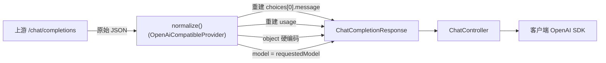

# ChatCompletionResponse

> **本页速览**
> - 非流式响应契约。★ **它是网关自己拼出来的,不是把上游响应原样透传。**
> - 结构是三层嵌套:`Response` → `Choice` → `Message`(+ 并列的 `Usage`)。
> - 只有 3 个字段名需要 `@JsonProperty` 钉成 snake_case,其余天然一致。
> - ★ `Usage` 是 **G7 Token 计费的原始数据** —— "上游就给了,不用自己数"。
> - 一句话记住:只有自己拼,才能把各家厂商的差异**挡在网关内部**。
>
> **导航**:[← 上一页:类-ChatCompletionRequest](类-ChatCompletionRequest.md) ｜ [下一页:类-ChatCompletionChunk →](类-ChatCompletionChunk.md) ｜ [所属模块:M3 对外契约](_index.md)

---

## 一句话职责

**定义非流式回答的对外结构** —— 客户端拿到的"完整答案"长这样。

---

## 位置

```text
src/main/java/com/example/gateway/dto/ChatCompletionResponse.java     (45 行)
```

---

## 为什么需要这个类

**Javadoc 里的那句话就是全部理由**:

> *"关键点:**这个对象是网关自己拼出来的,不是把上游响应原样透传。**
> 只有自己拼,才能把各家厂商的差异挡在网关内部 ——
> 上游是 DeepSeek、通义千问还是本地 Ollama,出口长这样。"*

**"透传"看起来更省事,但它会破坏三件事**:

| 透传的后果 | 具体是什么 |
|---|---|
| ★ **契约被上游单方面改写** | 上游加个字段,我们的响应就变了;上游改个字段名,客户端就崩 |
| ★ **厂商痕迹外泄** | 上游返回的 `model` 可能是 `deepseek-flash`,`reasoning_content` 是某家特有的 —— 等于告诉客户端"你用的是谁" |
| ★ **差异无法收敛** | 某家多一层嵌套、某家字段名不同 → 客户端要为每家写一套解析 |

> **规律**:「**归一要在每一层的出口做**」。
> 出口在哪,契约就在哪;契约在哪,翻译就得在哪。

---

## 关键属性

```java
public record ChatCompletionResponse(
        String id,
        String object,          // 固定 "chat.completion"
        long created,
        String model,
        List<Choice> choices,
        Usage usage
) { }
```

| 字段 | 类型 | 说明 |
|---|---|---|
| `id` | `String` | 本次调用 ID。**注意是由网关给的,不是上游的** |
| `object` | `String` | ★ 固定 `"chat.completion"`,**硬编码,不取上游的** |
| `created` | `long` | Unix 时间戳(秒) |
| `model` | `String` | ★ **报客户端请求的模型名**,不是上游实际用的 |
| `choices` | `List<Choice>` | 通常只有 1 个元素 |
| `usage` | `Usage` | Token 用量 |

### 为什么 `object` 要硬编码

```text
它是协议约定的一部分 —— 告诉客户端"这是一个完整响应"
   ↓
OpenAI SDK 靠它选解析路径
   ↓
★ 上游万一拼错、或者用了一个变体,不该透传给客户端
```

> 对应的流式版本是 `"chat.completion.chunk"` —— **同一个字段,两个值,就是"完整"和"分块"的分界线**。
> 详见 → [类-ChatCompletionChunk](类-ChatCompletionChunk.md)

### `model` 为什么报"请求的那个"

```text
我们请求:  "deepseek-chat"
上游返回:  "deepseek-flash"      ← ★ 实测出现过(厂商内部别名映射)

如果照抄上游:
   调用方会怀疑"网关是不是搞错了渠道 / 被降级了"
   → 一个"看起来像故障"的现象,实际啥事没有 → 支持成本
```

> ★ **规律**:「**我们的响应应该反映我们的意图,而不是上游的实现细节**」。

---

## 嵌套结构:三层 + 一个并列

```java
public record Choice(
        int index,
        Message message,
        @JsonProperty("finish_reason") String finishReason
) { }

public record Message(String role, String content) { }

public record Usage(
        @JsonProperty("prompt_tokens")     int promptTokens,
        @JsonProperty("completion_tokens") int completionTokens,
        @JsonProperty("total_tokens")      int totalTokens
) { }
```

**画成 JSON 看层次**:

```json
{
  "id": "...",  "object": "chat.completion",  "created": 1730000000,
  "model": "deepseek-chat",
  "choices": [                          ← 数组(通常 1 个)
    {
      "index": 0,
      "message": { "role": "assistant", "content": "你好" },   ← 答案在这
      "finish_reason": "stop"           ← ★ 需要钉 snake_case
    }
  ],
  "usage": {                            ← 和 choices 并列
    "prompt_tokens": 12,                ← ★ 三个都要钉
    "completion_tokens": 5,
    "total_tokens": 17
  }
}
```

### 哪些字段需要 `@JsonProperty`,哪些不用

| 字段 | 要钉吗 | 钉成什么 |
|---|---|---|
| `id` / `object` / `created` / `model` | ❌ | 全是无大小写变化的单词 |
| `choices` / `usage` / `index` / `message` | ❌ | 同上 |
| `finishReason` | ✅ | `finish_reason` |
| `promptTokens` / `completionTokens` / `totalTokens` | ✅ | `prompt_tokens` 等 |
| `role` / `content` | ❌ | 单词本身 |

> ★ **只钉真正需要的那几个**。为什么不用全局命名策略?见
> → [契约-OpenAI兼容约定](契约-OpenAI兼容约定.md) 的「约定二」

### `choices` 是数组,虽然通常只有 1 个

```text
OpenAI 协议里它是数组,因为 n 参数可以要多个候选回答
   ↓
本项目支持 n 吗? → ❌ 不支持(也没在请求契约里暴露这个字段)
   ↓
那为什么还保留数组?
   ★ 因为客户端 SDK 是按数组解析的 —— 改成对象会让 SDK 直接崩
```

> ★ **规律**:「**兼容协议时,数组就是数组,即使你永远只放一个元素**」。
> 协议的形状不是"你觉得合理的形状"。

---

## `Usage` —— G7 计费的原始数据

```java
/** token 用量。G7 计量直接吃这个结构 —— 计费的原始数据上游就给了,不用自己数 */
public record Usage(
        @JsonProperty("prompt_tokens")     int promptTokens,
        @JsonProperty("completion_tokens") int completionTokens,
        @JsonProperty("total_tokens")      int totalTokens
) { }
```

**这段注释里有一条值得记住的工程判断**:

> ★ **"计费的原始数据,上游就给了,不用自己数。"**

**如果非要自己数会怎样**:

```text
自己数 token 需要:
   ① 引入对应厂商的分词器(tiktoken / 各家的 tokenizer)
   ② 每个模型不同版本的分词器都不同 → 一个庞大的依赖 + 持续的维护
   ③ ★ 而且数出来是"估算值",可能和厂商实际计费不一致
   ↓
★ 账单是厂商开的,当然以厂商的数为准 —— 自己数一遍是为了"对账",不是为了"代替"
```

> **规律**:「**能拿到的权威数据,不要去推算同类数据**」。
> 推算值的唯一价值是**和权威值对不上时报警** —— 那是 G7 之后可以考虑的事。

---

## 这个类在项目中的角色



**它是"出口的形状"** —— 所有非流式回答都变成它,才发给客户端。

---

## 值得学习的点

### 1. "自己拼"而不是"透传",是一个需要付出成本的决定

**透传的成本是 0,自己拼的成本是这一整个 `normalize()` 方法。**
那为什么还要自己拼?

```text
透传省下的成本,会以三种形式还给维护者:
   ① 上游改字段 → 你的客户端崩(但你什么都没改)★ 最贵的一种
   ② 厂商痕迹外泄 → "客户端零改造"这个卖点直接失效
   ③ 想加一家协议略有差异的厂商 → 只能在客户端做兼容

自己拼的成本只在 ★ 一开始付一次,之后每家新厂商都复用同一份代码。
```

> **规律**:「**在系统边界上多做一步归一,收益是复利的**」。
> 边界处偷的懒,会以 N 倍还给每一个下游。

### 2. `object` 硬编码这件事,体现的是"谁拥有契约"

```java
"object": "chat.completion"     // ← 写死在我们的代码里
```

**一个反直觉的点**:这个值**本来可以从上游拿到**,而且上游返回的一般也对。

**但"一般也对"不等于"一定对"**:

```text
我们要的是"客户端能正确解析"
   ↓
这件事只取决于 ★ 我们返回什么,不取决于上游返回什么
   ↓
所以这个值的所有权必须在我们手上
   ↓
★ 能拿到 ≠ 应该用
```

> ★ **规律**:「**凡是'客户端会据此做判断'的字段,所有权都该在网关手上**」。
> 同类字段:`object` / `model` / 错误 `code` / `Retry-After`。

### 3. 45 行里注释占了 20 行,这是合理的

**Javadoc 里那两句合起来回答了读者最可能问的两个问题**:

```text
"为什么不直接透传?"      → 只有自己拼,才能把差异挡在内部
"字段名为什么这么写?"    → OpenAI 协议就是 snake_case,
                            不要为此改全局命名策略(那会影响所有接口)
```

第二个尤其重要 —— **不留这句话,后来的人很可能"顺手"把全局配置改成
`SNAKE_CASE`,然后网关自己的所有接口都跟着变了**,而这个改动在 code review 里
看起来还挺"统一规范"。

> **规律**:「**阻止一个未来的错误决定,也是注释的职责**」。

---

## 相关页

- 约定的总说明 → [契约-OpenAI兼容约定](契约-OpenAI兼容约定.md)
- 流式版本(结构几乎一样,只有一处关键差别) → [类-ChatCompletionChunk](类-ChatCompletionChunk.md)
- 谁把它拼出来 → [类-OpenAiCompatibleProvider](../02-上游渠道抽象/类-OpenAiCompatibleProvider.md)
- 出错时的结构 → [类-OpenAiErrorResponse](类-OpenAiErrorResponse.md)

> **导航**:[← 上一页:类-ChatCompletionRequest](类-ChatCompletionRequest.md) ｜ [下一页:类-ChatCompletionChunk →](类-ChatCompletionChunk.md) ｜ [所属模块:M3 对外契约](_index.md)
