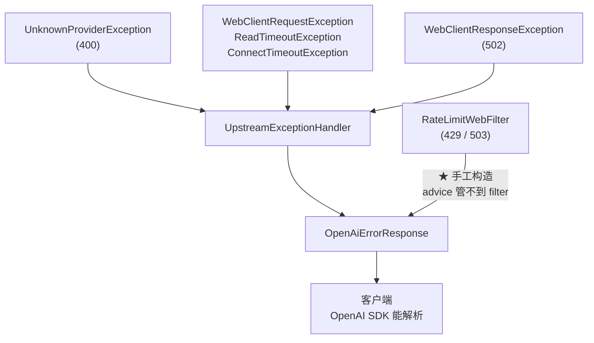

# OpenAiErrorResponse

> **本页速览**
> - **只有 29 行,是全项目最短的契约类**,但它守住的是"客户端能不能读懂错误"。
> - ★ 唯一的理由:**OpenAI SDK 是按 `{"error":{...}}` 解析错误的** —— 给它 Spring 默认格式,它直接解析失败。
> - 结构固定三层:`error.message` / `error.type` / `error.code`。
> - ★ `code` 是**机器可读**的 —— G5 的渠道转移要靠它判断"这次失败该不该换渠道重试"。
> - ⚠️ 两个诚实标注:`requestId` 目前**恒为 null**;400 的错误也被标成了 `type: upstream_error`。
>
> **导航**:[← 上一页:类-ChatCompletionChunk](类-ChatCompletionChunk.md) ｜ [下一页:M4 请求入口 →](../04-请求入口/_index.md) ｜ [所属模块:M3 对外契约](_index.md)

---

## 一句话职责

**定义网关出错时的对外结构**,让客户端 SDK 能用同一套代码解析成功和失败。

---

## 位置

```text
src/main/java/io/github/maixiaowen/gateway/dto/OpenAiErrorResponse.java     (29 行)
```

---

## 为什么需要这个类

> *"为什么错误也要用 OpenAI 的格式? 1c 定了「对外就是 OpenAI 协议」。那出错时也必须一致 ——
> 客户端的 OpenAI SDK 是按 `{"error":{"message","type","code"}}` 解析错误的,
> 你返回 Spring 默认的 `{"timestamp","status","path"}`,**SDK 直接解析失败,用户看到的是"未知错误"而不是你的提示**。
> 一句判据:**成功和失败的契约,要么都是我们的,要么都是标准的,不能一半一半。**"*

### 用一张图看"一半一半"有多糟

```text
✅ 一致的情况:
   客户端:  try { 解析 choices } catch (e) { 读 error.message 显示给用户 }
   → 用户看到:"渠道 [gpt-4] 不存在。当前可用渠道:[deepseek, moonshot]"
   ★ 一眼就知道自己参数写错了

❌ 一半一半的情况:
   网关返回: {"timestamp":"...","status":400,"path":"/v1/chat/completions"}
   → SDK 找不到 error 字段 → 抛"无法解析的响应"
   → 用户看到:"未知错误" 或 "Unexpected response format"
   ★ 你精心写的错误提示一个字都没传出去
```

> ★ **规律**:「**错误响应的质量,决定了"出问题时排查要多久"**」。而它比成功响应更值得投入 —— 因为**成功路径的信息量是零**(大家都一样),**错误路径才是区分"好网关"和"能跑的网关"的地方**。

---

## 关键属性

```java
@JsonInclude(JsonInclude.Include.NON_NULL)
public record OpenAiErrorResponse(ErrorBody error) {

    @JsonInclude(JsonInclude.Include.NON_NULL)
    public record ErrorBody(
            String message,
            String type,
            String code,
            String requestId
    ) { }
}
```

**注意:外层包了一层 `error`** —— 这是 OpenAI 的错误格式,不是我们随便设计的:

```json
{
  "error": {                      ← ★ 必须这一层
    "message": "渠道 [gpt-4] 不存在。当前可用渠道：[deepseek, moonshot]",
    "type": "upstream_error",
    "code": "unknown_provider"
  }
}
```

| 字段 | 给谁看 | 说明 |
|---|---|---|
| `message` | ★ **人**(最终用户 / 开发者的日志) | 可读的描述,**要包含排查所需的信息** |
| `type` | 半机器 | 错误大类,OpenAI 用 `invalid_request_error` / `server_error` 这类 |
| `code` | ★ **机器**(程序逻辑) | 稳定不变的标识符,程序据此做分支 |
| `requestId` | 人 + 机器 | 用来和服务端日志对上号 |

### ★ 为什么 `message` 和 `code` 要分开

```text
message: "渠道 [gpt-4] 不存在。当前可用渠道：[deepseek, moonshot]"
   → ★ 这句话随时可能改(改措辞、加信息、翻译成英文)
   → 客户端 ★ 不能用字符串匹配来做逻辑判断

code: "unknown_provider"
   → ★ 永远不变(改了就是破坏性变更)
   → 客户端可以放心 if (code.equals("unknown_provider"))
```

> ★ **规律**:「**给人看的字段可以随时改,给机器看的字段碰不得**」。把两者混成一个字段,等于每次改文案都是一次潜在的破坏性变更。

### `code` 的实际用途(不只是给客户端)

> *"机器可读的错误码,**G5 的渠道转移就靠它判断"这次失败该不该换渠道重试"**"*

| `code` | HTTP | 产生它的地方 | 含义 |
|---|---|---|---|
| `unknown_provider` | **400** | `UpstreamExceptionHandler` | 请求的渠道不存在 |
| `upstream_read_timeout` | **504** | 同上 | 上游响应超时 |
| `upstream_connect_timeout` | **504** | 同上 | 上游连接超时 |
| `upstream_unreachable` | **502** | 同上 | 连不上(DNS/拒绝/TLS) |
| `upstream_http_error` | **502** | 同上 | 上游回了错误状态码 |
| `rate_limit_exceeded` | **429** | `RateLimitWebFilter` | 被限流(**调用方的问题**) |
| `rate_limiter_unavailable` | **503** | 同上 | 限流器坏了(**我们的问题**) |

> ★ 注意最后两个都是"限流"相关,但**码不同、状态码不同**。原因见 → [类-RateLimitDecision](../06-限流/类-RateLimitDecision.md):
> **429 客户端该退避重试,503 重试一万次也没用** —— 混用会把所有人指错方向。

---

## `@JsonInclude(NON_NULL)` —— 为什么加在这里

```java
@JsonInclude(JsonInclude.Include.NON_NULL)
public record OpenAiErrorResponse(ErrorBody error) { ... }
```

```json
// 不挂 NON_NULL(会输出一堆 null)
{"error":{"message":"...","type":"upstream_error","code":"unknown_provider","requestId":null}}

// 挂了 NON_NULL(清爽,而且不撒谎)
{"error":{"message":"...","type":"upstream_error","code":"unknown_provider"}}
```

**为什么"不撒谎"很重要**:

```text
"requestId": null  → 客户端会认为"这个字段存在但值是空的"
                       → 可能据此认为"网关的 requestId 功能坏了"

字段整个不存在    → 客户端会认为"这个版本还没有这个字段"
                       → ★ 这是更准确的表达
```

> ★ **规律**:「**"我没有这个字段"和"这个字段的值是 null"是两件事**」。
> 这一点在 [类-ChatCompletionChunk](类-ChatCompletionChunk.md) 里有一个**反向的例子**(`finish_reason` 必须显式 null)—— 对比着看更清楚。

---

## ⚠️ 两个诚实标注(别在面试里说错)

### 标注一:`requestId` 目前恒为 null

```java
// UpstreamExceptionHandler
new OpenAiErrorResponse.ErrorBody(message, "upstream_error", code, null)
//                                                            ↑ ★ 永远是 null

// RateLimitWebFilter
new OpenAiErrorResponse.ErrorBody(message, type, code, null)
//                                                    ↑ ★ 也是 null
```

**所以 `requestId` 是"字段留好了、但还没接上"的状态。**

**要接上它需要什么**:一个贯穿全链路的请求 ID(MDC / Reactor Context),在入口生成、在日志里打、在错误响应里带出去。**这是一件独立的工作,目前没做。**

> ★ 但因为挂了 `NON_NULL`,**这个缺失不会污染响应** —— 客户端完全看不到这个字段,不会以为是"网关给了个空 ID"。**这正是 `NON_NULL` 的额外收益:让"没实现"和"实现成了空"看起来不一样。**

### 标注二:400 的错误也被标成了 `type: upstream_error`

```java
private ResponseEntity<OpenAiErrorResponse> build(HttpStatus status, String message, String code) {
    return ResponseEntity.status(status)
            .body(new OpenAiErrorResponse(
                    new OpenAiErrorResponse.ErrorBody(message, "upstream_error", code, null)));
    //                                                ↑ ★ 四种情况都用同一个 type
}
```

**于是 400(渠道不存在)也带着 `type: "upstream_error"`** —— 而它压根没轮到上游。

```text
code 区分得很清楚:unknown_provider vs upstream_read_timeout ✅
type 却都是 upstream_error                              ⚠️

按 OpenAI 的惯例:
   unknown_provider   → type 应该是 "invalid_request_error"
   upstream_*         → type 应该是 "server_error" 或 "api_error"
```

**为什么可以接受**:因为**真正被程序消费的是 `code`**(稳定、精确),`type` 在本项目里没有被任何逻辑读取。

**但为什么还要写出来**:因为**面试时被问到"你的错误分类做得怎么样",说"code 分得很细,type 目前是统一的、是我知道的一个待改进点"**远比"我的错误分类很完善"更可信。

> ★ **规律**:「**知道自己哪里没做好,是"做过"和"看过"的分界线**」。

---

## 这个类在项目中的角色



**★ 注意有两条路径到达它**:

```text
路径 A:异常 → @RestControllerAdvice 兜住 → 构造错误体
路径 B:限流 filter → ★ 手工构造错误体(因为 advice 管不到 filter)

两条路径的存在,本身就是"成功失败必须同源"这条纪律的代价 ——
你需要 ★ 在所有出口都记得用它。
```

> 为什么 advice 管不到 filter → [类-RateLimitWebFilter](../06-限流/类-RateLimitWebFilter.md)

---

## 值得学习的点

### 1. 29 行守住的东西,比很多大类都关键

**这个类没有一行逻辑** —— 只有字段和一个注解。但它决定了:

```text
✅ 客户端能不能读懂错误(能 / 看到"未知错误")
✅ 出问题时排查要多久(5 秒 / 半天)
✅ G5 能不能做渠道转移(有 code 可判 / 只能靠字符串匹配 message)
```

> ★ **规律**:「**契约类的价值不在它有多少代码,在它约束了多少下游**」。

### 2. "成功和失败同源"是一条容易被违反的纪律

**为什么容易被违反**:因为成功路径和失败路径**通常写在不同的地方**:

```text
成功:Controller 正常 return        → 走我们的 DTO ✅
失败 A:抛异常                     → 走 @RestControllerAdvice ✅(如果配了)
失败 B:WebFilter 里拦截           → ★ advice 管不到,容易漏
失败 C:Spring 内部的 404 / 405    → ★ 也是 Spring 默认格式,没人管
```

**本项目的状态**:A 和 B 都覆盖了,**C 没有**。

```text
比如:请求一个不存在的路径 /v1/wrong
   → 得到 Spring 默认的 {"timestamp","status":404,"path":...}
   ★ 和我们的错误格式不一致

这是一个诚实的遗留问题:要修它需要自定义 ErrorWebExceptionHandler,
优先级不高(客户端不会去访问不存在的路径)。
```

> ★ **规律**:「**"统一"这件事,难在穷举出口,不难在写代码**」。所以判断一个项目的错误处理好不好,问一句"**一共几条出口路径?都覆盖了吗?**"

### 3. 用注解而不是代码来表达"不输出 null"

```java
@JsonInclude(JsonInclude.Include.NON_NULL)     // ← 声明式
```

```java
// ❌ 命令式:每个构造点都要记得判
ErrorBody body = new ErrorBody(msg, type, code,
        requestId == null ? null : requestId);   // 没意义,还是 null
// 或者更糟:写一堆 if 判断哪些字段该放进 Map
```

**注解的好处**:**规则只写一次,对所有实例生效**,而且**不会因为新加了一个构造点就漏掉**。

> ★ **规律**:「**横切规则用声明(注解/配置)表达,不用命令(代码)表达**」。这和 M1 用 `WebClientCustomizer` 而不是在每个 Provider 里配超时,是**同一条思路**。

---

## 相关页

- 约定总览(成功失败同源) → [契约-OpenAI兼容约定](契约-OpenAI兼容约定.md)
- 谁产生这些错误 → [M5 错误处理](../05-错误处理/_index.md)
- 限流那两条手工构造的错误体 → [类-RateLimitWebFilter](../06-限流/类-RateLimitWebFilter.md)
- 为什么 429 和 503 要分开 → [类-RateLimitDecision](../06-限流/类-RateLimitDecision.md)

> **导航**:[← 上一页:类-ChatCompletionChunk](类-ChatCompletionChunk.md) ｜ [下一页:M4 请求入口 →](../04-请求入口/_index.md) ｜ [所属模块:M3 对外契约](_index.md)
