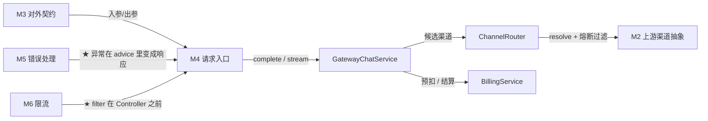

# M4 · 请求入口

> **本页速览**
> - 只有 **2 个 Controller、总共 188 行**,但"客户端零改造"这个承诺从这里兑现。
> - ★ `ChatController` 是全项目**最薄的类**之一 —— 路由只有一行,而且是刻意压到一行的。
> - ⚠️ 本模块有一个**被删掉的类**:`AskController`。它的删除理由比它的存在更有价值。
> - ★ 有一行代码看起来多余但**必须显式写**:钉死 `Content-Type`,否则流式直接 500。
> - `PingController` 只有 45 行,却是**面试答"为什么用 WebFlux"时的实证**。
>
> **导航**:[← 上一页:类-OpenAiErrorResponse](../03-对外契约/类-OpenAiErrorResponse.md) ｜ [下一页:类-ChatController →](类-ChatController.md) ｜ [回到 README](../../README.md)

---

## 这个模块解决什么问题

### 它的职责只有一个:把 HTTP 请求交给正确的人

```text
收到 POST /v1/chat/completions
   ↓
① 反序列化成 ChatCompletionRequest     ← M3 的契约
② 决定走哪个渠道                        ← 交给 M2 的注册表
③ 判断走流式还是非流式                  ← 本模块唯一的判断
④ 把结果写回 HTTP 响应                  ← 出口在这
```

**注意 ② 和 ③ 的分工**:

| 判断 | 在哪做 | 为什么 |
|---|---|---|
| 走哪个渠道 | ★ **不在 Controller** | 交给 `ProviderRegistry` —— 连同"渠道不存在怎么办"那个设计决策 |
| 走流式还是非流式 | ★ **在 Controller** | 因为只有这一层知道"要给客户端写什么格式的响应" |

> ★ **规律**:「**Controller 只该做"HTTP 层"的判断**」。
> 一旦在 Controller 里出现业务分支(哪个渠道、哪家厂商、什么策略),
> 就说明那段逻辑**放错层了**。

### "客户端零改造"在这里兑现

```text
路径      /v1/chat/completions   ← OpenAI 官方路径
入参      ChatCompletionRequest  ← OpenAI 兼容结构
出参      ChatCompletionResponse / Chunk
错误      OpenAiErrorResponse
   ↓
★ 客户端把 baseUrl 从 https://api.deepseek.com
  改成 http://网关:8081  →  其余代码一行不动
```

---

## 模块结构图

```mermaid
graph TD
    C["客户端"] -->|"POST /v1/chat/completions"| CC["ChatController"]
    C -->|"GET /ping"| PC["PingController"]
    CC -->|"request.provider()"| REG["ProviderRegistry<br/>(M2)"]
    CC -->|"stream=false"| A["provider.chatCompletion()"]
    CC -->|"stream=true"| B["provider.chatCompletionStream()"]
    B -->|"map + concatWith [DONE]"| CC
    PC --> M["Mono.just(\"pong\")"]
```

**两个 Controller 的对比**:

| | `ChatController` | `PingController` |
|---|---|---|
| 行数 | 143 | 45 |
| 端点 | `/v1/chat/completions` | `/ping` |
| 有业务逻辑吗 | 有一点(流式/非流式分流) | ★ **完全没有** |
| 被限流吗 | ✅ 是(在 filter 的白名单里) | ❌ **否**(刻意,见下) |
| 作用 | 兑现对外契约 | ★ **证明"活着",以及证明用的是 WebFlux** |

---

## 类清单

| 类 | 一句话职责 | 页 |
|---|---|---|
| `ChatController` | 唯一正式端点。★ 路由一行、分流一行、出口一处 | [类-ChatController](类-ChatController.md) |
| `PingController` | 健康探针。★ 45 行里藏着 WebFlux 的核心心智模型 | [类-PingController](类-PingController.md) |

### ⚠️ 一个"不在这里"的类:`AskController`(已删除)

**G3b 删了它。而这次删除的理由,比这两个类的存在更值得读。**

| 层面 | 理由 |
|---|---|
| **架构上** | 它调的是 `chat(String)` —— 一个**不在 SPI 上**的便利方法,所以它只能指名道姓地要具体实现类。★ **它是 3b 之后唯一还在认识厂商的 Controller** —— 留着就等于留着一条"换厂商要改的地方" |
| **安全上(更重要)** | 它**没有任何鉴权、走默认渠道、且不产生业务日志**。★ 一个能被任何人扫到、**白嫖大模型额度的接口** |

> ★★ Javadoc 里那句话值得原样记住:
> **"它不会报错、不会告警,只会在月底的账单上体现出来。"**
>
> 顺带,`chat(String)` 也一起删了 —— 它失去了唯一的调用方。
> **"死代码不会自己消失,它只会变成下一个人不敢删的东西。"**

**为什么这段值得单独讲**:

```text
面试时被问"你做过什么安全相关的事":
   说"我加了 JWT 鉴权"       → 可能是在背方案
   说"我删了一个没有鉴权的测试接口,因为它会被人白嫖额度,
       而且我保留了删除的理由" → ★ 这是真实的判断
```

---

## 与其他模块的交互



> ⚠️ G5/G6 之后,Controller **不再直接调用 `resolveOrDefault`**:
> 路由、重试、转移、结算都在 `GatewayChatService` 里,Controller 只负责 HTTP 层。

**★ 注意 M6 那条箭头的位置**:

```text
请求 → [限流 filter] → [路由匹配] → [JSON 反序列化] → ChatController
        ↑ M6 在这                                     ↑ M4 在这

限流跑在最前面,所以被限流的请求 ★ 根本到不了 Controller
→ 路由匹配、反序列化这些"活"全省下了
```

> 为什么限流必须放在 filter 而不是 Controller 里 →
> [类-RateLimitWebFilter](../06-限流/类-RateLimitWebFilter.md)

---

## 本模块值得学习的设计点

### 1. ★ 好的 Controller 是"薄"的,而薄是可以被测量的

**`ChatController` 里真正"做决定"的代码只有两处**:

```java
String clientId = ClientIdentity.resolve(exchange);   // ① 定计费主体

if (Boolean.TRUE.equals(request.stream())) {          // ② 按业务字段分流
    return streamToClient(clientId, request);
}
return chatService.complete(clientId, request);
```

> G3b 时这里还有一行"选渠道";G5/G6 之后它被移进了服务层 ——
> 因为路由需要熔断器、重试计数、首字节标记这些**跨请求/跨渠道的状态**,
> 而 Controller 是每个请求一个新实例,存不住它们。

**Javadoc 里把这个"薄"当成了验收标准,写得很明确**:

> *"加了一家厂商、加了按请求路由 —— **本类没有 if/else 分支,没有新增字段,
> 没有 import 任何厂商相关的类。这就是 SPI 抽对了的样子。**"*

> ★ **规律**:「**抽象抽对了的一个可验证信号是:上层的新需求不产生新分支**」。
> 如果加一家厂商要在 Controller 里加一个 `else if`,那不是"业务需要",
> 是**抽象漏了**。

### 2. ★ 有些"看起来多余"的代码,是在补框架的坑

```java
exchange.getResponse().getHeaders().setContentType(MediaType.TEXT_EVENT_STREAM);
```

**看起来应该自动发生**,但注释写着:

> *"★必须显式钉死★ 不钉的话,客户端未声明 `Accept` 时 Spring 的内容协商会挑
> **JSON writer 去序列化 SSE 对象,直接 500(实测)**。
> **路由由业务字段决定,不由 HTTP 头决定。**"*

**拆开看这个坑**:

```text
客户端发: POST /v1/chat/completions   body: {"stream": true}
          但没带 HTTP 头 Accept: text/event-stream
   ↓
Spring 的内容协商机制去猜"客户端想要什么格式"
   ↓
它看到方法返回 Object(泛型信息丢失),猜了个 JSON
   ↓
★ 用 JSON 序列化器去写 SSE 的字符串 → 500
```

> ★★ **这句话是本页最值钱的**:
> **「路由由业务字段决定,不由 HTTP 头决定。」**
>
> `stream` 是**请求体里的业务字段**;`Accept` 是 **HTTP 层的偏好**。
> 当一个决定可以被两种东西表达时,**必须明确谁说了算** ——
> 否则就会出现"同一个请求,因为客户端有没有发某个头而行为不同"。

### 3. ★ 出口只有一处,是刻意的

```java
private Flux<String> streamToClient(...) {
    Flux<String> chunks = provider.chatCompletionStream(request).map(this::toJson);
    return chunks.concatWith(Mono.just(ChatCompletionChunk.DONE_SENTINEL));   // ★ 唯一的收尾
}
```

**所有流式响应都从这一个方法出去**。好处:

```text
✅ [DONE] 只补一次,不会漏(Provider 那边已经过滤掉了上游的)
✅ 序列化只在一处,不会出现"有的地方序列化方式不同"
✅ 加响应头、加埋点、加 usage 统计 —— 都只需要改这一个地方
```

> **规律**:「**出口收敛**」。
> 这和 M2 里"所有请求都经过 `resolveOrDefault`"、M1 里"所有超时都来自同一个 Customizer"
> 是**同一种思路的三个实例**:★ **让一件事只有一个入口和一个出口。**

---

## 相关页

- 上一模块 → [M3 对外契约](../03-对外契约/_index.md)
- 下一模块 → [M5 错误处理](../05-错误处理/_index.md)
- 流式端到端 → [02-flows/流式请求处理流程](../../02-flows/流式请求处理流程.md)
- 限流为什么在 Controller 之前 → [类-RateLimitWebFilter](../06-限流/类-RateLimitWebFilter.md)
- 用 `curl` 实测的智能体 → [M7 测试验证](../07-测试验证/_index.md)

> **导航**:[← 上一页:类-OpenAiErrorResponse](../03-对外契约/类-OpenAiErrorResponse.md) ｜ [下一页:类-ChatController →](类-ChatController.md) ｜ [回到 README](../../README.md)
