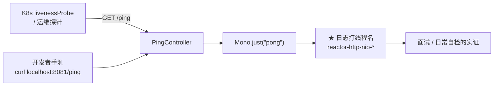

# PingController

> **本页速览**
> - 全项目**第二短的文件**(45 行),但它是**面试答"为什么用 WebFlux"时的实证**。
> - 唯一的知识点:返回类型是 `Mono<String>` 而**不是** `String` —— 这是 WebFlux 的契约,不是写法偏好。
> - ★ 它打的那行**线程名日志**是全项目最值钱的一行日志,见下。
> - ★★ 一个高频误解:**`Mono.just("pong")` 本身就是同步的**,它演示的是"形状"而非"性能"。
> - ⚠️ 它**不在限流的白名单里** —— 这是刻意的,原因和 K8s 探针有关。
>
> **导航**:[← 上一页:类-ChatController](类-ChatController.md) ｜ [下一页:M5 错误处理 →](../05-错误处理/_index.md) ｜ [所属模块:M4 请求入口](_index.md)

---

## 一句话职责
**返回 `"pong"`,证明服务活着** —— 除此之外什么都不做。

---

## 位置
```text
src/main/java/io/github/maixiaowen/gateway/controller/PingController.java     (45 行)
```

---

## 为什么需要这个类
**不只是一个健康检查。** Javadoc 里写明了它的教学职责:

> *"本类唯一的知识点:**返回类型是 `Mono<String>` 而不是 `String`**。
> 这不是写法偏好,是 WebFlux 的契约。"*

```text
45 行里方法体只有 3 行 → 剩下 42 行全是"为什么这 3 行要这么写"
★ 这是一个"把教学意图写进源码"的典型例子
```

---

## 关键方法
### `ping()`
```java
@GetMapping("/ping")
public Mono<String> ping() {
    log.info("ping 命中，处理线程 = {}", Thread.currentThread().getName());
    return Mono.just("pong");
}
```

| 项 | 说明 |
|---|---|
| **做什么** | 打一行日志,返回一个"立刻就有值"的 `Mono` |
| **参数** | 无 |
| **返回值** | `Mono<String>` —— ★ **不是 `String`** |
| **被谁调用** | 运维探针、K8s liveness/readiness、开发者手测 |
| **调用了谁** | `Mono.just()`(Reactor) |

---

## ★ 为什么是 `Mono<String>`,不是 `String`
**Javadoc 里的解释值得逐句读**:

> *"`Mono` 代表「一个还没有发生的值」—— 方法返回时值并不存在,
> **调用线程不会停在这里等它**,而是立刻返回去处理别的请求。
> 值真正产生后会由 Reactor 回调下游。"*

### 用一张图看差别
```text
【MVC / 返回 String】
   Tomcat 线程 ──→ 进入方法 ──→ 算出 "pong" ──→ 返回 ──→ 写响应 ──→ 线程还回池子
                    └──────────── 整个过程中这条线程被独占 ────────────┘

【WebFlux / 返回 Mono<String>】
   事件循环线程 ──→ 进入方法 ──→ 拿到一个"将来会有值"的凭证 ──→ 立刻返回 ★
                                  ↓
                              （这条线程去处理别的连接了）
                                  ↓
                              值就绪时 → 回调 → 写响应
```

> ★ **注意这里的差别不在"快慢",在"线程有没有被占住"**。
> `Mono.just("pong")` 这个值**当下就存在**,所以这个例子里省不下任何时间 ——
> 它演示的是**形状**,不是性能。

### ★★ 一个高频误解,必须说清楚
```text
❌ 常见误解:"用了 Mono 就快"
✅ 事实:"Mono 让线程 ★ 有机会 不被占住" —— 而能不能省下,取决于里面做了什么
```

**对比三种情况**:

| 方法体 | 用 `Mono` 有收益吗 |
|---|---|
| `return Mono.just("pong")` | ❌ **零收益** —— 值本来就是现成的 |
| `return Mono.fromCallable(() -> { Thread.sleep(1000); return "x"; })` | ❌ **反而是负收益** —— 阻塞的还是事件循环线程(除非指定 `subscribeOn`) |
| `return webClient.get()...retrieve().bodyToMono(String.class)` | ✅ **这才是收益点** —— 等待过程中线程被释放了 |

> ★★ **所以真正该记的一句话是**:
> **「WebFlux 的收益不来自 `Mono` 这个类型,来自"IO 是异步的"。」**
> 如果项目里所有 IO 都是阻塞的(`Thread.sleep`、阻塞 JDBC、同步 HTTP 客户端),
> 那么 `Mono` 只是换了一种写法,**性能可能比 MVC 更差** —— 因为阻塞的是 scarce 的事件循环线程。
> 这条和 M1 的 [配置-pom.xml](../01-骨架与配置/配置-pom.xml.md) 坑②
> (用非 reactive Redis)"几个并发就能让网关停止响应"**是同一个道理**。

---

## ★★ 那行线程名日志 —— 全项目最值钱的一行
```java
log.info("ping 命中，处理线程 = {}", Thread.currentThread().getName());
```

**源码注释直接把它的用途写明了**:

> *"1a 的第二个验收点:打印当前线程名。
>   - WebFlux(Netty) → **`reactor-http-nio-1`** 少量事件循环线程服务全部请求
>   - Spring MVC(Tomcat) → **`http-nio-8081-exec-1`** 每个请求独占一个线程
> **这一行日志是面试答「为什么用 WebFlux 而不是 Spring MVC」时的实证,不是背来的话术。**"*

### 为什么"实证"和"话术"差别很大
**面试时两种回答**:

```text
❌ 话术版:"WebFlux 是非阻塞的,基于事件循环,能支撑更高并发"
   → 面试官:任何人都能背这句,下一位 → 而且你没法证明你的项目真的跑在 WebFlux 上

✅ 实证版:"我起服务打 /ping,日志里线程名是 reactor-http-nio-1 ——
           少量几个事件循环线程服务全部请求。项目里有条自检:
           如果看到 http-nio-8081-exec-1,说明 starter-web 被误引进来、Spring 退回 MVC 了
           —— 而那种情况下 Mono 会被当普通对象处理,★ 不报错,只是架构悄悄变形了"
   → 面试官:这个人真的跑过、真的踩过
```

> ★ **规律**:「**能给出验证方法的结论,才是自己的结论**」。

### 而且它还是一个"日常自检"
| 看到什么 | 说明 |
|---|---|
| `reactor-http-nio-*` | ✅ 正常,WebFlux 生效 |
| `http-nio-8081-exec-*` | ❌ ★ **starter-web 被误引进了**,架构已变形 |
| `reactor-http-nio-*` 但只有少数几个 | ✅ 正常 —— 事件循环线程数 = CPU 核数,本来就少 |

> ⚠️ 注意 `ChatController` 的日志里**也打了线程名**,所以这个自检在两个端点上都能做。

---

## 后续每一段都建立在这个"不等待"的模型上
**Javadoc 里列了三处未来的依赖,值得记住**:

```java
/**
 * 后续每一段都建立在这个「不等待」的模型上:
 *   - G2 SSE 流式:返回值会变成 Flux<ServerSentEvent<String>>,一个流而不是一个值
 *   - G5 熔断:靠的就是「首字节到达前」这个时间窗做渠道转移
 *   - G7 计量:靠 Reactor 的 doOnNext / doFinally 钩子,断流也能触发结算
 * 1a 没吃透 Mono,G2 必然卡死。
 */
```

**展开成"为什么是这三件事"**:

| 未来阶段 | 用到 `Mono`/`Flux` 的哪个特性 |
|---|---|
| **G2 流式** | `Flux` 是"多个值" —— 流式就是"从 Mono 到 Flux"的升级 |
| **G5 熔断/故障转移** | ★ **"首字节到达前" = 还没有任何值产生** —— 这正是 `Mono` 能表达而"同步返回值"表达不了的**时间窗** |
| **G7 计量** | `doOnNext` / `doFinally` —— ★ **即使流被取消(用户关页面),结算也照样触发** |

> ★★ **最后一条特别值得想**:
> ```text
> 如果用同步写法:用户在"算到一半"时断开 → 代码根本走不到"记账"那一行
> 用 Reactor 钩子:doFinally 在 ★ 任何终止方式下都会执行(完成/出错/取消) → 已经消耗的 token 一定能被记上
> ```
> 这和 [深入页](../02-上游渠道抽象/类-OpenAiCompatibleProvider-深入.md)
> 里 `doFinally` 区分 CANCEL 和正常结束是**同一套机制的两种用法**。

---

## ⚠️ 它不在限流的白名单里
**回顾 [类-RateLimitWebFilter](../06-限流/类-RateLimitWebFilter.md) 的白名单**:

```java
private static final Set<String> PROTECTED_PATHS = Set.of("/v1/chat/completions");
//                                                       ↑ ★ 只有这一个
```

**`/ping` 不在里面,而且这是刻意的** —— 源码注释写了理由:

> *"为什么健康检查/探针天然不在里面:限流器一旦误伤探针,
> **Kubernetes 会把整个 Pod 重启掉** —— **你会同时失去服务和可观测性**,
> 然后在重启的循环里找不到原因。"*

**把这条推理展开**:

```text
假如 /ping 也被限流:
   ↓
某个时刻限流器误判(配置错、Redis 抖动、fail-closed) → /ping 开始返回 429
   ↓
K8s liveness 探针失败 → ★ 杀掉并重启 Pod
   ↓
新 Pod 起来 → 又被限 → 又重启 → ★ CrashLoopBackOff
   ↓
★★ 最糟的部分:你以为是"服务挂了",于是去查服务 ——
    而真相是"探针被限流了",服务本身好好的 → 而且因为是重启循环,日志一直在被覆盖,很难看清
```

> ★ **规律**:「**给观测手段本身加限制,风险远大于收益**」。
> 同类:不要给 `/metrics`、`/health`、日志采集端点加限流。

---

## 这个类在项目中的角色


**它是"探针 + 教学样本"双重身份** —— 功能上什么都不做,但它是**验证"这个项目真的跑在 WebFlux 上"的唯一手段**。

---

## 值得学习的点
### 1. 健康探针要不要"真的检查依赖",是一个设计决策
**本项目的 `/ping` 只返回 `"pong"`,什么都不检查。**

| 探针类型 | 该检查什么 | 适合什么场景 |
|---|---|---|
| **liveness**(存活) | ★ **只检查"进程还在不在"** | 失败就**重启** —— 所以不该检查外部依赖 |
| **readiness**(就绪) | 可以检查依赖(Redis、上游) | 失败就**摘流量**,不重启 |

**本项目的 `/ping` 属于 liveness 类型** —— 这是对的选择:

```text
如果 liveness 探针去检查 Redis:
   Redis 抖 3 秒 → 所有 Pod 的 liveness 全失败
   → K8s ★ 重启全部 Pod → 本来自愈只要 3 秒的抖动,变成一次 ★ 全量重启事故
   → 而且重启后 Redis 还是抖的 → CrashLoopBackOff
```

> ★★ **规律**:「**liveness 探针检查依赖,是把依赖的故障放大成自己的故障**」。
> 这和 [类-RateLimitConfig](../06-限流/类-RateLimitConfig.md) 里 "Redis 抖动时如果 fail-closed,一次局部降级变成全面故障"是**同一条判断**。
> ⚠️ **诚实标注**:本项目**没有单独的 readiness 端点**。生产环境通常需要两个(`/health/live` 和 `/health/ready`),前者只检查自己,后者才检查 Redis。

### 2. 45 行里 42 行注释,值不值
**看它的读者是谁**:

```text
读这个项目的场景:
  ① 大三学生学 WebFlux → ★ 需要知道"为什么是 Mono"
  ② 面试官看代码       → ★ 需要看到"作者知道自己在写什么"
  ③ 未来的自己回来改   → ★ 需要知道"这行为什么不能改成 String"
```

**三种读者都从注释里拿到东西**,而代码本身只有 3 行,**这种情况下注释才是这个文件的主要内容。**

> ★ 但**不是说所有类都该这样** —— 判据是:
> **这 45 行的价值,主要在"代码"还是主要在"为什么"?**
> 对一个只做 `return Mono.just("pong")` 的探针来说,答案显然是后者。

### 3. 一个"什么都不做"的端点,如何撑起一次技术选型的论证
**技术选型最容易被问的问题**:

```text
"你为什么用 WebFlux 而不是 Spring MVC?"
   ❌ "因为 WebFlux 性能更好"        → 片面,而且项目规模看不出差别
   ✅ "因为这个网关的核心是'等上游大模型返回',是典型的高延迟 IO 密集场景。
        ★ 我验证过:日志里的线程名是 reactor-http-nio-1,说明不用为每个请求分配一条线程。"
```

> ★ **规律**:「**技术选型的论证要有"锚点"**」—— 一个具体的、可复现的证据。
> 而这个项目里,那个锚点就是 `/ping` 打的那行日志。
> 同类的锚点还有:
> - 断言"抽象没漏"的 → `grep -i deepseek ChatController.java`
> - 断言"真的在流式"的 → 观察响应是否逐字出现(见 [M7](../07-测试验证/测试-流式与取消传播.md))

---

## 相关页
- 兄弟类:正式端点 → [类-ChatController](类-ChatController.md)
- WebFlux 的技术栈选择 → [配置-pom.xml](../01-骨架与配置/配置-pom.xml.md)
- 为什么写错栈会"静默降级" → [类-LlmGatewayApplication](../01-骨架与配置/类-LlmGatewayApplication.md)
- 探针为什么不能被限流 → [类-RateLimitWebFilter](../06-限流/类-RateLimitWebFilter.md)
- 取消传播怎么用到这套模型 → [类-OpenAiCompatibleProvider-深入](../02-上游渠道抽象/类-OpenAiCompatibleProvider-深入.md)

> **导航**:[← 上一页:类-ChatController](类-ChatController.md) ｜ [下一页:M5 错误处理 →](../05-错误处理/_index.md) ｜ [所属模块:M4 请求入口](_index.md)
