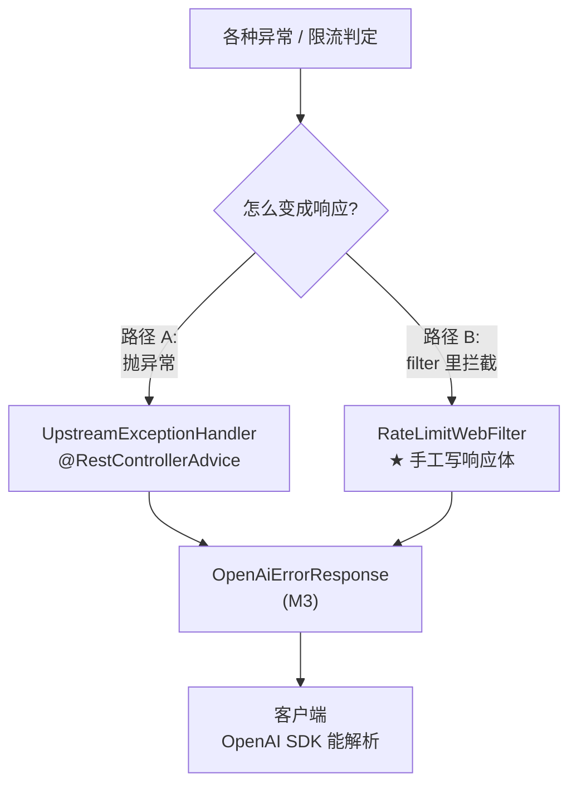
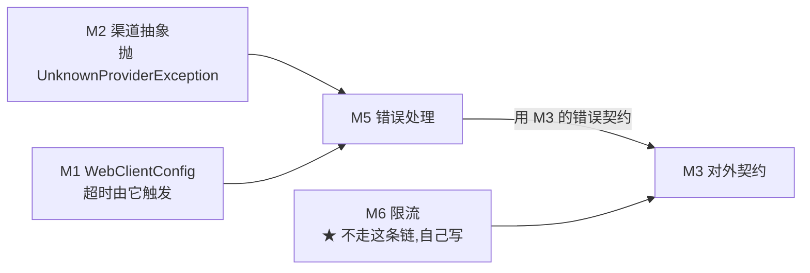

# M5 · 错误处理

> **本页速览**
> - 这个模块回答一个问题:**出错的时候,返回哪个状态码、给谁看、怎么排查**。
> - ★ 贯穿全模块的一条纪律:**错误码要指向"谁的错"** —— 指错了,调用方的重试策略就做错。
> - 5 种状态码分工:**400 你错了 / 429 你太快了 / 502 上游回了坏东西 / 504 没等到上游 / 503 我坏了**。
> - 3 个自定义异常 + 1 个统一出口(`@RestControllerAdvice`)。
> - ⚠️ 有三个"没做"的地方,都在下面诚实标注了。
>
> **导航**:[← 上一页:类-PingController](../04-请求入口/类-PingController.md) ｜ [下一页:类-UpstreamExceptionHandler →](类-UpstreamExceptionHandler.md) ｜ [回到 README](../../README.md)

---

## 这个模块解决什么问题

### 先说一个反例:只配了超时,没配错误处理

**G1 配上超时之后,超时确实会触发了。然后呢?**

```text
上游卡住 → 超时触发 → 抛出 TimeoutException
   ↓
★ 没有专门的处理器
   ↓
Spring 兜底成 500,响应体是默认格式:
   {"timestamp":"...","status":500,"path":"/v1/chat/completions"}
   ↓
① 客户端 SDK 解析不了(不是 OpenAI 错误格式)
② 运维看不出是"上游慢"还是"自己崩了" —— ★ 两者都是 500
③ 调用方的重试策略做错:500 通常会重试,但这是上游的问题,重试可能还是慢
```

> ★ **所以"配了超时"只完成了一半** ——
> 另一半是**让超时这件事在对外表现上是可区分的**。

### 这个模块给出的答案

```text
① 自定义异常类型      → 让"是哪一种错"在类型层面就分得开
② @RestControllerAdvice → 统一映射成"状态码 + OpenAI 格式的错误体"
③ 状态码按"谁的错"分配  → 让调用方的重试策略能做对
```

---

## ★ 全模块的核心:一张"谁的错"的表

**这是本页最该背下来的东西。**

| 情况 | 异常 | 状态码 | ★ 谁的错 | 调用方该做什么 |
|---|---|---|---|---|
| 渠道名不存在 | `UnknownProviderException` | **400** | **调用方** | 改参数,**别重试** |
| 请求太频繁 | (限流,不是异常) | **429** | **调用方** | ★ **退避后重试** |
| 上游**回了**错误状态码 | `WebClientResponseException` | **502** | 上游 | 可能重试 / 换渠道 |
| 连不上上游(DNS/拒绝/TLS) | `WebClientRequestException` | **502** | 上游 | 可能重试 / 换渠道 |
| 上游**没回**(读超时) | `ReadTimeoutException` | **504** | 上游 | 可能重试 / 换渠道 |
| 上游**没连上**(连接超时) | `ConnectTimeoutException` | **504** | 上游 | 可能重试 / 换渠道 |
| 限流器坏了 + fail-closed | (限流,不是异常) | **503** | ★ **我们** | 等待,**重试没用** |
| 流式中途停滞 | `UpstreamIdleTimeoutException` | ★ **无**(见下) | 上游 | —— |

### ★ 两条最容易被搞混的边界

#### 边界一:400 vs 502/504 —— "轮到上游了吗"

```text
400 = ★ 压根没轮到上游
      渠道名写错 → 我们连"该找谁"都没搞清楚
      所以这是 ★ 请求方的问题

502 = 上游回了坏东西  ┐
504 = 没等到上游      ┘ 两者都是"轮到上游了,是它的问题"
```

**源码注释里的原话**:

> *"`502` = **上游回了坏东西**;`504` = **没等到上游**。两者都意味着'轮到上游了,是它的问题'。
> 而渠道名写错,**压根没轮到上游** —— 是我们连'该找谁'都没搞清楚。"*

#### 边界二:502 vs 504 —— "等到了坏东西" vs "什么都没等到"

> *"**502 Bad Gateway**:上游**回了**,但回的是错误响应或垃圾。
> 「**没等到**」和「**等到了坏东西**」是两件事,别混。"*

```text
✅ 504:发出去 → 等到超时 → ★ 什么都没回来
✅ 502:发出去 → 上游说"你的 API Key 无效"(401) → ★ 回来了,但是坏的
```

### ★★ 为什么这个分类"值钱",而不只是"好看"

**源码里给了一个非常具体的场景**:

> *"如果这里也返回 502,告警会显示'上游故障率上升' ——
> 值班的人会去查上游、联系厂商,
> 而真正的问题是**调用方把渠道名拼错了**。
> **错误分类的意义不是"好看",是让排查方向不跑偏。**"*

**把这条推理画出来**:

```text
【错误码分得清】
401 报警 → "调用方参数错误" → ★ 5 分钟解决(让他改参数)
502 报警 → "上游故障"       → 联系厂商 / 换渠道

【错误码都返回 502】
告警: "上游故障率突然从 0.1% 涨到 12%"
   ↓
值班的人:查上游健康度(正常)、联系厂商(说他们没问题)、
          查网络(正常)、查自己的代码(看不出问题)
   ↓
★ 三个小时后发现:是某个客户把 model 名填进了 provider 字段
```

> ★★ **规律**:「**错误分类的成本在前端支付,收益在故障时兑现**」。
> 分类的时候多花 10 分钟,故障的时候省 3 小时 —— 而且是在**最紧张的时刻**省。

---

## 模块结构图



**★ 为什么有两条路径** —— 这是本模块一个必须知道的坑:

```text
@RestControllerAdvice 的生效范围是
   「DispatcherHandler 调用的 handler 抛出的异常」
   ↓
而 WebFilter 跑在 handler ★ 之前,压根不在那条调用链上
   ↓
★ 在 filter 里抛异常,得到的是 Spring 默认错误页,不是我们的契约
   ↓
所以必须在 filter 里 ★ 手工写 body
```

> 详见 → [类-RateLimitWebFilter](../06-限流/类-RateLimitWebFilter.md)

---

## 类清单

| 类 | 一句话职责 | 页 |
|---|---|---|
| `UpstreamExceptionHandler` | 统一出口。★ 3 个 `@ExceptionHandler` 覆盖全部上游异常 | [类-UpstreamExceptionHandler](类-UpstreamExceptionHandler.md) |
| `UnknownProviderException` | "请求的渠道不存在"。★ 携带**可用渠道列表** | [类-UnknownProviderException](类-UnknownProviderException.md) |
| `UpstreamIdleTimeoutException` | "流式中途停滞"。★ **它不映射状态码**,原因很关键 | [类-UpstreamIdleTimeoutException](类-UpstreamIdleTimeoutException.md) |
| —— | ★ **完整链路**:从抛异常到客户端收到 400 | [流程-错误如何变成OpenAI格式](流程-错误如何变成OpenAI格式.md) |

---

## 与其他模块的交互



★ **注意 M6 那条箭头是绕过 M5 的** —— 这是"filter 不在 advice 范围内"的直接体现。

---

## 本模块值得学习的设计点

### 1. ★ 定义一个"只可能由一处产生"的异常类型

**两个自定义异常都遵循这条原则**,而且理由说得一模一样:

```java
// UnknownProviderException 的注释
"抛 IllegalArgumentException:它太通用了 ——
 日志里看到它,你分不清是参数校验失败、还是渠道名写错了。
 定义一个语义明确的类型,日志一眼能定位,测试断言它也不会'碰巧通过'。"

// UpstreamIdleTimeoutException 的注释
"那两种异常在链路上会从很多地方冒出来(连接超时、读超时、客户端断开的次生异常……),
 排错时根本分不清是哪一种。定义一个 ★ 只可能由'逐块空闲超时'这一处产生 的类型,
 日志和告警才能一眼定位。"
```

**合起来是一条可复用的判据**:

> ★ **「这个异常类型,除了我想的那一处,还有别的地方会抛吗?」**
> - 有 → 用通用类型就够了(比如标准库的)
> - 没有 → ★ **值得自定义**,因为它现在是一个**精确的信号**

**"测试断言它也不会碰巧通过"这句尤其值得琢磨**:

```text
断言 catch (IllegalArgumentException e):
   如果代码里别的地方也抛 IllegalArgumentException
   → ★ 测试可能因为"另一个原因"而通过 → 假绿

断言 catch (UnknownProviderException e):
   → 只可能来自渠道查找失败 → ★ 断言是可信的
```

> ★ **规律**:「**异常类型的精度,直接决定测试断言的精度**」。

### 2. ★ 异常里要带"排查所需的数据",不只是描述

**`UnknownProviderException` 带了两个字段**:

```java
private final String requestedName;        // 请求的名字
private final Set<String> availableNames;  // ★ 当前可用的全部
```

**为什么第二个字段是关键**:

```java
super(String.format("渠道 [%s] 不存在。当前可用渠道：%s", requestedName, availableNames));
```

**对比两种错误信息**:

```text
❌ "渠道不存在"
   → 读日志的人:那有哪些渠道?去翻 application.yml?
     翻完发现:YAML 里明明有 moonshot 啊?(因为环境变量覆盖了)

✅ "渠道 [gpt-4] 不存在。当前可用渠道：[deepseek, moonshot]"
   → 一秒定位:哦,我把模型名当成渠道名填了
```

> ★ **规律**:「**错误信息要包含"排除法所需的信息"**」——
> 只说"什么不对"不够,还要说"**那什么是对的**"。
>
> 这和 [类-ProviderRegistry](../02-上游渠道抽象/类-ProviderRegistry.md) 的
> 启动校验是**同一个做法**,而且是刻意统一的。

### 3. ⚠️ 三个诚实的"没做"(面试时要能说出来)

| 没做的事 | 现状 | 影响 |
|---|---|---|
| **404 / 405 等 Spring 内部错误** | ★ 还是 Spring 默认格式,没走我们的契约 | 客户端访问不存在的路径会拿到不一致的格式 |
| **`type` 字段没有细分** | 全部是 `"upstream_error"`,包括 400 | ⚠️ 400 标成 upstream 是不准的 |
| **`requestId` 恒为 null** | 字段留好了但没接上链路 ID | 靠 `NON_NULL` 隐藏了,客户端看不到 |

**为什么把这三条写出来,而不是藏起来**:

```text
面试问"你的错误处理做得怎么样":
   ❌ "我做了统一的错误处理,很完善"
      → 追问"404 呢?" → 答不上来 → ★ 可信度全失

   ✅ "统一了上游异常和限流的错误格式。
       有三处没做:404/405 还是 Spring 默认格式;
       type 字段没细分,400 也标成了 upstream_error;
       requestId 留了字段但没接链路 ID。
       ★ 前两个影响不大,第三个要做的话需要引入 MDC + Reactor Context"
      → ★ 这比"很完善"可信得多,而且展示了对系统边界的认知
```

> ★★ **规律**:「**知道自己哪里没做好,是"做过"和"看过"的分界线**」。
> 而这条在**面试**里的价值,比在代码里更大。

### 4. 判据:一个模块的"边界"比它的"功能"更能说明设计水平

**这个模块的功能清单很短**:3 个异常 + 3 个 handler 方法。
**但它的边界清单很长**:

```text
✅ 覆盖了:上游超时(读/连接)、上游不可达、上游返回错误、渠道不存在
✅ 覆盖了:限流的两种拒绝(429/503,虽然走了另一条路径)
❌ 没覆盖:Spring 内部错误(404/405/400 参数绑定失败)
❌ 没覆盖:流式响应已经发出之后的错误(状态码改不了了)
```

> ★ **规律**:「**问一个模块"它不管什么",比问"它管什么"更能看出作者的掌握程度**」。

---

## 相关页

- 下一模块 → [M6 限流](../06-限流/_index.md)
- 错误响应的结构 → [类-OpenAiErrorResponse](../03-对外契约/类-OpenAiErrorResponse.md)
- 渠道不存在怎么被抛出 → [类-ProviderRegistry](../02-上游渠道抽象/类-ProviderRegistry.md)
- 超时从哪来 → [类-WebClientConfig](../01-骨架与配置/类-WebClientConfig.md)
- 限流那条绕过的路径 → [类-RateLimitWebFilter](../06-限流/类-RateLimitWebFilter.md)
- 这些映射怎么被测试 → [M7 测试验证](../07-测试验证/_index.md)

> **导航**:[← 上一页:类-PingController](../04-请求入口/类-PingController.md) ｜ [下一页:类-UpstreamExceptionHandler →](类-UpstreamExceptionHandler.md) ｜ [回到 README](../../README.md)
