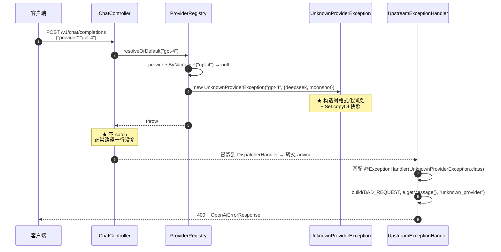

# 流程 · 一个错误如何变成 OpenAI 格式的响应

> **本页速览**
> - 完整走一遍:**从 `resolve()` 里 `throw`,到客户端收到 `400`**。
> - ★ 中间经过 4 个环节,而 `ChatController` ★ **一行 try/catch 都没有**。
> - ★★ 本页最值钱的一句话:**「集中式异常处理的收益,体现在业务代码里"没有"什么」**。
> - 走完这条链之后,顺手把**另一条链**(限流那条,绕过了这个流程)对照一遍。
> - ⚠️ 结尾诚实标注三处"这条链目前接不住的东西"。
>
> **导航**:[← 上一页:类-UpstreamIdleTimeoutException](类-UpstreamIdleTimeoutException.md) ｜ [下一页:M6 限流 →](../06-限流/_index.md) ｜ [所属模块:M5 错误处理](_index.md)

---
## 触发条件
**这条链的触发条件只有一个**:业务代码里**抛出了一个未被捕获的异常**。

```text
★ 关键在"未被捕获"四个字 —— Controller / Provider / 注册表里,任何一处都不写 try/catch ↓ 异常一路冒泡到 DispatcherHandler → 交给 @RestControllerAdvice
```

**本流程用一条最容易复现的路径做示例:渠道名写错。**

```bash
curl -X POST http://localhost:8081/v1/chat/completions \
  -H "Content-Type: application/json" \
  -d '{"provider":"gpt-4","messages":[{"role":"user","content":"hi"}]}'
```
> ★ **注意请求里的 `"provider":"gpt-4"`** —— 这是真实场景里最常见的错误:调用方把**模型名**填进了**渠道名字段**。因为 OpenAI 协议里 `model` 是必填的,而 `provider` 是我们的扩展字段 —— 很容易搞混。

---
## 步骤化讲解
### 第 ①步:注册表查不到 → 构造异常

```java
// ProviderRegistry.resolve()
Provider provider = providersByName.get(name);      // "gpt-4" → null
if (provider == null) {
    throw new UnknownProviderException(name, providersByName.keySet());
    //                                   ↑ "gpt-4"  ↑ {deepseek, moonshot}
}
```

**这一刻发生了两件事,第二件常被忽略**:① 抛出一个异常(显式);② ★ 异常对象在**构造时就把消息格式化好了**(隐式)—— `super(String.format("渠道 [%s] 不存在。当前可用渠道：%s", ...))` → 消息定格在"事件发生的那一刻",还顺手 `Set.copyOf` 拷了一份可用渠道快照。
> ★ **为什么"构造时格式化"值得单独说**:异常对象会被保存、传递、延迟读取(日志异步刷盘、告警延迟上报);若消息是 `getMessage()` 里现算的,延迟读取时拿到的是**变化后的世界**。

### 第 ②步:异常冒泡 —— ★ 中间三层,零 try/catch

```text
resolve() 抛(★ 没有 catch) → resolveOrDefault() 不处理(★ 没有 catch) → completions() 不处理(★ 没有 catch) → DispatcherHandler ★ 兜住,转交 advice
```

**★ 这三段"没有 catch"是本页最重要的观察点。** 对比一下"如果写了 try/catch"会变成什么样:

```java
// ❌ 反例:把错误处理写进 Controller
@PostMapping("/v1/chat/completions")
public Object completions(...) {
    Provider provider;
    try {
        provider = providerRegistry.resolveOrDefault(request.provider());
    } catch (UnknownProviderException e) {
        exchange.getResponse().setStatusCode(HttpStatus.BAD_REQUEST);   // ★ 状态码散落在这
        return new OpenAiErrorResponse(new ErrorBody(e.getMessage(), "upstream_error", "unknown_provider", null));
    }                                                                   // ★ 错误格式也散落在这
    ...
}
```

**代价清单**:

| 代价 | 说明 |
|---|---|
| ★ **格式散落** | 错误格式出现在 Controller 里,加一个字段要改 N 处 |
| ★ **状态码散落** | "400"这个数字出现在业务代码里,不再集中可审阅 |
| ★ **可读性下降** | 正常路径被 `try/catch` 切碎,要跳着读 |
| ⚠️ **覆盖率下降** | ★ 只在被 `try` 包住的那一行有效 —— 后面 `provider.chatCompletion()` 抛的异常就漏了 |

> ★★ **最后一条最致命**:只 `try` 包住 `resolveOrDefault(...)` 那一行 → 后面 `provider.chatCompletion(request)` 抛的异常没人接 → 症状:渠道名写错 → 400 ✅ 格式正确;上游超时 → 500 ❌ 格式又变回 Spring 默认了 → ★ "有的错误格式对、有的不对",而且后者只在特定故障下出现。

### 第 ③步:advice 匹配 handler

```java
// DispatcherHandler 在异常处理器链里找匹配
@ExceptionHandler(UnknownProviderException.class)      ← ★ 精确匹配命中
public ResponseEntity<OpenAiErrorResponse> handleUnknownProvider(UnknownProviderException e) { ... }
```

★ Spring 会挑"最具体"的那个 handler:若同时有 `@ExceptionHandler(Exception.class)` 和 `@ExceptionHandler(UnknownProviderException.class)`,抛 UnknownProviderException 时 ★ **后者胜出** → 这正是我们能在同一个 advice 里写"兜底 + 具体"两层的原因。
> ⚠️ **本项目现在只有具体 handler,没有 `Exception.class` 的兜底** —— 见文末"没做的"。

### 第 ④步:构造并写出响应

```java
private ResponseEntity<OpenAiErrorResponse> build(HttpStatus status, String message, String code) {
    return ResponseEntity.status(status).body(new OpenAiErrorResponse(
            new OpenAiErrorResponse.ErrorBody(message, "upstream_error", code, null)));
}
```

**客户端最终收到的**:

```http
HTTP/1.1 400 Bad Request
Content-Type: application/json

{
  "error": { "type": "upstream_error", "code": "unknown_provider", "message": "渠道 [gpt-4] 不存在。当前可用渠道：[deepseek, moonshot]" }
}
```

**注意响应体里"没有"的东西**:

- ❌ 没有 requestId ← 恒为 null,被 NON_NULL 隐藏了
- ❌ 没有 timestamp ← ★ Spring 默认格式里有,我们刻意不带
- ❌ 没有 path ← ★ 同上 —— 不向外部泄漏内部路径
- ❌ 没有 stack trace ← ★ 绝对不能在响应里出现

> ★★ **规律**:「**错误响应要"够用且不泄漏"**」。客户端需要的:状态码 + 机器可读的 code + 人能懂的 message。**三样,不多不少。** `path` / `timestamp` / `trace` 都是**我们排障用的**,应该进日志,**不进响应**。

---
## 时序图



**★ 读这张图的一个要点**:CC(Controller)那个角色 —— 收到请求 → 转给 REG → 收到 throw → ★ 直接放行;它在这条链里"什么都没做",而这正是设计目标。

---
## ★★ 从这条链提炼:集中式异常处理的收益在哪
**收益不在 advice 那个类里,在"业务代码里没有的东西"里。**

| 位置 | 有 try/catch 吗 | 该有吗 |
|---|---|---|
| `ChatController.completions()` | ❌ 没有 | ★ 不该有 |
| `ChatController.streamToClient()` | ❌ 没有 | ★ 不该有 |
| `OpenAiCompatibleProvider.chatCompletion()` | ❌ 没有 | ★ 不该有(它只管抛,不管转) |
| `ProviderRegistry.resolve()` | ❌ 没有 | ★ 不该有 |
| `UpstreamExceptionHandler` | ✅ **有,但用的是 `@ExceptionHandler`** | ★ 只有这一处该有 |

**★ 业务层不认识 HTTP,HTTP 只在边界层出现**:`Provider` / `ProviderRegistry` 只认识领域概念(渠道、provider),抛异常时不知道"400"也不该知道 → 状态码映射集中在异常处理器、限流过滤器、管理接口,以及 G5 的 `ErrorClassifier` 分类表里 → ★ 职责分界线:"什么错了"在业务层,"对外怎么表达"在边界层。
> ⚠️ G5 之后不再是"全项目只有一个类 import HttpStatus":错误分类器也要把错误种类映射成 HTTP 状态码。**这是有意的收敛,不是抽象漏了** —— 但它确实说明"只有一个类知道 HTTP"的旧说法已经不成立。

### ★★ 一个可以拿去面试的量化说法

```text
❌ "我用了 @RestControllerAdvice 做全局异常处理" → 听众:这谁都会
✅ "Provider 接口、两个 Provider 实现和注册表里,import 不到任何 HttpStatus —— 加一家新厂商时,协议适配代码里没有一行 HTTP 状态码。状态码映射只在边界层和错误分类表里做。" → 听众:★ 这是有边界意识的设计
```
> ★ **规律**:「**架构的好坏,可以用"改一个需求要动几个文件"来量化**」。这也是 [类-ChatController](../04-请求入口/类-ChatController.md) 里 "加第二家厂商只改了一个表达式" 是同一个说法的另一种用法。

---
## ★ 对照:另一条链(限流),它绕过了本流程
**把两条链并排放**:

```text
【本流程:业务异常】请求 → [路由匹配] → [反序列化] → ChatController → 抛异常 → DispatcherHandler → advice → 响应(★ 走完了整条 WebFlux 处理链)
【限流:filter 里直接拒】请求 → ★ RateLimitWebFilter 里就拦住 → 自己写 body → 响应(★ 后面的路由匹配、反序列化、Controller 全部没执行)
```

| | 本流程 | 限流那条 |
|---|---|---|
| 拦截位置 | handler 之后 | ★ handler **之前** |
| 谁写响应 | `@RestControllerAdvice` | ★ **filter 自己手写** |
| 能省下什么 | 不能,已经在 handler 里了 | ★ **路由匹配 + JSON 反序列化** |
| 错误格式来源 | 统一的地方 | ★ **另一份实现(重复!) ⚠️** |

### ★ 为什么会重复,以及为什么接受它
`@RestControllerAdvice` 的生效范围 =「DispatcherHandler 调用 handler 抛出的异常」;filter 不在那条调用链上 → 在 filter 里 throw → ★ 得到 Spring 默认错误页 → ★ 所以必须在 filter 里手工写 body。

**这是"性能位置" 和 "代码收敛" 之间的一次取舍**:

```text
选项 A:把限流挪进 Controller → ✅ 错误格式能统一(异常直接抛给 advice);❌ ★ 被拒的请求仍要走完 路由匹配 + JSON 反序列化,而反序列化成本 ★ 恰恰是限流要防的东西之一(大 body 解析很贵,应拦在解析之前)
选项 B:留在 filter 自己写 body → ✅ ★ 拦住得更早,省下反序列化;❌ 错误格式有两份实现 ⚠️
★ 选择 B —— 限流的意义就是"在昂贵操作之前拦住"
```
> ★★ **规律**:「**当"代码收敛"和"性能位置"冲突时,要看这个位置的性能收益是不是设计目标本身**」。这里限流的**全部意义**就是"早拦",所以牺牲收敛是值得的。
> **代价要记住**:改错误格式时**必须改两个地方**。详见 → [类-RateLimitWebFilter](../06-限流/类-RateLimitWebFilter.md)

---
## 涉及的类

| 类 | 在这条链里的角色 | 页 |
|---|---|---|
| `ProviderRegistry` | ★ 起爆点。查不到就抛 | [类-ProviderRegistry](../02-上游渠道抽象/类-ProviderRegistry.md) |
| `UnknownProviderException` | ★ 携带病因 + 可用渠道列表 | [类-UnknownProviderException](类-UnknownProviderException.md) |
| `ChatController` | ★ **什么都不做**(这是设计目标) | [类-ChatController](../04-请求入口/类-ChatController.md) |
| `UpstreamExceptionHandler` | ★ 唯一的翻译层 | [类-UpstreamExceptionHandler](类-UpstreamExceptionHandler.md) |
| `OpenAiErrorResponse` | ★ 被翻译成的形状 | [类-OpenAiErrorResponse](../03-对外契约/类-OpenAiErrorResponse.md) |
| `RateLimitWebFilter` | ⚠️ 走**另一条**链 | [类-RateLimitWebFilter](../06-限流/类-RateLimitWebFilter.md) |

---
## 容易卡住的点
### 卡点 1:★ "为什么我在 filter 里 `throw` 异常,返回的还是 Spring 默认格式"
**症状**:写了 @RestControllerAdvice 处理 MyException,在 WebFilter 里 throw new MyException() → 客户端收到 500 + Spring 默认错误页 ❌ 格式不对。

**原因**:advice 的生效范围是 **DispatcherHandler 调用的 handler 抛出的异常**;filter 跑在 handler **之前**,压根不在那条调用链上。

**怎么办**:在 filter 里**手工写响应体**(见 [类-RateLimitWebFilter](../06-限流/类-RateLimitWebFilter.md))。
> ★ 这个坑的通用形态:**「全局」这个词,一定要问清楚"全局"的边界在哪一层。**

### 卡点 2:★ "异常链里有 ReadTimeout,但 `instanceof` 判不出来"
**症状**:

```java
if (e instanceof ReadTimeoutException) { ... }   // ❌ 永远 false
```

**原因**:框架给你的异常**通常在最外层**,真正的病因埋在 `getCause()` 链的第 2~3 层。

**怎么办**:用 `hasCause()` 沿链遍历([类-UpstreamExceptionHandler](类-UpstreamExceptionHandler.md))。
> ★ 通用形态:**「框架抛的异常描述的是'在做什么时失败',不是'为什么失败'。」**

### 卡点 3:"流式中途出错了,但状态码还是 200"
**症状**:

```text
客户端:HTTP/1.1 200 OK,data: {...},data: {...},★ 然后流断了,没有 [DONE]
```

**原因**:**响应头在第一个块之前就发出去了**,状态码已定格。

**怎么办**:这不是 bug,是流式接口的固有特性。能做的是:① 干净地断开 ② 日志里写清原因(**带上阈值**) ③ 将来在流里补一个约定的错误事件。
> ★ 通用形态:**「状态码是响应的开始,不是响应的全部。」** 只有当过没过"首字节"这一关,才能决定用哪种手段表达错误。

### 卡点 4:⚠️ "为什么错误响应里没有 requestId"
**症状**:客户端报错时给不出请求编号,客服定位不到那一次请求。

**原因**:字段留了(`OpenAiErrorResponse.ErrorBody.requestId`),但**没接上链路 ID**,而且被 `@JsonInclude(NON_NULL)` **隐藏**了 —— 所以客户端看到的是"没有这个字段",而不是"这个字段是空的"。

**要做的话需要**:

```text
① 一个贯穿整条链路的请求 ID
② Reactor Context / MDC 的桥接(★ Reactor 切线程会丢 ThreadLocal)
③ filter 里生成、advice 里读出
```
> ⚠️ 这三件事都不难,但都不属于"错误处理"这个模块 —— 是"可观测性"的话题。

---
## ⚠️ 这条链目前接不住的三样东西
**写在流程页结尾,因为"流程的边界"比"流程的步骤"更容易被忽略。**

| 接不住的东西 | 现状 | 影响 |
|---|---|---|
| **非本 advice 覆盖的异常** | 比如 `NullPointerException`、参数绑定失败 | ★ 返回 Spring 默认格式,和我们的契约不一致 |
| **404 / 405** | Spring 内部处理,不走 advice | 访问不存在的路径格式不一致 |
| **流式响应已发出之后的错误** | `UpstreamIdleTimeoutException` 没有 handler | 客户端看到 200 + 不完整的流 |

**为什么把这三条写出来**:

```text
面试场景:
   ❌ "我做了全局异常处理" → "流式出错怎么办?" → 卡住 → ★ 说明只是照搬了模板
   ✅ "全局异常处理覆盖的是'handler 抛出的异常';我这套接不住三样:404/405 这类 Spring 内部处理的、参数绑定失败的、以及流式响应已经发出之后的。★ 最后一类不是遗漏,是物理上做不到 —— 状态码已经发出去了,所以那类异常我在代码里明说了'不映射状态码,只负责干净地断开'。" → ★ 这展示的是"知道自己的边界在哪"
```
> ★★ **规律**:「**能把一个流程的边界说清楚,才算真的走通过这个流程**」。只讲"正常路径怎么走"的,通常是照着代码读的;能讲"什么情况下它不管用"的,才是踩过的。

---
## 相关页

- 模块首页(完整的"谁的错"表) → [M5 错误处理](_index.md)
- 翻译层本身 → [类-UpstreamExceptionHandler](类-UpstreamExceptionHandler.md)
- 起爆点 → [类-ProviderRegistry](../02-上游渠道抽象/类-ProviderRegistry.md)
- 另一条链的完整流程 → [流程-一次被限流的请求](../06-限流/流程-一次被限流的请求.md)
- 非流式的正常路径 → [02-flows/非流式请求处理流程](../../02-flows/非流式请求处理流程.md)
- 流式的正常路径 → [02-flows/流式请求处理流程](../../02-flows/流式请求处理流程.md)
- 这些映射的测试 → [测试-契约测试](../07-测试验证/测试-契约测试.md)

> **导航**:[← 上一页:类-UpstreamIdleTimeoutException](类-UpstreamIdleTimeoutException.md) ｜ [下一页:M6 限流 →](../06-限流/_index.md) ｜ [所属模块:M5 错误处理](_index.md)
