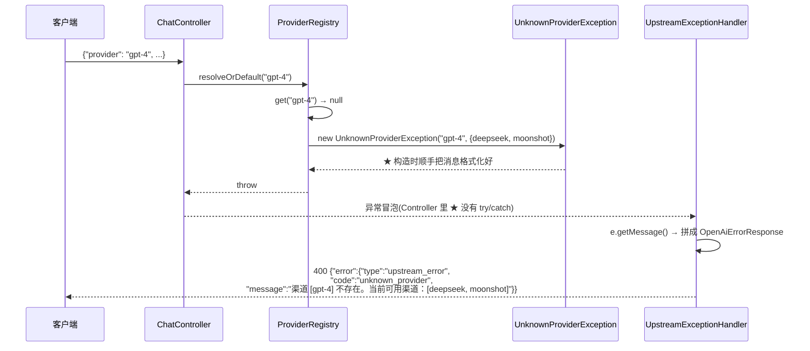

# UnknownProviderException

> **本页速览**
> - 45 行的自定义异常,但它是**唯一一个映射到 400 的异常** —— 唯一"指责调用方"的那一个。
> - ★ 它不是"设计出来的",是**从两次删除里长出来的**:先否掉了 `IllegalStateException`,又否掉了 `IllegalArgumentException`。
> - ★★ 它带了**两个业务字段**(请求的名字 + 可用渠道列表),而且第二个是关键。
> - ★ 这是"异常即数据传输对象"的一次实践:字段携带结构化信息,而不是只靠字符串。
> - ⚠️ 生产代码目前只用 `getMessage()` 拼响应;**两个访问器是测试在用**(结构化断言)。
> - ⚠️ 它现在**只有一个抛出点** —— `ProviderRegistry.resolve()`。
>
> **导航**:[← 上一页:类-UpstreamExceptionHandler](类-UpstreamExceptionHandler.md) ｜ [下一页:类-UpstreamIdleTimeoutException →](类-UpstreamIdleTimeoutException.md) ｜ [所属模块:M5 错误处理](_index.md)

## 一句话职责
**表示"调用方点名要一个不存在的渠道"** —— 并且**带上"当前有哪些渠道",让这个错误可以自我解释。**

---
## 位置
```text
src/main/java/io/github/maixiaowen/gateway/exception/UnknownProviderException.java     (45 行)
```

---
## 为什么需要这个类(设计动机)
### 它的历史:两次否定
**Javadoc 里把这段推理写下来了,是 45 行里最值钱的部分**:
```text
第一版想法:抛 IllegalStateException
   ❌ 它表示"对象状态不对" —— 但这里状态没有任何问题,注册表好得很,是"调用方查了一个不存在的名字"
   ❌ 而且它太宽 → 日志里看到它,分不清是什么状态出了问题
第二版想法:抛 IllegalArgumentException
   ❌ 这个方向对了(确实是参数问题)
   ❌ ★ 但它太通用了 —— 日志里看到它,你分不清是"参数校验失败" 还是 "渠道名写错了"
   ❌ ★★ 而且测试断言它也不会"碰巧通过":代码里别的地方也抛 IllegalArgumentException → 测试可能因为 ★ 另一个原因 而通过 → 假绿
```
**最终方案:自定义一个类型。**

### ★★ "测试断言不会碰巧通过" 这句话必须展开
**这是本页最重要的一条推理,把它画出来**:
```text
【用 IllegalArgumentException 的测试】
@Test void 查不存在的渠道应该报错() { assertThrows(IllegalArgumentException.class, () -> registry.resolve("nope")); }
   ↓ 某天有人在 resolve() 前面加了一行参数校验: if (name.length() > 64) throw new IllegalArgumentException("名字太长");
   ↓ 测试还是绿的 ✅ —— 但它现在可能因为 ★ 完全不同的原因 而通过
   ↓ ★★ 而且没人会注意到:测试没红、覆盖率没降、CI 全绿 → 这个断言从"验证行为"退化成了"验证有个异常"
```

**换成自定义类型之后**:
```java
assertThrows(UnknownProviderException.class, () -> registry.resolve("nope"));
   ↓ ★ 全项目只有 ProviderRegistry.resolve() 一处会抛它 → 这个断言不可能因为"别的原因"通过 → 断言是 ★ 可信的
```

> ★★ **规律**:「**异常类型的精度 = 测试断言的精度**」。而且这条推理有个更普适的版本:**「一个可能因为多种原因通过的断言,和没有断言,差别没那么大。」**它给了你绿色的信心,却没给你绿色的保证。

### 顺带:这也是"异常类型是一种接口"的体现
```text
★ 抛出一个异常,等于对外做了一个承诺:"这个类型只会因为这一件事被抛出"
   ↓ 这个承诺的价值不在生产环境(生产环境只看日志),★ 在测试环境 —— 因为测试是唯一"按类型断言"的地方
```

---
## 关键属性

| 字段 | 类型 | 说明 |
|---|---|---|
| `requestedName` | `String` | ★ **调用方请求的名字**(可能是 `"gpt-4"` 这种模型名) |
| `availableNames` | `Set<String>` | ★★ **当前注册表里真实存在的全部名字** |

### ★ 第二个字段为什么是关键
**`super(...)` 里的消息直接用了它**:
```java
super(String.format("渠道 [%s] 不存在。当前可用渠道：%s", requestedName, availableNames));
```
**对比两种错误信息在真实排查中的差别**:
```text
【只有 requestedName】日志: 渠道 [gpt-4] 不存在 → 读日志的人:那有哪些?
   ① 去翻 application.yml ② 发现 YAML 里明明有 moonshot 啊? ③ 才想到可能是环境变量覆盖了 / profile 不对 / 配置没生效 → ★ 至少三轮猜测

【两个字段都有】日志: 渠道 [gpt-4] 不存在。当前可用渠道：[deepseek, moonshot] → 一秒定位:我把 ★ 模型名 当成 ★ 渠道名 填了 → ★ 零轮猜测
```

> ★ **规律**:「**错误信息要包含"排除法所需的信息"**」—— 只说"什么不对"不够,还要说"**那什么是对的**"。
>
> **"gpt-4 当渠道名填"这个错误在真实场景里非常常见** —— 因为 OpenAI 的 API 里 `model` 是必填的、`provider` 不是,调用方很容易把熟悉的那个字段填错地方。

### `Set.copyOf(...)` —— 一行防御性拷贝
```java
this.availableNames = Set.copyOf(availableNames);
//                                    ↑ 不是直接赋值
```
**如果直接赋值会怎样**:
```java
this.availableNames = availableNames;   // ❌
   ↓ 调用方传进来的是 registry 内部的 LinkedHashMap.keySet() 视图
   ↓ ① 异常对象持有的字段 ★ 会随注册表变化而变化 → 你抓到这个异常、打日志时,看到的是"现在的"渠道列表,不是"当时"的
② 调用方如果拿到这个 Set 去改,会 ★ 改到注册表内部
```

> ★ **规律**:「**异常对象是一个"时间切片",它不该随外界变化**」—— 你捕获它、记录它、上报它,**可能是在几秒之后**。那时候它必须还描述着**当初发生的事**。

---
## 关键方法
### 构造器 —— 唯一的入口
```java
public UnknownProviderException(String requestedName, Set<String> availableNames) {
    super(String.format("渠道 [%s] 不存在。当前可用渠道：%s", requestedName, availableNames));
    this.requestedName = requestedName;
    this.availableNames = Set.copyOf(availableNames);
}
```

| 项 | 说明 |
|---|---|
| **参数 1** | 请求的渠道名 —— 注意**不校验非空**(能走到这里说明名字至少非空) |
| **参数 2** | 当前可用渠道 —— **防御性拷贝** |
| **调用了谁** | `String.format`、`Set.copyOf` |
| **被谁调用** | ★ **只有一处**:`ProviderRegistry.resolve()` |

### 为什么消息格式是"渠道 [x] 不存在。当前可用渠道：[...]"
**三个细节都是刻意的**:

| 细节 | 为什么 |
|---|---|
| `渠道 [...]` 用方括号 | ★ **一眼能看出边界** —— 名字里带空格或有前后空格时,不用猜 |
| **中文** | 这条消息的读者是**人**(运维看日志),不是程序 |
| **列出可用渠道** | 见上面「排除法所需的信息」 |

> ⚠️ **但这里有个隐含风险**:这条中文消息**同时被 `@ExceptionHandler` 拿去当 `message` 字段**返回给客户端,所以它会出现在**外部的响应体**里。好处:调用方一看就懂("哦,渠道名写错了");风险:★ 可用渠道列表 = 内部配置,泄漏给了外部。
>
> ⚠️ **诚实标注**:在当前场景下这**是可以接受的** —— 渠道名(`deepseek` / `moonshot`)本身不是秘密,调用方需要知道才能改对。但**如果将来渠道名变成了内部业务概念**(比如 `tenant-a-internal`),这条消息就要拆成"对外消息"和"对内日志"两份。

### `requestedName()` / `availableNames()` —— 两个访问器
```java
public String requestedName() { return requestedName; }
public Set<String> availableNames() { return availableNames; }
```

| 项 | 说明 |
|---|---|
| **做什么** | 暴露两个字段 |
| **★ 谁在用** | 生产代码**没用**;**测试**用它们做结构化断言(`ProviderRegistryTest`) |
| **为什么定义它们** | 见下 |

**这是"异常作为数据载体"的关键一步**:
```text
没有访问器:异常只能靠 getMessage() 说话 → 调用方想拿"可用渠道列表"只能 ★ 解析中文字符串 → 改个标点就崩
有访问器: 结构化读取 → if (e.availableNames().contains(fallback)) { 用 fallback 重试 }
```

> ★ **规律**:「**异常的信息应该能被"读",不该被"解析"**」—— `getMessage()` 是给**人**的,访问器是给**代码**的。两个都要有。

⚠️ **诚实标注**:本项目的 `UpstreamExceptionHandler` 目前**只用 `getMessage()`**(它调的是 `build(status, e.getMessage(), code)`),没用这两个访问器。
**G5 故障转移也没有用它们** —— 转移候选由 `ChannelRouter` 在调用前就算好了,不需要从异常里反推。
所以这两个访问器当前的真实用户是**测试**:它们让断言读 `requestedName()` / `availableNames()`,
而不是去解析一条中文字符串。**"留了接口暂时只有测试用"是诚实的描述,不要包装成生产特性。**

---
## ★ 它唯一的调用点
```java
// ProviderRegistry.resolve()
public Provider resolve(String name) {
    Provider provider = providersByName.get(name);
    if (provider == null) {
        throw new UnknownProviderException(name, providersByName.keySet());
        //                                   ↑ 请求的   ↑ ★ 当前的全部
    }
    return provider;
}
```

**注意调用点传的第二个参数是 `providersByName.keySet()`** —— 一个**内部视图**。这正好印证了上面那行 `Set.copyOf` 的必要性:**两边各做一半,才算安全**。
```text
调用方:交出内部视图(它信任异常类不会乱来) / 异常类:自己拷一份(它不信任调用方不会改)
   ↓ ★ 防御性编程的双向写法:★ 不假设对方会做对
```

> ★ **规律**:「**在边界处,双方都做防御**」—— 只靠一方守规矩的接口,会在"换一个调用方"或"换一个实现"时出问题。

### ★★ 它"只有一个调用点"这件事本身值得注意
```text
反面想法:"只有一个地方抛它,是不是过度设计?" → 正面回答:★ 正是因为只有一个调用点,它才是一个精确的信号 → 日志里出现它 = 100% 是渠道路由失败 → 测试断言它 = 100% 可靠
```

**这和"只有一个异常出口"是同一个思路的两端**:
```text
M5 出口:所有异常 → 一个 advice(收敛) / 本类入口:一个异常类型 ← 一个抛出点(收敛)
   ↓ ★ 一个精确的错误信号 = 窄的入口 + 窄的出口
```

---
## 这个类在项目中的角色


> ★ **注意 Controller 里没有 try/catch** —— 异常直接冒到 advice。这正是集中式异常处理的意义:**业务代码只写正常路径**。

---
## 值得学习的点
### 1. ★ 自定义异常的门槛:它是不是"只可能由一处产生"
**这一条在本模块的两个异常上都适用,可以当判据用**:
```text
问自己:「这个异常类型,除了我想的那一处,还有别的地方会抛吗?」
  有 → 用通用类型就够了(甚至可以直接用 RuntimeException)
   ★ 没有 → 值得自定义 —— 它现在是一个"精确的信号"
```

**为什么"只有一处"是判据**:
```text
只有一处 → 类型 = 病因          → 日志一眼定位,测试断言可信
多处     → 类型 = 一个大类      → 还得看消息才知道是什么事
```

> ★ **规律**:「**自定义异常不是为了"显得专业",是为了让类型携带信息量**」。一个到处都被抛的自定义异常,信息量等于 `RuntimeException`。

### 2. 继承谁?—— 一个经常被随手决定、但影响深远的选择
**本类继承 `RuntimeException`(unchecked)**,这个选择值得说清楚:

| 选项 | 后果 |
|---|---|
| `extends Exception`(checked) | ★ **每个调用链上都要声明 throws** —— `resolve()` / `resolveOrDefault()` / `Controller` 全要改签名 |
| `extends RuntimeException` | ★ **签名完全不变**,异常自由冒泡到 advice |

```text
如果选了 checked:
   ProviderRegistry.resolve() / resolveOrDefault() / ChatController.completions() 全要 throws UnknownProviderException
   ↓ ★ 每个方法都被污染,而且中间层根本不知道该怎么处理它
```

**判据**:
```text
★ 中间层能"处理"这个异常吗? 能 → checked(强制处理是好事);不能,只能往上抛 → ★ unchecked(强制声明只是噪音)
```

**这里的答案显然是"不能"**:`ChatController` 拿到"渠道不存在"能干什么?它唯一能做的就是**让它继续往上冒到 advice**。

> ★ **规律**:「**checked 异常适用于"调用方有办法恢复"的场景**」。Spring 生态里几乎所有业务异常都是 unchecked,就是因为**分层架构中,中间层通常无法恢复下层的错误**。

### 3. ★ 消息在构造时格式化 —— 一个小而重要的时机选择
```java
super(String.format("渠道 [%s] 不存在。当前可用渠道：%s", requestedName, availableNames));
//    ↑ ★ 在构造时就算好,不是在 getMessage() 里现算
```

**为什么**:
```text
构造时格式化: ✅ 消息定格在"事件发生的那一刻";✅ getMessage() 是纯读操作,不会因为后续状态变化而变;✅ 即使字段被改(虽然这里不会),消息也不会跟着变
getMessage() 里现算: ⚠️ 每次调用都可能不同;⚠️ 要把格式化所需的全部信息都存成字段(否则算不出来)
```

> ★ **规律**:「**日志/错误消息是"事件快照",应该在事件发生时定格**」。这条和 `Set.copyOf` 是同一个动机的两种实现:**★ 让异常对象成为一份不可变的历史记录。**

### 4. 45 行里,有 3 行是代码,42 行是注释
**这个特征在本项目里反复出现**(`PingController` 45 行、本类 45 行):
```text
★ 判据:这个文件的难度在"代码"还是在"判断"? 本类:核心就是"构造 + 两个访问器" —— 代码毫无难度,但"为什么自定义""为什么带列表""为什么 unchecked"—— 全是判断
```

> ⚠️ **但要小心这条判据的反面**:「注释多」**本身不是优点**。如果一段代码的注释只是在**复述代码在做什么**(`// 把 name 赋值给 requestedName`),那注释越多越糟。
>
> ★ **有价值的注释只回答一个问题:「为什么是这样,而不是那样」**。本类的 42 行注释里,每一句都在回答这个问题 —— 这才是它值得占 42 行的原因。

---
## 相关页

- 模块首页(400 在错误码表里的位置) → [M5 错误处理](_index.md)
- 谁抛它、抛之前做了什么 → [类-ProviderRegistry](../02-上游渠道抽象/类-ProviderRegistry.md)
- 它怎么变成 400 响应体 → [类-UpstreamExceptionHandler](类-UpstreamExceptionHandler.md)
- 端到端走一遍 → [流程-错误如何变成OpenAI格式](流程-错误如何变成OpenAI格式.md)
- "没指定渠道"为什么不抛它 → [类-ProviderRegistry](../02-上游渠道抽象/类-ProviderRegistry.md)
- 它的单测 → [测试-路由与注册表](../07-测试验证/测试-路由与注册表.md)

> **导航**:[← 上一页:类-UpstreamExceptionHandler](类-UpstreamExceptionHandler.md) ｜ [下一页:类-UpstreamIdleTimeoutException →](类-UpstreamIdleTimeoutException.md) ｜ [所属模块:M5 错误处理](_index.md)
