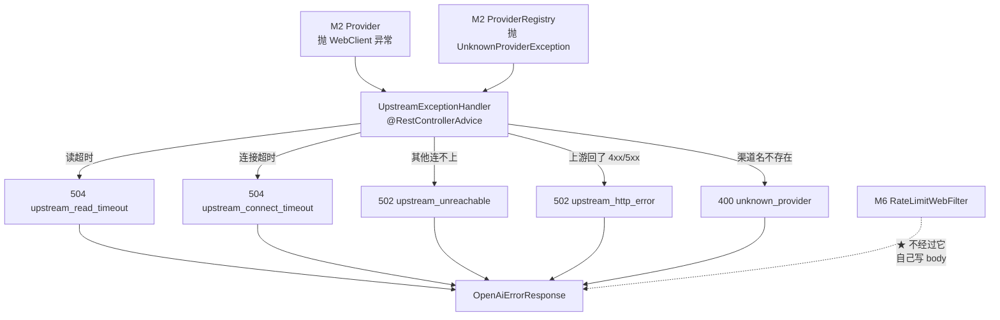

# UpstreamExceptionHandler

> **本页速览**
> - 全项目的**唯一异常出口**。121 行,3 个 `@ExceptionHandler`,覆盖全部上游异常。
> - ★ 它的价值不在"捕获异常",在**把异常翻译成"谁的错"** —— 这是 502 / 504 / 400 的分配器。
> - ★★ 本页最该学的方法:`hasCause()` —— 一个**沿异常链向下走**的小工具,没有它 504 就出不来。
> - ⚠️ 有一处**真实的错误**:`type` 字段恒为 `"upstream_error"`,连 400 也标上了。见文末。
> - ★ 它**管不了 filter 里的异常** —— 这是 WebFlux 的一条硬边界。
>
> **导航**:[← 上一页:M5 模块首页](_index.md) ｜ [下一页:类-UnknownProviderException →](类-UnknownProviderException.md) ｜ [所属模块:M5 错误处理](_index.md)

## 一句话职责
**把所有从业务代码里抛出来的异常,翻译成"正确的 HTTP 状态码 + OpenAI 格式的错误体"。**

---

## 位置
`src/main/java/com/example/gateway/exception/UpstreamExceptionHandler.java`(121 行)

---

## 为什么需要这个类(设计动机)
### 问题:没有它,所有错误长得一模一样
```text
上游读超时 / 连不上 / 返回 401 / 渠道名写错 → 全是 500
★ 对客户端:四种完全不同的故障,一种表现;对运维:告警只有"错误率上升",没有方向
```

**而且响应体还是 Spring 的默认格式**:

```json
{"timestamp":"2026-10-17T10:00:00.000+00:00","status":500,
 "error":"Internal Server Error","path":"/v1/chat/completions"}
```

❌ 不是 OpenAI 错误格式 → 客户端 SDK 解析失败;❌ 没有 type / code → 程序没法按错误类型分支处理;❌ 有 timestamp/path → 泄漏内部细节,客户端用不上。

### 它给出的答案
★ 把"异常 → 响应"的映射集中到一个类里 → 三种异常、四种情况、四个状态码全部在一处可见,加一种新异常时只改这一个文件。

> ★ **规律**:「**错误映射表放在一处,才能被审阅**」。如果映射散在各处 `try/catch` 里,没人能回答"这个服务总共有多少种错误码"。

---

## 关键方法
### ① `handleUpstreamFailure(...)` —— 502 还是 504
```java
@ExceptionHandler({WebClientRequestException.class, ReadTimeoutException.class,
                   ConnectTimeoutException.class})
public ResponseEntity<OpenAiErrorResponse> handleUpstreamFailure(Throwable e) {
    if (hasCause(e, ReadTimeoutException.class))    → 504 "upstream_read_timeout"
    if (hasCause(e, ConnectTimeoutException.class)) → 504 "upstream_connect_timeout"
    → 502 "upstream_unreachable"
}
```

| 项 | 说明 |
|---|---|
| **做什么** | 把三个类别的上游连接异常,按**具体原因**分成 502 / 504 |
| **参数** | `Throwable e` —— ★ **故意用最宽的基类** |
| **返回值** | `ResponseEntity<OpenAiErrorResponse>` —— 状态码 + OpenAI 错误体 |
| **被谁调用** | ★ **Spring 调用,不是人调用**(`@ExceptionHandler` 是回调) |
| **调用了谁** | `hasCause()`、`build()`、`log` |

### ★ 为什么参数类型是 `Throwable`,不是具体异常
**因为这里要处理的是"一族"异常,而它们的共同基类只有 `Throwable`**:ReadTimeoutException / ConnectTimeoutException 都 extends TimeoutException,WebClientRequestException extends WebClientException。★ 三者没有共同的"上游异常"基类(都是 Netty / Reactor 的类,我们改不了)→ 只能退到 Throwable,再在方法体里 ★ 用 hasCause() 自己去分辨。

> ★ **规律**:「**当框架给的异常类型体系不够用时,分类逻辑只能自己写**」。而"自己写"的第一件事,就是先搞清**异常是怎么层层包起来的**。

### ★★ `hasCause(...)` —— 本页最该学的方法
```java
private boolean hasCause(Throwable t, Class<? extends Throwable> type) {
    for (Throwable cur = t; cur != null; cur = cur.getCause()) {
        if (type.isInstance(cur)) return true;
        if (cur.getCause() == cur) break;      // ★ 自引用 → 停,防死循环
    }
    return false;
}
```

| 项 | 说明 |
|---|---|
| **做什么** | 沿 `getCause()` 链往下走,看**链上任何一环**是不是目标类型 |
| **参数** | 起点异常、要找的类型 |
| **返回值** | `true` = 链上有 |
| **被谁调用** | `handleUpstreamFailure()` 两次 |
| **调用了谁** | `Throwable.getCause()` |

#### 为什么不能只看最外层(`e instanceof ReadTimeoutException`)
**因为异常是层层包装的**。真实异常链:

```text
【最外层】WebClientRequestException: Connection prematurely closed → cause: reactor.netty.http.client.PrematureCloseException → cause: ★ ReadTimeoutException: Read timeout
↑ 真正的病因埋在第三层,而参数拿到的是第一层
```

```java
// ❌ 这样写,504 永远出不来
if (e instanceof ReadTimeoutException) { ... }
// ✅ 必须往下挖
if (hasCause(e, ReadTimeoutException.class)) { ... }
```

> ★★ **规律**:「**异常链是洋葱,病因在最里面那一层**」—— 而框架给你的那个异常,**通常是描述"在做什么时失败了",不是"为什么失败"**。

#### 那两个 `if` 的顺序也是设计
① 先查 ReadTimeout → ② 再查 ConnectTimeout → ③ 都没有 → 502 unreachable。**为什么读超时必须排在连接超时前面**:读超时的异常链里可能同时出现两种超时相关的类型(读超时是"连上了但没数据",实现上会牵扯到连接层的类)。★ 若先判断连接超时,一个读超时可能被误标成"连不上" → 排查方向从"上游慢"跑偏到"网络不通"。

> ⚠️ **诚实标注**:这个顺序是**防御性的**。当前代码路径下两者通常互斥,但**把更具体的判断放前面**是一条便宜且不会出错的纪律。

#### `if (cur.getCause() == cur) break;` —— 一行防死循环
正常情况下 getCause() 链有终点(null);但 ★ 有些异常会自己指向自己(某些包装类实现不当)→ 循环永不结束 → ★ 请求线程被挂死。★ 加一个自引用检测:发现"自己指向自己"就停。

> ★ **规律**:「**所有 `while` 遍历,都要能回答"它一定会结束吗"**」。遍历外部数据(异常链、图、链表)时,**终止条件的健壮性比遍历逻辑本身更重要**。

### ② `handleUpstreamResponseError(...)` —— 上游"回了坏东西"
```java
@ExceptionHandler(WebClientResponseException.class) → 502 "upstream_http_error"
```

| 项 | 说明 |
|---|---|
| **做什么** | 上游**回了**响应,但状态码是 4xx/5xx(401 无效 Key、429 上游限流) |
| **为什么是 502** | ★ 上游回了坏东西 —— 网关职责是"转发",上游坏了就是网关的错 |
| **和 504 的差别** | 504 是"什么都没回来",502 是"回来了但是坏的" |

**值得想的一点**:上游返回 401(API Key 无效)时,网关也返回 502。上游 401 → 网关 502 ✅ 对的:客户端没做错任何事(它甚至不知道有"上游"),是网关自己的 Key 配错了。若把 401 原样透传:客户端以为"我的身份有问题" → 去查自己的 token,★ 它没有 token,根本没做认证。

> ★ **规律**:「**网关要做"状态码的翻译",不是"状态码的透传"**」—— 同一个状态码,站在不同的位置含义完全不同:上游的 401 是"网关没配好",对客户端就是"服务端故障"。

### ③ `handleUnknownProvider(...)` —— 唯一的 400
```java
@ExceptionHandler(UnknownProviderException.class) → 400 "unknown_provider"
```

| 项 | 说明 |
|---|---|
| **做什么** | 渠道名不存在 → **告诉客户端是它的参数错了** |
| **和上面两个的根本差别** | ★ **压根没轮到上游** |
| **测试要点** | 断言必须是 400,**不能是 5xx** |

> 完整推理 → [类-UnknownProviderException](类-UnknownProviderException.md)

### ④ `build(...)` —— 唯一的响应构造处
```java
private ResponseEntity<OpenAiErrorResponse> build(HttpStatus status, String message, String code) {
    return ResponseEntity.status(status).body(new OpenAiErrorResponse(
            new OpenAiErrorResponse.ErrorBody(message, "upstream_error", code, null)));
    //                                            ↑ ★ 恒为这样      ↑ ★ 恒为 null
}
```

| 参数 | 说明 |
|---|---|
| `status` | HTTP 状态码 |
| `message` | 给人看的(**中文**,运维读日志用) |
| `code` | 给程序看的(**英文小写下划线**,客户端按它分支) |

**★ message 和 code 的分工是刻意的**:message → 人读(日志、告警、排查),中文可以改文案;code → 程序读(客户端分支逻辑),英文 ★ 一旦定了就不能改。❌ 只给 message → 客户端要字符串匹配中文,改个标点就崩;❌ 只给 code → 运维读日志看到 "upstream_read_timeout" 还得去查表。

> ★ **规律**:「**同一个错误要有"给人看的"和"给机器看的"两份描述**」—— 一份可以随便改,一份绝对不能改。混成一份,两者都做不好。

### ⚠️ `build()` 里的两处真实问题
#### 问题一:`type` 恒为 `"upstream_error"`,连 400 也是
渠道名不存在 → 400 → 但 type 标的是 "upstream_error"。★ 客户端若按 type 做分支(如"upstream_error 就重试"),会对"参数错误"发起重试 —— ★ 而重试永远不会成功。**为什么没修**:修法很简单(给 build 加 type 参数,调用处各传各的);但 OpenAiErrorResponse 的 type 字段语义还没定:是"错误大类"(upstream / client / gateway)?还是"错误来源"(上游 / 我们)?★ 定义没想清楚之前,加参数只是把模糊搬了个地方。

> ⚠️ **诚实标注**:这是一个**已知的、有意的暂缓**。面试时这种"我知道它不对,但我想清楚了为什么现在不改"的回答,比"我没注意到"和"我马上改"都好。详见 → [类-OpenAiErrorResponse](../03-对外契约/类-OpenAiErrorResponse.md)

#### 问题二:`requestId` 恒为 `null`
字段留了,但没接上链路 ID → 客户端报错时无法给出"这次请求的编号" → 客服从日志里定位不到那一次请求。靠 @JsonInclude(NON_NULL) 把它从响应里 ★ 隐藏掉了 → 客户端只会觉得"没有这个字段"。**要做的话需要什么**:① 一个能贯穿整条链路(包括 Reactor 异步线程切换)的请求 ID;② Reactor Context 或 MDC 的桥接(★ Reactor 切换线程时 ThreadLocal 会丢);③ 在 filter 里生成、在 advice 里读出来。★ 这三件事都不难,但都不属于"错误处理"这个模块。

---

## ★★ 它管不了的那一块:filter 里的异常
**这是本页另一条必须记住的边界。**

```text
@RestControllerAdvice 的生效范围:★ DispatcherHandler 调用 handler 抛出的异常
WebFilter 跑在 handler ★ 之前 → 不在那条调用链上
★ 在 filter 里 throw new RuntimeException(...) → 得到 Spring 默认错误页,★ 不是我们的 OpenAiErrorResponse
```

**所以 M6 的限流 filter 必须自己写响应体**:

```java
// RateLimitWebFilter 里的做法(见 M6)
byte[] bytes = objectMapper.writeValueAsBytes(errorBody);
DataBuffer buffer = response.bufferFactory().wrap(bytes);
response.writeWith(Mono.just(buffer));
```

★ 同一个契约,两处实现 —— 这不是重复,是边界的代价:代价 = 改错误格式时要改两个地方 ⚠️;收益 = 限流被拒的请求 ★ 完全不会走到反序列化/路由匹配。

> ★★ **规律**:「**"能统一处理"是个需要验证的假设,不是默认事实**」。框架文档说"全局异常处理",你要问的是:**「全局」的边界在哪一层?我的代码在那一层里面吗?** 这个坑的典型症状是:**测试时发现"限流返回的格式和其他错误不一样"** —— 而如果没写测试,它会一直躺在生产里。

---

## 这个类在项目中的角色


**它是"翻译层"**:上游世界说的是"ReadTimeout / ConnectTimeout / 401",客户端世界只认"502 / 504 / OpenAI 错误格式"——**这个类就是两个世界之间的词典。**

---

## 值得学习的点
### 1. ★ 集中式异常处理 vs 分散式 try/catch
| | 集中式(`@RestControllerAdvice`) | 分散式(`try/catch`) |
|---|---|---|
| 映射表在哪 | ★ **一个文件,可以通读** | 散在 N 处 |
| 新增错误 | 加一个方法 | 要找齐所有调用点 |
| 业务代码 | ★ **干净,只有正常路径** | 每处都要包一层 |
| 遗漏风险 | 低(漏了会有日志) | ★ 高(某处忘了包 → 500) |

**分散式最难查的失败模式**:某处忘了 try/catch → 异常冒到 Spring 默认处理 → 500。表现:99% 的请求错误格式都是对的,偶尔冒出一个 Spring 默认格式的。★ 而"偶尔"意味着:它只在上游恰好以某种方式失败时出现 → 测试很难覆盖,线上偶发。

> ★ **规律**:「**分散的 catch 的失败模式是"遗漏",而遗漏是不可见的**」。集中式把"遗漏"变成一件**看得见的事** —— 因为你能一眼看完整个映射表。

### 2. ★ 异常链遍历是通用技能,不只是这里用
| 场景 | 要找什么 |
|---|---|
| 本类 | 异常链里有没有 `ReadTimeoutException` |
| 排查 OOM | 异常链最里层的 `OutOfMemoryError` |
| 日志打印 | 遍历链拼出完整的 `Caused by:` 段 |
| 判断是否"客户端主动断开" | 链里有没有 `IOException: Connection reset` |

**通用写法(可以背下来)**:

```java
for (Throwable cur = t; cur != null; cur = cur.getCause()) {
    if (目标.isInstance(cur)) return 找到;
    if (cur.getCause() == cur) break;    // ★ 别忘了这行
}
```

> ★ **规律**:「**框架给你的异常,是"在哪一层失败";病因在"最里面那一层"**」。只看最外层判断类型,是从 `try/catch` 升级到"能真正处理错误"的分水岭。

### 3. ★ 用回调方法的"参数宽度"来表达意图
```java
public ResponseEntity<OpenAiErrorResponse> handleUpstreamFailure(Throwable e)
//                                                                  ↑ 最宽
@ExceptionHandler({A.class, B.class, C.class})   // ↑ 用注解把范围收窄
```

★ 参数用 Throwable(最宽) + 注解里列具体类型(最窄)→ 类型安全靠注解,方法体靠 hasCause 自己分辨。对比:参数写成 ReadTimeoutException → 一个方法只能处理一种 → 三个方法,三份 build() 调用 → ★ 重复。

> ★ **规律**:「**当分类逻辑复杂到一定程度,把"匹配"和"处理"拆开**」—— 注解负责"哪些进来",方法体负责"进来之后怎么分"。

### 4. 121 行里,真正"做映射"的只有 3 行
**把方法体剥掉注释之后**:

```java
if (hasCause(e, ReadTimeoutException.class))         return build(GATEWAY_TIMEOUT, ...);
if (hasCause(e, ConnectTimeoutException.class))      return build(GATEWAY_TIMEOUT, ...);
                                                     return build(BAD_GATEWAY, ...);
```

★ 大部分行数花在"解释为什么这么分"上,而不是"怎么分"上 → 这和 PingController(45 行里 42 行注释)是同一个特征 → ★ 判据:这个文件的难度在"代码"还是在"判断"?

> ★ **规律**:「**当一行代码背后有三个设计判断时,注释才是主要内容**」。反过来也成立:**如果一个文件注释很多但判断很少,那是注释在掩盖问题**。

---

## 相关页

- 模块首页(完整的"谁的错"对照表) → [M5 错误处理](_index.md)
- 它能接住的第一个异常 → [类-UnknownProviderException](类-UnknownProviderException.md)
- ★ **它接不住**的那个异常 → [类-UpstreamIdleTimeoutException](类-UpstreamIdleTimeoutException.md)
- 完整链路走一遍 → [流程-错误如何变成OpenAI格式](流程-错误如何变成OpenAI格式.md)
- 响应体的结构 → [类-OpenAiErrorResponse](../03-对外契约/类-OpenAiErrorResponse.md)
- filter 为什么绕开它 → [类-RateLimitWebFilter](../06-限流/类-RateLimitWebFilter.md)

> **导航**:[← 上一页:M5 模块首页](_index.md) ｜ [下一页:类-UnknownProviderException →](类-UnknownProviderException.md) ｜ [所属模块:M5 错误处理](_index.md)
