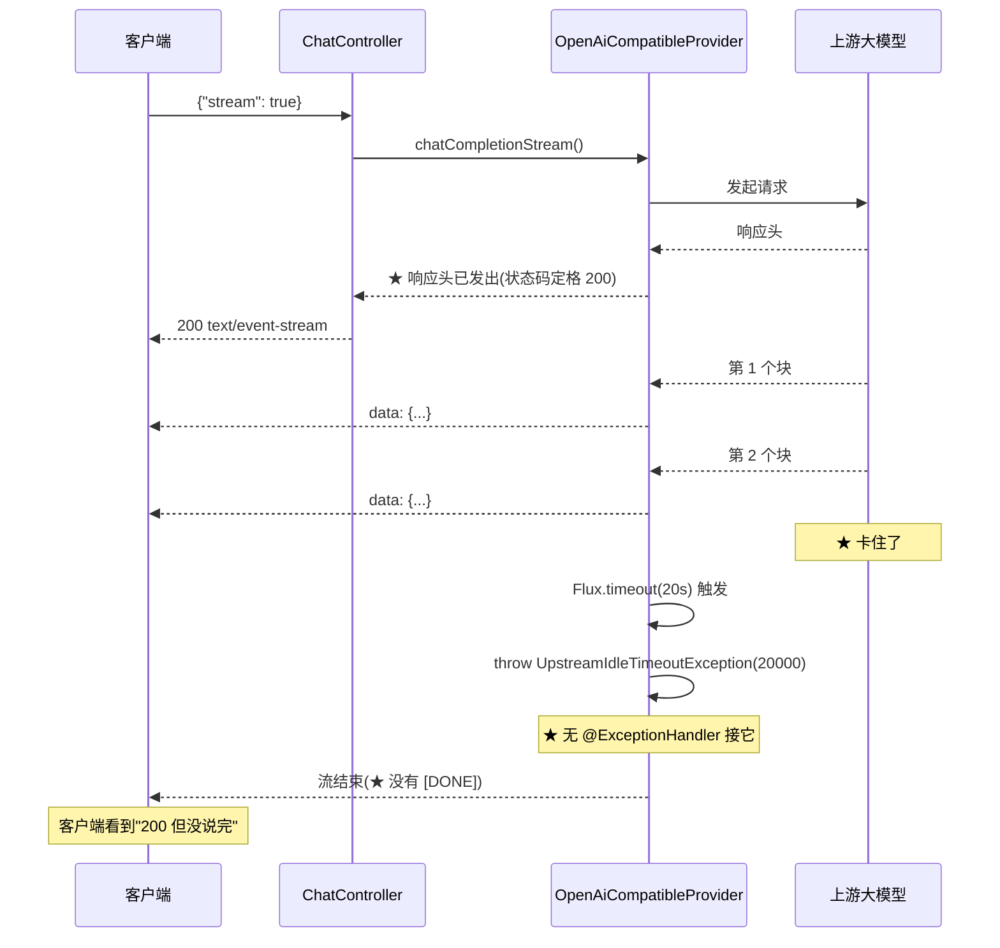

# UpstreamIdleTimeoutException

> **本页速览**
> - ★★ **全项目唯一一个"不映射 HTTP 状态码"的异常** —— 这不是遗漏,是物理限制。
> - 原因一句话:**它被抛出时,响应头已经发出去了**,状态码改不了了。
> - ★ 由此引出一条贯穿全局的纪律:**「错误处理分两个阶段,分界线是"响应头有没有发出去"」**。
> - 它只带一个字段 `idleTimeoutMs` —— 而且这个字段是**给日志和调参用的**,不是给响应用的。
> - ★ 它的价值在 G5:流式中断是一个**可以据此换渠道重试**的信号。
>
> **导航**:[← 上一页:类-UnknownProviderException](类-UnknownProviderException.md) ｜ [下一页:流程-错误如何变成OpenAI格式 →](流程-错误如何变成OpenAI格式.md) ｜ [所属模块:M5 错误处理](_index.md)

---

## 一句话职责

**表示"流式响应已经开始发送,但上游连续 N 毫秒没有吐出下一个块"。**

---

## 位置

```text
src/main/java/io/github/maixiaowen/gateway/exception/UpstreamIdleTimeoutException.java     (38 行)
```

---

## ★★ 它最特殊的地方:不映射状态码

**别的异常都在 `UpstreamExceptionHandler` 里有对应的 `@ExceptionHandler`。它没有。** **Javadoc 里的原话(值得逐字读)**:

> *"为什么它不像其他上游异常那样返回 504:
> **能抛出它,说明响应头已经发出去了**,HTTP 状态码改不了了。
> 所以它不做状态码映射,只负责让流**干净地终止并留下明确日志**。"*

### 把这条推理拆开

```text
HTTP 响应的生命周期: ① 连接建立  ② ★ 响应头发出(状态码 + Content-Type 在这一刻定格)  ③ 响应体分块发送  ④ 结束

★ 流式响应在"第一个块"之前,响应头就已经发出去了(要告诉客户端 "200 OK + text/event-stream",客户端才开始收流)
   ↓ 之后的任何错误 ★ 都发生在第 ② 步之后  ↓ ★★ 这时候你再想"返回 504"是 ★ 物理上做不到的 —— 状态码已经在线路上了,你总不能把它追回来
```

### 那客户端最终收到什么

```text
客户端看到的:
   HTTP/1.1 200 OK          ← ★ 状态码是 200,而且永远不会变
   Content-Type: text/event-stream
   ↓
   data: {"choices":[{"delta":{"content":"你"}}]}   data: {"choices":[{"delta":{"content":"好"}}]}
   ★ 然后流就断了 —— 没有 [DONE],没有错误信息

★ 注意这个结局有多"安静":不是 500,不是 504,是 ★ 一个"看起来成功但没说完"的 200
   - 如果客户端不检查 [DONE],它会以为回复就到这里了
```

> ★★ **规律**:「**流式接口的错误处理,从"状态码"退化成"流内协议"**」。这是所有流式 API 的共同问题(不只是本项目):
> ```text
> 非流式:错误 → 状态码 + JSON body        ✅ 有标准做法
> 流式:  错误 → ???                       ⚠️ 只能自己定协议
>   常见做法:① 发一个特殊的错误块  ② 发一个 OpenAI 风格的 error 事件  ③ ★ 干脆不发,只断开(本项目现在的做法)
> ```

---

## ★★ 由此提炼:错误处理的两个阶段

**这是本页最该带走的一条框架性认识。**

```text
阶段一:响应头发出之前 —— ★ 一切手段都可用
   ✅ 可以选状态码(502 / 504 / 400 / 429)  ✅ 可以选响应体格式(OpenAI 错误格式)  ✅ 可以重试、可以换渠道
   → 本模块的 UpstreamExceptionHandler 全部工作在这一阶段
阶段二:响应头发出之后 —— ★ 状态码已定格,只能用"流内"的手段
   ❌ 改不了状态码  ✅ 可以:干净地断开  ✅ 可以:打一条明确的日志  ✅ 可以:在流里补一个错误块(本项目没做)
   → ★ 本类工作在这一阶段
```

### ★★ 分界线就是"首字节"

```text
★ "响应头发出去" 这一刻 = "首字节发出去" 这一刻
   ↓ 这也是为什么 [M1 的 PingController](../04-请求入口/类-PingController.md) 会提到"G5 熔断靠的是'首字节到达前'这个时间窗":
   ↓ ★ 首字节之前:可以换渠道重试(客户端还什么都不知道)  ★ 首字节之后:不能换了(客户端已经开始收内容,换渠道会得到一份拼接错的回复)
```

> ★★ **规律**:「**"首字节"是流式系统的关键分界线**」—— 熔断、重试、降级、错误映射,**所有这些策略都要先问一句:现在过没过首字节?**

---

## 为什么需要这个类(而不是直接用现成的)

**Javadoc 里给的理由,和 `UnknownProviderException` 是同一套判据**:

> *"那两种异常在链路上会从很多地方冒出来(连接超时、读超时、客户端断开的次生异常……),排错时根本分不清是哪一种。
> 定义一个**只可能由'逐块空闲超时'这一处产生**的类型,日志和告警才能一眼定位。"*

```text
"那两种异常"指的是: ① ConnectTimeoutException —— 连不上  ② ReadTimeoutException —— 等响应头超时
它们在流式场景下 ★ 也可能出现,而且和"流中途停滞"完全不同: 连不上 → 一个块都没收到   等不到响应头 → 一个块都没收到   ★ 流中途停滞 → 已经收到 N 个块,第 N+1 个迟迟不来
★ 如果三种情况都抛 ReadTimeoutException,日志里就分不出来
```

**三种超时的对照表(本模块的核心区分之一)**:

| 现象 | 异常 | 发生时机 | 阶段 |
|---|---|---|---|
| 连不上 | `ConnectTimeoutException` | 建连阶段 | 响**应头之前** |
| 等不到响应头 | `ReadTimeoutException` | 请求已发出 | **响应头之前** |
| **流中途停滞** | ★ **本类** | 已收到若干块 | ★ **响应头之后** |

> ★ **规律**:「**超时不是一种错,是一族错**」。只要涉及网络,至少要区分:**连接超时 / 首字节超时 / 空闲超时** —— 排查时它们指向完全不同的方向(网络不通 / 服务太慢 / 服务卡住)。

---

## 关键属性

| 字段 | 类型 | 说明 |
|---|---|---|
| `idleTimeoutMs` | `long` | ★ 触发时配置的**空闲超时阈值** |

### ★ 为什么要把这个数字带在异常里

**它有两个用途,而且都不是"给客户端看"**:

```text
① ★ 给日志看 —— "流式中断,空闲超时 = 20000ms"
   → 读日志的人立刻知道:是 20 秒这个阈值被触发了 → 而不用去翻配置(配置可能被环境变量覆盖了!)
② ★ 给调参看 —— 如果日志里大量出现"空闲超时 = 20000ms",有两种可能: a) 上游真的卡住了（要换渠道 / 报障）  b) ★ 阈值设太严了 —— 大模型"思考"时间长,20 秒不吐字很正常 → 带上数字,才能判断是哪种
```

**对比"不带数字"的版本**: `❌ "流式空闲超时"` → 是多少秒触发的?去翻 application.yml? → 翻完想:等等,生产环境的配置是不是被环境变量覆盖了? → ★ 又是三轮猜测。`✅ "流式空闲超时:20000ms"`

> ★ **规律**:「**凡是"阈值触发"的事件,日志里都要带上当时的阈值**」—— 阈值本身是**配置**,而配置会变、会被覆盖、会在不同环境不同。只记"触发了"不记"触发条件",等于只记录了一半。

### ★ 那为什么不在响应里告诉客户端

```text
响应的状态码改不了,但能不能在 ★ 流里 补一个错误块? → 技术上可以(发一个 data: {"error": {...}} 再断开)
本项目 ★ 没做,原因: ① OpenAI 的流式协议里没有约定"错误块"长什么样 → 自己发明一个,客户端 SDK 不认识 → ★ 反而会解析失败  ② 现在做会引入一个"非标准的扩展" → 和 M3 "客户端零改造"的目标冲突
★ 结论:先"干净地断开 + 日志明确",把要不要补错误块留到 G5 一起想
```

> ⚠️ **诚实标注**:这是"已知未做",不是"没想到"。面试时这条可以主动说:**"流式错误目前只做到'断开+日志',客户端的表现是'回复不完整但状态码 200'。要做对的话需要在流里补一个约定的错误事件 —— 但那会破坏 OpenAI 兼容性,是个取舍。"**

---

## 它从哪里被抛出

```java
// OpenAiCompatibleProvider.chatCompletionStreamRaw() 里
.timeout(Duration.ofMillis(idleTimeoutMs))
//   ↑ ★ Flux.timeout() —— 每收到一个元素就重置计时器
//     "逐块空闲超时",不是"总时长超时"
```

**★ `Flux.timeout()` 的语义非常关键**:

```text
★ 它重置计时器的时机 = 每收到一个元素 → 所以衡量的是「★ 两个块之间的间隔」,不是「整个流的总时长」
✅ 一个 60 秒的流,如果每 5 秒吐一个字 → ★ 永远不会触发(只要 idle 阈值 > 5s)
❌ 一个 3 秒的流,如果中间卡了 25 秒 → ★ 会触发
```

**这正好符合大模型的输出特征**:

```text
用"总时长超时"(比如整个流最多 60 秒): → 长回复(500 字)会被 ★ 误杀 → 大模型吐字速度不可控,没法设一个"总能通过"的值
用"逐块空闲超时": → 不管回复多长,只要 ★ 一直在吐字 就不断 → 只有真的卡住了才断 ★ 这才是"上游卡住"的正确判据
```

> ★★ **规律**:「**流式场景下,要监控的是"间隔",不是"总时长"**」。总时长只能设成一个很宽松的值(否则误杀),而宽松的值又抓不到卡顿 —— **只有"间隔"这一个指标同时满足"不误杀"和"抓得准"**。

---

## 这个类在项目中的角色



---

## 值得学习的点

### 1. ★★ "有些错误没法用状态码表达" —— 认识到这一点才算懂 HTTP

**很多人对 HTTP 错误的认知是"选一个合适的 4xx/5xx"。而真实系统里有一整类错误发生在"状态码已经定了之后"**:

| 场景 | 状态码能表达吗 |
|---|---|
| 响应体传到一半,磁盘满了 | ❌ 已经 200 了 |
| SSE 流中途,上游挂了 | ❌ 已经 200 了 |
| 大文件下载中断 | ❌ 已经 200 了 |
| 分页接口第 3 页出错 | ❌ 前两页已经返回了 |

```text
★ 这些情况的正确做法: ① 干净地断开连接(让客户端知道"没传完")  ② ★ 留下明确的日志(让运维知道"断在哪、为什么")  ③ 如果协议支持,用 ★ 协议层 的手段表达(HTTP/2 的 RST_STREAM、chunked 的不发终止块、SSE 的自定义事件)
```

> ★★ **规律**:「**状态码是"响应的开始",不是"响应的全部"**」。一个成熟的接口设计,要回答两个问题:**「开始之前出错怎么办」** 和 **「开始之后出错怎么办」**。

### 2. ★ 一个异常"没有 handler",可能正是它设计对了

**反直觉的一点**:

```text
看到"这个异常没有 @ExceptionHandler" → 第一反应:"是不是漏了?" → ★ 正确答案:看它能不能被映射
   → 能映射却没写 = 真漏了    → ★ 物理上映射不了 = 故意不写,而且应该写注释说明
```

**这个类做对的地方**:**它把"为什么不映射"写进了 Javadoc**。

```text
❌ 不写注释的后果: 半年后有人做代码审查 → "这个异常没人处理,补一个 handler 吧" → ★ 补了一个永远不生效的 handler(或者更糟:试图在流中途改状态码 → 报错) → 白改,还可能引入 bug
✅ 写了注释: 审查的人看到 → "哦,原来是想过的" → 跳过
```

> ★ **规律**:「**"故意不做"必须留下证据,否则会被当成"忘了做"**」。这条适用于所有"负向设计":不映射、不校验、不重试、不缓存。

### 3. ★ 自定义异常的判据,在这个类上体现得最清楚

**回顾 [类-UnknownProviderException](类-UnknownProviderException.md) 里的判据**:

> 「这个异常类型,除了我想的那一处,还有别的地方会抛吗?」

**本类的答案**:

```text
★ 只有一处:.timeout() 触发时。但这里有个 ★ 微妙之处: 它的两个"兄弟"(ConnectTimeout / ReadTimeout)在链路上会从 ★ 很多地方 冒出来 —— 包括上游的响应头、甚至客户端断开产生的次生异常
★ 如果复用它们,日志里就分不清"是哪种超时" → 所以必须新建一个类型
```

**这段推理的可复用形式**:

> ★ **「我要区分的这件事,现成的类型能唯一表达吗? 不能(一个类型对应多种原因)→ 新建。」**

### 4. 38 行、一个字段、零调用方 —— 但它可能是本模块最"重"的一个类

**按代码量排,它是最小的之一。按设计含量排,它在最前面**:

| 维度 | 内容 |
|---|---|
| 要不要映射状态码 | ★ **不能映射**(物理限制) |
| 用什么超时语义 | ★ **逐块空闲**,不是总时长 |
| 客户端看到什么 | ⚠️ **200 + 不完整的流**(已知未做错误块) |
| 现在怎么用 | ★ G5 已接入:首字节**前**归为可转移的 `TIMEOUT`;首字节**后**只允许中断,不再转移 |
| 为什么不复用现成类型 | ★ 那两种会从很多地方冒出来 |

> ★ **规律**:「**代码量衡量的是打字量,不是设计量**」。面试时如果被问"你项目里最难的类是哪几个",**"最小的那个"是一个很有说服力的答案 —— 前提是你能讲清上面这五条**。

---

## 相关页

- 模块首页(这张错误码表里它为什么是"无") → [M5 错误处理](_index.md)
- 它**不被**谁处理 → [类-UpstreamExceptionHandler](类-UpstreamExceptionHandler.md)
- 它从哪里抛出(逐块超时的实现) → [类-OpenAiCompatibleProvider-深入](../02-上游渠道抽象/类-OpenAiCompatibleProvider-深入.md)
- 三种超时的分工 → [类-WebClientConfig](../01-骨架与配置/类-WebClientConfig.md)
- "首字节"这条分界线 → [类-PingController](../04-请求入口/类-PingController.md)
- 取消传播(响应头之后的另一条路径) → [类-OpenAiCompatibleProvider-深入](../02-上游渠道抽象/类-OpenAiCompatibleProvider-深入.md)
- 流式中断怎么测 → [测试-流式与取消传播](../07-测试验证/测试-流式与取消传播.md)

> **导航**:[← 上一页:类-UnknownProviderException](类-UnknownProviderException.md) ｜ [下一页:流程-错误如何变成OpenAI格式 →](流程-错误如何变成OpenAI格式.md) ｜ [所属模块:M5 错误处理](_index.md)
