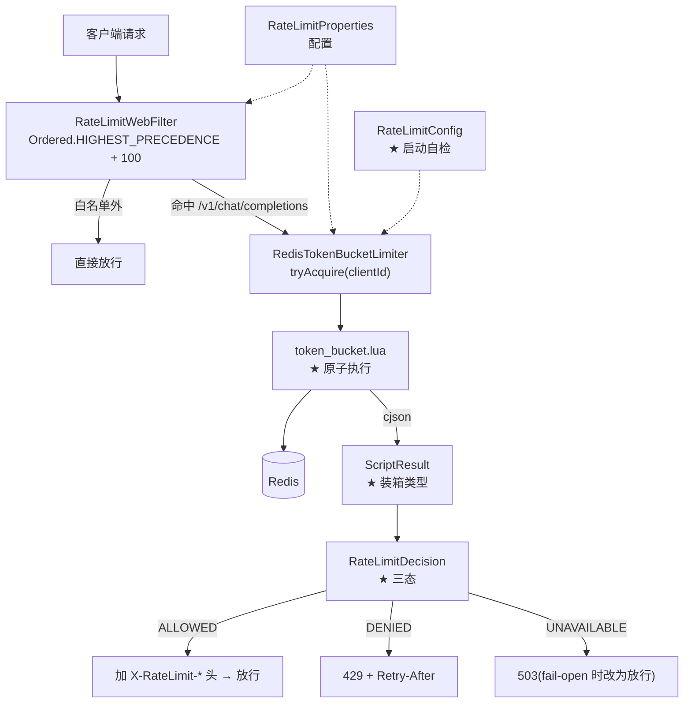
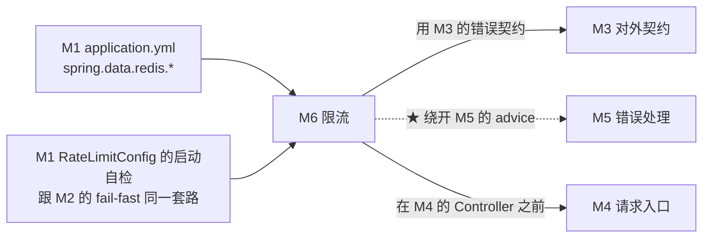

# M6 · 限流

> **本页速览**
> - 这个模块是**全项目代码量最大、也最容易写错**的一块:3 个类 + 1 个 Lua 脚本,合计 700+ 行。
> - ★ 核心算法:**Redis 令牌桶**,但真正的难点不在"桶",在**"读-判断-扣减-写回"这四步必须是原子的**。
> - ★★ 全模块最重要的一条业务决策:**Redis 挂掉时默认放行(fail-open)** —— 这是**业务判断**,不是技术判断。
> - ★ 判定结果有**三态**(放行 / 拒绝 / 限流器不可用),不是"过或不过"两态。
> - ⚠️ 有一处**刻意的代码重复**:filter 里的错误响应体是手写的,不走 `@RestControllerAdvice`。
>
> **导航**:[← 上一页:流程-错误如何变成OpenAI格式](../05-错误处理/流程-错误如何变成OpenAI格式.md) ｜ [下一页:类-RateLimitProperties →](类-RateLimitProperties.md) ｜ [回到 README](../../README.md)

---
## 这个模块解决什么问题

### 先说"不限流"会发生什么

**这不是理论风险,是网关类项目的默认死法**:

```text
网关对外暴露,背后是"按 token 计费"的大模型 API → ★ 没有限流
① 某个脚本跑飞了(死循环重试)→ 一分钟打进来几万次
② 某个人扫到了这个接口 → 白嫖额度
③ 正常用户被上游限流 → 大面积 429
★★ 三种情况的结果一样:月底账单爆炸,而 ★ 你不知道是谁干的
```

> ★ **所以限流的第一个价值不是"保护系统",是"让成本可归因"** —— 它把"谁用了多少"变成一件**记得住的事**。

### 但它不能简单地"超过 N 次就拒绝"

```text
如果限流只管"每个 IP 每分钟 60 次",会怎样?
   ↓
① 一个公司出口 IP 后面有 500 个员工 → ★ 全被算成一个人
② 突发流量:前 59 秒没用,第 60 秒连发 60 个 → ✅ 允许,然后接下来 60 秒 ★ 一次都发不出去
★ 前者是"误伤",后者是"体验断崖"
```

**所以需要的是"令牌桶"**,而不是"计数器"。

---
## ★ 令牌桶是什么(用一句话说清)

```text
想象一个桶,容量 = capacity,以每秒 refillPerSecond 个的速度 ★ 补充令牌
   每次请求 ★ 取走 1 个令牌
   · 桶里有 → 取走,放行
   · 桶里没有 → ★ 拒绝,并告诉他"还要等多久"
```

| | 固定窗口计数器 | ★ 令牌桶 |
|---|---|---|
| 突发流量 | ❌ 窗口边界处能翻倍通过 | ✅ **桶里的存量就是允许的突发量** |
| 长期速率 | ✅ 精确 | ✅ 精确(补充速度决定) |
| "还要等多久" | ❌ 答不出来 | ★ **能精确算出来**(见 `retryAfterMs`) |
| 内存 | 每个窗口重置 | ★ **一个 key 存两个数** |

> ★★ **规律**:「**限流器的好坏,一半看"拦得对不对",一半看"被拦之后能不能给出有用的信息"**」。
> 只返回 429 不返回 `Retry-After`,客户端只能瞎猜重试时机 —— 而**瞎猜的重试就是重试风暴的来源**。

---
## ★★ 真正的难点:四个动作必须是原子的

```text
一次限流判定要做四件事:① 读当前令牌数(GET) ② 判断够不够(应用层) ③ 扣减(DECRBY) ④ 写回(SET)
★ 如果分四次访问 Redis:
   A 请求:读 → 10 个,够
   B 请求:读 → 10 个,够        ← ★ 两个请求都读到 10
   A 请求:扣 1 → 9
   B 请求:扣 1 → 9              ← ★ 只扣了 1 次,但放行了 2 次
   ↓
★★ 超卖。并发越高越严重,而 ★ 单测几乎测不出来
```

**解决办法:把四步塞进一段 Lua 脚本**。

```text
Redis 执行 Lua 时 ★ 整段是原子的 —— 中间不会有别的命令插进来
   ↓
四步变成一步 → ★ 不可能超卖
```

> ★★ **规律**:「**只要"读改写"跨越了网络边界,就必须考虑原子性**」。
> 这和数据库的 `SELECT ... FOR UPDATE`、CAS 操作、`compareAndSwap` 是**同一个问题**,只是换了个存储介质。

---
## ★★ 全模块最重要的一条决策:fail-open 还是 fail-closed

**当 Redis 挂了(超时 / 连不上 / 脚本报错),限流器该怎么办?**

```text
选项 A:fail-closed → ★ 一律拒绝,返回 503
   ✅ 安全:绝不会超额
   ❌ ★★ Redis 抖 3 秒 → 整个网关 3 秒内 ★ 全量拒绝 → 局部故障放大成全面中断
选项 B:fail-open → ★ 一律放行
   ✅ 可用性:Redis 挂了业务照跑
   ❌ ★ 这段时间没人限流 → 存在超额风险
★ 项目的选择:B,通过 `fail-open: true` 配置,而且是 ★ 默认值
```

### 为什么选 B —— 这是**业务判断**

```text
问一句:这个网关 ★ 停了 和 ★ 超额了,哪个损失大?
网关停:★ 所有调用方立刻不可用(用户的 Agent、客服系统、知识库全挂)
超额:  ★ 账单多花一些钱,而且 ★ 有上限(Redis 挂了通常也就几分钟)
★ 两者量级不同 → 选放行
```

> ★★ **规律**:「**限流是"保护",不是"安全边界"**」。保护机制自己坏掉时,**不该比它要保护的东西更危险**。
> 但这条**不是普适的**:如果是**计费接口**或**防刷单**,fail-open 可能直接造成资损 —— **那时候必须 fail-closed,并且要接受"Redis 挂了就停服"这个结论**。★ 所以代码里它是**配置项**,不是写死的常量。

### ★ 而且"拒绝"和"故障"必须用不同状态码

```text
429 Too Many Requests      → ★ 是你的问题,退避后重试有意义
503 Service Unavailable    → ★ 是我的问题,重试没用,等我自己恢复
如果把 Redis 故障也返回 429 → 客户端会 ★ 加大重试 → 而限流器已经挂了 → 雪上加霜
```

> 这正是 [M5 那张"谁的错"表](../05-错误处理/_index.md)里的 **503**那一行。

---
## 模块结构图



---
## 类清单

| 文件 | 一句话职责 | 页 |
|---|---|---|
| `RateLimitProperties` | 配置的**形状 + 启动时校验**(★ 含一个宽松绑定的坑) | [类-RateLimitProperties](类-RateLimitProperties.md) |
| `RateLimitConfig` | 装配两个 Bean,**加一个启动自检** | [类-RateLimitConfig](类-RateLimitConfig.md) |
| `RateLimitDecision` | ★ **三态**判定结果 + 四个工厂方法 | [类-RateLimitDecision](类-RateLimitDecision.md) |
| `token_bucket.lua` | ★★ **原子算法本身**,全项目唯一的 Lua | [脚本-token_bucket.lua](脚本-token_bucket.lua.md) |
| `RedisTokenBucketLimiter` | 执行脚本、处理失败、`block()` 的边界 | [类-RedisTokenBucketLimiter](类-RedisTokenBucketLimiter.md) |
| —— | ★ 深入:`ScriptResult` 装箱、字符集、超时 | [类-RedisTokenBucketLimiter-深入](类-RedisTokenBucketLimiter-深入.md) |
| `RateLimitWebFilter` | 拦请求、写响应头、**手写错误体** | [类-RateLimitWebFilter](类-RateLimitWebFilter.md) |
| —— | ★ 深入:顺序、白名单、为什么不按渠道限流 | [类-RateLimitWebFilter-深入](类-RateLimitWebFilter-深入.md) |
| —— | ★ **端到端**:一次被限流的请求走了哪些路 | [流程-一次被限流的请求](流程-一次被限流的请求.md) |

---
## 与其他模块的交互



**★ 注意那条虚线**:限流走的是**另一条错误路径**(filter 手写响应体),原因和"为什么 `@RestControllerAdvice` 管不了它"是**同一个**。
详见 → [流程-错误如何变成OpenAI格式](../05-错误处理/流程-错误如何变成OpenAI格式.md)

---
## 本模块值得学习的设计点

### 1. ★★ 三态判定,而不是布尔值

```java
// ❌ 常见的偷懒写法
boolean allowed = limiter.tryAcquire(clientId);
   ↓
★ 它把两件完全不同的事压成了一个 false:
   ① "你超了"(调用方的问题 → 429)
   ② "我坏了"(我们的问题 → 503)
   ↓
★★ 而这两种情况,调用方该做的事 ★ 完全相反
```

> ★★ **规律**:「**当两种情况"要采取的行动不同"时,不要在类型层面把它们合并**」。
> 布尔值只有两个格子,而现实往往有三格。

| 场景 | ❌ 两态 | ✅ 三态 |
|---|---|---|
| 限流 | `allowed` | `ALLOWED / DENIED / UNAVAILABLE` |
| 缓存查询 | `hit` | `hit / miss / 未启用` |
| 健康检查 | `healthy` | `healthy / unhealthy / 未知(还没测过)` |

### 2. ★ 配置的"启动时校验"比"运行时报错"便宜得多

**`RateLimitProperties` 的紧凑构造器做了三件事**:

```text
① 把 null 的 keyPrefix 兜底成 "gw:rl"       (容错)
② ★ enabled=true 时,校验 capacity / refill / timeout 三个值   (fail-fast)
③ ★★ 校验失败的消息里,直接把"为什么"写进去    (见下)
```

> *"注意键名是 `timeout-millis` 而不是 `timeout-ms`:宽松绑定不会把 `ms` 展开成 `millis`,写成 `timeout-ms` 会被静默忽略。"*

```text
★★ 这是一个"坑过一次就再也忘不掉"的问题:
   YAML 里写 timeout-ms: 200 → 宽松绑定规范化成 timeoutms
   → 而字段 timeoutMillis 规范化成 timeoutmillis
   → ★ 不匹配 → 这个键被 ★ 静默忽略 → 字段是默认值 0 → ★★ 0 = "每次调用都立刻超时"
   ↓
★ 而这个错误在运行时表现是"限流器永远不可用"
   → 排查的人去看 Redis、看网络、看配置…… → ★ 而配置看起来是对的(那个键确实写在那儿了)
```

| 防线 | 做法 | 效果 |
|---|---|---|
| ① 拒绝未知键 | `ignoreUnknownFields = false` | ★ 写错的键名直接 **启动失败** |
| ② 启动时校验值 | 紧凑构造器 | 值为 0 也 **启动失败**,且消息里解释了坑 |

> ★★ **规律**:「**配置错误应该在启动时炸,而不是在第一次用到时静默出错**」。
> 而这个坑的特殊之处在于:**它连"报错"都不会报** —— 它只是悄悄用默认值。

### 3. ★ 限流要拦在"昂贵操作之前"

```text
限流 filter 的位置:Ordered.HIGHEST_PRECEDENCE + 100
   ↓ 在 ★ 路由匹配、JSON 反序列化之前,被拒的请求省下了:
   · 路由查找
   · 请求体反序列化成 ChatCompletionRequest
   · （大 body 的 JSON 解析是很贵的)
```

**这也解释了后面那处"刻意的代码重复"**:

```text
如果为了复用 advice 而把限流挪进 Controller:
   → ✅ 错误格式能统一
   → ❌ ★ 但被拒的请求仍然要付反序列化的成本
   → ★★ 而"拦在解析之前"恰恰是限流存在的意义之一
```

> ★ **规律**:「**拦截器的位置,应该由"你想避免什么成本"决定,不是由"哪里好写"决定**」。

### 4. ⚠️ 一处刻意的重复,以及它带来的真实维护负担

```text
★ 错误响应体有两份实现:
   · UpstreamExceptionHandler.build()        (M5)
   · RateLimitWebFilter 里手写的             (M6)
代价:改错误格式(比如加 requestId)时 ★ 必须改两个地方
★ 项目选择接受它,理由是"性能位置 > 代码收敛"
```

```text
① ★ 在 filter 的注释里写明"这里为什么不走 advice"
   → 让下一个改格式的人知道还有第二处
② 让两处 ★ 使用同一个 DTO(OpenAiErrorResponse)
   → 字段增删时,编译器会提醒(至少类型是共用的)
③ 有一条测试断言"限流返回的格式和上游错误格式一致"
   → ★ 这才是真正的保险
```

> ⚠️ **诚实标注**:本项目**做了 ① 和 ②,没做 ③** —— 见 [M7 测试验证](../07-测试验证/_index.md)里"限流的测试覆盖了什么"。

---
## 相关页

- 上一模块 → [M5 错误处理](../05-错误处理/_index.md)
- 下一模块 → [M7 测试验证](../07-测试验证/_index.md)
- 错误码分工(429 vs 503) → [M5 那张"谁的错"表](../05-错误处理/_index.md)
- 配置从哪读 → [配置-application.yml](../01-骨架与配置/配置-application.yml.md)
- Redis 客户端怎么配的 → [配置-pom.xml](../01-骨架与配置/配置-pom.xml.md)
- 一次被限流的完整链路 → [流程-一次被限流的请求](流程-一次被限流的请求.md)

> **导航**:[← 上一页:流程-错误如何变成OpenAI格式](../05-错误处理/流程-错误如何变成OpenAI格式.md) ｜ [下一页:类-RateLimitProperties →](类-RateLimitProperties.md) ｜ [回到 README](../../README.md)
