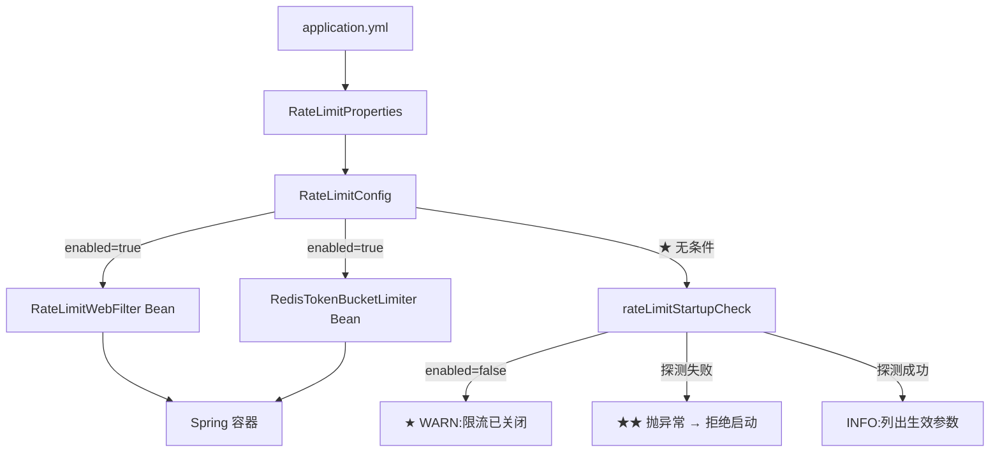

# RateLimitConfig

> **本页速览**
> - 132 行,3 个 Bean —— 但真正值得读的是第 3 个:**一个启动自检**。
> - ★ 两个业务 Bean 用 `@ConditionalOnProperty` 守卫 → **关闭限流时,这些 Bean 根本不存在**。
> - ★★ 本页核心是那个自检方法:它**覆盖三种状态**,其中一种会**让应用拒绝启动**。
> - ★ 自检里用了 `block()` —— 一个在 WebFlux 项目里通常被禁止的调用。本页解释**为什么这里可以**。
> - ⚠️ 那个 `block()` 也带来一个真实的边界:**Redis 没起来时,应用也起不来**。
>
> **导航**:[← 上一页:类-RateLimitProperties](类-RateLimitProperties.md) ｜ [下一页:类-RateLimitDecision →](类-RateLimitDecision.md) ｜ [所属模块:M6 限流](_index.md)

---

## 一句话职责

**把限流的零件装配起来,并在应用启动时**主动验证一次**"这套东西真的能用"。**

## 位置

```text
src/main/java/com/example/gateway/config/RateLimitConfig.java     (132 行)
```

## 为什么需要这个类(设计动机)

```text
假设只有 @Component 标注的 Limiter 和 Filter,没有任何启动检查:
① Redis 地址配错 → 应用 ★ 正常启动
② 第一个请求进来 → filter 调限流器 → Redis 连不上 → 超时
③ 超时 → 走 onErrorResume → ★ fail-open → 放行
★★ 系统表现:一切正常,日志里只有几条 WARN,而 ★ 限流从没生效过 → 直到月底账单或额度被打光
```

> ★★ **这个失败模式的关键特征是「安静」**:应用起来了 ✅ 请求正常返回 ✅ 没有任何报错 ✅
> ★ 唯一不对的是:**你以为有的保护,其实不存在。**

**它给出的答案**:**启动时真的去调一次 Redis**,让"不可用"变成"起不来"。

## 关键 Bean

### ① 两个业务 Bean,都被条件守卫

```java
@Bean
@ConditionalOnProperty(prefix = "gateway.rate-limit", name = "enabled", havingValue = "true")
public RateLimitWebFilter rateLimitWebFilter(...) { ... }

@Bean
@ConditionalOnProperty(prefix = "gateway.rate-limit", name = "enabled", havingValue = "true")
public RedisTokenBucketLimiter redisTokenBucketLimiter(...) { ... }
```

| 项 | 说明 |
|---|---|
| **做什么** | 创建 filter 和 limiter |
| **条件** | ★ `gateway.rate-limit.enabled: true` 时才创建 |
| **为什么不直接 `@Component`** | 见下 |

### ★ 为什么用条件装配,而不是"创建了但内部判断 enabled"

```text
方案 A(条件装配):enabled=false → ★ 这两个 Bean 压根不存在 → Spring 不创建它们 → 不连 Redis → 不占内存 → 不注册 filter

方案 B(创建但内部判断):enabled=false → Bean 存在,但每次调用都 if (!enabled) return 放行 → ★ 每次都白走一遍代码路径 → ★★ 更糟:filter 仍注册在链上,什么都不做

★ 可断言"关闭限流时,容器里没有 RateLimitWebFilter 这个 Bean" → 一个 ★ 可测的、明确的边界
   → 而方案 B 只能断言"它放行了",不能断言"它没参与"
```

> ★ **规律**:「**"关掉一个功能"最好的方式,是让它不存在,而不是让它不生效**」。
> 不存在的东西**不可能有 bug**,也不会有意外的副作用。

### ★ 顺带:`@ConditionalOnProperty` 的默认行为

```java
@ConditionalOnProperty(prefix = "gateway.rate-limit", name = "enabled", havingValue = "true")
//                                                                  ↑ 没有 matchIfMissing
```

```text
★ 没写 matchIfMissing = true → 默认 false → YAML 里 ★ 完全没提 enabled 这个键 → 条件不满足 → ★ Bean 不创建 → 限流关闭

**这个默认是刻意的**:★ 限流"默认关闭"比"默认开启"安全。
   → 如果默认开启:没配 capacity 的项目起来就带着 capacity=0 的限流器 → ★ 所有请求被拒 → 比"没有限流"更糟
```

### ② ★★ 第三个 Bean:`rateLimitStartupCheck` —— 本页的核心

**注意它没有 `@ConditionalOnProperty` 守卫** —— 这是刻意的,因为**它的职责之一就是"告诉你在关着"**。

```java
@Bean
public ApplicationRunner rateLimitStartupCheck(...) {
    return args -> {
        // ★ 三种状态,三条不同的路
    };
}
```

**三种状态**:

| 状态 | 检测 | 行为 |
|---|---|---|
| ① 限流**被关闭** | `!properties.enabled()` | ★ **WARN 一条日志**,然后正常启动 |
| ② 限流开着但 **Redis 不可用** | 探测失败 | ★★ **抛异常,拒绝启动** |
| ③ 一切正常 | 探测成功 | INFO 一条,**列出生效的参数** |

### 状态 ① 为什么是 WARN 而不是 ERROR

```text
关闭限流 ★ 是合法配置选择(本地开发、压测环境常关) → 不该阻止启动
但 ★ 也绝不该完全不说 → "我以为它开着,其实关着"是"安静失败"的另一种形态
★ WARN 是唯一正确的级别:不阻断,但一定出现在日志里
```

> ★ **规律**:「**"功能被关闭"这件事,必须留下痕迹**」。
> 生产出问题时第一要问的常是"这功能到底开着吗"——日志里没明说,你只能靠翻配置猜(而配置可能被环境变量覆盖)。

### ★★ 状态 ② 为什么必须"拒绝启动" —— 本页最重要的一条

```text
Redis 不可用 → 拒绝启动
★ 表面看很"脆弱":Redis 抖一下,应用就起不来
★ 但对比上一页 Properties 的 failOpen:failOpen=true 含义是「★ 运行时 Redis 挂了,我放行」
★★ 而"启动时 Redis 连不上"是另一回事:大概率是"地址配错了"/"Redis 没起"
   → ★ 这是"配置错误",不是"运行时抖动" → 配置错误 ★ 永远不会自愈 → 让它启动失败是唯一能让人立刻发现的时机
```

| | 运行时连不上 | ★ 启动时连不上 |
|---|---|---|
| 大概率原因 | Redis 抖动 / 网络闪断 | **配置写错了 / Redis 没起** |
| 会自愈吗 | ✅ 会(几秒后恢复) | ❌ **不会** |
| 数据点 | 已经有一个"可用"的基线 | ★ **还没有任何基线** |
| 正确反应 | fail-open,**保持服务** | ★ **fail-fast,别让它起** |

> ★★ **规律**:「**同样的故障,发生在启动时和运行时,应该有不同的处理方式**」。
>
> 判据是:**「现在有可用的基线可以退回去吗?」**
> - 有(运行中)→ 退回基线,别让服务中断
> - 没有(启动中)→ ★ **没有基线可退,就别假装能用**

### 状态 ③ 为什么要"列出生效的参数"

```text
限流已启用：容量=10，补充速率=1.0/秒，超时=200ms，key前缀=gw:rl，Redis故障时=放行

① ★ 它是"实际生效值",不是"配置文件里的值" → 可能被 application-prod.yml / 环境变量 GATEWAY_RATE_LIMIT_CAPACITY 覆盖,也可能被上一页"键名写错被静默忽略"影响
② ★ 它让"配置到底生效没有"一眼可见 → 排查"限流怎么没生效"时,★ 第一件事就是看这行日志
```

> ★ **规律**:「**把"最终生效的配置"打出来,是排查配置问题的第一步**」。
> 配置层次(文件 / profile / 环境变量 / 命令行)越多,这一步越值钱。

## ★ `block()` —— 一个在 WebFlux 里通常被禁止的调用

**自检里需要"同步地探测一次 Redis"**,而 `RedisTokenBucketLimiter.tryAcquire()` 返回 `Mono`。**于是必须用 `block()`,而它在 WebFlux 里通常是一条红线。**

### 为什么通常是红线

```text
WebFlux 用 ★ 少量事件循环线程(≈ CPU 核数)服务全部请求
在事件循环线程上 block():这条线程被挂住 → ★ 它负责的 ★ 所有连接全部卡住 → 几个并发就够了 → ★★ 整个网关停止响应
```

> 这条在 [类-PingController](../04-请求入口/类-PingController.md) 里也提过:
> **"WebFlux 的收益不来自 `Mono` 这个类型,来自 IO 是异步的"** —— 而 `block()` 正是把这笔收益**当场退回去**。

### ★ 为什么这里可以

```text
★ 判断依据只有一条:这段代码跑在哪个线程上?
   事件循环线程(reactor-http-nio-*)  → ❌ 绝对不能 block
   ★ Spring 启动主线程(main)        → ✅ 可以 block
   ↓
ApplicationRunner 运行在 ★ 应用启动阶段,此时 HTTP 服务器 ★ 还没开始接收请求 → 没有别的连接会受影响 → ★ block 的唯一后果是"启动慢一点点"
```

**项目的 Javadoc 里明确写了这一点** —— 这正是"知情使用"和"随手乱用"的区别:

> *"`block()` 在这里是可接受的:它运行在启动主线程上,不是事件循环线程。
> 启动阶段还没有请求在跑,阻塞它不影响任何连接。"*

> ★★ **规律**:「**"能不能 block"不是看 API,是看线程**」。
> 同一个 `block()`,在主线程上是方便的工具,在事件循环上是生产事故。
> 看到 `block()` 时的正确反应不是"这是错的",而是**"这行跑在什么线程上"**。

## ⚠️ `block()` 带来的一个真实边界

```text
自检会 block 地探测 Redis
★★ 如果 Redis 没起来,应用 ★ 也起不来
后果(部署时的真实场景):Pod 启动 → 连不上 Redis → 启动失败 → K8s 重启 Pod → 又失败 → CrashLoopBackOff
```

| 部署方式 | 影响 |
|---|---|
| ★ 有编排(K8s / docker-compose `depends_on` + healthcheck) | ✅ **好事** —— 依赖没起来就别启动,避免"起来了但不可用" |
| ⚠️ 手工部署 / Redis 是可选依赖 | ❌ **麻烦** —— 需要保证启动顺序 |

```text
★ 正确理解:这把"启动顺序"从 ★ 隐式约定 变成 ★ 显式依赖 → 以前:先起 Redis 再起应用(靠人记着) → 现在:★ 不按顺序就起不来(靠系统保证)
```

> ⚠️ **诚实标注**:项目**没有**在这种启动失败时提供"跳过自检"的开关。
> 生产环境通常会需要逃生阀(比如 `gateway.rate-limit.startup-check: false`),用于"Redis 正在迁移、我要先把应用拉起来"这种场景。
> **现在没有 → 只能靠改代码或临时关掉整个限流来绕过。**

## 这个类在项目中的角色



## 值得学习的点

### 1. ★★ "启动自检"是一个被严重低估的模式

| | 没有自检 | 有自检 |
|---|---|---|
| 发现时机 | 第一个生产请求 | ★ **部署的那一刻** |
| 谁发现 | ★ **用户 / 账单** | ★ **部署的人** |
| 修复成本 | 线上热修,要定位是哪个依赖 | 改配置重新部署 |
| 有没有"静默期" | ★★ **有**,可能几小时到几天 | ✅ **没有** |

> ★★ **规律**:「**能提前到启动阶段的检查,就不要留到运行时**」—— 因为启动阶段有运行时没有的东西:**有人在看着**。

| 位置 | 检查什么 | 失败行为 |
|---|---|---|
| `ProviderRegistry` 构造器 | 渠道表合法性 | ★ 启动失败 |
| `RateLimitProperties` 构造器 | 配置值合法性 | ★ 启动失败 |
| ★ `rateLimitStartupCheck` | **依赖真的能用吗** | ★ 启动失败 |

> ★ 前两个是"**数据校验**",第三个是"**连通性验证**" —— 后者是前两者做不到的:配置可以完全合法,但 Redis 地址就是错的。

### 2. ★ 用一个"永远存在的 Bean"来报告"某个功能不存在"

```text
功能 A 是可开关的
★ 但"它开没开"这件事本身,不该是可开关的 → 否则关闭时你连"它关着"都不知道
★ 用一个无条件存在的组件,来报告条件组件的有无
```

> ★ **规律**:「**"功能开关"和"功能开关的状态"是两件事,后者不该被前者控制**」。
> 同类的还有:健康检查端点不该被业务开关关掉、审计日志不该被"调试模式"关掉。

### 3. ★ 校验放在构造器,连通性验证放在 `ApplicationRunner`

```text
构造器里做网络调用 → ★ 三个问题:
   ① 构造函数有副作用(网络 IO),难测、难 mock
   ② Bean 创建顺序问题:限流器构造时,Redis 客户端可能还没建好
   ③ ★ 抛异常时堆栈显示"创建 Bean 失败",不是"Redis 不可用" —— 排查信息被包一层
★ ApplicationRunner 在所有 Bean 创建完之后运行 → 依赖全部就绪 → ★ 失败信息干净
```

> ★ **规律**:「**构造器负责"这个对象长得对不对",不负责"它依赖的外部世界在不在"**」。
> 前者是**不变量的自检**(必须有),后者是**环境的验证**(放到启动流程后期)。

### 4. 三个状态,三条路 —— 一个通用的"启动自检"模板

> ★ **规律**:「**日志级别应该由"读者该采取的行动"决定,不是由"技术上严不严重"决定**」。
> 限流关着技术上完全正常,但读者**需要知道** → WARN。

## 相关页

- 模块首页(为什么要 fail-open) → [M6 限流](_index.md)
- 被它创建的配置对象 → [类-RateLimitProperties](类-RateLimitProperties.md)
- 自检里调用的那个方法 → [类-RedisTokenBucketLimiter](类-RedisTokenBucketLimiter.md)
- 被它创建的 filter → [类-RateLimitWebFilter](类-RateLimitWebFilter.md)
- 另一处 fail-fast → [类-ProviderRegistry](../02-上游渠道抽象/类-ProviderRegistry.md)
- 为什么在 WebFlux 里 `block()` 通常被禁 → [类-PingController](../04-请求入口/类-PingController.md)
- Redis 客户端从哪来 → [配置-pom.xml](../01-骨架与配置/配置-pom.xml.md)

> **导航**:[← 上一页:类-RateLimitProperties](类-RateLimitProperties.md) ｜ [下一页:类-RateLimitDecision →](类-RateLimitDecision.md) ｜ [所属模块:M6 限流](_index.md)
