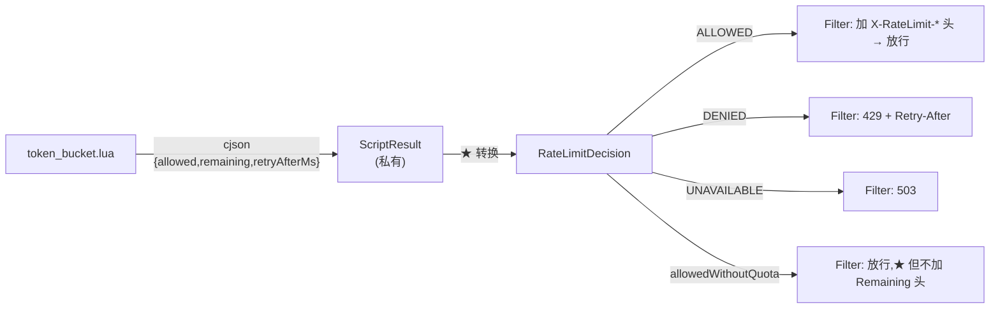

# RateLimitDecision

> **本页速览**
> - 102 行的 `record`,3 个字段 —— 它回答的问题只有一个:**"这次到底过不过"**。
> - ★★ 核心设计:**三态,不是布尔**。`ALLOWED` / `DENIED`(你太快) / `UNAVAILABLE`(我坏了)。
> - ★ 两个哨兵值 `-1L` 都表示"未知",而不是"零" —— 理由很具体:**报 0 是在撒谎**。
> - ★★ `retryAfterSeconds()` **向上取整**。差 1 毫秒的取整方向,决定客户端会不会被二次拒绝。
> - ★ 它**故意不接收** Redis 脚本的返回结构 —— 一条重要的边界判断。
>
> **导航**:[← 上一页:类-RateLimitConfig](类-RateLimitConfig.md) ｜ [下一页:脚本-token_bucket.lua →](脚本-token_bucket.lua.md) ｜ [所属模块:M6 限流](_index.md)
## 一句话职责
**描述一次限流判定的结果 —— 过没过、还剩多少、以及"多久后再来"。**
## 位置
```text
src/main/java/io/github/maixiaowen/gateway/limiter/RateLimitDecision.java     (102 行)
```
## ★★ 为什么是三态,不是 `boolean allowed`
**这是本类的全部理由,源 Javadoc 里写得很直接**:
> *"如果只有 `boolean`,这两种情况会共用 429。后果很具体:**客户端看到 429 会'退避后重试'—— 而我们的 Redis 挂了,重试一万次也没用**;同时值班的人看到 429 会去查'谁在刷接口',而真凶是 Redis。**错误码选错,不只是不好看,是把所有人指错了方向。**"*

### 把这条推理展开成"谁会因此走错路"
```text
【只有 boolean,两种失败都是 false → 都返回 429】
① 客户端:429 → "我太快了" → ★ 退避后重试 → 又被拒 → ★ 对着坏掉的 Redis 做指数退避
   → ★★ 加重故障:每次重试仍要发起一次 Redis 调用(而它正超时)
② 值班:告警"429 激增" → 查"谁在刷接口"没发现异常 → ★ 真凶 Redis 在另一个监控面板
   → ★★ 排查方向从"基础设施"跑偏到"某个客户"
③ 你自己:全是 429 → ★ 分不清"真的超额"还是"限流器一直在坏"
```
### 三态之后,三个人各自走对路

| 结果 | 谁的错 | HTTP | 客户端该做 | 值班该查 |
|---|---|---|---|---|
| `ALLOWED` | —— | 正常 | 继续 | —— |
| `DENIED` | ★ **调用方** | **429** | 退避后重试 | 谁在刷接口 |
| `UNAVAILABLE` | ★ **我们** | **503** | 别急着重试 | ★ **Redis** |

> ★★ **规律**:「**一个布尔值把两种"要采取不同行动"的情况合并了,这就是设计缺陷**」。判据是一句话:**「拿到这个 false 的人,下一步该做什么?」** 如果答案是"看情况" → ★ **那这个类型的信息量不够**。

## 关键属性
```java
public record RateLimitDecision(Outcome outcome, long remaining, long retryAfterMillis) { }
```

| 字段 | 类型 | 含义 |
|---|---|---|
| `outcome` | `Outcome` | 三态结果 |
| `remaining` | `long` | 本次之后桶里还剩几个。★ **未知时是 `-1`** |
| `retryAfterMillis` | `long` | 建议多久后重试(毫秒)。★ **永不回填时是 `-1`** |

### `Outcome` 是一个嵌套枚举
```java
public enum Outcome {
    ALLOWED,       // 桶里够,放行
    DENIED,        // 桶里不够 → 429
    UNAVAILABLE    // 限流器坏了 + fail-closed → 503
}
```
**★ 注意它是嵌套在 record 里的** —— 调用处写成 `RateLimitDecision.Outcome.DENIED`,好处是**命名空间被收进一个明确的上下文**:`DENIED` 太泛,单独放包里会让人以为是"权限拒绝"。
> ★ **规律**:「**枚举名越短,越要放进上下文里**」。`Outcome.DENIED` 比 `RateLimitDenied` 更短,又比裸的 `DENIED` 更清楚。

## ★ 两个哨兵值:为什么用 `-1` 而不是 `0`
```java
public static final long UNKNOWN_REMAINING = -1L;   // remaining 的"未知"
public static final long NEVER_REFILLS     = -1L;   // retryAfterMillis 的"永不回填"
```
**Javadoc 里对 `UNKNOWN_REMAINING` 的解释是本页最值得读的一段**:
> *"**用 -1 而不是 0**:报 0 是在撒谎("已经用光了"),而调用方可能据此放弃重试 —— 用未知告诉它'我们不知道',它才会按 Retry-After 行动。"*

### "报 0 是在撒谎" —— 把这句话拆开
```text
场景:Redis 挂了,我们 ★ 根本没读到水位
❌ 报 remaining = 0 → 客户端理解"额度用光了" → ★ 可能就此放弃、走降级或报错
   → ★★ 真相是:我们不知道剩多少,可能还剩 100 个
✅ 报 remaining = -1(未知)→ 客户端理解"服务端没告诉我水位"
   → ★ 它只能按 Retry-After 行动 —— 那才是我们唯一确定的信息
```
> ★★ **规律**:「**"零"和"未知"是两个不同的值,不能用一个数表示**」。这条在设计统计/监控接口时尤其重要:
```text
错误率 = 0%   → 真的没有错误
错误率 = null → ★ 没有数据(服务没起来 / 采样失败);混成 0% → ★★ 图上看着"这段时间很健康" —— 其实是没有数据
```
### ★ 负数的第二个好处:天然可判
```text
UNKNOWN_REMAINING = -1 → ★ 负数,而"剩余令牌数"永远 ≥ 0
   → `remaining < 0` 就等价于"未知" → 出 HTTP 头时直接 skip(见 RateLimitWebFilter)
```
> ★ **规律**:「**哨兵值要选一个"值域外的值"**」。用 0 当哨兵,就永远分不清"真的是 0"和"不知道"。

## 关键方法
### 四个静态工厂 —— 覆盖全部四种结局
```java
public static RateLimitDecision allowed(long remaining)
public static RateLimitDecision denied(long remaining, long retryAfterMillis)
public static RateLimitDecision unavailable()
public static RateLimitDecision allowedWithoutQuota()
```

| 工厂 | 用在哪 | 三字段取值 |
|---|---|---|
| `allowed(remaining)` | 正常放行 | `ALLOWED, remaining, 0` |
| `denied(remaining, retryAfter)` | 桶不够 | `DENIED, remaining, retryAfterMillis` |
| `unavailable()` | ★ Redis 挂了 + **fail-closed** | `UNAVAILABLE, -1, -1` |
| `allowedWithoutQuota()` | ★ Redis 挂了 + **fail-open** | `ALLOWED, -1, 0` |

### ★★ 后两个工厂是本类的设计精华
**它们处理的是同一件事(Redis 挂了),却给出两个相反的结果**:
```text
RateLimitDecision allowedWithoutQuota()   ← ★ 注意:结果是 ALLOWED,但它 ★ 不是普通的 allowed
   → 区别在 remaining = UNKNOWN_REMAINING(-1)
★ 这个 -1 是"我们把这次失败记下来了"的唯一证据
   → 没有它,日志里"Redis 挂了"和"正常放行"长得一模一样
```
**为什么用一个专门的工厂名,而不是复用 `allowed(-1)`**:
```text
❌ allowed(UNKNOWN_REMAINING)
   → 调用处看不出"这是因为故障而放行" → 读代码的人以为是个普通放行
✅ allowedWithoutQuota()
   → ★ 方法名本身就是文档:"放行,但没扣额度" → 日志、注释、审查时一眼看出这条特殊路径
```
> ★★ **规律**:「**当同一个结果有两条语义不同的产生路径时,给它们不同的名字**」。类型一样、值一样,但**含义不同** —— 含义要靠命名表达,不能靠注释。

### `allowed()` —— 一个便利方法
```java
public boolean allowed() {
    return outcome == Outcome.ALLOWED;
}
```

| 项 | 说明 |
|---|---|
| **做什么** | 把三态收窄成一个布尔,给"只关心过不过"的调用点用 |
| **★ 风险** | ★ **它丢掉了 `DENIED` 和 `UNAVAILABLE` 的区别** |
| **谁在用** | filter 里判断"要不要继续往下走" |

```text
⚠️ 所以它只能用在"两种拒绝的处理路径相同"的地方。本项目 filter ★ 没用它 —— filter 用的是 switch (outcome),
因为 429 和 503 要走不同分支 → ★ 这个方法更像是给测试和未来的简单场景准备的
```
> ★ **规律**:「**便利方法要标清"什么场景下可以偷懒"**」。它最大的风险,是被用在**不该偷懒的地方**。

### ★★ `retryAfterSeconds()` —— 本页的第二个精华
```java
public long retryAfterSeconds() {
    if (retryAfterMillis == NEVER_REFILLS || retryAfterMillis <= 0) {
        return DEFAULT_RETRY_AFTER_SECONDS;      // 60 秒
    }
    return (retryAfterMillis + 999L) / 1000L;    // ★ 向上取整
}
```
#### ★ 为什么是"向上取整"
> *"1399ms 向下取整是 1 秒 —— 客户端 1 秒后重试,**还是不够,又被拒一次**。Retry-After 的意义是'照着这个数等就一定能过',向下取整会让它变成'照着等也过不去'。**宁可让客户端多等 1 秒。**"*

**把这一刻的真实后果画出来**:
```text
桶里还差 1399ms 才补够 1 个令牌
【向下取整 → Retry-After: 1】客户端等 1 秒 → 重试 → ★ 还差 399ms → 又被拒 → 再等 1 秒 → ✅ 过了
   → ★ 白跑一次请求,还多一次 Redis 调用
【向上取整 → Retry-After: 2】客户端等 2 秒 → 重试 → ✅ 一次就过 → ★ 代价:多等了 601ms
```
> ★★ **规律**:「**`Retry-After` 是一个承诺,不是估算**」。它的语义是"**等到这个时刻,一定会成功**",所以宁可**保守**(向上取整),不可**乐观**(向下取整):承诺失败的成本(一次白跑)大于保守的成本(多等不到 1 秒)。

#### ★ 为什么"永不回填"时给 60 秒,而不是省略这个头
> *"标准客户端看到没有 `Retry-After` 会用默认退避,而默认退避通常比 60 秒激进得多 —— 于是它会在'等多久都没用'的情况下反复重试。**给一个明确的、偏保守的数字,比不给强。**"*
```text
场景:refillPerSecond = 0(桶永不回填)→ ★ 一旦满了就永久封禁
省略 Retry-After:客户端用默认退避(可能 100ms 起步,指数增长)→ ★★ 全打在已满的桶上
   → 每秒几十次无用的 Redis 调用
给 60 秒:★ 客户端至少会等 60 秒,最终仍失败(桶永不回填)→ ★ 但我们的 Redis 得到了保护
```
> ★★ **规律**:「**当"正确答案是永远不要重试"时,给一个大的等待时间是最接近正确的表达**」。因为 HTTP 头里**没有"不要重试"这个语义**,只有"等多久"。

#### ★ 那 `DEFAULT_RETRY_AFTER_SECONDS` 为什么是 `private`
```java
private static final long DEFAULT_RETRY_AFTER_SECONDS = 60L;
//     ↑ 而上面两个哨兵是 public
```
```text
UNKNOWN_REMAINING / NEVER_REFILLS → public:它们出现在 ★ 公开工厂方法签名里,调用方要能引用
DEFAULT_RETRY_AFTER_SECONDS → private:只是 ★ 内部默认值,调用方只用 retryAfterSeconds() 拿结果
   → 暴露出去反而诱导别人绕过方法直接用这个数
```
> ★ **规律**:「**常量暴露与否,看调用方"需不需要引用它",而不是看它"是不是常量"**」。

## ★★ 一条重要的边界:它不接收 Redis 的返回结构
> *"为什么不直接拿 Redis 返回的 JSON 反序列化成这个类:脚本的返回结构是**脚本的事**,这个类是**我们 API 的事**。让它们共用一个类型,等于让 Redis 里的字段名决定了我们对外契约的形状 —— 哪天脚本想改个字段名,就变成一次对外接口变更。"*
```text
❌ 让 Lua 返回 {outcome, remaining, retryAfterMillis} 直接映射成这个 record
某天改脚本:把 retryAfterMs 改名成 retry_after_ms
   → ★ 这个类的字段名也要跟着改 → ★ 而它是对外契约的一部分(被 filter 读、被测试断言)
   → ★★ 一次"脚本内部重构"变成了"接口变更"
```
**项目的做法是加一层转换**:
```text
token_bucket.lua → 返回 cjson {allowed, remaining, retryAfterMs}
   ↓ ★ 反序列化成 RedisTokenBucketLimiter 里 ★ 私有 record ScriptResult
   ↓ ★ 在 limiter 里转换成公开的 RateLimitDecision
★ 两个类型,各管一边:一个对内(脚本契约),一个对外(API 契约)
```
> ★★ **规律**:「**跨越边界的每一层,都该有自己的类型**」。共用类型看似省事,实际是把**两边的变更耦合在一起** —— ★ 而耦合的代价,总在**改动的那一刻**才显现。

## 这个类在项目中的角色

**★ 注意它被创建的两个地方**:

| 来源 | 谁创建 | 由什么决定 |
|---|---|---|
| 正常路径 | `RedisTokenBucketLimiter` 按脚本结果转换 | 桶里够不够 |
| ★ 故障路径 | 同一个类,在 `onErrorResume` 里 | ★ **`failOpen` 配置** |

## 值得学习的点
### 1. ★★ "让类型携带决策所需的信息"是一个可复用的判据
**回顾 M5 的错误分类**(400 / 502 / 504),和本类的三态,**是同一个思路**:
```text
M5:错误 → 谁的问题 → 该不该重试   M6:判定 → 谁的问题 → 该不该重试
   ↓ ★ 两个模块都在回答同一个问题:「★ 拿到这个结果的人,下一步该做什么?」
```
**可以形式化成一条设计动作**:
```text
① 先问:拿到这个返回值的人,有几种"不同的下一步"? → 假设 3 种
② 再问:现在的类型能区分这 3 种吗? 能 → 保持;不能 → ★ 类型不够,要拆
```
**这条能用在很多地方**:

| 场景 | 只有两态会怎样 |
|---|---|
| 调用外部 API | 成功/失败 —— ★ 分不清"参数错"和"对方挂了" |
| 数据库查询 | 有/无 —— ★ 分不清"没查到"和"查询出错" |
| 文件读取 | 读到/没读到 —— ★ 分不清"文件不存在"和"权限不足" |

> ★★ **规律**:「**设计的核心动作之一,是数一数"有几种结局"**」。数错了,后面的所有处理逻辑都会跟着错。

### 2. ★ 向上取整 vs 向下取整:一个关于"承诺"的判断
**这条可以推广成一类判断**:
```text
★ 当你在告诉别人"多久之后可以做某事":这是 ★ 承诺 → 向上取整(宁可多等);还是 ★ 估算 → 向下取整(宁可早一点)
```

| 场景 | 取整方向 | 理由 |
|---|---|---|
| ★ `Retry-After` | **向上** | 承诺"等这么久一定能过" |
| 超时时间 | 向上 | 宁可多等,别误杀 |
| 预估剩余时间 | 向下 | 显示进度,早一点比晚一点好 |
| 分页的"还剩几页" | 向下 | 它是估算 |

> ★ **规律**:「**取整方向由"这个数字的语义"决定,不是由"哪个更方便"决定**」。

### 3. ★ 不可变的 `record` 让"结果"这个词变得准确
**为什么"结果"必须是不可变的**:
```text
RateLimitDecision 会被 ★ 传出去:从 limiter 传给 filter、从 filter 传给日志、从测试传到断言
★ 如果它可变:某处顺手改了 remaining → ★ 另一处看到的就不是"当初的判定结果"
★★ 而它描述的是 ★ 一个已经发生的事实 —— 事实不该被修改
```
> ★ **规律**:「**凡是描述"已经发生的事"的对象,都该是不可变的**」。事件、结果、快照、日志记录 —— 都属于这一类。

### 4. ⚠️ 一处可以改进的地方:`allowed()` 的语义有点模糊
```text
★ 它同时对两种情况返回 true:正常放行(remaining ≥ 0)、★ Redis 挂了而 fail-open(remaining = -1)
调用方写 if (decision.allowed()) 时 → ★ 看不出自己是否正在"无保护地放行"
```
**如果重写,可以更明确**:
```java
// 可能的改进方向(本项目未采用)
public boolean allowedWithQuota()   { return outcome == ALLOWED && remaining >= 0; }
public boolean allowedWithoutQuota(){ return outcome == ALLOWED && remaining < 0; }
```
> ⚠️ **诚实标注**:本项目**没有**这么做,因为 filter 用的是 `switch (outcome)`,本来就按三态分支,不需要 `allowed()`;**这个方法是给未来的简单调用点预留的**。★ 但也正因为它现在**没有生产调用方**,这种"预留的模糊"是**可以接受**的 —— 一旦有人开始用它,这个模糊就会变成一个真实的坑。

## 相关页
- 模块首页(三态 vs 布尔的设计判据) → [M6 限流](_index.md)
- 谁按三态分支 → [类-RateLimitWebFilter](类-RateLimitWebFilter.md)
- 谁创建它 → [类-RedisTokenBucketLimiter](类-RedisTokenBucketLimiter.md)
- 它接收的那份"内部结果" → [类-RedisTokenBucketLimiter-深入](类-RedisTokenBucketLimiter-深入.md)
- 脚本返回的原始结构 → [脚本-token_bucket.lua](脚本-token_bucket.lua.md)
- `failOpen` 从哪来 → [类-RateLimitProperties](类-RateLimitProperties.md)
- 同一套"错误分类"纪律在 M5 的形态 → [M5 错误处理](../05-错误处理/_index.md)

> **导航**:[← 上一页:类-RateLimitConfig](类-RateLimitConfig.md) ｜ [下一页:脚本-token_bucket.lua →](脚本-token_bucket.lua.md) ｜ [所属模块:M6 限流](_index.md)
