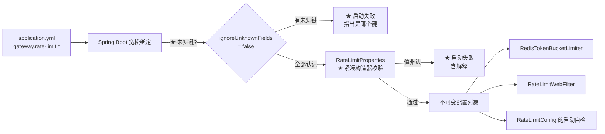

# RateLimitProperties

> **本页速览**
> - 124 行的 `record`,6 个字段 —— 但它的价值**不在字段,在紧凑构造器里的那几行校验**。
> - ★★ 本页的核心是一个 **Spring Boot 宽松绑定的真实陷阱**:`timeout-ms` 会被**静默忽略**。
> - ★ 项目用两道防线对付它:**拒绝未知键**(`ignoreUnknownFields = false`)+ **启动时校验值**。
> - ★ `failOpen` 是本模块**唯一一个纯业务决策**配置项 —— 它没有任何技术上的对错。
> - 只有 `enabled=true` 时才校验数值 —— 一个刻意的顺序安排。
>
> **导航**:[← 上一页:M6 模块首页](_index.md) ｜ [下一页:类-RateLimitConfig →](类-RateLimitConfig.md) ｜ [所属模块:M6 限流](_index.md)

## 一句话职责
**描述限流的全部可配置项,并在应用启动时把非法的配置拦下来。**

## 位置
```text
src/main/java/io/github/maixiaowen/gateway/limiter/RateLimitProperties.java     (124 行)
```

## 为什么需要这个类(设计动机)
**直接读 `@Value` 也能拿到配置**:

```java
@Value("${gateway.rate-limit.capacity}") private int capacity;
@Value("${gateway.rate-limit.refill-per-second}") private double refillPerSecond;
// ... 六行
```

**那为什么要 `@ConfigurationProperties` + `record`**:

| | `@Value` × 6 | ★ `@ConfigurationProperties` |
|---|---|---|
| 配置的形状 | ★ 散在 6 个字段上,看不出"这是一组" | ★ **一个类就是一份配置的全貌** |
| 能不能整体传给别的类 | ❌ 传 6 个参数,或者到处注入 | ✅ **注入这一个对象** |
| 未知键 | ⚠️ 完全不报错 | ✅ 可配 `ignoreUnknownFields = false` |
| 校验放哪 | 要写 `@PostConstruct` | ★ **紧凑构造器里,对象造不出来就是非法** |
| 测试 | 要起 Spring 容器 | ★ **可以 `new RateLimitProperties(...)` 直接测** |

> ★ **最后一条是本项目反复出现的主题**:能不能直接 `new` 出来测,是设计好不好的指示器(对比 [类-ProviderRegistry](../02-上游渠道抽象/类-ProviderRegistry.md) 的"不 import 框架")。

## 关键属性
```java
public record RateLimitProperties(
        boolean enabled,
        int capacity,
        double refillPerSecond,
        boolean failOpen,
        long timeoutMillis,
        String keyPrefix
) { }
```

| 字段 | 类型 | YAML 键 | 含义 |
|---|---|---|---|
| `enabled` | `boolean` | `enabled` | 总开关。★ `false` 时下面全部字段都不校验 |
| `capacity` | `int` | `capacity` | ★ **桶的容量** = 允许的突发上限 |
| `refillPerSecond` | `double` | `refill-per-second` | ★ **长期速率** |
| `failOpen` | `boolean` | `fail-open` | ★★ Redis 故障时:放行还是拒绝(见下) |
| `timeoutMillis` | `long` | ★ **`timeout-millis`** | 单次限流调用的超时 |
| `keyPrefix` | `String` | `key-prefix` | Redis key 前缀,★ **null 时兜底成 `gw:rl`** |

### ★ 两个字段组合起来才是"限流策略"
```text
capacity = 10, refillPerSecond = 1 → 平均每秒 1 个请求,但 ★ 允许一次性突发 10 个
★ "瞬时能打多快" 由 capacity 决定;★ "长期能打多快" 由 refillPerSecond 决定
```

**这两种限流要一起配才有意义**:

```text
❌ 只配 capacity,不配 refill → 桶永远不补 → ★ 前 N 个请求之后就永久封禁
❌ 只配 refill,capacity=1 → 退化成"严格的间隔限制":一个用户"1 秒内发 2 个"就被拒,即使他前 10 秒都没用 → ★ 这就是 M6 首页说的"体验断崖"
```

## 关键方法
### 紧凑构造器 —— 124 行里唯一有逻辑的地方
```java
public RateLimitProperties {
    // ① 兜底:没写 key-prefix 时给个默认值
    keyPrefix = (keyPrefix == null || keyPrefix.isBlank()) ? DEFAULT_KEY_PREFIX : keyPrefix;

    // ② ★ 只在 enabled 时才校验数值
    if (enabled) {
        if (capacity <= 0)          throw new IllegalStateException("gateway.rate-limit.capacity 必须大于 0…");
        if (refillPerSecond < 0)    throw new IllegalStateException("…refill-per-second 不能为负…");
        if (timeoutMillis <= 0)     throw new IllegalStateException("…timeout-millis 必须大于 0…");
    }
}
```

### ★ ① 为什么 `keyPrefix` 要兜底,别的字段不兜底
```text
keyPrefix 有默认值 "gw:rl"   → 因为它 ★ 不影响正确性,只是命名偏好
capacity / refill / timeout  → ★ 因为它们的"默认值"是危险的:capacity=0 → 一个请求都过不去;refillPerSec=0 → 桶永远不补;timeoutMillis=0 → ★★ 每次调用立刻超时 → 限流器永久"不可用"
★ 判据:字段的 0 值是"合理的默认"还是"灾难"?合理 → 可以给默认、可以不校验;★ 灾难 → 必须校验,而且 ★ 拒绝启动
```

> ★ **规律**:「**原始类型的"默认 0"是一个危险值,因为它不报错**」。`boolean` 默认 `false`(安全,等于关掉),`int` 默认 `0`(**可能致命**)。

### ★ ② 为什么校验被包在 `if (enabled)` 里
```text
场景:某人在 YAML 里整个关掉限流 → enabled: false,capacity / refill / timeout 一个都没写
★ 如果不判断 enabled:三个字段都是 0 → ★ 应用启动失败 → 而他的意图明明是"我不想用限流" → ★ 结果:关掉功能反而让应用起不来
```

**这是"配置的语义层次"问题**:

```text
★ enabled=false 意味着"这套配置整体无效" → "其中的数值是否合法"就 ★ 不是一个有意义的问题;对比:如果只校验 timeoutMillis 不校验 capacity,就变成"部分字段在禁用时仍需合法" → ★ 语义混乱
```

> ★ **规律**:「**校验的严格程度,应该跟着"这段配置生效了吗"走**」。对一个**整体被关闭**的功能做参数校验,只会制造无意义的启动失败。

### ★★ ③ 那条把坑写进错误消息的注释
```java
throw new IllegalStateException(
    "gateway.rate-limit.timeout-millis 必须大于 0，当前值 = " + timeoutMillis + "。"
    + "（注意键名是 timeout-millis 而不是 timeout-ms：宽松绑定不会把 ms 展开成 millis，"
    + "写成 timeout-ms 会被静默忽略）");
```

**这个坑完整地长这样**:

```text
YAML 里写 timeout-ms: 200 → Spring 宽松绑定规范化(去掉分隔符并小写) → "timeoutms"
Java 字段名 timeoutMillis → 规范化 → "timeoutmillis" → ★ 两个字符串不相等 → ★ 找不到对应字段
★★ 默认行为:静默忽略(不报错、不告警、不记录)
结果:timeoutMillis = 0 → 每次限流调用 ★ 立刻超时 → "限流器一直不可用" → 走 fail-open → ★ 实际上没有任何限流
```

> ★★ **这是本页最值钱的一条**。它的可怕之处在于**每一环看起来都对**:YAML 语法正确 ✅ / 键名风格正确(其他键都是 `xxx-yyy` 形式)✅ / 应用正常启动 ✅ / 日志没有任何异常 ✅。★★ **唯一的问题是:限流悄悄失效了。**

### ★★ 两道防线,缺一不可
| 防线 | 在哪 | 拦住什么 |
|---|---|---|
| ① `ignoreUnknownFields = false` | 类上的注解 | ★ **键名写错** → 启动失败并指出是哪个键 |
| ② 紧凑构造器校验 | 构造器里 | ★ **值不合法**(包括"因为键被忽略而变成 0") |

```java
@ConfigurationProperties(prefix = "gateway.rate-limit", ignoreUnknownFields = false)
//                                                                    ↑ ★ 第一道
```

**为什么需要两道**:

```text
只靠 ①:如果键名写对了但值写成 0 → ★ 照样静默失效
只靠 ②:如果键名写错(被忽略) → 字段是 0 → ★ 会触发校验,但报的是"timeout-millis 必须大于 0",指向 ★ 错的键名;排查的人会去改 timeout-millis 的值,而真正的错误在 timeout-ms 这个键上
★ 两道合起来:① 先保证"键名都是认识的",② 再保证"值是合法的"
```

> ⚠️ **诚实标注**:`ignoreUnknownFields = false` 是**本项目自己加的**,Spring Boot 的默认是 `true`(忽略未知键)。默认值这样定是有道理的(**宽松**能兼容多环境、多版本的配置文件),★ 但对"限流"这类**静默失效代价很高**的配置,值得改成严格。

## ★ `failOpen` —— 一个没有技术正确答案的配置项
```yaml
gateway:
  rate-limit:
    fail-open: true      # ★ 默认值
```

**它的两种取值,对应两种完全不同的业务假设**:

| 取值 | Redis 挂了会怎样 | 适合什么业务 |
|---|---|---|
| `true`(fail-open) | ★ **放行**,限流暂时失效 | 可用性优先:AI 问答、内部工具 |
| `false`(fail-closed) | ★ **拒绝**,返回 503 | 成本/安全优先:计费接口、防刷单 |

**为什么本项目默认 `true`**:

```text
★ 网关停摆 的损失  >>  ★ 短期超额 的损失
Redis 抖动通常只持续几秒到几分钟,而这期间：fail-open → 账单多花一点,但业务不中断;fail-closed → ★ 所有调用方立刻不可用
```

> ★★ **规律**:「**限流器是保护装置,它的故障不该比被保护对象更严重**」。但**这条不能照搬**,判断方法是一句话:**「把这个决定告诉业务方,他们会选哪个?」** 如果答案是"那当然不能超支",就必须 fail-closed —— ★ 而且那时候要**接受"Redis 是单点"这个事实**,去做 Redis 高可用,而不是靠限流器兜着。

## 这个类在项目中的角色


## 值得学习的点
### 1. ★ `record` + 紧凑构造器 = 校验和不可变一次拿到
```java
public RateLimitProperties {
    keyPrefix = ...;          // ★ 没有参数列表,直接改参数
    if (enabled) { ... }      // ★ 校验后字段才被赋值
}
```

**紧凑构造器的两个性质**:

```text
① ★ 没有括号里的参数列表 —— 编译器自动补上"和 record 组件同名同类型"的参数
② ★ 在构造器体里给参数重新赋值,赋的就是最终的字段值 → 所以它既是"校验点"也是"规范化点"
```

**这解决了 `record` 的一个常见抱怨**——"record 没法在构造时做校验":

```text
普通类:字段 final → 必须在构造器里赋值 → 校验和赋值混在一起写
record :★ 紧凑构造器天然就是"先跑你的代码,再赋值" → 校验、兜底、规范化,三件事在同一个地方
```

> ★ **规律**:「**紧凑构造器是 `record` 唯一允许的"副作用位置"**」—— 用好它,`record` 就能同时是 DTO 和"自校验的值对象"。

### 2. ★ 兜底和校验的区别,体现在"失败方式"上
```text
keyPrefix 不合法?  → ★ 兜底(变成 "gw:rl")
capacity  不合法?  → ★ 抛异常(拒绝启动)
```

**判据**:

| 字段性质 | 处理方式 | 理由 |
|---|---|---|
| ★ **有安全默认值** | 兜底 | 缺了不影响正确性,只是少个偏好 |
| ★ **无安全默认值** | 校验 + 拒绝启动 | 缺了会导致 ★ 静默的错误行为 |

> ★★ **规律**:「**不要给"没有安全默认值"的字段配默认值**」。一个"看起来能跑但行为悄悄不对"的系统,比一个"起不来"的系统危险得多。这和 [类-ProviderRegistry](../02-上游渠道抽象/类-ProviderRegistry.md) 的三重 fail-fast 是**同一条原则**:★ **宁可启动失败,不要运行时静默出错。**

### 3. ★ 把"坑的解释"写进错误消息里
**大多数错误消息只回答"什么不对"**。这条多回答了"**为什么会这样**":

```text
❌ "gateway.rate-limit.timeout-millis 必须大于 0，当前值 = 0" → 读的人:我明明写的是 200 啊!→ 去翻 YAML → 确实写着 timeout-ms: 200 → ★ 然后陷入困惑:配置和报错对不上
✅ "…当前值 = 0。（注意键名是 timeout-millis 而不是 timeout-ms：宽松绑定不会把 ms 展开成 millis，写成 timeout-ms 会被静默忽略）" → 读的人:哦!是键名。→ ★ 一秒修好
```

> ★ **规律**:「**错误消息的读者是"三分钟后的自己"**」—— 那时候你不知道自己写过什么,只知道"它报错了"。消息里多一句"为什么",省掉的是**重新推导整个因果链**的时间。

### 4. ⚠️ 一个诚实的遗留:`failOpen = false` 时返回 503 是硬编码的
```text
Properties 里配了 failOpen,但"503 这个状态码"不在配置里 → ★ 这没问题:503 是"限流器不可用"的语义,不该可配 → 但"fail-closed 时是否要额外告警 / 降级到本地限流"是没做的
```

**更值得说的是"没做什么"**:

| 没做的事 | 现状 | 影响 |
|---|---|---|
| **本地兜底限流** | ❌ 没做。Redis 挂了要么全放行、要么全拒绝 | ★ 中间态(用本地内存限流兜一层)是常见做法 |
| **配置热更新** | ❌ 没做。改 capacity 要重启 | 对限流来说**这个缺失是可以接受的**(改容量本来就不频繁) |
| **多租户不同容量** | ❌ 没做。全局一套 capacity | ⚠️ 真实网关通常要按客户分级 |

> ★ **规律**:「**知道一个模块"没做什么",比知道它"做了什么"更能说明你掌握它**」。面试里主动说这三条,比等着被问出来强得多。

## 相关页
- 模块首页(fail-open 的业务推理) → [M6 限流](_index.md)
- 谁把这些配置变成 Bean + 启动自检 → [类-RateLimitConfig](类-RateLimitConfig.md)
- `timeoutMillis` 用在哪 → [类-RedisTokenBucketLimiter](类-RedisTokenBucketLimiter.md)
- `failOpen` 在哪被读 → [类-RedisTokenBucketLimiter](类-RedisTokenBucketLimiter.md)
- `keyPrefix` 拼成什么 key → [类-RedisTokenBucketLimiter](类-RedisTokenBucketLimiter.md)
- 配置在 YAML 里长什么样 → [配置-application.yml](../01-骨架与配置/配置-application.yml.md)
- 另一处 fail-fast(同一个套路) → [类-ProviderRegistry](../02-上游渠道抽象/类-ProviderRegistry.md)

> **导航**:[← 上一页:M6 模块首页](_index.md) ｜ [下一页:类-RateLimitConfig →](类-RateLimitConfig.md) ｜ [所属模块:M6 限流](_index.md)
