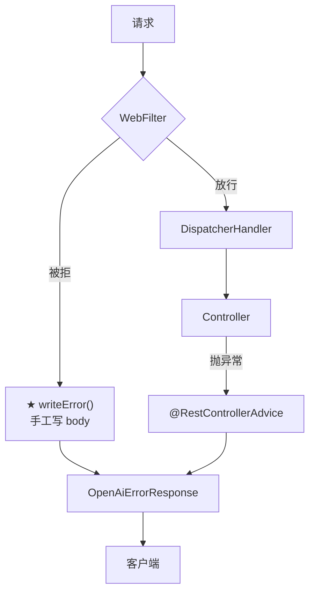

# RateLimitWebFilter · 深入

> **本页速览**
> - 主页面讲了"三个判断 + 三态分支",本页讲**两个被压缩进一行的决策**。
> - ★★ `writeError()` 手工写 body —— 因为 **`@RestControllerAdvice` 管不到 WebFilter**,这是本页最该记住的坑。
> - ★★ 而且它里面**还有一层降级**:连自己的错误体都序列化失败时,退化成一段最小 JSON。
> - ★ `resolveClientId()` 里那句:**「维度选谁,是个产品决策不是技术决策」**。
> - ⚠️ 本页完整交代 `X-Forwarded-For` 为什么不实现 —— 理由比实现本身值钱。
>
> **导航**:[← 上一页:类-RateLimitWebFilter](类-RateLimitWebFilter.md) ｜ [下一页:流程-一次被限流的请求 →](流程-一次被限流的请求.md) ｜ [所属模块:M6 限流](_index.md)
## 本页讲什么
主页面的 `apply()` 里有三个分支,每个拒绝分支的最后一行都是:

```java
yield writeError(exchange, status, type, code, message);
```
**这一行背后有两个决策,主页面都只提了一句**:

```text
① ★★ 为什么要手工写 body?→ 本页 —— 一条 WebFlux 的硬边界  ② ★★ clientId 是怎么来的?→ 本页 —— 一个产品决策
```
## ★★ ① `writeError()` —— 为什么必须手工写 body
### 坑长什么样
> *"因为**异常处理器管不到 WebFilter**。`@RestControllerAdvice` 的生效范围是「**DispatcherHandler 调用的 handler 抛出的异常**」——而 filter 在 handler **之前**,压根不在那条调用链上。在 filter 里抛异常,得到的是 Spring 的默认错误页,不是我们的 `{"error":{...}}` 契约。"*

```text
【请求处理链】★ RateLimitWebFilter(我们在这里) → DispatcherHandler → ChatController(抛异常处) → ★ @RestControllerAdvice(只接得住从这里冒上来的)
★ advice 覆盖的范围 = 「handler 及其下游」;★ filter 在 ★ 范围之外
```
### ★★ 这条注释里那句"最容易踩的坑"
> *"**这是个很容易踩的坑:你以为错误格式统一了,但有一个入口从来没走过那条统一的路。**"*
**为什么它"容易踩"**:

```text
★ 测试时的路径:① 测上游超时 → 504,格式 ✅ 对  ② 测渠道不存在 → 400,格式 ✅ 对  ③ ★ 测限流 → 429,格式…… ★ 咦?
★ 而 ①② 是"业务里的错误",③ 是"基础设施里的错误" → 写测试的人往往先覆盖 ①② → ★★ ③ 的格式问题要等到 ★ 真有人看 429 的响应体 时才发现
```
> ★★ **规律**:「**"全局异常处理"的"全局"是一个需要验证的假设,不是默认事实**」。★ 验证方法只有一条:**把每一个可能产生错误的入口,都实际请求一遍,看格式**。
### 用图看"两条路"


**同一个契约 `OpenAiErrorResponse`,两条产出路径。**
> ★ 这就是 [M5 流程页](../05-错误处理/流程-错误如何变成OpenAI格式.md) 里"限流那条绕过了 advice"的具体落点。
### ★★ `writeError()` 里还有一层降级

```java
byte[] body;
try {
    body = objectMapper.writeValueAsBytes(new OpenAiErrorResponse(
            new OpenAiErrorResponse.ErrorBody(message, type, code, null)));
} catch (JsonProcessingException e) {
    // 序列化我们自己的错误体都失败了 —— 这是 bug，但此刻**不能让它把响应变成空的**。
    // 退化成一段最小 JSON：状态码和 code 必须活着，因为客户端的重试逻辑就靠这两样。
    log.error("[限流] 错误响应体序列化失败，退化为最小 JSON", e);
    body = ("{\"error\":{\"code\":\"" + code + "\"}}").getBytes(StandardCharsets.UTF_8);
}
return response.writeWith(Mono.just(response.bufferFactory().wrap(body)));
```
#### "不能让它把响应变成空的" —— 这句话值得展开

```text
❌ 如果这里不 catch(让异常冒出去):★ 响应体是空的(或者 Spring 默认页),而 ★ 状态码 ★ 已经设成 429 → 客户端看到:"429 但没有任何信息" → ★★ 它不知道该等多久、也不知道是限流还是别的 429
★ 而"429 + 没有 body" 比 "429 + 最小 body" 更糟吗?→ 是的:★ 一个没有 code 的 429,客户端的错误处理分支会落到"未知错误"
```
**所以降级目标被明确限定为两个必须活下来的字段**:

| 字段 | 为什么必须活着 |
|---|---|
| ★ **状态码** | ★ 它决定客户端走哪条分支(重试 / 不重试) |
| ★ **`code`** | ★ 它决定**同一类状态码内部**走哪条分支 |

```text
★ 注意最小 JSON 里 ★ 没有 type、没有 message:· type → 客户端主要按 code 分支,type 是辅助 · message → ★ 给人看的,降级时最不重要
★★ "降级"的含义就是:★ 明确地决定"哪些必须保、哪些可以丢" → 而"全丢"不是降级,是放弃
```
> ★★ **规律**:「**降级要有一个明确的"最小可用集",而不是笼统地"少给点"**」。★ 判据:**「客户端拿到这个最小集,还能做对吗?」**
#### ★ 那 `body` 为什么先算成 `byte[]`

```java
byte[] body = ...;
return response.writeWith(Mono.just(response.bufferFactory().wrap(body)));
```

```text
★ 为什么不是 writeWith(Mono.just(string))?→ WebFlux 的响应写入需要 ★ DataBuffer,不是 String → bufferFactory().wrap(byte[]) → ★ 把字节包成 Netty 的缓冲区
★ 而且先算成 byte[] 有一个副作用好处:★ 序列化在返回之前就完成了 → 序列化失败能在 ★ 这里 就被 catch,而不是在流里变成另一个错误
```
> ★ **规律**:「**能在方法体里算完的东西,不要留到流里算**」——★ 因为流里的异常处理比方法体里的 `try/catch` 麻烦得多。
## ★★ ② `resolveClientId()` —— 一个产品决策

```java
private String resolveClientId(ServerWebExchange exchange) {
    String declared = exchange.getRequest().getHeaders().getFirst(CLIENT_ID_HEADER);
    if (StringUtils.hasText(declared)) {
        return declared.trim();
    }
    InetSocketAddress remote = exchange.getRequest().getRemoteAddress();
    return remote == null ? "unknown" : remote.getAddress().getHostAddress();
}
```
**逻辑只有三步,但选这个维度本身是一个决策**:
> *"**维度选谁,是个产品决策不是技术决策**。按 IP 限:一个公司出口 IP 后面的所有人共用一个桶(会议室里三个人同时用就互相挤);按用户限:公平,但需要先认证;按 API Key 限:能对应到账单,是 to-B 大模型网关的标准做法。**选哪个取决于"你想保护什么"—— 保护成本就按 Key,保护稳定性就按 IP。**"*
### ★★ 把三种维度的取舍列表化

| 维度 | ✅ 优点 | ❌ 缺点 | ★ 保护什么 |
|---|---|---|---|
| ★ **IP** | 无需认证,拿得到 | ★ **NAT 后面所有人共用一个桶** | 稳定性(别被打垮) |
| ★ **用户** | 公平 | 需要先认证 | 公平性 |
| ★ **API Key** | ★ **能对应到账单** | 需要认证 + 签发体系 | ★ **成本** |
| ★ **渠道** | 能按上游配额分配 | ⚠️ **filter 里拿不到**(见主页面) | 上游配额 |

> ★★ **规律**:「**"限流按什么维度"这个问题,答案取决于"你想保护什么"**」。★ 而这个答案**不是技术选出来的,是业务给的**。
> ★ 判据一句话:**「如果不限,最坏的结果是什么?」** - 最坏是"服务被打垮" → 按 IP(不用认证就能拦);- 最坏是"账单超支" → ★ 按 API Key(能对应到人);- 最坏是"某个用户不公平" → 按用户
### ★ `StringUtils.hasText()` 而不是 `!= null && !isEmpty()`

```java
if (StringUtils.hasText(declared)) {
```

```text
★ hasText 同时排除了三种"空":null / "" / "   "(纯空白)
★ 这和 [类-RateLimitProperties](类-RateLimitProperties.md) 里 (keyPrefix == null || keyPrefix.isBlank()) 是同一个判断 → 那边用了 JDK 的 isBlank,这边用了 Spring 的 hasText ⚠️ 两处写法不同,但语义一致
```
> ★ **规律**:「**"空字符串"和"空白字符串"在业务上通常等价于"没填"**」——★ 但代码里 `!= null` 只挡住了第一种。
### ★★ ⚠️ 然后是这段:关于 `X-Forwarded-For` 的完整交代
> *"没有 `X-Client-Id` 时退化到来源 IP。但网关前面一旦有 nginx / SLB,`getRemoteAddress()` 拿到的是**代理的 IP** ——**所有用户会被算成同一个人,限流器一开就把全员一起限死**。正确做法是读 `X-Forwarded-For` 的**第一个**地址,并且**只在"来自我们信任的代理"的请求上才认这个头** ——否则客户端自己伪造一个 XFF 就能随便换身份绕过限流。**这里先不实现,是因为现在还没有真实的部署拓扑可以验证这段逻辑;等 G9 接上真实拓扑时再写,那时候才有办法证明它是对的。写一段无法验证的转发头解析代码,比不写更危险 ——它会给人'已经处理过了'的错觉。**"*
#### 把"全员限死"这个后果画出来

```text
部署拓扑:客户端 → nginx/SLB → 网关
★ 网关看到的 remoteAddress = ★ nginx 的 IP(所有请求都一样)→ 所有用户 → clientId 都是 "10.0.0.5" → ★ 共用一个桶
★★ 容量 10 的桶,被全公司的流量一起用 → 前 10 个请求过后 → ★ 之后所有人的请求全部 429
★★ 表现:"网关一开限流就所有人都用不了" → 而排查的人去看配置:容量 10、回填 1/s ★ 都很正常
```
#### ★ 而且这里有两个坑,不是一个

| 坑 | 后果 |
|---|---|
| ★ ① 不读 XFF | ★ **全员共用一个桶** → 全员被限死 |
| ★★ ② **无条件**信任 XFF | ★★ **客户端可以伪造 XFF 换身份** → 限流被完全绕过 |

**第二个坑更危险**:

```text
★ X-Forwarded-For 是一个 ★ 普通的 HTTP 头 → 任何客户端都能自己加
如果网关无条件信任它:攻击者每次请求换一个 XFF 值 → ★ 每次都是"新客户端" → 每次都是满桶 → ★★ 限流形同虚设
★ 正确做法:只在"请求确实来自我们信任的代理"时才认这个头 → 而那需要知道 ★ 代理的 IP 段 → ★★ 也就是需要真实的部署拓扑
```
> ★★ **规律**:「**任何客户端能设置的头,在信任它之前都要问"谁能伪造它"**」。★ 同类的头:`X-Real-IP`、`X-Client-Id`(本项目也用它!)、`Referer`、`Origin`。
> ★★ **注意本项目的 `X-Client-Id` 也有这个问题** —— 它同样是客户端自报的,**客户端可以随便填一个值来换桶**。这在当前阶段是可接受的(还没有真正的认证体系),⚠️ 但**上生产前必须换成"认证之后由网关自己确定"的身份**,而不是信任客户端自报。
#### ★★ "写一段无法验证的代码,比不写更危险"
**这句话是本页最值钱的一句,值得单独拆开**:

```text
★ 写了 XFF 解析代码的后果:
   ① 代码看起来是对的(因为常见的写法就是这样)  ② ★ 审查的人看到"已经处理了转发头" → 跳过
   ③ ★★ 但"信任哪些代理"这个关键前提 ★ 没有任何代码能验证 → 因为它是 ★ 部署信息,不是代码信息
★★ 结果:一段"看起来处理过了、实际上可能完全错"的代码 → 比"明确地没处理"更危险
```
**对比两种状态**:

| | ★ 不写 | ❌ 写了但没验证 |
|---|---|---|
| 代码审查 | 会问"转发头呢?" | ★ **不会问**(看起来处理了) |
| 上线后 | ⚠️ 全员被限死 | ★★ **可能被绕过,也可能全员被限死 —— 取决于拓扑** |
| 排查 | ★ **一眼看出原因** | ★★ **要读完那段代码才能判断它对不对** |

> ★★ **规律**:「**"看起来做了"比"明确地没做"更危险 —— 因为它关闭了别人继续检查的意愿**」。
> ★ 这不是"偷懒的借口",而是一条**判断"什么时候该留空"的纪律**:**当你无法验证一个实现是否正确时,不实现 + 写清理由,是一个负责任的选择。** ⚠️ **但它的前提是**:**理由要写出来,而且要有人能看到**。如果只是"没写、也没说",那和忘了做没有区别 ——★ 这也是为什么这段注释写得这么长。
## ★ 一处跨模块的不一致:`type` 字段
**把两处的 `type` 值并排放**:

```java
// M5 · UpstreamExceptionHandler.build()
new OpenAiErrorResponse.ErrorBody(message, "upstream_error", code, null);
//                                          ↑ ★ 恒为 upstream_error,连 400 也是

// M6 · RateLimitWebFilter.apply()
writeError(exchange, TOO_MANY_REQUESTS,   "rate_limit_error",     "rate_limit_exceeded",  ...);
//                                        ↑ 这里是 rate_limit_error
writeError(exchange, SERVICE_UNAVAILABLE, "server_error",         "rate_limiter_unavailable", ...);
//                                        ↑ 这里是 server_error
```

| 场景 | `type` 值 | ⚠️ 一致吗 |
|---|---|---|
| 渠道不存在(400) | `upstream_error` | ★ **错**(不是上游的问题) |
| 上游超时(504) | `upstream_error` | ✅ 对 |
| 限流拒绝(429) | `rate_limit_error` | ⚠️ 和 M5 风格不同 |
| 限流器不可用(503) | `server_error` | ⚠️ 同上 |

> ⚠️ **诚实标注**:这两处**没有统一的 `type` 枚举**,是各写各的字符串。后果:客户端如果按 `type` 做分支,会看到一套**没有规律的取值集合**。**要修的话**需要先回答那个 M5 里悬着的问题:**`type` 到底是"错误大类"(upstream / client / gateway),还是"错误来源"(上游 / 我们)?** ★ 定义没想清楚之前,统一只是把不一致搬到一个地方。详见 → [类-OpenAiErrorResponse](../03-对外契约/类-OpenAiErrorResponse.md)

> ★★ **规律**:「**跨模块的"字符串常量"最容易长歪**」——★ 因为它们**没有编译器检查**。判据:**「同一个语义的字符串,在项目里出现了几次?」**超过一次 → ★ 应该是一个枚举或常量。
## 值得学习的点
### 1. ★★ "错误格式统一"是一个需要主动验证的命题
**本项目有两条产出错误响应的路径**:

| 路径 | 覆盖 | 怎么发现的 |
|---|---|---|
| `@RestControllerAdvice` | handler 抛出的异常 | 写代码时就想到了 |
| ★ `RateLimitWebFilter.writeError()` | filter 里拦下的 | ★ **靠"想过 filter 在哪一层"** |

**验证方法(可以照着做)**:

```bash
# 把每一个可能出错的分支都实际打一遍,看响应体格式是否一致
curl -X POST localhost:8081/v1/chat/completions -d '{"provider":"nope"}'   # 400
curl -X POST localhost:8081/v1/chat/completions -d '{...}'                 # 504(上游慢)
# ★ 连打 N 次触发限流
for i in $(seq 1 20); do curl -s -o /dev/null -w "%{http_code} " -X POST \
  localhost:8081/v1/chat/completions -H "X-Client-Id: t" -d '{...}'; done   # 429
curl localhost:8081/not-exist                                             # ⚠️ 404 —— 走的是第三条路!
```
> ★★ **规律**:「**"统一"要靠"枚举所有入口"来验证,不能靠"我以为只有一个入口"**」。★ 最后那条 `404` 的测试很重要 —— 它**既不走 filter 也不走 advice**,是 Spring 内部的处理,⚠️ 格式又是另一套(见 [M5 模块首页](../05-错误处理/_index.md) 的"没做的")。
### 2. ★★ 降级要有"最小可用集"

```java
body = ("{\"error\":{\"code\":\"" + code + "\"}}").getBytes(StandardCharsets.UTF_8);
```
**这一行的设计含量在于:它明确地选择了保什么、丢什么。**

```text
★ 保:状态码(429/503) + code(rate_limit_exceeded / rate_limiter_unavailable)  ★ 丢:type、message
★★ 而"保"的依据是 ★ 客户端的程序逻辑需要什么,不是"哪个字段重要" → message 对人重要,但 ★ 降级时人不在场(人在看日志)
```
> ★★ **规律**:「**降级时,按"机器需要什么"排优先级,不是按"人需要什么"**」。★ 因为降级发生的时刻,正是**没有人在实时处理**的时刻。
### 3. ★ 一个"产品决策"被写进了代码注释

```java
/**
 * ★ 维度选谁，是个产品决策不是技术决策 ★
 * 按 IP 限：... 按用户限：... 按 API Key 限：...
 * 选哪个取决于"你想保护什么"。
 */
```
**为什么值得学**:

```text
★ 大多数技术决策的背后,都有一个业务假设 → 而 ★ 这个假设通常没人写下来 → 半年后有人问"为什么按 IP 限?" → ★ 没人知道
★★ 把假设写下来,等于 ★ 给未来的人一个"可以重新判断"的起点 → 他可以说"现在业务变了,应该按 Key 限" → 而不是"不知道为什么这么写,不敢改"
```
> ★★ **规律**:「**写清"依据什么做的决定",比写清"做了什么决定"更有价值**」——★ 因为依据会过时,而决定本身不会告诉你它什么时候过时了。
### 4. ⚠️ 本页涉及的四处"没做"

| 没做的事 | 现状 | 影响 |
|---|---|---|
| **XFF 解析** | ❌ 不实现,⚠️ 但有明确的理由和触发条件(G9) | ★★ 有代理时全员限死 |
| **`X-Client-Id` 可被伪造** | ⚠️ 信任客户端自报 | ★ 客户端可以换桶绕过 |
| **`type` 字段不统一** | ⚠️ 和 M5 各写各的 | 客户端分支逻辑混乱 |
| **同步写响应体是阻塞的** | `objectMapper.writeValueAsBytes` 在事件循环线程上执行 | ⚠️ 量小时可接受,量大时是隐患 |

> ⚠️ **最后一条值得注意**:
> ```text
> ★ writeValueAsBytes 是 ★ 同步 的 CPU 操作 → 它跑在 ★ 事件循环线程 上 → 对一个"只有几十字节的错误体"来说 ★ 完全可接受 → ★★ 但这是一条"如果错误体变大就要重新评估"的边界
> ```
> ★ 诚实地说,这是**一个被判断为"不值得优化"的取舍**,不是遗漏。
## 相关页

- 主页面(三层叠法 + 三态分支) → [类-RateLimitWebFilter](类-RateLimitWebFilter.md)
- 它为什么绕开 advice → [类-UpstreamExceptionHandler](../05-错误处理/类-UpstreamExceptionHandler.md)
- 那条被绕开的完整流程 → [流程-错误如何变成OpenAI格式](../05-错误处理/流程-错误如何变成OpenAI格式.md)
- 三态的设计理由 → [类-RateLimitDecision](类-RateLimitDecision.md)
- `type` 字段的语义问题 → [类-OpenAiErrorResponse](../03-对外契约/类-OpenAiErrorResponse.md)
- 端到端走一遍 → [流程-一次被限流的请求](流程-一次被限流的请求.md)
- 白名单为什么排除 `/ping` → [类-PingController](../04-请求入口/类-PingController.md)

> **导航**:[← 上一页:类-RateLimitWebFilter](类-RateLimitWebFilter.md) ｜ [下一页:流程-一次被限流的请求 →](流程-一次被限流的请求.md) ｜ [所属模块:M6 限流](_index.md)
