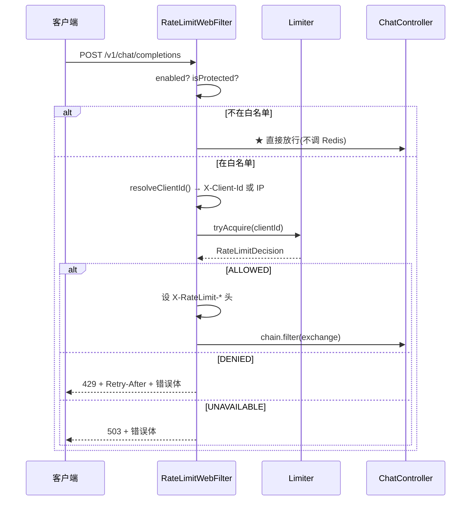

# RateLimitWebFilter

> **本页速览**
> - 限流的**入口**。219 行,职责一句话:**在请求到达任何业务代码之前,先问一句"这个客户端还有额度吗"**。
> - ★★ 为什么做成 `WebFilter` 而不是在 Controller 里调一下 —— 两个理由:**位置对** 和 **覆盖全**。
> - ★ `getOrder()` 返回 `HIGHEST_PRECEDENCE + 100`,**那 100 是刻意留出来的插队空间**。
> - ★★ 三态被翻译成三个 HTTP 结果:放行 / **429** / **503**。
> - ⚠️ 本页含一条**诚实的边界**:这个 filter **限不了"按渠道"** —— 而且是物理约束,不是偷懒。
>
> **导航**:[← 上一页:类-RedisTokenBucketLimiter-深入](类-RedisTokenBucketLimiter-深入.md) ｜ [下一页:类-RateLimitWebFilter-深入 →](类-RateLimitWebFilter-深入.md) ｜ [所属模块:M6 限流](_index.md)
## 一句话职责
**拦在业务代码之前,决定这个请求放行、429 拒绝,还是 503 拒绝。**
## 位置
```text
src/main/java/io/github/maixiaowen/gateway/limiter/RateLimitWebFilter.java     (219 行)
```
## ★★ 为什么做成 `WebFilter`,而不是在 Controller 里调一下
**Javadoc 给了两个理由,第一个是"性能",第二个是"正确性"**:
> *"① **位置对**:限流是'最便宜的一道闸'。放在 Controller 里,意味着请求要先经过**路由匹配、JSON 反序列化、日志**——**被限流的请求白白干了这些活**。攻击流量打进来时,这些'白干的活'就是被消耗掉的 CPU。
> ② **覆盖全**:filter 是**所有**请求的必经之路。放在某个 Controller 里,就天然只能守那一个端点 —— 哪天新加了端点,**限流'忘了加'是必然会发生的事**。"*
### ① 位置对 —— "白干的活"就是攻击成本
```text
【限流在 Controller 里】
请求 → 路由匹配 → ★ JSON 反序列化 → ★ 打日志 → 进 Controller → ★ 限流判断 → 429
        └──────────────── ★ 这些全白干了 ────────────────┘
【限流在 filter 里】
请求 → ★ 限流判断 → 429 ✂
        └─ 路由匹配、反序列化、日志 ★ 一步都没走
```
**为什么"白干的活"值钱**:
```text
★ 被限流的请求,恰恰 ★ 是攻击流量 / 跑飞的脚本发出来的 → 也就是 ★ 量最大的那部分
★ 如果每次都要先反序列化一个 JSON 才拒绝 → 被拒绝的请求仍然消耗 CPU → ★★ 限流器不但没保护 CPU,反而成了 CPU 的消耗方之一
```
> ★★ **规律**:「**限流应该拦在"最贵的操作"之前**」——而"哪个操作最贵"要具体看:大 body 的 JSON 解析、数据库查询、上游调用、模板渲染。★ **在 filter 里拦,是"还什么都没做"的位置。**
### ★★ ② 覆盖全 —— 这一条比性能更重要
> *"哪天新加了端点,限流'忘了加'是必然会发生的事。"*
```text
★ "必然会发生"这四个字是关键。
在 Controller 里做限流 = ★ 限流是"每个端点各自的责任" → 加端点的人要记得加 → ★ "记得"不是一种工程手段
在 filter 里做限流 = ★ 限流是"一个横切关注点" → 默认所有请求都经过 → ★ 漏掉需要 ★ 显式地排除(PROTECTED_PATHS 白名单)
★★ 差别就是:"默认保护" 和 "默认不保护"
```
> ★★ **规律**:「**安全相关的默认值必须是"保护",而不是"放行"**」。这和"白名单 > 黑名单"是同一条原则 —— 见下面 `PROTECTED_PATHS` 的注释。
## ⚠️ 一条诚实的边界:本 filter **限不了"按渠道"**
> *"路线图里写的限流维度是'按 API Key / 按用户 / 按渠道'。前两个在这里都能做,**但'按渠道'做不到 —— 因为渠道名在请求体里(`provider` 字段),而 WebFilter 跑在请求体被读取之前。**
> 理论上可以在 filter 里把请求体整个读出来缓存,但那意味着**每个请求(包括流式请求)都要先在内存里存一份完整的请求体** —— 对一个代理来说这是不可接受的(请求体会被放大,长 prompt 可以到 MB 级)。
> **所以'按渠道限流'只能在渠道被解析出来之后做(也就是 Controller 里)。这不是偷懒,是 WebFlux 里一个真实的物理约束 —— 而且它是可以被说清楚的,比含糊地说'我做了多维度限流'要值钱得多。**"*
### 把这条约束画清楚
```text
WebFilter 执行时机:请求行 + 请求头 ★ 已到达,请求体 ★ 还没被读取
而 provider 在 ★ 请求体里 → ★ filter 里拿不到
★ 想在 filter 里拿到,只有一个办法:把 body 读出来缓存在内存里
   → ★ 代价:每个请求(含流式)都在内存里放一份完整请求体
   → ★★ 长 prompt 可以到 MB 级,高并发下 ★ 内存会被打爆
```
> ★★ **规律**:「**"做不到"有两种:一种是能力不够,一种是物理上不可能 —— 而后者值得解释清楚**」。面试里的价值差别:
> - ❌ "我做了按渠道限流" → 追问"在 filter 里怎么拿到 provider 的?" → 卡住
> - ✅ "按 IP 和按客户端都能在 filter 里做。**按渠道做不到** —— 渠道名在请求体里,而 filter 跑到请求体被读之前。要在 filter 里做,就得把整个 body 缓存在内存里,对一个可能收到 MB 级 prompt 的代理来说不可接受。**所以它只能在 Controller 里做,我没有做。**" → ★ 这是"知道边界在哪"
## ★★ 三层限流的正确叠法
**即使只实现了一层,也要知道另外两层在哪**:
```text
最外层  按来源 IP 限流      ← 在认证之前,★ 目的:"别让未认证的流量打垮后面"
中间层  按客户端标识限流    ← ★ 本类。需要客户端自报身份(X-Client-Id)
最内层  按渠道 / 账号限流   ← 需要请求体或认证结果,只能在 Controller 里
```
### ★ 为什么最外层是"按 IP",而且要在认证之前
```text
★ 认证本身是有成本的(查库、验签、调认证服务)→ 有人用海量未认证请求打进来,认证会成为第一个被打垮的东西
★ 所以最外层必须是一个"不需要认证就能判断"的维度 → 而 IP 是唯一这样的维度(它在 TCP 层就有,不用读任何东西)
```
> ★★ **规律**:「**防护层的顺序,应该按"判断成本"从低到高排**」。★ 便宜的判断放前面,能挡掉的流量就不用付出后面那些昂贵的判断成本。
### ★ 那 100 个空位是怎么留出来的
```java
@Override
public int getOrder() {
    return Ordered.HIGHEST_PRECEDENCE + 100;
}
```
> *"本类的 order 是 `HIGHEST_PRECEDENCE + 100`,**刻意留出 100 个位置给将来要插到更前面的 IP 黑名单** —— **顺序就是这几层之间的关系,随便挑一个数会让自己以后没有插队空间。**"*
```text
Ordered.HIGHEST_PRECEDENCE = Integer.MIN_VALUE,+100 → ★ 前面留了 100 个位置
将来加"IP 黑名单 filter" → 用 HIGHEST_PRECEDENCE + 10 → ★ 天然排在限流之前,不用改任何已有代码
```
> ★★ **规律**:「**顺序常量不要挑"随便一个数",要挑"表达关系的一个数"**」。`HIGHEST_PRECEDENCE + 100` 表达的是"★ 我很靠前,但前面还有空间";而 `Integer.MIN_VALUE + 1` 表达的是"★ 我要抢第一" —— 那才是没有退路。
## 关键属性
| 字段 | 类型 | 说明 |
|---|---|---|
| `CLIENT_ID_HEADER` | `String` | ★ `"X-Client-Id"` —— **网关自己的约定,不是 OpenAI 协议的一部分** |
| `PROTECTED_PATHS` | `Set<String>` | ★ 白名单,目前只有 `/v1/chat/completions` |
| `limiter` / `properties` / `objectMapper` | —— | 三个依赖 |
### ★★ `PROTECTED_PATHS` —— 为什么是白名单,不是黑名单
> *"用白名单,不用黑名单:写黑名单意味着'**新加的端点默认不限流**'——于是'忘了加限流'会在每次加端点时重演。白名单的失效方式是'新端点忘了加进去,于是没被限',同样不好,但它至少是**一个集中、可见、可以写测试守住的清单**。"*
**这段注释的诚实之处在于:它承认白名单也会失效。**

| | 黑名单 | ★ 白名单 |
|---|---|---|
| 新加端点时默认 | ★ **不限流** | 不限流 |
| 失效方式 | 忘了加 → 新端点裸奔 | 忘了加 → 新端点裸奔 |
| ★ **失效清单在哪** | 散落在各处 `if` | ★ **一个 `Set.of(...)`** |
| 能写测试守住吗 | ⚠️ 难(要枚举"所有不该限的") | ★ **能**(断言"受保护路径都在这个 Set 里") |
> ★★ **规律**:「**当两种方案"失效概率一样"时,选那个"失效后能被发现"的**」。白名单的失效是**集中的、可见的**;黑名单的失效是**分散的、隐蔽的**。
### ★ 为什么健康检查"天然"不在里面
> *"限流器一旦误伤探针,Kubernetes 会把整个 Pod 重启掉 —— **你会同时失去服务和可观测性**,然后在重启的循环里找不到原因。"*
```text
/ping 被限流 → K8s liveness 探针失败 → ★ 杀掉并重启 Pod → 新 Pod 起来 → 又被限 → CrashLoopBackOff
★★ 最糟的部分:你以为是"服务挂了",去查服务 → 而真相是"探针被限流了",服务本身好好的 → 因为是重启循环,日志一直被覆盖
```
> ★ 完整推理 → [类-PingController](../04-请求入口/类-PingController.md)
> ★★ **规律**:「**给观测手段本身加限制,风险远大于收益**」。
## 关键方法
### `filter(...)` —— 三个判断,然后交给 limiter
```java
@Override
public Mono<Void> filter(ServerWebExchange exchange, WebFilterChain chain) {
    if (!properties.enabled() || !isProtected(exchange)) {
        return chain.filter(exchange);          // ★ 直接放行
    }
    String clientId = resolveClientId(exchange);
    return limiter.tryAcquire(clientId)
            .flatMap(decision -> apply(decision, exchange, chain, clientId));
}
```
| 项 | 说明 |
|---|---|
| **做什么** | 两个快速判断 → 解析身份 → 问 limiter → 按结果处置 |
| **返回值** | `Mono<Void>` —— ★ **不放任何值,只表示"处理完了"** |
| **被谁调用** | ★ **WebFlux 框架调用**(这是回调,不是普通方法) |
| **调用了谁** | `isProtected()`、`resolveClientId()`、`limiter.tryAcquire()`、`apply()` |
#### ★ 那个 `!properties.enabled()` 是"多余的",但刻意留着
```java
// 未启用时**不该有本 Bean**（由 RateLimitConfig 的 @ConditionalOnProperty 保证）。
// 这里再判一次是防御：Bean 的装配条件将来可能被改，而"限流开关失效但代码还在跑"
// 属于那种不会报错、只会悄悄改变行为的故障。多这一行，代价是零。
if (!properties.enabled() || !isProtected(exchange)) {
```
```text
★ 现在的装配逻辑:enabled=false → ★ 这个 Bean 根本不存在 → 第一半判断 ★ 永远为 false(走不到)
★★ 那为什么还留着? → 因为"Bean 不存在"这个保证 ★ 依赖于 RateLimitConfig 里的注解,
   而那个注解将来可能被改(比如"想让 filter 一直注册,只是内部跳过")→ 一旦那样改,这行判断就成了唯一的防线
★ 判据:"多这一行,代价是零;少这一行,风险是一个静默故障"
```
> ★★ **规律**:「**防御性代码的价值不在"现在需要它",在"它保护的东西将来可能变"**」。★ 但要区分:**有意识地留** 和 **不知道为什么在** —— 前者要写注释说明(像这里),后者应该删掉。
### ★★ `apply(...)` —— 三态翻译成三个 HTTP 结果
```java
return switch (decision.outcome()) {
    case ALLOWED     -> chain.filter(exchange);                    // 放行
    case DENIED      -> { ... 429 ... }
    case UNAVAILABLE -> { ... 503 ... }
};
```
**注意:先设公共响应头,再分支**:
```java
headers.set("X-RateLimit-Limit", String.valueOf(properties.capacity()));
if (decision.remaining() != RateLimitDecision.UNKNOWN_REMAINING) {
    headers.set("X-RateLimit-Remaining", String.valueOf(decision.remaining()));
}
```
| 头 | 含义 | 什么时候不发 |
|---|---|---|
| `X-RateLimit-Limit` | ★ 总容量 | **总是发** |
| `X-RateLimit-Remaining` | ★ 还剩多少 | ★ **水位未知时(值为 `-1`)不发** |
#### ★★ 为什么"未知"时**不发**这个头,而不是发 `-1` 或 `0`
> *"水位未知时**不发这个头**,而不是发个 0 或 -1:**客户端和监控会把这个头当事实用,发一个假的事实比不发更坏。**"*
```text
❌ 发 X-RateLimit-Remaining: 0 → 客户端/监控理解:"额度用光了" → ★ 这是假的事实 → 可能触发告警、让客户端放弃重试
❌ 发 -1 → ★ 有些客户端把它当数字用(算百分比)→ 负数;有些监控当异常值丢掉 → ★ 效果和"没发"一样,但更混乱
✅ 不发 → ★ HTTP 语义是"这个响应没有这个信息" → 客户端找不到这个头 ★ 就知道"服务端没告诉我"
```
> ★★ **规律**:「**"缺失"应该用"不存在"表达,而不是用一个特殊值**」——★ 因为**特殊值需要接收方也知道那个约定**,而"不存在"是协议本身就有的表达方式。
> 这和 [类-RateLimitDecision](类-RateLimitDecision.md) 里"用 -1 而不是 0"是**一个取舍的两面**:**内部表示用哨兵值(方便判断),对外表示用缺失(不撒谎)。**
#### `DENIED` 分支 —— 429 + `Retry-After`
```java
headers.set(HttpHeaders.RETRY_AFTER, String.valueOf(decision.retryAfterSeconds()));
log.warn("[限流-拒绝] client={}，剩余={}，建议 {}s 后重试（容量 {}，回填 {}/s）", ...);
yield writeError(exchange, HttpStatus.TOO_MANY_REQUESTS,
        "rate_limit_error", "rate_limit_exceeded",
        "请求过于频繁，请 " + decision.retryAfterSeconds() + " 秒后重试");
```
> *"**`Retry-After` 是 429 响应里唯一被标准客户端真正消费的字段**。OpenAI SDK、requests 的重试适配器、各种退避库都读它。只返回 429 而不给这个头,等于把'等多久'交给客户端猜 —— 而它们的默认退避策略往往比需要的激进,会形成无效重试风暴。"*
**日志把这五个值一次打全,值得注意**:
```text
client ← ★ 谁 / 剩余 ← ★ 当时桶里还有多少(≈0) / 建议 Ns 后重试 ← ★ 我们给出的建议
容量 ← ★ 配置值 / 回填/s ← ★ 配置值
★ 后两个是"配置",前三个是"事实" → ★★ 一条日志同时给出"发生了什么"和"在什么配置下发生的"
```
> ★★ **规律**:「**涉及阈值/配额的事件,日志要同时带"当时的值"和"配置的值"**」。因为排查的第一问往往是"**这是配置问题还是真的超了?**" —— ★ 两个值都在,一眼能答。
#### `UNAVAILABLE` 分支 —— 503,而且必须说清"不是 429"
```java
case UNAVAILABLE -> {
    // ★ 这里是 503，不是 429。区别很重要，理由见 RateLimitDecision 的类注释。
    log.error("[限流-拒绝] client={}，限流器不可用且 fail-open=false，返回 503", clientId);
    yield writeError(exchange, HttpStatus.SERVICE_UNAVAILABLE,
            "server_error", "rate_limiter_unavailable", "网关限流组件暂不可用，请稍后重试");
}
```
**注意三个字段和 DENIED 全都不同**:

| 字段 | `DENIED` | `UNAVAILABLE` |
|---|---|---|
| 状态码 | **429** | ★ **503** |
| `type` | `rate_limit_error` | ★ `server_error` |
| `code` | `rate_limit_exceeded` | ★ `rate_limiter_unavailable` |
| 日志级别 | `warn` | ★ **`error`** |
| 消息 | "请求过于频繁,请 N 秒后重试" | "网关限流组件暂不可用" |
> ★ **注意 `type` 字段在这里是 `rate_limit_error` / `server_error`,而 M5 的 `build()` 里恒为 `upstream_error`** —— 这是同一个 DTO 的两处使用,**命名不一致**。⚠️ 这条和 [类-UpstreamExceptionHandler](../05-错误处理/类-UpstreamExceptionHandler.md) 里标的"`type` 语义未定"是同一个问题。详见 [深入页](类-RateLimitWebFilter-深入.md)。
### `isProtected(...)` —— 一行,但有一个细节
```java
private boolean isProtected(ServerWebExchange exchange) {
    // pathWithinApplication() 而不是 getPath()：前者已经去掉了 base-path，
    // 所以以后给网关加了统一前缀，这个白名单不用跟着改。
    String path = exchange.getRequest().getPath().pathWithinApplication().value();
    return PROTECTED_PATHS.contains(path);
}
```
```text
getPath()               → ★ 含 base-path,如 "/gateway/v1/chat/completions"
pathWithinApplication() → ★ 已去掉 base-path,如 "/v1/chat/completions"
★ 白名单里写的是后者 → 将来配置 server.servlet.context-path=/gateway → ★ 白名单一行不用改
```
> ★ **规律**:「**做匹配时,先把两边都归一化到同一个"坐标系"**」。★ 而"选哪个坐标系"的判据是:**哪个坐标系更稳定?**
## 这个类在项目中的角色

**★ 注意那个 `alt 不在白名单` 分支** —— 它**根本不调 Redis**,所以 `/ping` 之类的请求连限流器的开销都没有。
## 值得学习的点
### 1. ★★ "横切关注点"的判据:它该拦在哪里
**限流、认证、日志、追踪、CORS —— 都属于横切关注点**。**它们的实现位置由一个问题决定:「它需要读到什么?」**

| 关注点 | 需要读什么 | ★ 实现位置 |
|---|---|---|
| ★ 限流(按 IP) | 只有请求头 / 连接信息 | ★ **filter** |
| ★ 限流(按渠道) | ★ **请求体** | ⚠️ **只能在 Controller** |
| 认证 | 请求头(token) | filter |
| 请求日志(含 body) | ★ **请求体** | ⚠️ 要么 Controller,要么缓存 body |
| 响应日志 | ★ 响应体 | filter(包装 response) |
| CORS | 请求头 | filter |
> ★★ **规律**:「**"我能不能在这里实现它",取决于"这里能读到什么"**」。★ 而 WebFlux 的 `WebFilter` 有一个非常明确的物理边界:**它在请求体被读取之前**。★★ 记住这条边界,能一眼看出一堆设计问题的答案。
### 2. ★ 防御性代码要写注释,否则会被当垃圾删掉
★ 没有注释:下一个读代码的人会当"死代码"删掉 → 某天装配条件一改 → ★ 静默故障;有注释:读的人知道"这是有意的",★ 即使要删也会先想清楚。
> ★★ **规律**:「**"看起来多余的代码"必须解释它为什么不多余**」。这和 [类-UpstreamIdleTimeoutException](../05-错误处理/类-UpstreamIdleTimeoutException.md) "不映射状态码要写注释"是**同一条纪律**:★ **"故意不做"必须留下证据,否则会被当成"忘了做"。**
### 3. ★★ 顺序常量是一种"架构声明"
`HIGHEST_PRECEDENCE + 100` 一个返回值同时表达了三件事:① ★ 我很靠前 ② ★ 但我不是第一个(+100,前面还有空间)③ ★ 那 100 个位置是留给谁的(IP 黑名单 —— 写在注释里)。★ 换句话说:这个常量记录了一条 ★ 还没实现的架构决策。
> ★★ **规律**:「**当你在"预留扩展点"时,要把"预留给谁"写下来**」——★ 否则半年后有人看到 `+100`,会以为是随手写的,然后按自己的需要改掉。**同类**:数据库的字段长度留余量、枚举值跳号(10/20/30)、错误码分段(1xxx 用户 / 2xxx 订单)。
### 4. ⚠️ 三处诚实的标注
| 没做的事 | 现状 | 影响 |
|---|---|---|
| **不认 `X-Forwarded-For`** | 前面有 nginx/SLB 时,★ **所有用户被算成同一个 IP** | ★★ 限流器一开就全员限死 |
| **`type` 字段命名和 M5 不一致** | 这里是 `rate_limit_error` / `server_error`,M5 恒为 `upstream_error` | ⚠️ 客户端的 `type` 分支逻辑会混乱 |
| **没有 metrics** | 只能靠日志数 | ⚠️ 无法做实时告警"限流率突增" |
**第一条最值得展开**(源码注释写得很坦率):
> *"没有 `X-Client-Id` 时退化到来源 IP。但网关前面一旦有 nginx / SLB,`getRemoteAddress()` 拿到的是**代理的 IP** —— **所有用户会被算成同一个人,限流器一开就把全员一起限死**。
> 正确做法是读 `X-Forwarded-For` 的**第一个**地址,并且**只在"来自我们信任的代理"的请求上才认这个头** —— 否则客户端自己伪造一个 XFF 就能随便换身份绕过限流。
> **这里先不实现,是因为现在还没有真实的部署拓扑可以验证这段逻辑;等 G9 接上真实拓扑时再写,那时候才有办法证明它是对的。写一段无法验证的转发头解析代码,比不写更危险 —— 它会给人'已经处理过了'的错觉。**"
> ★★ **最后那句值得背下来**:**「写一段无法验证的代码,比不写更危险 —— 它会给人"已经处理过了"的错觉。」**这是一种很成熟的态度:**知道"代码存在"和"功能可用"是两件事**。
## 相关页
- ★ **深入页**(手写响应体的理由 + XFF + 维度选择) → [类-RateLimitWebFilter-深入](类-RateLimitWebFilter-深入.md)
- 它调用的 limiter → [类-RedisTokenBucketLimiter](类-RedisTokenBucketLimiter.md)
- 三态怎么来的 → [类-RateLimitDecision](类-RateLimitDecision.md)
- 它不在哪一层(三层叠法) → [M6 模块首页](_index.md)
- `/ping` 为什么不在白名单 → [类-PingController](../04-请求入口/类-PingController.md)
- 它为什么绕开 advice → [类-UpstreamExceptionHandler](../05-错误处理/类-UpstreamExceptionHandler.md)
- 端到端一次被拒 → [流程-一次被限流的请求](流程-一次被限流的请求.md)

> **导航**:[← 上一页:类-RedisTokenBucketLimiter-深入](类-RedisTokenBucketLimiter-深入.md) ｜ [下一页:类-RateLimitWebFilter-深入 →](类-RateLimitWebFilter-深入.md) ｜ [所属模块:M6 限流](_index.md)