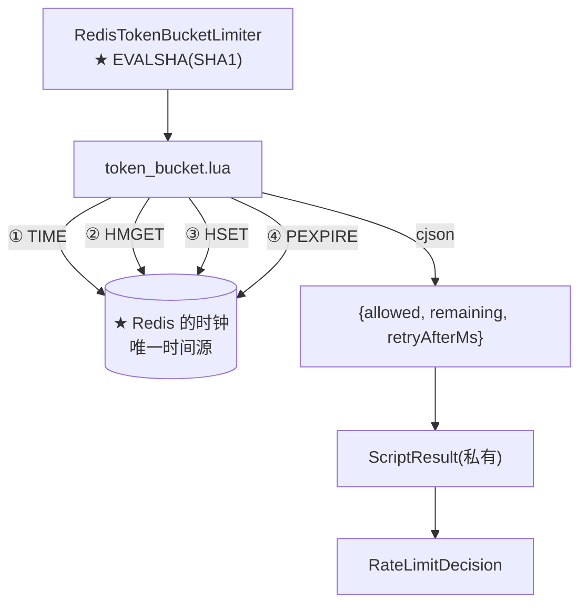

# token_bucket.lua

> **本页速览**
> - ★★ **全项目技术含金量最高的一段**。124 行 Lua,是整个限流器的核心。
> - ★ 用 Lua 的**真正原因**不是"快",是:**单条 Redis 命令是原子的,跨命令的组合从来不是**。
> - ★★ 时间**从 Redis 取**(`redis.call('TIME')`),不由应用传 —— 多实例时钟偏差会让"某台机器限流总是松一点"。
> - ★ 三个精心处理的边界:**首次访问从满桶开始**、**时钟回拨防护**、**TTL 防 key 无限增长**。
> - ★ 一条可带走的判断:**「可观测性不是加个日志就有的,是让状态本身可读」**。
>
> **导航**:[← 上一页:类-RateLimitDecision](类-RateLimitDecision.md) ｜ [下一页:类-RedisTokenBucketLimiter →](类-RedisTokenBucketLimiter.md) ｜ [所属模块:M6 限流](_index.md)

## 一句话职责
**在 Redis 里原子地完成"读令牌 → 补令牌 → 判断 → 扣减 → 写回",并返回这次判定的结果。**

## 位置
```text
src/main/resources/scripts/token_bucket.lua     (124 行)
```

## ★★ 为什么必须整段跑在 Redis 里
**脚本开头的注释把这条推理写得非常完整,是全文最该背下来的一段**:
> *"限流的四步是:'读令牌数 → 判断够不够 → 扣减 → 写回'。这四步在并发下**必须是一个原子操作**。如果分成四次 Redis 调用(哪怕每次都是原子的):
> ```
> 时刻 T1   请求 A 读到「还剩 1 个令牌」
> 时刻 T2   请求 B 读到「还剩 1 个令牌」   ← 同一个 1,被读到了两次
> 时刻 T3   A 判断 1 >= 1,通过,写回 0
> 时刻 T4   B 判断 1 >= 1,通过,写回 0
> ```
> 结果:桶里只有 1 个令牌,却放行了 2 个请求 = **超卖**。"*
### ★★ 那段"面试高频"的澄清
> *"注意这里最容易搞混的一点(面试高频):「**Redis 是单线程的,所以命令是原子的**」—— 这句话没错,**但它保的是单条命令。跨命令的组合从来都不是原子的**。**这才是要用 Lua 的真正原因**,不是'因为 Lua 快'。"*
**拆成对照表**:

| 说法 | 对不对 | 说明 |
|---|---|---|
| "Redis 单线程,所以我的操作是原子的" | ⚠️ **半对** | ★ 只对**单条命令**成立 |
| `INCR` / `DECRBY` 单个命令 | ✅ 原子 | Redis 一次只执行一条命令 |
| `GET` + `DECRBY` 两条命令 | ❌ **不原子** | ★ 两条命令之间能插进别的客户端的命令 |
| ★ **一段 Lua 里的多步** | ✅ **原子** | ★ 整段执行完才处理下一个命令 |
> ★★ **规律**:「**"原子"这个词必须问清作用域:单条命令?一次事务?一段脚本?**」这是所有并发问题的通用问法 —— 从数据库事务到 CAS,都是同一件事。

## 参数与返回
```text
KEYS[1]  桶的 key(形如 gw:rl:<客户端标识>)
ARGV[1]  capacity         桶容量(= 允许的突发量)
ARGV[2]  refillPerSecond  每秒回填多少(= 长期平均吞吐)
ARGV[3]  requested        本次消耗几个(目前恒为 1)

返回:cjson 编码的 { allowed, remaining, retryAfterMs }
```
> ★ **注意 KEYS 和 ARGV 的分工** —— Redis 脚本的约定:`KEYS` 放 **key 名**(集群模式下靠它做分片路由),`ARGV` 放**普通参数**。**放错了单机上看不出问题,Redis Cluster 上会直接报错。**

## ★ 时间从 Redis 取,不由应用传
```lua
local t   = redis.call('TIME')
local now = tonumber(t[1]) * 1000 + math.floor(tonumber(t[2]) / 1000)
```
**注释里的理由,是本页最值得读的一段之一**:
> *"多实例部署时,每台机器的系统时钟都有偏差(NTP 同步也不是零误差,跨机房更是几十毫秒起)。如果让应用把 now 传进来,就等于'**每个实例拿自己的尺子去量同一个桶**'—— 时钟快的那台会算出更多的令牌,**表现是"某台机器限流总是松一点",而且极难查(换个实例就好了)**。限流器的时钟只能有一个来源,就是 Redis 自己。(分布式唯一 ID、分布式锁的时间判断,都是同一个道理。)"*
### ★★ "换个实例就好了" —— 这类 bug 为什么最难查
```text
现象:用户投诉"有时候能连发很多次,有时候第 3 次就被拒"
   ↓ 排查:① 看网关日志 → ★ 每次都"看起来正常";② 看限流配置 → 完全一致;③ 本地复现 → ★ 复现不出来
   ↓ ★★ 原因:请求被负载均衡轮询到 ★ 不同的网关实例 → 时钟快的算出令牌多(松)、慢的算出令牌少(紧)→ 用户感受到"时好时坏"
```
**这个失败模式的三个特征**:

| 特征 | 后果 |
|---|---|
| 概率性 | ★ 无法稳定复现 |
| 依赖机器 | ★ "重启一下又好了" |
| 无报错 | ★ 日志里一切正常 |
> ★★ **规律**:「**分布式系统里,凡是"每台机器各算各的"的地方,都会长出这类 bug**」。判定标准:**这个计算的输入里,有没有"本机的状态"?** 有 → 就是隐患。时间、随机数、本地缓存、内存计数,全在这一类。
**这条纪律的同类应用**:

| 场景 | 本机输入的危害 |
|---|---|
| 限流的时间 | ★ 各算各的令牌数 |
| 分布式 ID | 时钟回拨 → **ID 重复** |
| 分布式锁的过期判断 | 时钟快的机器会**提前认为锁过期** |
| 本地缓存 | 各实例看到的数据不一致 |

## 五个步骤逐个讲
### ① 读:用 `HMGET` 的返回值判断"桶存不存在"
```lua
local state  = redis.call('HMGET', KEYS[1], 'tokens', 'ts')
local tokens = tonumber(state[1])
local ts     = tonumber(state[2])

if tokens == nil then
  tokens = capacity        -- ★ 首次访问:从满桶开始
  ts     = now
end
```
**注释里那个技巧值得记**:
> *"`HMGET` 对不存在的 key 返回 `{false, false}`,`tonumber(false)` 得到 `nil`—— **正好用来判"桶不存在"**。"*
```text
★ Redis 的 Lua 里,不存在的字段返回 false(不是 nil、不是 0)→ tonumber(false) → nil → `tokens == nil` 等价于"这个桶是新的" → ★ 一个判断同时覆盖"key 不存在"和"key 存在但字段缺失"两种情况
```
#### ★ 为什么首次访问从**满桶**开始
> *"第一次见到这个客户端:从**满桶**开始,不是空桶。空桶意味着'**新客户的第一句话必然被拒**',那叫冷启动惩罚,不合理。"*
```text
新客户端 → 桶是空的 → 第一次请求就被拒 → ★ 用户看到"我第一次用就被限流了" → ★★ 而且在"每个客户端一个桶"的设计里,会发生 ★ 每一个新客户端
```
> ★★ **规律**:「**"新对象"的初始状态,应该等于"它被正常使用一段时间后的状态"**」,而不是"最保守的状态"。缓存预热、连接池预热、JIT 预热 —— **冷启动惩罚是一个要主动消除的东西**。
### ② 补:**惰性回填**,没有后台定时器
```lua
local elapsed = now - ts
if elapsed < 0 then
  elapsed = 0        -- ★ 防时钟回拨
end
tokens = math.min(capacity, tokens + elapsed * refillPerMs)
```
**为什么是"惰性"**:
> *"注意这里没有后台定时器在往桶里加令牌 —— 是'**谁来了,顺便算一下从上次结算到现在该补多少**'。好处:没有访问的桶不消耗任何 CPU,也不需要为每个客户端维护一个定时任务(**十万个客户端就是十万个定时器**)。"*
```text
❌ 定时器方案:每个客户端一个定时任务 → 十万客户端 = ★ 十万个任务 → 内存、CPU、调度开销全是线性的,而且 ★ 大部分桶大部分时间没人访问(白补)
✅ 惰性方案:★ 没人访问 → 零开销;★ 有人访问 → 顺便把这段时间的账一次算清 → O(1) 状态,不需要任何调度
```
> ★★ **规律**:「**"按需计算"往往比"提前计算"更优 —— 提前计算要为"可能不会发生的访问"付费**」。这和"懒加载""惰性求值""COW"是同一个思路。
#### ★ `if elapsed < 0 then elapsed = 0 end` —— 一行防"桶变欠债"
> *"防时钟回拨:Redis 主从切换、NTP 校正都可能让 now < ts。不挡这一下会算出**负数令牌**,把桶变成'欠债状态'。"*
```text
时钟回拨 → elapsed 是负数 → tokens = tokens + 负数 × 速率 → ★ 令牌数减少甚至变成负数 → ★★ 一旦为负:之后 ★ 每次请求都要先"还债"才能过 → 桶被"冻结"很长一段时间 → 原因(一次 NTP 校正)★ 当时不留任何痕迹
```
> ★★ **规律**:「**凡是"两个时间戳相减"的地方,都要问一句"减出负数怎么办"**」。时间在分布式系统里**不单调** —— 它会跳、会回拨、会在主从切换时倒退。
#### ★ 补的上限是 `capacity`
```lua
tokens = math.min(capacity, tokens + elapsed * refillPerMs)
//                   ↑ ★ 桶装不下更多
```
```text
桶空闲 1 小时 → 按速率能补 3600 个 → ★ 但桶容量只有 10 → math.min 把它压回 10 → ★ 这就是"突发上限"的物理含义:★ 空闲再久,也只能攒 capacity 个
```
### ③④ 判断 + 扣减 —— 以及 `retryAfterMs` 的算法
```lua
if tokens >= requested then
  allowed = 1
  tokens  = tokens - requested
else
  if refillPerMs > 0 then
    retryAfterMs = math.ceil((requested - tokens) / refillPerMs)
  else
    retryAfterMs = -1          -- ★ 永不回填的桶
  end
end
```
**注释里解释了为什么这个值必须准确**:
> *"这个值会变成 HTTP 的 `Retry-After` 头 —— 它必须**准确**,因为客户端的重试库会照着它睡。给个拍脑袋的 1 秒,会让调用方在**还没攒够令牌时又来一次,然后又被拒一次,形成无效重试风暴**。"*
```text
缺 N 个令牌,每秒补 R 个 → ★ 等待时间 = N / R 毫秒 → math.ceil(向上取整)★ 因为 retryAfterMs 最后会经 RateLimitDecision 转成"秒"→ 两处都向上取整 → ★ 宁可多等,不要少等
```
> ★ 这条和 [类-RateLimitDecision](类-RateLimitDecision.md) 里"`Retry-After` 是承诺不是估算"是**同一件事的两端**:脚本算准毫秒,Java 侧再保守地转成秒。
**`-1` 的含义**:**这个桶永不回填**(`refillPerSecond = 0`)——它是一次性总配额,**等多久都没用**。
### ⑤ 写回 —— ★ 放行与否都写
```lua
redis.call('HSET', KEYS[1], 'tokens', tokens, 'ts', now)
```
**注释里的这段推理非常值钱**:
> *"被拒时如果故意不写,下次请求会拿着旧的 `ts` 重算一遍 —— 结果虽然一样,**但桶的状态就不再代表'此刻的真实水位'了,排查问题时 `hgetall` 看不出任何东西**。**可观测性不是加个日志就有的,是让状态本身可读。**"*
### ★★ "可观测性不是加个日志就有的,是让状态本身可读"
```text
❌ 常见做法:在拒绝分支加一句 log.warn("限流拒绝")→ 日志里有了"被拒"这件事 → ★ 但去 redis-cli 里 hgetall 那个桶,看到的是 ★ 过时状态 → 剩下多少令牌?上次结算何时?★ 看不出来
✅ 项目的做法:无论放行还是拒绝,都把"计算结果"写回 → ★ 桶的状态 ★ 永远等于"此刻的真实水位"→ 排查时 hgetall 一下,能直接读到:还剩多少、上次结算是何时
```
> ★★ **规律**:「**日志记录的是"发生过什么",状态记录的是"现在是什么样" —— 后者往往更有用**」。排查问题时,你需要的常常不是"当时发生了什么",而是"**现在把它读出来,能看出什么**"。

## ★ 过期时间:一行防"限流器把 Redis 撑爆"
```lua
local ttl
if refillPerMs > 0 then
  ttl = math.ceil(capacity / refillPerMs) * 2   -- 攒满一桶所需时间 × 2
else
  ttl = 3600000                                  -- 不回填:给 1 小时兜底
end
if ttl < 60000 then
  ttl = 60000                                    -- ★ 下限 1 分钟
end
redis.call('PEXPIRE', KEYS[1], ttl)
```
**注释把后果说得很清楚**:
> *"少了这一步,每一个访问过的客户端都会在 Redis 里留下一个**永不消失**的 key。一个'内存只增不减'的限流器,迟早会把 Redis 打爆 ——**而它挂掉的方式是'慢慢变慢',不是'突然报错',所以等你发现时已经晚了**。(限流器自己把 Redis 撑爆,是这类系统最经典的死法。)"*
### ★★ "慢慢变慢,不是突然报错" —— 这类故障为什么最危险

| | 突然报错 | ★ **慢慢变慢** |
|---|---|---|
| 告警 | ✅ 立刻触发 | ❌ **所有阈值都是"正常"的** |
| 排查 | 有明确的错误信息 | ⚠️ 只能靠"感觉比以前慢" |
| 恢复 | 修好即恢复 | ★ **要清理数据才能恢复** |
| 发现时机 | 分钟级 | ★★ **可能几周后** |
> ★★ **规律**:「**资源泄漏类的问题,判据不是"会不会崩",而是"发现它需要多久"**」。对抗它的手段不是"加监控阈值",而是**在设计时就让它不可能无限增长**。
### ★ 三个 TTL 细节

| 细节 | 值 | 为什么 |
|---|---|---|
| 正常桶 | `攒满一桶时间 × 2` | ★ 空闲这么久,桶和"全新桶"没区别 → 删掉无损失 |
| 不回填的桶 | 1 小时 | ⚠️ 它**不能删**,删了等于"额度重置" → 给大的兜底值 |
| **下限** | **1 分钟** | ★ 太短的 TTL 会让"桶被删掉"变成**事实上的额度重置** |
**下限那条尤其值得注意**:
```text
capacity 很小、回填很快 → 攒满一桶只要几毫秒 → TTL = 几毫秒 × 2 → ★ 桶几乎立刻过期 → 客户端下一次请求 → 桶不存在 → ★ 又从满桶开始 → ★★ 限流完全失效(每次都是满桶)→ ★ 下限 1 分钟把这个漏洞堵住
```
> ★★ **规律**:「**凡是"根据配置算出来的时间/大小",都要给它一个下界**」—— 配置的组合空间里,总有一组会算出荒谬的值。

## ★ 返回 `cjson`,不返回 Lua 数组
```lua
return cjson.encode({
  allowed      = allowed,
  remaining    = math.floor(tokens),
  retryAfterMs = retryAfterMs
})
```

| 项 | 说明 |
|---|---|
| **为什么 JSON 而不是数组** | ★ 让返回值在 `redis-cli` 里**肉眼可读**,且 Java 侧能按字段名反序列化 |
| `cjson` 从哪来 | ★ Redis **内置**的,不用装任何东西 |
| `math.floor(tokens)` | ★ 令牌数是小数(惰性回填会算出小数),对外报整数 |
> ★ **注意 `remaining` 是 `math.floor` 之后的** —— 桶内部可以有 `7.3` 个令牌,但对客户端报 `7`(★ 不能报 8,那是在虚报额度)。

## 这个脚本在项目中的角色

**★ 注意它是"一个脚本,多个 Redis 调用"** —— `TIME` / `HMGET` / `HSET` / `PEXPIRE` 四次访问 Redis,但**从外面看是一次不可分割的操作**。这正是 Lua 的价值。

## 值得学习的点
### 1. ★★ 用脚本解决的"读改写"问题是通用的

| 场景 | 读改写的内容 | 可以怎么原子化 |
|---|---|---|
| ★ 限流 | 读令牌 → 扣减 | **Lua 脚本** |
| 分布式锁 | 读锁 → 判断持有者 → 释放 | Lua 脚本 |
| 库存扣减 | 读库存 → 判断 → 扣减 | Lua / 数据库 `UPDATE ... WHERE stock >= n` |
| 数据库 | 读行 → 改 → 写回 | `SELECT ... FOR UPDATE` / 乐观锁版本号 |
| 内存 | 读 → CAS → 写 | `AtomicInteger.compareAndSet` |
> ★★ **规律**:「**凡是"先读、再根据读到的值决定写什么"的地方,并发下都会超卖**」。这不是 Redis 的问题,是**这个操作形状本身的固有属性**。要解决就得**把"读"和"写"绑成一次不可分割的动作** —— 手段可以是锁、CAS、事务,或者一段脚本。
### 2. ★ 注释里那句"面试高频"值得学
**这句话(见上文"面试高频"澄清)的写法本身值得学**:
```text
★ 它没有说"Redis 单线程是错的"(那是硬拗),它说的是"这句话没错,★ 但它保的范围比你以为的小"
   ↓ ★★ 这是"精确"而不是"反驳" —— 技术讨论里,后者几乎总是更有说服力
```
**顺带,这个知识点可以直接变成面试话术**:
```text
面试官:"Redis 是单线程的,所以不用考虑并发问题吧?"
   ❌ "对" → 错;❌ "不对,Redis 也有并发问题" → 太笼统,没信息量
   ✅ "单线程保证的是★单条命令原子。像限流这种'读令牌→判断→扣减→写回'的四步组合,★跨命令从来都不是原子的 —— 这就是我在项目里用 Lua 脚本的原因。"
      → ★ 既纠正了前提,又给出了自己的实践
```
### 3. ★★ "冷启动惩罚"是一个值得主动识别的模式
**本脚本里**:新桶从满桶开始,而不是空桶。**同类的设计决策**:

| 场景 | ❌ 冷启动惩罚 | ✅ 合理做法 |
|---|---|---|
| ★ 限流桶 | 新客户端从空桶开始 → **第一次就被拒** | 从满桶开始 |
| 连接池 | 启动时 0 个连接 → 第一批请求全部等建连 | ★ 预热几个连接 |
| 本地缓存 | 启动后缓存全空 → 第一波请求全部穿透 | ★ 启动时预加载热点 |
| JVM | 解释执行 → 前几万次调用特别慢 | ★ 预热 / AOT |
> ★★ **规律**:「**"第一次"和"第 N 次"的体验差距,如果设计时没被考虑,就会变成一个投诉**」。消除它通常只需**把初始状态设成"稳态"而不是"零"**。
### 4. ⚠️ 三处诚实的标注

| 没做的事 | 现状 | 影响 |
|---|---|---|
| **不支持"消耗多个令牌"** | `ARGV[3]` 恒为 1 | ⚠️ 按 token 数计费(而不是按请求数)做不到 |
| **主从切换时可能丢状态** | 依赖 Redis 的持久化配置 | ⚠️ 故障切换瞬间的额度可能被重置 |
| **脚本没有版本管理** | 改脚本 → SHA1 变 → 需要重新加载 | ★ 项目靠"启动时加载"覆盖(见 Limiter) |
> ⚠️ **第一条最值得说**:真实网关往往**按 token 数计费**(输入 + 输出多少 token),而不是"每来一次算一次"。本项目留了 `ARGV[3]` 这个口子,★ 但**上游的 usage 要等流结束才知道** —— 那是 G7 的事。

## 相关页

- 模块首页(为什么要原子) → [M6 限流](_index.md)
- 谁执行这个脚本、怎么加载 → [类-RedisTokenBucketLimiter](类-RedisTokenBucketLimiter.md)
- ★ `ScriptResult` 装箱和那个真实 bug → [类-RedisTokenBucketLimiter-深入](类-RedisTokenBucketLimiter-深入.md)
- 返回值的类型定义 → [类-RateLimitDecision](类-RateLimitDecision.md)
- 参数从哪来 → [类-RateLimitProperties](类-RateLimitProperties.md)
- 端到端一次被拒 → [流程-一次被限流的请求](流程-一次被限流的请求.md)
- 对照组:不做原子会怎样 → [测试-对照组NaiveTokenBucket](../07-测试验证/测试-对照组NaiveTokenBucket.md)

> **导航**:[← 上一页:类-RateLimitDecision](类-RateLimitDecision.md) ｜ [下一页:类-RedisTokenBucketLimiter →](类-RedisTokenBucketLimiter.md) ｜ [所属模块:M6 限流](_index.md)
