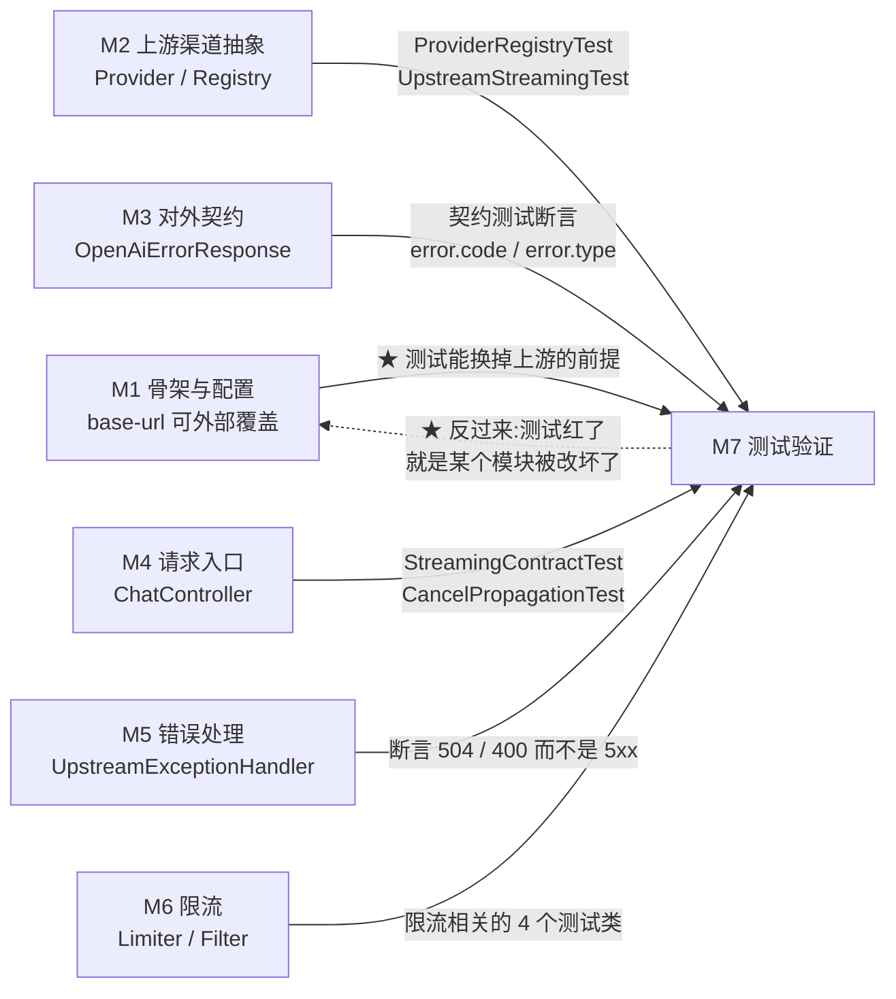

# M7 · 测试验证

> **本页速览**
> - 全项目 **12 个文件、35 个测试方法**,是本项目**唯一能证明"代码真的在按设计工作"的地方**。
> - ★★ 本模块最值得学的**不是怎么写测试,而是怎么设计"对照组"** —— 见 [测试-对照组NaiveTokenBucket](测试-对照组NaiveTokenBucket.md)。
> - ★ 一个贯穿全模块的分工原则:**`ProviderRegistryTest` 不起 Spring、`RoutingTest` 起** —— 判据是"被测类能不能被 `new` 出来"。
> - ⚠️ 一部分测试**依赖本机 Docker**(Testcontainers 起 Redis),在空机器上会红。
> - ★ 本模块的测试**不是"补上的",而是先定验收标准再写实现** —— 每个测试的 Javadoc 里都写着它对应哪一段路线图的验收物。
>
> **导航**:[← 上一页:M6 限流](../06-限流/_index.md) ｜ [下一页:测试-契约测试 →](测试-契约测试.md) ｜ [所属模块:M7 测试验证](_index.md)

---

## 这个模块解决什么问题

### 问题:没有测试的网关,改动一次就得靠"感觉"

```text
改了 OpenAiCompatibleProvider 的一行 → 手动 curl 一遍 → 看起来没问题 → 提交
   ↓
★ 三个月后:"流式怎么不流了?" / "限流好像不生效?" / "渠道路由错了?"
   → 而这些在改动当天,手动 curl 是 ★ 看不出来的
```

**因为手动验证有个致命特点:它只验"正常路径"**。

```text
手动 curl 能验的:       200 回来了、内容是对的
手动 curl 验不了的:     · 并发下会不会超卖(要 32 个请求同时打)
                        · 客户端断开时上游有没有被取消(要"中途关掉")
                        · 上游卡住 1000ms 会不会被掐断(要能等)
                        · 配置键名写错会不会被发现(要"改了再跑一遍")
                        · ★ 一个渠道被打满会不会影响另一个(要两个客户端)
```

> ★ **规律**:「**手动验证是"做一次就没了"的证据;测试是"每次改动都重放一遍"的证据**」。
> 这个项目的每个测试,都是把某一次手动验证**固化**下来的结果。

### 它给出的答案

```text
★ 用 35 个测试,把"网关该有的对外承诺"锁死
   → 任何一次重构,只要 mvn test 还是绿,就可以放心提交
   → ★ 而"绿"这个信号之所以可信,是因为测试本身被设计成"会红"
```

---

## ★ 本模块的核心:三组"成对"的测试

**这是全模块最值钱的设计,值得单独拎出来看。**

```text
【第一组】限流:真实现 vs 对照组
   RateLimitConcurrencyTest#neverOversellsUnderConcurrency  →   32 并发 → 放行 5
   RateLimitConcurrencyTest#naiveImplementationDoesOversell →   32 并发 → 放行 32
   ★★ 两条一起,才证明"Lua 是拦住超卖的那道墙"

【第二组】停滞:该杀 vs 不该杀
   IdleTimeoutTest#stalledUpstreamIsDetected  →  间隔 1000ms > 阈值 400ms → 报错
   IdleTimeoutTest#steadyStreamIsNotKilled    →  间隔   100ms < 阈值 400ms → 通过
   ★ 只测前者,把阈值写成 1ms 也能全绿 —— 那是个灾难性配置

【第三组】取消:该记 vs 不该记
   CancelPropagationTest#clientDisconnectPropagatesCancelToUpstream → 有 [cancel]
   CancelPropagationTest#normalCompletionIsNotReportedAsCancel      → 无 [cancel]
   ★ 只测前者,无脑把每次结束都记成取消也能绿,但统计就全是假的
```

> ★★ **规律**:**「一个只会变绿的测试,和一个永远变绿的断言,是同一种东西」**。
>
> **每个"必须发生"的测试,都该配一条"必须不发生"的测试** ——
> 否则你验的不是"功能正确",只是"这条代码路径被走到了"。
>
> ★ 这个模式在面试里非常好用:被问"你怎么保证测试有效",答
> **"我给每个正向断言都配了一条反向的,而且我有一组对照组证明'去掉关键实现就会红'"**。

---

## 模块结构图

```mermaid
graph TD
    subgraph 纯逻辑测试["纯逻辑测试(不起 Spring · 毫秒级)"]
        PRT["ProviderRegistryTest<br/>9 个方法 · 注册表解析 + fail-fast"]
        RDT["RateLimitDecisionTest<br/>4 个方法 · 毫秒→秒换算"]
    end

    subgraph 集成测试["集成测试(起 Spring + WireMock)"]
        CCT["ChatCompletionContractTest<br/>2 个方法 · 非流式契约"]
        SCT["StreamingContractTest<br/>3 个方法 · 流式出口契约"]
        UST["UpstreamStreamingTest<br/>1 个方法 · 流真的在流"]
        CPT["CancelPropagationTest<br/>2 个方法 · 取消传播"]
        ITT["IdleTimeoutTest<br/>2 个方法 · 逐块空闲超时"]
        RT["RoutingTest<br/>4 个方法 · 按请求路由"]
    end

    subgraph 需要Docker["需要 Docker(Testcontainers · redis:7)"]
        RCT["RateLimitConcurrencyTest<br/>3 个方法 · 并发不超卖"]
        RLT["RateLimitEndToEndTest<br/>3 个方法 · 429 真的在 HTTP 上"]
    end

    FOT["RateLimitFailOpenTest<br/>2 个方法 · Redis 挂了怎么办<br/>★ 不需要 Docker(指向死端口)"]

    NAIVE["NaiveTokenBucket<br/>★ 不是测试,是"反面教材"<br/>只在 src/test,src/main 里没有"]
    NAIVE -.->|"对照组,被它调用"| RCT
```

**★ 三层分类本身就是本页第一个知识点**:

| 层 | 起 Spring | 需要 Docker | 耗时 | 能验什么 |
|---|---|---|---|---|
| 纯逻辑 | ❌ | ❌ | 毫秒 | 换算规则、解析逻辑、fail-fast |
| 集成 | ✅ | ❌ | 秒级 | HTTP 契约、SSE、路由、取消 |
| 需要 Redis | ✅/❌ | ✅ | 十秒级 | ★ 并发原子性 |

> ★ **规律**:「**测试的"重"程度应该恰好等于被测对象的依赖程度**」。
> 一个纯函数不需要 Spring;一个要验 Redis 原子性的测试**必须**要真 Redis。

---

## 测试清单

| 文件 | 一句话职责 | 方法数 | 需要 Docker | 页 |
|---|---|---|---|---|
| `ChatCompletionContractTest` | ★ 锁死**非流式**的对外契约(归一 + 504) | 2 | ❌ | [测试-契约测试](测试-契约测试.md) |
| `UpstreamStreamingTest` | 证明**流真的是一块块到的**,不是攒齐再发 | 1 | ❌ | [测试-流式与取消传播](测试-流式与取消传播.md) |
| `StreamingContractTest` | ★ 证明**流式出口也归一了**(不是透传厂商协议) | 3 | ❌ | [同上](测试-流式与取消传播.md) |
| `CancelPropagationTest` | ★ 证明**客户端断开 → 上游真被取消**(不是只断自己这头) | 2 | ❌ | [同上](测试-流式与取消传播.md) |
| `IdleTimeoutTest` | ★ 证明**中途停滞会被发现**、且**健康长回复不被误杀** | 2 | ❌ | [同上](测试-流式与取消传播.md) |
| `ProviderRegistryTest` | 注册表纯逻辑 + **四种 fail-fast** | 9 | ❌ | [测试-路由与注册表](测试-路由与注册表.md) |
| `RoutingTest` | ★ 证明**配置 → Bean → 注册表 → 真实 HTTP 请求**这条链是通的 | 4 | ❌ | [同上](测试-路由与注册表.md) |
| `RateLimitDecisionTest` | 毫秒 → `Retry-After` 秒的**换算规则** | 4 | ❌ | [测试-限流与并发](测试-限流与并发.md) |
| `RateLimitConcurrencyTest` | ★★ **32 并发不超卖** + **对照组证明超卖真会发生** | 3 | ✅ | [同上](测试-限流与并发.md) |
| `RateLimitEndToEndTest` | ★★ **429 + Retry-After 真的在 HTTP 响应上**,且**没打到上游** | 3 | ✅ | [同上](测试-限流与并发.md) |
| `RateLimitFailOpenTest` | ★ **Redis 挂了**时 fail-open / fail-closed 的行为 | 2 | ❌ | [同上](测试-限流与并发.md) |
| `NaiveTokenBucket` | ⚠️ **不是测试**,是"不用 Lua 会怎样"的**证据** | —— | —— | [测试-对照组NaiveTokenBucket](测试-对照组NaiveTokenBucket.md) |

**合计:11 个测试类 + 1 个对照组 = 35 个测试方法。**

> ★ **35 这个数字可以直接写进简历**,但真正值钱的是括号里的东西:
> **"其中 3 组是成对的(正向 + 反向 / 真实现 + 对照组)"**。
> 只报"35 个测试"是数量;报"有对照组"才是质量。

---

## 模块内的关键流程

**跑一次 `mvn test` 会发生什么**:

```text
① 纯逻辑测试最先跑完(毫秒级)
   ProviderRegistryTest / RateLimitDecisionTest

② 集成测试:每个类都做同样三件事
   · 起一个 WireMock(dynamicPort → 随机端口,不会撞)
   · @DynamicPropertySource 把网关的 base-url 指过去
   · 起 Spring(随机端口),用 WebTestClient 真打 HTTP

③ 需要 Redis 的测试:Testcontainers 拉起 redis:7 容器
   ★ 在 static 块里启动 —— 保证早于 @DynamicPropertySource 求值

④ 跑完 @AfterAll:停 WireMock、停容器
```

> ★ 第 ②步里那句 `@DynamicPropertySource` 是**本模块的关键技巧**:
> **一个字都没改业务代码,就把网关的上游从 `api.deepseek.com` 换成了本地假服务器**。
> 这能成立,靠的是 M1 把 `base-url` 做成了可外部覆盖的配置 ——
> ★ 见 [M2 渠道抽象](../02-上游渠道抽象/_index.md)。

---

## 与其他模块的交互



> ★ **本模块和别处不同的一点**:别的模块是"被测试覆盖的对象",
> 而 M7 **反过来是其他所有模块的守卫**。
> 06-限流 那一页的 filter,之所以敢说"429 没打到上游",
> 证据不在 filter 里,而在这里的 `UPSTREAM.verify(CAPACITY, ...)`。

---

## 本模块值得学习的设计点

### 1. ★★ "对照组"思维:让测试自己证明它有效

**这是本模块最值钱的一条,已在上面展开**。这里补一个更狠的用法:

```java
// RateLimitEndToEndTest:只断言 429 是不够的
.expectStatus().isEqualTo(429)
// ★★ 还要断言"被限流的请求压根没打到上游"
UPSTREAM.verify(CAPACITY, postRequestedFor(urlEqualTo("/chat/completions")));
```

```text
★ 为什么这条断言比 429 那条更重要:
   一个"先转发、再拒绝"的实现 ★ 同样返回 429 ——
   而它已经把 3 次上游调用变成了 4 次:钱照花,429 只是给用户看的安慰
   ↓
★★ 限流的价值一半在"拒绝",另一半在"拒绝得足够早"
```

> ★★ **规律**:「**断言"结果对不对"很容易漏掉"过程对不对"**」。
> 状态码对了、但多花了一次钱 —— 这种 bug **只有"零请求断言"能抓住**。

### 2. ★ 测试替身的判据:只替换"无关的部分"

| 被测对象 | 替身选择 | 为什么 |
|---|---|---|
| `ProviderRegistry` | 手写桩 `Provider` | 真实的要 `WebClient`+5 个配置,和"解析"无关 |
| 上游 HTTP 服务 | WireMock | 真上游要钱、结果不确定,没法断言 |
| **Redis 原子性** | ★ **真 Redis(容器)** | **要验的就是 Redis 本身,mock 掉等于验我自己的假货** |

```text
★★ 判据:"我的 mock 说它是原子的" —— 这句结论一文不值
```

> ★★ **规律**:「**测试替身能替换的,是"和结论无关的部分"**」。
> 一旦被测对象**就是**那个替身,**测试的绿就变成了自我循环**。

### 3. ★ 造故障场景 ≠ 必须起一个真集群

```java
// RateLimitFailOpenTest:造出"Redis 挂了"
int deadPort = findClosedPort();          // 刚探测到空闲、没人监听的端口
connectionFactory = new LettuceConnectionFactory("127.0.0.1", deadPort);
```

```text
★ 效果和真停 Redis 完全一样(连接被立刻拒绝)
★★ 但:不需要 Docker、50 毫秒以内跑完
```

> ★★ **规律**:「**用最小的代价造出等价的观测条件,是测试设计的一部分**」。
> "要测故障就得起一个坏掉的集群"是一种**没必要的重**。

### 4. ⚠️ 诚实标注:这个模块也不是完美的

| 缺口 | 影响 |
|---|---|
| **没有统一的"契约回归"测试** | M5 的 `OpenAiErrorResponse` 和 M6 filter 里手写的错误体**是两处实现**,没有测试断言它们一致 |
| **`X-RateLimit-Remaining` 在未知时不发** | ★ `RateLimitFailOpenTest` 断言的是 **decision 的值**,不是 **HTTP 头** |
| **没有性能/压测** | 只有 32 并发的正确性验证,没有吞吐量数据 |
| ⚠️ **部分测试依赖 Docker** | 空机器上 `RateLimitConcurrencyTest` / `RateLimitEndToEndTest` 会红 |

> ★ **规律**:「**说清"没测什么",比说清"测了什么"更能让人信任你的测试报告**」。
> 面试时这一条是加分项:**"我知道我的测试覆盖到哪里为止"**。

---

## 相关页

- 第一个测试类(非流式契约) → [测试-契约测试](测试-契约测试.md)
- ★ 流式三件套 → [测试-流式与取消传播](测试-流式与取消传播.md)
- 注册表 + 路由的两层分工 → [测试-路由与注册表](测试-路由与注册表.md)
- ★★ 并发不超卖 + 端到端 429 → [测试-限流与并发](测试-限流与并发.md)
- ★★ 反面教材为什么放在 `src/test` → [测试-对照组NaiveTokenBucket](测试-对照组NaiveTokenBucket.md)
- 被测试的限流实现 → [M6 限流](../06-限流/_index.md)
- 被测试的渠道路由 → [M2 上游渠道抽象](../02-上游渠道抽象/_index.md)
- 换一台机器怎么把测试跑起来 → [启动流程](../../02-flows/启动流程.md)
- 术语不确定 → [术语表](../../03-reference/术语表.md)

> **导航**:[← 上一页:M6 限流](../06-限流/_index.md) ｜ [下一页:测试-契约测试 →](测试-契约测试.md) ｜ [所属模块:M7 测试验证](_index.md)
