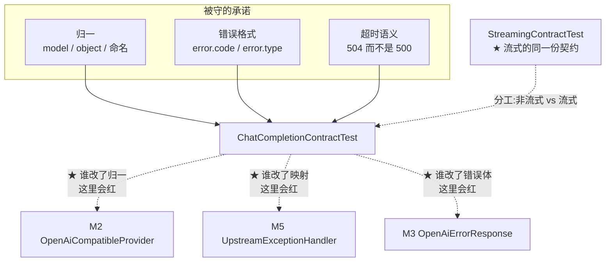

# 测试 · 对外契约测试

> **本页速览**
> - `ChatCompletionContractTest`(183 行,2 个方法)—— 用**假上游**锁死网关对外的非流式承诺。
> - ★ "契约测试"的含义:**只锁对外承诺,不管内部怎么实现**。内部随便重构,契约不破就该绿。
> - ★★ 本页两个最值钱的技巧:**假上游"故意埋坑"**、**"光断言 504 不够,还要断言多久返回"**。
> - ⚠️ 一个容易踩的坑:`@DynamicPropertySource` 的求值时机 **早于 `@BeforeAll`**。
> - ★ 它和 [M5 错误处理](../05-错误处理/_index.md) 是配套的:那边写映射,这边守映射。
>
> **导航**:[← 上一页:M7 模块首页](_index.md) ｜ [下一页:测试-流式与取消传播 →](测试-流式与取消传播.md) ｜ [所属模块:M7 测试验证](_index.md)

## 这个测试在防什么
**"网关对外的承诺,在每一次改动之后依然成立。"**

```text
G1-1d 手工验证:起个假上游 → 改环境变量 → curl 一遍 → 看结果 ✅
★ 问题:这验证做一次就没了。明天有人改了 OpenAiCompatibleProvider 的一行,没任何东西提醒他"契约可能破了"
```

**"契约"到底指什么**:

| 承诺 | 具体是什么 | 在哪定义 |
|---|---|---|
| **归一** | 出口的 `model` 是**客户端请求的**,不是上游报的 | [类-ChatCompletionResponse](../03-对外契约/类-ChatCompletionResponse.md) |
| **归一** | 上游没给的 `object`,我们来补 | 同上 |
| **命名** | `finish_reason` 是 snake_case,不是 `finishReason` | 同上 |
| **归一** | 上游没给 `object`,但**流式块**必须是 `chat.completion.chunk` | 见[流式页](测试-流式与取消传播.md) |
| **错误格式** | 失败也必须是 OpenAI 错误格式,不能是 Spring 默认格式 | [类-OpenAiErrorResponse](../03-对外契约/类-OpenAiErrorResponse.md) |
| **谁的错** | 上游读超时 → **504**,不是 500/502 | [M5 错误处理](../05-错误处理/_index.md) |

> ★ **规律**:「**契约测试不关心你怎么做到的,只关心你承诺了什么**」。
> 判据:**如果一个测试在你把内部实现整个重写之后依然该绿,它就是契约测试。**

## ★ 测试设计一:假上游为什么比真上游好
```java
registry.add("gateway.providers.channels.deepseek.base-url",
        () -> "http://localhost:" + UPSTREAM.port());
registry.add("gateway.providers.channels.deepseek.api-key", () -> "test-key-not-a-real-secret");
```

**真上游(api.deepseek.com)的三个问题**:

| 问题 | 后果 |
|---|---|
| 要真 Key | ★ 密钥进 CI → 泄漏风险 |
| 要花钱 | ★ 每次 `mvn test` 都烧钱 → 没人愿意跑 |
| **结果不确定** | ★★ 模型每次回的话都不一样 → **没法断言** |

```text
★★ 第三条才是致命的:真上游的回答是"这是假上游返回的固定答复"吗?不一定。
   → 你只能断言"content 非空" → ★ 一个几乎永远不会红的断言
```

> ★★ **规律**:「**不确定性是断言的天敌**」。
> 用真上游测,你得到的不是"契约正确",而是"这次恰好没崩"。

**假上游的代价**:它得**手动维护**,而且可能和真实上游**不一致**。★ 这笔账是这样算的:
**归一的逻辑不依赖上游的具体内容** —— 我们验的是"上游说 X,出口必须说 Y",`X` 是什么由我们指定,才验得精确。

## ★★ 测试设计二:假上游"故意埋坑"
```java
private static final String UPSTREAM_BODY = """
        {
          "id": "chatcmpl-wiremock-001",
          "model": "deepseek-flash",        // ★ 坑 1
          ...                               // ★ 坑 2:压根没给 object
        }
        """;
```

```text
客户端请求的是:model = "deepseek-chat"
上游回的是:    model = "deepseek-flash"   ← ★ 故意不一样
★ 于是下面这条断言就变成了"归一的证据":
   .jsonPath("$.model").isEqualTo("deepseek-chat")
★★ 如果上游回什么就透传什么 → 出口会是 deepseek-flash → ★ 红
```

**两个坑分别守什么**:

| 坑 | 上游给的 | 出口必须给 | 漏掉的后果 |
|---|---|---|---|
| ① `model` 不一致 | `deepseek-flash` | **`deepseek-chat`** | 客户端看到自己从没请求过的模型名 |
| ② `object` 缺失 | 干脆不给 | **`chat.completion`** | OpenAI SDK 认不出这是补全响应 |

> ★★ **规律**:「**要证明"我做了 A",就得让"不做 A 的结果"和"做了 A 的结果"不同**」。
> 如果上游回的就是 `deepseek-chat`,那么 `.jsonPath("$.model").isEqualTo("deepseek-chat")` **在透传实现下也会绿** —— ★ **这条断言就白写了**。
> ★ **这是判断"一条断言到底有没有价值"最快的办法:想象把被测逻辑删掉,它还会绿吗?**

## ★★ 测试设计三:光断言状态码是不够的
```java
@Test
@DisplayName("上游超时：必须在读超时到点就返回 504，而不是陪着上游一直等")
void upstreamReadTimeoutYields504() {
    // 假上游接了连接，但拖 6 秒才回 —— 远超 1.5 秒的读超时
    UPSTREAM.stubFor(post(urlEqualTo("/chat/completions"))
            .willReturn(aResponse()
                    .withStatus(200)
                    .withFixedDelay((int) READ_TIMEOUT_MS * 4)   // ★ 6 秒
                    .withBody(UPSTREAM_BODY)));

    long startNanos = System.nanoTime();

    client.post().uri("/v1/chat/completions")
            ...
            .expectStatus().isEqualTo(504)
            .expectBody()
            .jsonPath("$.error.code").isEqualTo("upstream_read_timeout")
            .jsonPath("$.error.type").isEqualTo("upstream_error");

    long elapsedMs = (System.nanoTime() - startNanos) / 1_000_000;

    // ★★ 这条断言才真正锁住"到点就掐断"
    assertThat(elapsedMs)
            .as("应在读超时附近返回，而不是等满上游的 6 秒延迟")
            .isLessThan(READ_TIMEOUT_MS * 4);
}
```

```text
只断言 504:"等满 6 秒、上游回完了、然后网关自己返回 504" 也是 504 ✅ 绿
→ 但语义完全错了:超时机制 ★ 压根没生效
加上耗时断言:必须 < 6000ms → 证明"到点(1.5s)就掐断了"
```

> ★★ **规律**:「**状态码是"结论",耗时是"过程"。一个 bug 最容易藏在过程里**」。
> ★ 这个模式在本项目里出现了 **3 次**,而且每次都抓的是不同的 bug:

| 测试 | 光断言这个不够 | 还要断言 |
|---|---|---|
| 本测试 | `504` | ★ **多久返回的** |
| [`UpstreamStreamingTest`](测试-流式与取消传播.md) | "拿到 4 条内容" | ★ **首尾元素隔了多久** |
| [`RateLimitEndToEndTest`](测试-限流与并发.md) | "第 4 个返回 429" | ★ **上游只被调了 3 次** |

> ★★ 三条合起来是一句话:**「每个功能都有一条"看起来对、其实没生效"的假实现,而它们全都躲得过状态码断言」**。

## 测试里最值钱的一句话
```java
private static final long READ_TIMEOUT_MS = 1500;

/** 读超时设短一点，否则测试要等 30 秒。生产默认值是 30000ms */
```

```text
★ 测试用的超时值(1.5s)和 ★ 生产默认值(30s)不一样 —— 这是刻意的
★★ 一个 30 秒的测试,在 CI 上会被人想办法"优化掉" → 一个 1.5 秒的测试,没人有借口不跑它
```

> ★ **规律**:「**测试的耗时是一种预算,超预算的测试迟早会被关掉**」。
> 但注意:改小的是**测试专用的值**,不是生产值 ——
> ★ 生产值由 `application.yml` 提供,测试用 `@DynamicPropertySource` 局部覆盖。

## ⚠️ 踩坑:`@DynamicPropertySource` 的求值时机
```java
// ✅ 静态字段 —— 类加载时就初始化,赶得上
private static final WireMockServer UPSTREAM = startUpstream();

// ❌ @BeforeAll —— 太晚了
@BeforeAll
static void setUp() { ... }
```

```text
@DynamicPropertySource 求值时机:★ Spring 上下文启动时
@BeforeAll            执行时机:★ 上下文启动 ★ 之后
→ 写在 @BeforeAll 里,端口号还没生成就被读走了 → ★ 拿到 0
→ 症状:网关连到 http://localhost:0 → 报一个和"时机"毫无关系的错
```

> ★★ **规律**:「**"顺序"类的 bug,报错信息几乎从不指向真正的原因**」。
> 同一个坑在本项目里被踩了**两次**:
> - 这里 → **用静态字段**解决
> - [`RateLimitConcurrencyTest`](测试-限流与并发.md) 的 Testcontainers → **在 `static {}` 块里启动**解决
> ★ 两次的解法是同一个:**"把初始化提前到类加载阶段,时序就确定了"**。

## 关键方法一览
### ① `normalResponseIsNormalized()` —— 归一

| 项 | 说明 |
|---|---|
| **做什么** | 打一个非流式请求,逐字段断言出口形状 |
| **断言 5 条** | `model` / `object` / `content` / `finish_reason` / `usage.total_tokens` |
| **被谁守** | 上面的两个"坑" |
| **反面** | 若把归一删掉,`model` 和 `object` 两条会红 |

### ② `upstreamReadTimeoutYields504()` —— 超时

| 项 | 说明 |
|---|---|
| **做什么** | 假上游拖 6 秒,断言 **504 + 错误码 + 耗时 < 6 秒** |
| **★ 前提** | 假上游要 `.withFixedDelay()` —— **接了连接但不回** |
| **和 502 的边界** | 504 = "连上了但没数据";502 = "压根连不上" → 见 [M5](../05-错误处理/_index.md) |
| **反面** | 若把超时去掉,耗时断言会红(等满 6 秒) |

> ★ 第 ② 个方法**没有**断言 `Retry-After` —— 因为 504 不该带这个头 (那是客户端的问题,不是我们的;见 [M6](../06-限流/_index.md))。

## 这个测试在项目中的角色


> ★ **注意最后那条虚线**:非流式和流式**是两条独立的出口路径**,
> 所以契约测试也**必须两份** ——
> ★ 一个只测非流式的契约测试,会让"流式出口透传了厂商协议"这件事**完全无人发现**。

## 值得学习的点
### 1. ★ 契约 vs 实现的分离

| | 契约测试 | 单元测试 |
|---|---|---|
| 关注 | ★ **对外承诺** | ★ 内部逻辑 |
| 重构后 | ★ **应该依然绿** | 可能要改 |
| 谁来写 | 对外接口的负责人 | 类的作者 |
| 数量 | 少而稳 | 多而细 |

★ 本项目里对应的是:`ChatCompletionContractTest` 是契约;`RateLimitDecisionTest`(见[限流页](测试-限流与并发.md))是单元 —— 它断言的是 `1399ms → 2秒` 这种**内部换算规则**。

> ★ **规律**:「**契约测试是给别人看的,单元测试是给自己看的**」。
> 前者承诺"我不会变",后者保护"我改得动"。

### 2. ★ 断言消息(`.as(...)`)里写的是"为什么"
```java
.expectHeader().contentTypeCompatibleWith(MediaType.TEXT_EVENT_STREAM)
// 出口必须是 SSE 的内容类型 —— 钉不住的话浏览器/SDK 会当成一坨 JSON 文本
```

```text
★ 断言失败时,CI 上你只能看到这行字
→ 写"expected true but was false" ★ 等于没写
→ 写"钉不住的话 SDK 会当成一坨 JSON" ★ 让人立刻知道该改哪
```

> ★ **规律**:「**断言消息是写给"三个月后看到红的自己"的**」。
> **它该回答的是"为什么这条断言存在",不是"什么值不等于什么值"** —— 后者编译器已经说过了。

### 3. ★ 测试名(`@DisplayName`)用的是中文、写的是完整句子
```java
@DisplayName("上游超时：必须在读超时到点就返回 504，而不是陪着上游一直等")
```

```text
★ mvn test 的输出直接就是一份"这个服务的承诺清单"
★★ 新同事不用读代码,看测试名就知道网关该干什么
```

> ★ **规律**:「**测试名是文档,而且是唯一不会过期的那种文档**」——
> 因为它过期的当天就会红。

### 4. ⚠️ 这个测试没覆盖的部分

| 缺口 | 说明 |
|---|---|
| **上游 4xx 的情况** | M5 的 `handleUpstreamResponseError` → 502,本页没测 |
| **`requestId` 字段** | M5 里恒为 `null`,本页没断言 |
| **连接超时(502)** | 本页只测了读超时(504),没造"连不上" |

> ★ **规律**:「**说清边界,比声称"覆盖全了"可信**」。
> ★ 这三条都在题库里,见 [待深入问题](../../99-appendix/待深入问题.md)。

## 相关页
- ★ 流式的同一份契约 → [测试-流式与取消传播](测试-流式与取消传播.md)
- 被守的归一逻辑 → [类-OpenAiCompatibleProvider](../02-上游渠道抽象/类-OpenAiCompatibleProvider.md)
- 被守的错误映射 → [类-UpstreamExceptionHandler](../05-错误处理/类-UpstreamExceptionHandler.md)
- 被守的响应结构 → [类-OpenAiErrorResponse](../03-对外契约/类-OpenAiErrorResponse.md)
- 完整的 OpenAI 兼容约定 → [契约-OpenAI兼容约定](../03-对外契约/契约-OpenAI兼容约定.md)
- 另一条链路(错误怎么变成响应) → [流程-错误如何变成OpenAI格式](../05-错误处理/流程-错误如何变成OpenAI格式.md)
- ★★ 对照组的写法 → [测试-对照组NaiveTokenBucket](测试-对照组NaiveTokenBucket.md)

> **导航**:[← 上一页:M7 模块首页](_index.md) ｜ [下一页:测试-流式与取消传播 →](测试-流式与取消传播.md) ｜ [所属模块:M7 测试验证](_index.md)
