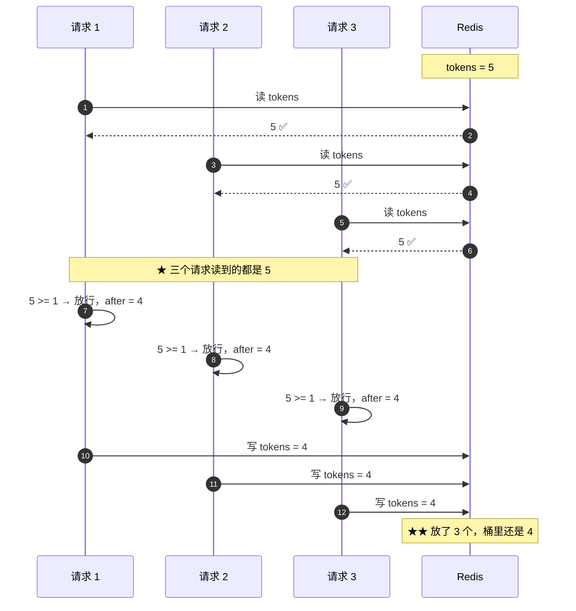
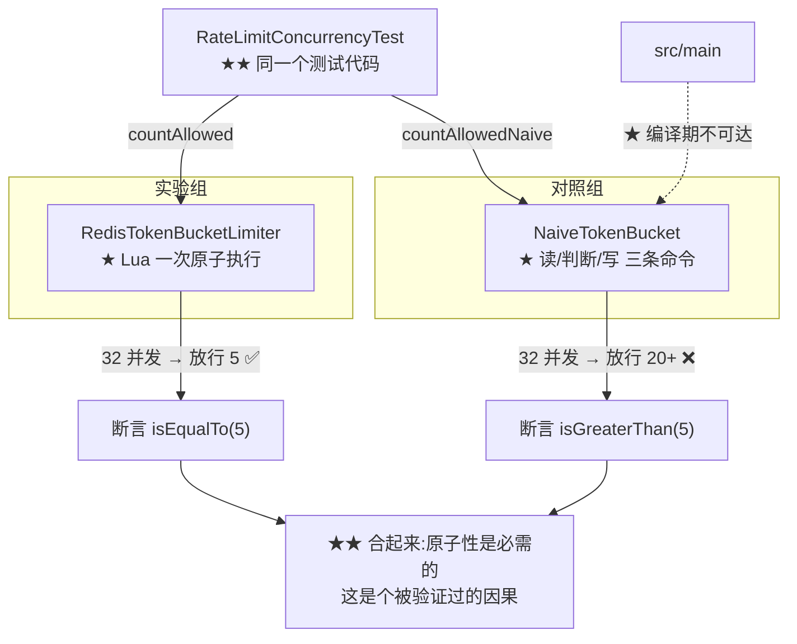

# 测试 · 对照组 NaiveTokenBucket

> **本页速览**
> - 一个 **112 行、故意会出错**的令牌桶,只存在于 `src/test/`,存在的唯一目的是**当证据**。
> - ★★ 本页是全项目**最值得学的一页**:它讲的是 **"怎么证明一个测试真的测出了东西"**。
> - ★ 它**不是稻草人** —— 逻辑一行都没错,单机压测往往是绿的,只在并发下无声地多放行几个。
> - ★★ 关键手法:**把一个"靠运气才发生"的竞态,变成"必然发生"的**(把读写窗口放大到 20ms)。
> - ⚠️ 它**不能**放进 `src/main` —— **反面教材不应该可以被 import**。
> - ★ 面试时这一条几乎是万能弹药:被问"你怎么保证测试有效",答案就在这一页。
>
> **导航**:[← 上一页:测试-限流与并发](测试-限流与并发.md) ｜ [下一页:启动流程 →](../../02-flows/启动流程.md) ｜ [所属模块:M7 测试验证](_index.md)

## 一句话职责
**用一份"写得很像样但没做原子"的实现,证明 `RateLimitConcurrencyTest` 的第一条断言是有价值的。**
## 位置
```text
src/test/java/com/example/gateway/limiter/NaiveTokenBucket.java     (112 行)
                                    ↑ ★ 在 test 里,不在 main 里
```
## 为什么需要这个类(设计动机)
★★ 少了它,`RateLimitConcurrencyTest` 里的"32 并发 → 恰好放行 5 个"只能证明"我的实现没超卖";有了它,同一套测试代码跑出"32 并发 → 放行 32 个",才能证明"超卖这件事真的会发生,而 Lua 是拦住它的那一道墙"。两条测试用的是**完全相同的测试代码 / 同一个 Redis / 同样的并发数**,唯一差别:被测实现有没有把四步装进一次原子执行 —— 于是结论从"我的实现对"升级成"★ 原子性是必需的,而且我证明了它"。

> ★★ **规律**:「**一个不会失败的对照组,等于没有对照组**」。只有第一条 → 可能是这个测试压根测不出问题,绿的也没有什么意义。
## ★★ 为什么它不能放进 `src/main`
**这条纪律的完整论证**:

| 放在 `src/main` | 放在 `src/test` |
|---|---|
| ★ 能被生产代码 `import` | ★★ **编译期就不可达** |
| 有一个"看起来能用"的实现 | 只是测试的依赖 |
| ★ 迟早有人在线上 new 它 | 不会泄露到产物里 |
| 别人会以为"这是备选方案" | ★ 名字就说明它是反例 |

> ★★ **规律**:「**约束一个东西"不要被用",最可靠的方式是让它编译期不可达**」。对比几种"软约束",全部不如上面这条:
>
> | 手段 | 可靠性 |
> |---|---|
> | 写在文档里"不要用" | ★ 没人读 |
> | 加 `@Deprecated` 注解 | ★ 只是警告,能编译过 |
> | 类名加 `Naive` 前缀 | ★ 有提示,但挡不住 |
> | ★★ **放进 `src/test/`** | ★★ **编译不过 —— 这才是约束** |
## ★★ 它不是稻草人
★ 它是一份**写得很像样**的实现:读当前令牌 → 按流逝时间回填 → 判断够不够 → 扣掉 → 写回,逻辑一行都没错,单机压测往往是绿的(请求串行到达,读改写之间没有别的请求插进来);它**只在并发下错,而且错得无声无息 —— 不报错、不告警,只是偶尔多放行几个**。
```java
public Mono<RateLimitDecision> tryAcquire(String clientId) {
    String key = KEY_PREFIX + ":" + clientId;
    long now = System.currentTimeMillis();

    // ① 读 —— 一次独立的 Redis 调用
    return redis.<String, String>opsForHash()
            .entries(key)
            .collectMap(Map.Entry::getKey, Map.Entry::getValue)
            .flatMap(state -> {
                double tokens = state.containsKey("tokens")
                        ? Double.parseDouble(state.get("tokens"))
                        : capacity;                                   // ★ 首次满桶,和 Lua 一致
                long ts = state.containsKey("ts") ? Long.parseLong(state.get("ts")) : now;

                // ② 补
                long elapsed = Math.max(0L, now - ts);                // ★ 时钟回拨保护,也有
                double refilled = Math.min(capacity, tokens + elapsed * refillPerSecond / 1000.0);

                // ③ 判断 + 扣减
                boolean allowed = refilled >= 1.0;
                double after = allowed ? refilled - 1.0 : refilled;
                long retryAfterMs = allowed || refillPerSecond <= 0
                        ? -1L
                        : (long) Math.ceil((1.0 - refilled) / (refillPerSecond / 1000.0));

                // ★★ 就是这里 ★★
                return Mono.delay(readWriteWindow)
                        // ④ 写回 —— 另一次独立的 Redis 调用
                        .flatMap(ignored -> redis.<String, String>opsForHash().putAll(key, Map.of(
                                "tokens", String.valueOf(after),
                                "ts", String.valueOf(now))))
                        .thenReturn(allowed
                                ? RateLimitDecision.allowed((long) after)
                                : RateLimitDecision.denied((long) after, retryAfterMs));
            });
}
```
```text
★ 逐条对照 Lua 脚本(见 脚本-token_bucket.lua):
   首次满桶 ✅   惰性回填 ✅   时钟回拨保护 ✅   向上取整 ✅
   ★ 唯一缺的:【读 → 判断 → 写】是不是一次原子执行
   ↓
★★ 也就是说:两个实现 ★ 只差一步,而这一步决定了它是不是限流器
```
> ★★ **规律**:「**好的对照组和真实现的差距,应该只有"你要验的那一个点"**」。如果对照组连"回填"都没做,那测试红了你也**不知道是哪个原因导致的**。
## ★★ 核心:那个 bug 到底在哪
★★ **就是这里**:「判断完了」和「写回去」之间,别的请求可以随便插进来读 —— 20 个请求全部在这里读到同一个"还剩 5 个",然后全部判定通过,最后全部写回 4,桶里只有 5 个令牌却放行了 20 个。

> ★★ **规律**:「**"Redis 是单线程的" ≠ "你的复合操作是原子的"**」。这是**面试里最常被问到、也最容易答错**的一点 —— 这个 bug 和"Redis 是不是单线程"完全无关:Redis 单线程只保证【每一条命令】原子,`读-判断-写` 是三条命令,它们之间永远是敞开的,唯一的解法是搬到 Redis 内部去,也就是 Lua;而**分布式场景下应用层加锁也不行**,要锁的是"别的实例"。
## ★★ 核心手法:把"偶发"变成"必然"
```java
/**
 * 「读」和「写」之间的耗时。
 * 它模拟的是什么：真实世界里这一步之间至少夹着一次 Redis 往返的网络延迟
 * （读回来 → 应用算 → 写回去），加上业务处理。生产环境里这个窗口通常在 1~3ms。
 * 为什么测试里要把它放大到 20ms：不是为了"造假"，而是为了让一个
 * 【本来靠运气才会发生】的竞态变成【必然发生】的。测试如果要用"跑一百次碰上一次"
 * 来证明一个 bug 存在，那它在 CI 上就是一条随机失败的测试 —— 比没有更糟。
 * 放大窗口只是让证据变可靠，没有改变结论：那段时间真实存在，只是长短不同。
 */
private final Duration readWriteWindow;
```
```java
long allowed = countAllowedNaive(CAPACITY, REFILL_DISABLED, Duration.ofMillis(20), "naive");
```
**为什么 20ms 是关键**:

| 窗口大小 | 结果 |
|---|---|
| 0(不放大) | ★ 32 个请求可能串行跑完 → **对照组也绿** → 测试白写 |
| ★ **20ms** | ★★ 32 个请求全部挤在这个窗口里读 → **必然超卖** |
| 2000ms | ⚠️ 能过,但测试慢 2 秒,**没必要** |

> ★★ **规律**:「**测试如果要用"跑一百次碰上一次"来证明一个 bug 存在,那它在 CI 上就是一条随机失败的测试 —— 比没有更糟**」。这也解释了为什么"我手动压了半天才复现一次"不能作为证据。
### ★★ 为什么"放大窗口"不算造假
```text
★ 三条理由:
   ① 【性质没变】:那段时间 ★ 真实存在,只是从 1~3ms 变成 20ms
   ② 【方向没变】:放大窗口只会 ★ 更容易超卖 —— 而对照组本来就该红
   ③ 【结论更强】:若在 20ms 下都不超卖,那才能说"这个实现是安全的"
   ↓
★★ 判据:放大的是"★ 真实存在的关键变量",不是"★ 造一个不存在的条件"
```
> ★★ **规律**:「**为了让一个 bug 稳定复现而放大某个真实参数,和不造假之间,差的是"这个参数真实存在吗"**」。反例:如果 `readWriteWindow` 模拟"网络延迟",真实环境却是**同机通信(0.1ms)**,那 20ms 就是**造了一个不存在的条件** —— 这时结论才不成立。
## ★ 辅助方法里的一处细节
```java
private long countAllowedNaive(int capacity, double refillPerSecond, Duration window, String label) {
    NaiveTokenBucket naive = new NaiveTokenBucket(redis, capacity, refillPerSecond, window);
    String clientId = uniqueClientId(label);

    List<RateLimitDecision> decisions = Flux.range(0, CONCURRENCY)
            .flatMap(i -> naive.tryAcquire(clientId), CONCURRENCY)   // ★ 和真实现同一个并发写法
            .collectList()
            .block(Duration.ofSeconds(30));

    return decisions.stream().filter(RateLimitDecision::allowed).count();
}
```
```text
★★ 注意这里 ★ 复用了和真实现测试完全一样的并发写法:
   Flux.range(0, CONCURRENCY).flatMap(..., CONCURRENCY)
   ↓
★ 这样"两条测试唯一的差别"才真的只剩"被测实现是否原子"
   → 如果对照组用了别的并发方式,"对照组超卖"就可能被归因到并发方式上
```
> ★★ **规律**:「**对照组和实验组,除了"被验的那一个变量",其余必须完全一致**」。这是**控制变量法**,和中学实验里的那条是同一件事 —— 只是软件里"其余都一致"要靠**共用同一段辅助代码**来保证。
## 这个类在项目中的角色

```text
★★ 中间那两条箭头是同一个测试的两个分支
   → ★ 它们不是"两个测试",是"一个实验的两组"
   ★ 而下面那条虚线:src/main 够不到它
```
## 值得学习的点
### 1. ★★ 反问:"如果这个功能是错的,我的测试会不会红?"
| 问自己 | 如果答不上来 |
|---|---|
| ★ 把被测逻辑**删掉**,这条断言会红吗? | 这条断言**白写** |
| ★ 被测逻辑**写反**,这条断言会红吗? | 只能验"跑到了",验不了"跑对了" |
| ★ 有没有一条**负向**断言,证明"不该发生的没发生"? | 漏掉"我不想要的也发生了"这一整类 |
| ★ 这个测试**上一次红**是什么时候? | 可能要怀疑它是恒绿的 |

> ★★ **规律**:「**测试的有效性,不体现在它绿的时候,体现在"它什么时候会红"**」。一个从来没红过的测试,和 `assertThat(true).isTrue()` 没有区别。
### 2. ★★ 三条测试的"成对"模式(全项目汇总)
| 主题 | 实验组 | 对照组 / 反向 |
|---|---|---|
| ★ **原子性** | 真实现 → 放行 **5** | ★ **本页** → 放行 **>5** |
| 空闲超时 | 停滞 1000ms → **报错** | 健康 100ms → **不报错** |
| 取消日志 | 断开 → **有** `[cancel]` | 正常读完 → **没有** `[cancel]` |
| 路由 | moonshot → **收到 1** | deepseek → **收到 0** |
| 限流位置 | 第 4 个 → **429** | 上游 → **只被调 3 次** |

> ★★ **规律**:「**一个项目的测试质量,很大程度上看它有多少条"负向/对照"断言**」。**这一张表可以直接背下来当面试话术**:"我给每个正向断言都配了一条反向的,而且关键的那一条有对照组,证明去掉实现就会红。"
### 3. ★ "错误的实现"比"正确的实现"更值得写注释
| 内容 | 行数 |
|---|---|
| 类级 Javadoc(为什么存在、为什么在 test 里、为什么不是稻草人、为什么生产才会爆) | ~25 行 |
| 字段注释(窗口模拟什么、为什么放大) | ~12 行 |
| 方法内注释(★ 就是这里) | ~10 行 |
| **真正的代码** | ★ **~40 行** |

```text
★ 注释:代码 ≈ 1.2 : 1
★★ 对比 PingController(45 行里 42 行注释)—— 同一个特征
   ↓
★ 判据:这个文件的难度在【代码】还是在【判断】?
```
> ★★ **规律**:「**当一行代码背后有三个设计判断时,注释才是主要内容**」。反面也成立:如果一个文件注释很多但判断很少,那是注释在掩盖问题。
### 4. ⚠️ 这个对照组也**没**覆盖的部分
| 缺口 | 说明 |
|---|---|
| **多实例场景** | 对照组和真实现都在单进程内,没验"两个网关实例同时打" |
| **Lua 脚本报错时的行为** | 对照组不涉及,那条路径在 [RateLimitFailOpenTest](测试-限流与并发.md) 里 |
| **窗口大小的影响** | 只用过 20ms,没试过 1ms / 200ms 会怎样 |

> ★ 第一条是**真问题** —— 但它同时也是 Lua 方案相对"应用层加锁"的核心优势,★ 见 [待深入问题](../../99-appendix/待深入问题.md)。

## ★★ 这一页能提炼出的简历 / 面试话术

**简历那一行可以这么写**:

> 为 Redis 限流器设计了**对照组测试**(`NaiveTokenBucket`)——
> 用同一套并发测试代码跑"非原子实现",证明 32 并发下容量 5 的桶会放行 20+ 个,
> 从而把"Lua 是必需的吗"从**设计争论**变成了**可复现的实验结论**。

**面试被问到时,这三句话按顺序说**:

```text
① "我先写了一个天真实现当对照组,它逻辑一行都没错,只是没把读判断写装进一次原子执行。"
② "为了让竞态必然发生而不是偶发,我把'读写窗口'放大到 20ms —— 这个窗口真实存在,只是被放大了。"
③ "两条测试跑同一套代码、同一个 Redis、同样的并发数,唯一差别就是原不原子。
    于是'32 并发放行 5 个'这个结论,不再是我认为的,而是被证明的。"
```

> ★★ **规律**:「**面试里最值钱的不是"我知道 xx 要用 Lua",而是"我证明了为什么必须用 Lua"**」。

## 相关页
- ★★ 调用它的测试 → [测试-限流与并发](测试-限流与并发.md)
- 真实现(被对照的那个) → [类-RedisTokenBucketLimiter](../06-限流/类-RedisTokenBucketLimiter.md)
- 原子性到底靠什么 → [脚本-token_bucket.lua](../06-限流/脚本-token_bucket.lua.md)
- 降级路径怎么测 → [测试-限流与并发](测试-限流与并发.md)
- M6 模块首页(fail-open、保护性 vs 功能性) → [M6 限流](../06-限流/_index.md)
- 全项目的测试地图 → [M7 测试验证](_index.md)
- 另外几处"成对测试" → [测试-流式与取消传播](测试-流式与取消传播.md)
- 怎么把测试跑起来 → [启动流程](../../02-flows/启动流程.md)

> **导航**:[← 上一页:测试-限流与并发](测试-限流与并发.md) ｜ [下一页:启动流程 →](../../02-flows/启动流程.md) ｜ [所属模块:M7 测试验证](_index.md)
