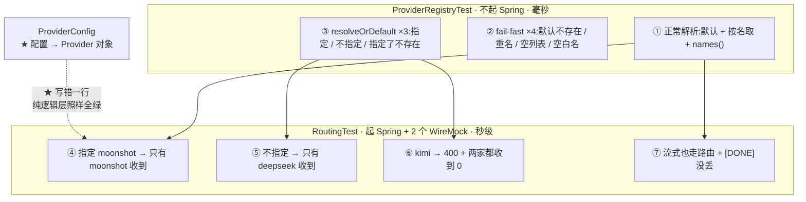

# 测试 · 路由与注册表

> **本页速览**
> - 两个类、13 个方法,守同一件事的两层:**`ProviderRegistryTest`(纯逻辑,不起 Spring)+ `RoutingTest`(端到端,起 Spring)**。
> - ★★ 本页最值钱的一条:**「纯逻辑测试全绿,而应用跑起来路由不生效,是完全可能的」** —— 所以两个都要有。
> - ★ `ProviderRegistryTest` 里 4 条 **fail-fast** 测试:配置错了要**启动就炸**,不能等请求进来才 500。
> - ★★ `RoutingTest` 的**双向断言**:既验"响应来自谁",也验"请求打给了谁"(`verify(0, ...)` 也是断言)。
> - ★ 一条容易被忽略的测试:**"指定了不存在的渠道 → 报错,绝不静默回落默认"** —— 守的是一个"看起来更友好"的错误做法。
>
> **导航**:[← 上一页:测试-流式与取消传播](测试-流式与取消传播.md) ｜ [下一页:测试-限流与并发 →](测试-限流与并发.md) ｜ [所属模块:M7 测试验证](_index.md)
## 为什么这一块要两个测试类
```java
/**
 * 一个纯逻辑测试全绿、而整个应用跑起来路由不生效，是完全可能的。
 * 只要在 ProviderConfig 里写错一行（比如所有渠道都用了同一个 builder 的
 * base-url、或者 map 遍历时对象被覆盖），注册表依然"正确"，
 * 而每个请求都打到同一个上游上。只有端到端测试能发现这种错。
 */
```
> ★★ **规律**:「**每个单元都对,不代表组装起来对**」—— 两个测试类就是"零件合格"与"整机合格"两个验收项。
## 一、`ProviderRegistryTest` —— 纯逻辑 + fail-fast
### ★ 起点:为什么刻意不起 Spring
```java
/**
 * 注册表是个纯逻辑类 —— 给它一个 Provider 列表和一个默认名，它就该给出确定性结果。
 * 用 @SpringBootTest 去测它，等于为了验一个纯函数把整个应用启动一遍：
 * 慢、脆、而且掩盖了"这个类其实不依赖框架"这个事实。
 *
 * 判据：被测类能不能被 new 出来。能，就用普通单测。
 * 测试起 Spring 的成本，应该由"被测对象真的依赖容器"来买单。
 */
```
```text
★ 本项目的应用:ProviderRegistryTest / RateLimitDecisionTest / RateLimitConcurrencyTest → 不起 Spring(最后那个起 Redis)
★ RoutingTest / StreamingContractTest → @SpringBootTest ← ★ 要起,因为验的是 HTTP
```
### ★ 桩 Provider 只实现关心的那个方法
```java
/** 最小桩：只关心 name()，另外两个方法永远不会被本测试调到 */
private static Provider stub(String name) {
    return new Provider() {
        @Override public String name() { return name; }

        @Override public Mono<ChatCompletionResponse> chatCompletion(ChatCompletionRequest request) {
            throw new UnsupportedOperationException("本测试不涉及补全逻辑");
        }

        @Override public Flux<ChatCompletionChunk> chatCompletionStream(ChatCompletionRequest request) {
            throw new UnsupportedOperationException("本测试不涉及补全逻辑");
        }
    };
}
```
> ★★ **规律**:「**桩方法的"不该被调用"要表达出来,而不是留白**」—— 抛 `UnsupportedOperationException` 而不是返回 `null` 或 `Mockito.mock()`,万一被调到,报错直接说"是这里",而不是在很远的地方 NPE。
### ★★ 四条 fail-fast 测试

| 测试 | 场景 | 断言 |
|---|---|---|
| `failsFastWhenDefaultProviderIsMissing` | 配置写 `qwen`,但没有实现叫这名字 | ★ `IllegalStateException` |
| `failsFastOnDuplicateProviderName` | 两个实现用了同一个名字 | ★ `IllegalStateException` |
| `failsFastWhenNoProviderAtAll` | 一个渠道都没有 | ★ `IllegalStateException` |
| `failsFastOnBlankProviderName` | 渠道名是 `"   "` | ★ `IllegalStateException` |

```text
★ "启动失败"是【可发现的事故】—— 部署流程会拦住、日志一眼看到
★ "请求时才报错"是【静默的灾难】—— 探针是绿的,但每个请求都 500
```
**重名特别阴险**:后注册的会【静默覆盖】前一个 —— "我改的代码没生效",代码改了、测试也绿了,就是跑的不是它;★ 所有可见信号都是对的,只有"实际运行的代码"是错的。
> ★★ **规律**:「**能变成启动失败的错,就不该留到运行期**」—— 判据:这个错误在启动时能不能被发现?能,就必须在启动时发现。
> ★ 这也是本项目的一条主线:见 [类-RateLimitConfig](../06-限流/类-RateLimitConfig.md) 的启动自检、[类-ProviderConfig](../02-上游渠道抽象/类-ProviderConfig.md) 的校验。
### ★ 错误信息里必须带上"实际可用的"
```java
assertThatThrownBy(() -> new ProviderRegistry(List.of(stub("deepseek")), "qwen"))
        .isInstanceOf(IllegalStateException.class)
        .hasMessageContaining("qwen")
        .hasMessageContaining("deepseek");   // ★ 错误信息里要列出实际可用的，省得再去翻代码
```
> ★★ **规律**:「**错误信息的读者是"正在被线上问题追着跑的人"**」—— 它该回答的不是"什么失败了",而是**"我要怎么办"**:只报"qwen 不存在"还得去翻代码;报"可用的有:deepseek,moonshot"一眼看到答案。
### ★ 结构化字段:异常不只带 message
```java
UnknownProviderException ex = catchThrowableOfType(
        () -> registry.resolve("kimi"), UnknownProviderException.class);
assertThat(ex.requestedName()).isEqualTo("kimi");
assertThat(ex.availableNames()).isEqualTo(Set.of("deepseek", "qwen"));

/**
 * 异常本身也要带上结构化字段：G3-3b 的异常处理器要靠它填错误响应，
 * 而不是去 parse message 字符串（那太脆了）
 */
```
> ★★ **规律**:「**给机器读的数据要用字段传,别塞进字符串里**」—— `parse` message 的后果:**改一个标点就崩,而崩溃点在很远的地方**。★ 完整推理 → [类-UnknownProviderException](../05-错误处理/类-UnknownProviderException.md)
### ★★ G3b 新增的三条:路由的三种输入
```java
/**
 * 这三条是成对的，缺一条就会让"路由"退化成"随便返回个渠道"：
 *   ① 指定了     → 必须是指定的那个（否则路由根本没生效）
 *   ② 没指定     → 必须是默认的（否则标准 OpenAI 客户端全部调不通）
 *   ③ 指定了不存在的 → 必须报错（否则静默走错渠道，而且没人知道）
 */
```
**第 ② 条守的是"标准客户端能不能用"**:

```java
/**
 * 真实的 OpenAI SDK / LangChain4j 压根不知道"渠道"这个概念，
 * 它们永远不发 provider 字段 —— 对它们来说 null 是【正常情况】，不是错误。
 * 如果这里报错，网关就把所有标准客户端都拒之门外了。
 */
assertThat(registry.resolveOrDefault(null)).isSameAs(deepseek);
assertThat(registry.resolveOrDefault("   "))     // ★ 空白也要当"没指定"
        .as("客户端很容易传个空串进来，把它当成'指定了一个叫空格的渠道'然后报 400 是没道理的")
        .isSameAs(deepseek);
```
**★★ 第 ③ 条守的是一个"看起来更友好"的错误做法**:

```java
/**
 * 很多网关在"指定了不存在的渠道"时选择回落默认，理由是"保证可用性"。
 * 后果：调用方把渠道名拼错【三个月都没人发现】——
 * 请求全都成功了（走了默认渠道），日志里一条错误都没有，
 * 只是账单一直出在错误的渠道上、或者该走便宜渠道的批量任务一直在烧贵的。
 *
 * 可用性不能靠"假装请求是对的"来换。
 */
```
> ★★ **规律**:「**"静默回落"是一种把错误变成沉默的设计**」。
> ★ 它的危险:**失败被转化成了成功** —— 监控全绿、日志无错、用户无感,而**账单在错误的地方**。★ 判据:**这个"友好的兜底",会不会让一个错误永远不被发现?**
## 二、`RoutingTest` —— 端到端证明请求真的分开了
### ★★ 关键设计:起两个 WireMock,双向断言
```java
private static final WireMockServer DEEPSEEK = startUpstream();
private static final WireMockServer MOONSHOT = startUpstream();

private static final String DS_CONTENT = "from-deepseek";
private static final String MS_CONTENT = "from-moonshot";
```
```text
★★ 为什么是【两个】假上游、各返回一句能区分身份的话:
   ① 响应体里的内容是谁的 → 证明"回来的数据来自哪"
   ② 两个假上游各自【收到了几个请求】→ 证明"发出去的请求去了哪"
★ 只断言 ① 不够:若把请求同时发给两家(广播),响应体照样是"其中一家" → 测试会绿 —— 那不是路由,那是灾难
```
**这就是 `verify(0, ...)` 的价值**:

```java
MOONSHOT.verify(postRequestedFor(urlEqualTo("/chat/completions")));
DEEPSEEK.verify(0, postRequestedFor(urlEqualTo("/chat/completions")));
//           ↑ ★ "零请求"也是一条断言
```
> ★★ **规律**:「**"没发生"必须被显式断言,它不会自己变成红的**」—— 本项目第三次出现这个思想(另见 [契约测试](测试-契约测试.md) 的"多久返回"、[限流页](测试-限流与并发.md) 的"上游只被调了 3 次")。
> ★★ **合起来:一个只断言"我想要的发生了"的测试,漏掉了"我不想要的也发生了"这一整类 bug。**
### ★ 四条测试,覆盖四种情况

| 测试 | 输入 | 断言 |
|---|---|---|
| `explicitProviderRoutesToThatUpstream` | `provider=moonshot` | ★ moonshot 收到 1,**deepseek 收到 0** |
| `absentProviderFallsBackToDefault` | 不传 `provider` | ★ deepseek 收到 1,**moonshot 收到 0** |
| `unknownProviderIsRejectedBeforeAnyUpstreamCall` | `provider=kimi` | ★ **400**,且**两家都收到 0** |
| `streamingRequestIsRoutedToo` | `provider=moonshot` + `stream=true` | ★ moonshot 收到 1,deepseek 收到 0,末尾有 `[DONE]` |

**第 ③ 条为什么也要断言"零请求"**:

```java
/**
 * 这条断言是"400 而不是 502/504"这个决策的直接证据：
 * 渠道名写错时，网关【压根没轮到上游】。
 * 如果这里返回的是 502，运维告警会显示"上游故障率上升"，
 * 值班的人会去查上游、联系厂商 —— 而真凶是调用方拼错了名字。
 */
DEEPSEEK.verify(0, postRequestedFor(urlEqualTo("/chat/completions")));
MOONSHOT.verify(0, postRequestedFor(urlEqualTo("/chat/completions")));
```
> ★★ **规律**:「**状态码是"给客户端的结论",零请求断言是"给运维的结论"**」—— 前者说"你错了",后者说"**不用查上游**"。★ 完整对照表 → [M5 错误处理](../05-错误处理/_index.md)
**第 ④ 条为什么要单独写**:

```java
/**
 * 流式是网关最主要的用法（项目一的 Agent 走的就是它）。
 * 路由那一行在 Controller 里位于 stream 分支【之前】，
 * 所以理论上两条路都覆盖了 —— 但"理论上"不是证据，这条测试才是。
 */
```
> ★★ **规律**:「**"代码位置保证了它" 是推理,"测试证明了它" 是证据**」—— 这条还顺手断言 `[DONE]`:**换渠道不能把网关补的协议尾巴弄丢**。
### ★ 第 ③ 条的消息断言:三段都要在
```java
.jsonPath("$.error.message").value(msg -> assertThat((String) msg)
        .contains("kimi")
        .contains("deepseek")
        .contains("moonshot"));
```
> ★ 和前面对 `ProviderRegistryTest` 的要求一样:错误信息要说清"你要的没有" + "实际有什么";★ 这次只是验 ★ 穿过 HTTP 之后,那段 message 有没有被丢掉。
## 两个类的分工图

```text
★★ 那条虚线是"两个测试类为什么都要有"的答案:ProviderConfig 归属于 M2,它错了
   左侧 3 组测试依然全绿(桩 Provider 是测试自己造的),右侧 4 条测试立刻红 → 左边守"注册表这个类",右边守"装配这一步"
```
> ★ **规律**:「**该给"装配"单独写测试**」—— **装配代码往往没有归属**,它不属于任何类,写错了没有任何单元测试会红。
## 这个测试在项目中的角色

| 被守的承诺 | 谁来守 | 页 |
|---|---|---|
| 渠道名写错 → **400** 而不是 5xx | `RoutingTest#unknownProvider...` | [M5](../05-错误处理/_index.md) |
| 不传 `provider` → **回落默认**(标准客户端可用) | `RoutingTest#absentProvider...` + `ProviderRegistryTest` | [类-ProviderRegistry](../02-上游渠道抽象/类-ProviderRegistry.md) |
| 配置错了 → **启动就炸** | `ProviderRegistryTest` ×4 | [类-ProviderRegistry](../02-上游渠道抽象/类-ProviderRegistry.md) |
| **一个实现类 × N 份配置** 真的分开了 | `RoutingTest` 的两家 WireMock | [M2 渠道抽象](../02-上游渠道抽象/_index.md) |
| 流式和路由**不互相干扰** | `RoutingTest#streamingRequestIsRoutedToo` | [类-ChatController](../04-请求入口/类-ChatController.md) |

## 值得学习的点
### 1. ★★ "单元绿 + 整机红"是常态,不是意外
> ★★ **规律**:「**给"胶水代码"写测试**」—— 胶水代码的失败模式是**"什么都没发生"**:没有任何类抛异常,只是行为悄悄变了。
### 2. ★ 测试替身的选择:桩 vs 真实对象

| 被测对象 | 替身 | 判据 |
|---|---|---|
| `ProviderRegistry` | ★ 手写桩(只实现 `name()`) | 真实的要 `WebClient`+5 个配置,**全和"解析"无关** |
| 上游 HTTP 服务 | WireMock | ★ 要能"控制返回什么",才能断言确定结论 |
| **Redis 原子性** | ⚠️ **必须真 Redis** | ★★ **要验的就是 Redis 本身** |

> ★★ **规律**:「**替身只能替换掉"和结论无关的部分"**」—— 一旦被测对象**就是**那个替身,mock 的绿**是自我循环**。
### 3. ★ 用 `verify(0, ...)` 把"没发生"变成断言

| 场景 | "没发生"的断言 |
|---|---|
| 路由 | ★ `DEEPSEEK.verify(0, ...)` |
| 限流 | ★ 上游只被调了 3 次(不是 4 次) |
| 取消 | ★ 正常读完的流里**没有** `[cancel]` |
| 空闲超时 | ★ 健康的长回复**不抛异常** |
| 归一 | ★ 中间块的 `finish_reason` **是 null** |

> ★★ **规律**:「**一个项目的测试质量,很大程度上看它有多少条"负向断言"**」。
### 4. ⚠️ 这个模块没覆盖的部分

| 缺口 | 说明 |
|---|---|
| **真实厂商的 API 形状** | 假上游是我们自己写的,**可能和真厂商不一致** |
| **`ProviderConfig` 的失败路径** | 配置里 base-url 是空的会怎样?未见测试 |
| **多实例部署** | 本项目是单实例验证,没有集群下的路由验证 |

> ★ 三条都在 [待深入问题](../../99-appendix/待深入问题.md) 里。
## 相关页

- ★ 另一个"纯逻辑 + 端到端"的分工 → [测试-契约测试](测试-契约测试.md) vs [测试-流式与取消传播](测试-流式与取消传播.md)
- 注册表的设计动机 → [类-ProviderRegistry](../02-上游渠道抽象/类-ProviderRegistry.md)
- 配置怎么变成 Provider 对象 → [类-ProviderConfig](../02-上游渠道抽象/类-ProviderConfig.md)
- SPI 的边界在哪 → [类-Provider](../02-上游渠道抽象/类-Provider.md)
- 完整的路由流程 → [流程-渠道路由](../02-上游渠道抽象/流程-渠道路由.md)
- 那一处 400 的完整推理 → [类-UnknownProviderException](../05-错误处理/类-UnknownProviderException.md)
- ★★ 另一组"成对测试" → [测试-限流与并发](测试-限流与并发.md)

> **导航**:[← 上一页:测试-流式与取消传播](测试-流式与取消传播.md) ｜ [下一页:测试-限流与并发 →](测试-限流与并发.md) ｜ [所属模块:M7 测试验证](_index.md)
