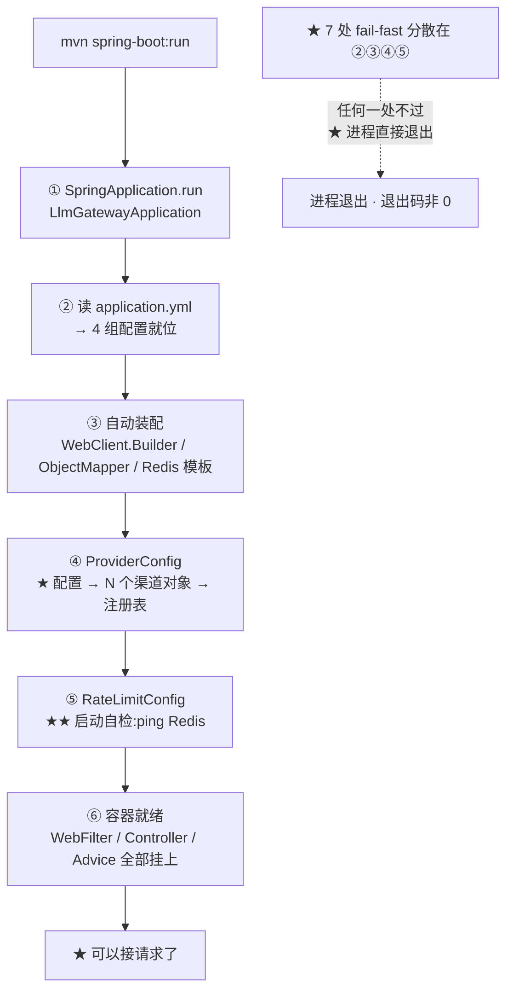

# 启动流程

> **本页速览**
> - 从 `main()` 到"可以接请求",一共 **6 个阶段**;本页把它们逐个拆开。
> - ★★ 本流程的主线只有一句:**「配置错了就别启动」** —— 全流程有 **7 处 fail-fast**。
> - ★ 其中一处**故意不 fail-fast**(渠道密钥为空只打 WARN),理由是个真实的开发需求。
> - ★★ 最容易被忽略的一步:`WebClientCustomizer` —— 它决定了"三个渠道自动共享同一套超时"。
> - ⚠️ 限流的启动自检有一条**会 `block()` 的代码**,本页讲清为什么它在这里是安全的。
>
> **导航**:[← 上一页:测试-对照组NaiveTokenBucket](../01-modules/07-测试验证/测试-对照组NaiveTokenBucket.md) ｜ [下一页:非流式请求处理流程 →](非流式请求处理流程.md) ｜ [相关:架构总览](../00-map/架构总览.md)
---
## 触发条件
```bash
mvn spring-boot:run
# 或者打包后
java -jar target/llm-gateway-*.jar
```
**启动成功的样子**:
```text
  .   ____          _            __ _ _
 /\\ / ___'_ __ _ _(_)_ __  __ _ \ \ \ \
...
Tomcat initialized with port 8081 (http)   ← ⚠️ 注意:日志写的是 Tomcat,实际是 Reactor Netty(见下方卡点 3)
Started LlmGatewayApplication in 2.134 seconds
```
**启动失败的样子(这是本页的主角)**:
```text
***************************
APPLICATION FAILED TO START
***************************
Description:
没有配置任何上游渠道。请检查 gateway.providers.channels 配置项。
```
> ★ **看到这个不要慌** —— 这是设计在工作,不是 bug。见下面第 ④ 阶段。
---
## 阶段总览图

> ★ **读这张图最该注意的**:那个 `F → DEAD` 的箭头。**本项目所有的配置错误,都结束在"进程起不来",而不是"请求报 500"。**
---
## 步骤化讲解
### ① `main()` → `SpringApplication.run()`
```java
@SpringBootApplication
public class LlmGatewayApplication {
    public static void main(String[] args) {
        SpringApplication.run(LlmGatewayApplication.class, args);
    }
}
```
```text
★ 19 行里 12 行是注释 —— 一个类只有一行有效代码时,它的价值 ★ 不在代码里 ★ @SpringBootApplication = @ComponentScan + @EnableAutoConfiguration + @Configuration → 它一声令下,下面 5 个阶段全部自动发生
```
> ★ 完整读法 → [类-LlmGatewayApplication](../01-modules/01-骨架与配置/类-LlmGatewayApplication.md)
### ② 配置就位
**`application.yml` 里的四组配置,分别由不同的类消费**:

| 配置前缀 | 谁读它 | 读法 |
|---|---|---|
| `spring.data.redis.*` | ★ Spring Boot 自动装配 | 前缀**不能写错**(Boot 3 改了) |
| `gateway.providers.*` | `ProviderProperties` | `@ConfigurationProperties` |
| `gateway.upstream.*` | `WebClientConfig` + `ProviderConfig` | ★ `@Value` 逐个抠 |
| `gateway.rate-limit.*` | `RateLimitProperties` | `@ConfigurationProperties` |
**★ 这里藏着两处 fail-fast**:
```yaml
gateway:
  upstream:
    connect-timeout-ms: ${GATEWAY_CONNECT_TIMEOUT_MS:3000}   # ★ 有默认值
    read-timeout-ms: ${GATEWAY_READ_TIMEOUT_MS:30000}        # ★ 有默认值
```
```java
// WebClientConfig —— 没有默认值(不是 :0,是完全没有 : 后面)
@Value("${gateway.upstream.connect-timeout-ms}") int connectTimeoutMs
//                                 ↑ ★ 配置缺失 → 启动失败
```
```text
★ 为什么"没有默认值"是刻意的:超时值 ★ 不该有一个"猜"出来的默认 → 缺失就该炸,而不是悄悄用一个谁也不知道的数字 ★★ 对比 rate-limit 的键 ★ 全都带默认值 —— 因为它默认 enabled=false,整块配置可以不存在 → ★ "哪些键必须有默认值"取决于"这个功能默认开不开"
```
**★ 一处静默失败的经典现场**:
```yaml
spring:
  data:                 # ★ Boot 3 的前缀
    redis:
      host: ${SPRING_DATA_REDIS_HOST:localhost}
```
```text
⚠️ 写成 Boot 2.7 的 spring.redis.* → ★ 不会报错,只是连不上 → "连不上 Redis"只有 ★ 限流启用时才暴露 → ★★ 所以这里靠第 ⑤ 阶段的启动自检
```
> ★ **规律**:「**一个"写错了也不报错"的配置项,必须有一条别的路径让它报错**」。★ 这条 yml 注释里就写着:"写错了不会报错,只会连不上 —— 静默失败,最难查"。
### ③ 自动装配
**Spring Boot 在这一步造出三个"基础设施 Bean"** —— 注意它们**都不属于本项目**:

| Bean | 谁提供 | 谁消费 |
|---|---|---|
| `WebClient.Builder` | Spring Boot 自动装配 | `ProviderConfig` → N 个渠道 |
| `ObjectMapper` | Spring Boot 自动装配 | `ProviderConfig`、`ChatController`、`RedisTokenBucketLimiter` |
| `ReactiveStringRedisTemplate` | Spring Boot(有 `spring-data-redis` 时) | `RedisTokenBucketLimiter` |
**★ 本项目往 `WebClient.Builder` 上加了一层**:
```java
@Bean
public WebClientCustomizer upstreamTimeoutCustomizer(
        @Value("${gateway.upstream.connect-timeout-ms}") int connectTimeoutMs,
        @Value("${gateway.upstream.read-timeout-ms}") long readTimeoutMs) {
    HttpClient httpClient = HttpClient.create()
            .option(ChannelOption.CONNECT_TIMEOUT_MILLIS, connectTimeoutMs)   // ① 连接超时
            .responseTimeout(Duration.ofMillis(readTimeoutMs));               // ② 读超时
    return builder -> builder.clientConnector(new ReactorClientHttpConnector(httpClient));
}
```
```java
/**
 * 用 WebClientCustomizer 而不是自己 new 一个 WebClient.Builder：
 * new 会把 Spring Boot 自动装配的 builder 顶掉，丢掉它内置的编解码器、观察等能力。
 * Customizer 是"在自动装配的基础上加一层"，两种都不丢；也保证了 G3 的多个渠道客户端只要用注入的 builder，就自动继承同一套超时，不需要每个客户端各配一遍。
 */
```
> ★★ **规律**:「**要给框架造的东西加配置,用 Customizer,不要自己 new**」。
> ★ `new` 掉自动装配的 bean = **同时丢掉它带来的一切** —— 编解码器、指标、链路追踪,而且**不报错、不告警**,这是"静默降级"的又一个变种。
> ★ ⚠️ 这里只有 **2 个**超时;第 3 个(逐块空闲超时 `idle-timeout-ms`)由 `ProviderConfig` 通过 `@Value` 注入给每个渠道,**是每个 Provider 自己的**。
> ★ 为什么两种做法:**连接/读超时是"传输层"的,所有渠道共享;空闲超时是"流式语义"的,属于渠道。**
### ★★ ④ `ProviderConfig` —— 全流程最重要的一步
**这一个 `@Bean` 方法做了四件事**:
```java
@Bean
public ProviderRegistry providerRegistry(ProviderProperties properties,
                                         WebClient.Builder webClientBuilder,
                                         ObjectMapper objectMapper,
                                         @Value("${gateway.upstream.idle-timeout-ms}") long idleTimeoutMs) {
    Map<String, ProviderProperties.Channel> channels = properties.channels();
    // ── ① fail-fast:一个渠道都没有 ──
    if (channels.isEmpty()) {
        throw new IllegalStateException(
                "没有配置任何上游渠道。请检查 gateway.providers.channels 配置项。");
    }
    List<Provider> providers = new ArrayList<>(channels.size());
    for (Map.Entry<String, ProviderProperties.Channel> entry : channels.entrySet()) {
        String channelName = entry.getKey();
        ProviderProperties.Channel channel = entry.getValue();
        // ── ② fail-fast:base-url 为空 ──
        if (!StringUtils.hasText(channel.baseUrl())) {
            throw new IllegalStateException("渠道 [" + channelName + "] 缺少 base-url 配置。");
        }
        // ── ③ ★ 故意【不】fail-fast:密钥为空只打 WARN ──
        if (!StringUtils.hasText(channel.apiKey())) {
            log.warn("[渠道未配置密钥] channel={} —— 调用该渠道会被上游拒绝（401）。", channelName);
        }
        providers.add(new OpenAiCompatibleProvider(
                channelName, channel.baseUrl(), channel.apiKey(), channel.model(),
                idleTimeoutMs, webClientBuilder, objectMapper));
    }
    // ── ④ 注册表的构造器里还有三重校验 ──
    return new ProviderRegistry(providers, properties.defaultChannel());
}
```
**★ 那一处"故意不 fail-fast"的理由**:
```java
/**
 * ★ 密钥为空不阻止启动，但要喊一声。
 * 不像 base-url 那样拒绝启动：本地开发（不配 .env）时需要"能起来、只是调不通上游"来验别的。但线上密钥为空 = 每个请求都 401，那时你希望日志里有一句明确的话。
 */
```
> ★★ **规律**:「**fail-fast 的判据不是"这个配置重要吗",而是"缺了它还能不能验别的东西"**」。
> ★ `base-url` 缺了 → 整个渠道没意义 → **炸**;`api-key` 缺了 → 还能起来调别的东西 → **WARN**。★★ 而两种处理**都必须"有声音"** —— 一个 WARN、一个异常,**没有第三种(静默)**。
**★★ 那个 `WebClient.Builder` 的顺序陷阱**:
```java
/**
 * ⚠️ 一个不显眼但会致命的顺序问题
 * WebClient.Builder 是【可变的】：builder.baseUrl(x) 会改掉它自己的状态。
 * 下面循环把【同一个 builder】传给 N 个 Provider，每个构造时调 builder.baseUrl(自己地址).build()。
 * 现在【安全】，因为 build() 会【当场把当前配置复制走】，之后 builder 再变都不影响已造出的 WebClient。
 * 但哪天有人把 build() 挪到循环外（比如想省一次构建），N 个渠道会【全部指向同一个地址】——而且不报错，只是所有请求都打到最后一个渠道上。
 * 这类"顺序 + 可变对象"的 bug 不报错、只出错数据，是最贵的一种。
 */
```
> ★★ **规律**:「**"不报错、只出错数据"的 bug 是最贵的一种**」—— 因为它**没有观测点**。
> ★ 而它这次**被测试抓住了**:见 [测试-路由与注册表](../01-modules/07-测试验证/测试-路由与注册表.md) 的 `RoutingTest` —— **两个 WireMock、双向断言**。
**★ 注册表里的三重 fail-fast**(在第 ④ 步 `new` 的那一刻生效):
```text
① 默认渠道 ★ 必须存在 → 配置写 qwen 但没有 qwen 实现 → 炸 ② 渠道名 ★ 不许重复 → ★ 本设计下 map 的 key 天然唯一,这条是给"未来的手工注册路径"兜底
③ 渠道名 ★ 不许空白 → "   " 会让配置和日志都失去意义 → 炸
```
> ★ 完整推理 → [类-ProviderRegistry](../01-modules/02-上游渠道抽象/类-ProviderRegistry.md)
### ★★ ⑤ `RateLimitConfig` 的启动自检
**这是启动流程里最特殊的一步** —— 它会**主动去连一次 Redis**。
```java
// 三种状态,三条不同的路
if (!enabled)   →  WARN + 正常启动     ← ★ 有声音,但不拦人
if (ping 不通)  →  ★ 拒绝启动           ← ★ 变成"响亮的失败"
else            →  INFO + 列出生效参数  ← ★ 让人一眼看到"限流现在是开着的、参数是多少"
```
**为什么这里可以 `block()`**(而在业务代码里绝对不行):
```text
★ block() 在 ★ 事件循环线程 上调用 → 死锁整个网关;★★ 但启动自检跑在 ★ main 线程 上,那一刻还没有请求、没有事件循环在服务连接;★ 判据:这段代码在"哪个线程"上跑?那个线程此刻在服务别人吗?
```
> ★★ **规律**:「**"绝对不要用 `block()`"是一条简化过的规则**」—— ★ 精确的版本是:**"不要在事件循环线程上 block"**。★ 分清这两者,是"背规则"和"懂模型"的分水岭。
> ★ 完整论证 → [类-RateLimitConfig](../01-modules/06-限流/类-RateLimitConfig.md)
**★ 为什么"启动时连不上"值得拒绝启动,"运行时连不上"却不值得**:
```text
★ 启动时连不上 → ★ 配置错了(前缀写错、Redis 没起) → 现在不拦,上线后每个请求都白跑;★ 运行时连不上 → ★ 是故障,不是配置 → 该按 fail-open 降级,而不是让网关整体挂掉;★★ 同一件事("Redis 连不上"),在两个阶段是两种性质
```
### ⑥ 容器就绪
**这一步把所有"横向切面"挂上**:

| 组件 | 类型 | 挂在哪 |
|---|---|---|
| `RateLimitWebFilter` | `WebFilter` + `Ordered` | ★ **所有 HTTP 请求之前** |
| `UpstreamExceptionHandler` | `@RestControllerAdvice` | ★ **Controller 抛异常时** |
| `ChatController` | `@RestController` | `/v1/chat/completions` |
| `PingController` | `@RestController` | `/ping`(★ 探针,**不受限流影响**) |
```text
★ 顺序:HIGHEST_PRECEDENCE + 100 ← 见 类-RateLimitWebFilter ★ 为什么不是 HIGHEST_PRECEDENCE:留 100 个槽位给将来更靠前的东西(如 IP 黑名单)
```
> ★★ **规律**:「**留出编号空间本身是一种设计**」—— ★ 而它**不花任何成本**,只是 "+100" 而不是 "+0"。
---
## ★ 启动流程里的 7 处 fail-fast 汇总
| # | 位置 | 触发条件 | 后果 |
|---|---|---|---|
| ① | `WebClientConfig` | `connect-timeout-ms` / `read-timeout-ms` 缺失 | ★ 启动失败 |
| ② | `ProviderProperties` | 无(★ **紧凑构造器把 null 归一掉,不炸**) | —— |
| ③ | `ProviderConfig` | `channels` 为空 | ★ 启动失败 |
| ④ | `ProviderConfig` | 某渠道 `base-url` 为空 | ★ 启动失败 |
| ⑤ | `ProviderRegistry` | 默认渠道不存在 | ★ 启动失败 |
| ⑥ | `ProviderRegistry` | 渠道名重复 / 空白 | ★ 启动失败 |
| ⑦ | `RateLimitConfig` | `enabled=true` 但 Redis 连不上 | ★ 启动失败 |
| ★ | `ProviderConfig` | **密钥为空** | ⚠️ **只 WARN,不拦** |
**★ 两条纪律**:
```text
★★ 纪律一:能变成启动失败的,不留到运行期 → 判据:这个错误在启动时能不能被发现?能,就必须在启动时发现;★ 理由:"启动失败"是可发现的事故(部署流程会拦住),"请求时才报错"是静默的灾难(探针是绿的,但每个请求都 500)
★★ 纪律二:每一条 fail-fast 的错误信息里,要带上"实际可用的有什么" → 例:"渠道 [kimi] 不存在,可用的有:deepseek,moonshot";★ 理由:错误信息的读者是"正在被线上问题追着跑的人"
```
> ★ **规律**:「**一个项目的 fail-fast 数量,是它"配置纪律"的直接体现**」。
---
## 容易卡住的点
### 卡点 1:★ `ProviderProperties` 明明有 `defaultChannel`,yml 里写的是 `default-channel`
```yaml
gateway:
  providers:
    default-channel: ${GATEWAY_DEFAULT_CHANNEL:deepseek}
```
```text
★ 宽松绑定:default-channel → defaultchannel,defaultChannel → defaultchannel ★ 对得上;★★ 而 timeout-ms → timeoutms,timeoutMillis → timeoutmillis ★ 对不上
★ 规则:小写 + **去掉分隔符**,★ 不会把缩写展开 → 所以 "ms" 和 "millis" 是两个不同的词,这是唯一的坑
```
> ★ 完整故事 → [类-RateLimitProperties](../01-modules/06-限流/类-RateLimitProperties.md)
### 卡点 2:★ 少了第 ③ 步的 Customizer,超时会**静默消失**
```text
★ 症状:上游卡死 → 请求永远挂住 → ★ 但没有任何报错;★ 原因:自定义了 WebClient.Builder,把自动装配的那份顶掉了
★ 而且 ★ 超时不生效这件事,只有真的超时时才看得出来
```
> ★★ **规律**:「**"配置没生效"比"配置错了"难查得多**」—— 配置错了会炸,没生效只是**安静地不工作**。
### 卡点 3:⚠️ 日志里写的 "Tomcat initialized" 是骗人的
```text
★ 本项目是 WebFlux → 容器 ★ 其实是 Reactor Netty;日志里的 "Tomcat" 字样来自 Boot 的通用启动日志格式
★ 怎么确认:看依赖树里有没有 spring-boot-starter-web → ★ 有它 = 你会得到一个 MVC 应用,★ WebFilter 和 Flux 全部失效(或行为完全不同)
```
> ★ 依赖层面的排除见 [配置-pom.xml](../01-modules/01-骨架与配置/配置-pom.xml.md)。
### 卡点 4:★ 改了 yml 但没重启 —— Spring Boot **不会热加载**配置
```text
★ 改 yml → 没有任何提示 → ★ 行为没变 → 会让人以为"这个配置项不生效" → 去查代码 ★ 本项目的配置在启动时一次性绑定(record + 构造器绑定),★ 这是刻意的:"配置是只读的,启动时绑一次"
```
---
## 涉及的类
| 阶段 | 类 | 页 |
|---|---|---|
| ① | `LlmGatewayApplication` | [类-LlmGatewayApplication](../01-modules/01-骨架与配置/类-LlmGatewayApplication.md) |
| ② | `application.yml` | [配置-application.yml](../01-modules/01-骨架与配置/配置-application.yml.md) |
| ③ | `WebClientConfig` | [类-WebClientConfig](../01-modules/01-骨架与配置/类-WebClientConfig.md) |
| ④ | `ProviderProperties` / `ProviderConfig` / `ProviderRegistry` | [类-ProviderConfig](../01-modules/02-上游渠道抽象/类-ProviderConfig.md) · [类-ProviderRegistry](../01-modules/02-上游渠道抽象/类-ProviderRegistry.md) |
| ⑤ | `RateLimitConfig` | [类-RateLimitConfig](../01-modules/06-限流/类-RateLimitConfig.md) |
| ⑥ | `RateLimitWebFilter` / `UpstreamExceptionHandler` / `ChatController` | [类-RateLimitWebFilter](../01-modules/06-限流/类-RateLimitWebFilter.md) · [类-UpstreamExceptionHandler](../01-modules/05-错误处理/类-UpstreamExceptionHandler.md) |
---
## 相关页
- 启动完之后发生什么 → [非流式请求处理流程](非流式请求处理流程.md) · [流式请求处理流程](流式请求处理流程.md)
- 架构总览(模块之间怎么连) → [架构总览](../00-map/架构总览.md)
- 项目地图(先看哪个) → [项目地图](../00-map/项目地图.md)
- 依赖里为什么没有 `starter-web` → [配置-pom.xml](../01-modules/01-骨架与配置/配置-pom.xml.md)
- 怎么把测试跑起来 → [M7 测试验证](../01-modules/07-测试验证/_index.md)
- 术语不确定 → [术语表](../03-reference/术语表.md)

> **导航**:[← 上一页:测试-对照组NaiveTokenBucket](../01-modules/07-测试验证/测试-对照组NaiveTokenBucket.md) ｜ [下一页:非流式请求处理流程 →](非流式请求处理流程.md) ｜ [相关:架构总览](../00-map/架构总览.md)
