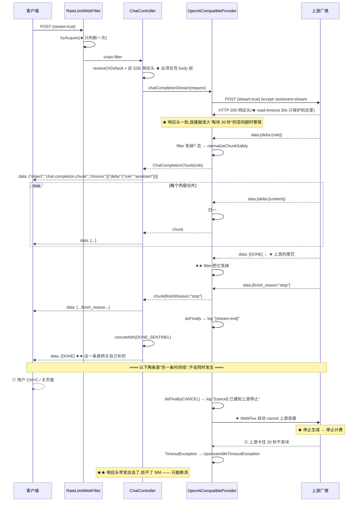

# 流式请求处理流程

> **本页速览**
> - 一次带 `stream: true` 的请求,和[非流式](非流式请求处理流程.md)**前 3 步完全一样**,从第 ④ 步开始分道扬镳。
> - ★★ 本流程的核心是**三段式**:`raw`(只管传输) → `filter`(只管协议尾巴) → `concatMap`(只管归一)。
> - ★★ 最容易搞错的一点:**`[DONE]` 是我们自己补的**,上游发的那个被 `filter` 丢掉了。
> - ★ 两个"看不见但必须存在"的机制:**取消传播**和**空闲超时** —— 一个省上游的钱,一个防连接吊死。
> - ⚠️ 一个反直觉结论:流式一旦开始,**错误就再也不能变成状态码了**(响应头早就发出去了)。
>
> **导航**:[← 上一页:非流式请求处理流程](非流式请求处理流程.md) ｜ [下一页:类速查表 →](../03-reference/类速查表.md) ｜ [相关:架构总览](../00-map/架构总览.md)

---
## 触发条件
```bash
curl -N -X POST http://localhost:8081/v1/chat/completions \
  -H "Content-Type: application/json" \
  -d '{"model":"deepseek-chat","messages":[{"role":"user","content":"写一首短诗"}],"stream":true}'
```
★ -N 是关掉 curl 的输出缓冲 —— ★ 不加它你会以为"流式没生效"。**期望输出(边生成边到达)**:
```text
data: {"id":"...","object":"chat.completion.chunk","choices":[{"delta":{"role":"assistant"}}]}
data: {"id":"...","object":"chat.completion.chunk","choices":[{"delta":{"content":"春"}}]}
...(中间的 content 分片)...
data: [DONE]
```

---
## 文字版数据流向图
```text
客户端 ── POST {stream:true} ──► RateLimitWebFilter ──► ChatController#completions
                                       (★ 和前 3 步一样) │ stream == TRUE
                                                                  ▼
                                          ┌────────────────────────────────────────────┐
                                          │ ★ 两个响应头,必须在返回 Flux 前             │
                                          │   Content-Type: text/event-stream · Cache-Control: no-cache(卡点1) │
                                          └────────────────────────────────────────────┘
                                                                  ▼
                          streamToClient() = A ──► B ──► C ──►(补)──► 客户端
                                                                  │
   ┌──────────────────────────────────────────────────────────────┘
   │  A. provider.chatCompletionStream(request)   ★ 三段式的第一段
   │     chatCompletionStreamRaw()    ★ 只管【传输】
   │       bodyToFlux(String.class) ← 一行一行地到
   │       .doFinally(…) → [cancel]/[stream-end]
   │       .timeout(20s) → ★★ 每个元素重置一次
   │       .onErrorMap(TimeoutException→空闲超时)
   │                        │  Flux<String>,含上游 [DONE]
   │                        ▼
   │     B. .filter(!DONE_SENTINEL.equals(chunk)) ★ 只管【协议尾巴】
   │        ★★ 把上游 [DONE] 丢掉 —— 我们补自己的
   │                        │  Flux<String>,不含 [DONE]
   │                        ▼
   │     C. .concatMap(normalizeChunkSafely(…)) ★ 只管【归一】 ★ concatMap 顺序不能乱
   │        ★ 单块坏了 → Flux.empty() 跳过,不炸整条流
   │                        │  Flux<ChatCompletionChunk>
   │                        ▼
   │     (补) .map(this::toJson) ★ 序列化成 SSE data 行
   │          .concatWith(Mono.just(DONE_SENTINEL)) ★★ 客户端的 [DONE]
   ▼
上游 HTTP 连接(★ 保持打开,直到读完或被取消)
```

---
## 步骤化讲解
### 第 ①~③ 步:与[非流式](非流式请求处理流程.md)完全相同
★ RateLimitWebFilter → resolveOrDefault → 打日志。★★ 唯一的区别是路由那一行 ★ 位于 stream 分支【之前】—— 所以两条路共用它;但"代码位置保证了它"不算证据,★ RoutingTest#streamingRequestIsRoutedToo 才是证据。

> ★ 见 [测试-路由与注册表](../01-modules/07-测试验证/测试-路由与注册表.md) 第 ④ 条。
### 第 ④ 步:设响应头(★ 顺序有生死)
```java
if (Boolean.TRUE.equals(request.stream())) {
    exchange.getResponse().getHeaders().setContentType(MediaType.TEXT_EVENT_STREAM);
    exchange.getResponse().getHeaders().set(HttpHeaders.CACHE_CONTROL, "no-cache");
    return streamToClient(provider, request);
}
```
★★ 为什么必须在这里、而不是在 streamToClient 里面?★ 一旦 Flux 开始发数据,响应头已随第一个 chunk 发出去了 —— 之后再 set 会抛 IllegalStateException("响应头已提交")。↓ ★★ 规律:「★ 响应头的可设置窗口,在"开始写 body"那一刻就关闭了」。

**★ `text/event-stream` 和 SSE 的关系**:★ SSE(Server-Sent Events)是基于纯文本的 HTTP 长连接协议,格式极简:每行 "data: xxx",空行分隔,流结束用 "data: [DONE]"。★ 不需要 WebSocket —— 大模型输出天然是单向推送。★ 术语不确定 → 术语表。
### 第 ⑤ 步:`streamToClient()` —— 只有四行,但每行都在做一件事
```java
private Flux<String> streamToClient(Provider provider, ChatCompletionRequest request) {
    return provider.chatCompletionStream(request)
            .map(this::toJson)
            .concatWith(Mono.just(ChatCompletionChunk.DONE_SENTINEL));
}

/** 网关自身的流式契约序列化失败 —— ★ 这是我们的 bug,不是上游的 */
private String toJson(ChatCompletionChunk chunk) {
    try {
        return objectMapper.writeValueAsString(chunk);
    } catch (JsonProcessingException e) {
        throw new IllegalStateException("网关自身的流式契约序列化失败", e);
    }
}
```
**★ 三个设计点**:

| 设计 | 为什么 |
|---|---|
| `.map(this::toJson)` 在这层 | ★ Provider 只管产出对象,**"怎么序列化成 SSE"是网关的协议细节** |
| `.concatWith(DONE_SENTINEL)` 在这层 | ★★ **`[DONE]` 属于网关对客户端的承诺**,不属于任何厂商 |
| 异常信息写 **"网关自身"** | ★★ 定位方向完全不同:这不是上游的锅 |

> ★★ **规律**:「**异常信息要说清"是谁的错"**」—— 一个写"序列化失败"的异常,和写"网关自身的序列化失败"的异常,**排障时差半小时**。
### ★★ 第 ⑥ 步:`chatCompletionStream()` —— 三段式的骨架
```java
@Override
public Flux<ChatCompletionChunk> chatCompletionStream(ChatCompletionRequest request) {
    String model = StringUtils.hasText(request.model()) ? request.model() : defaultModel;

    return chatCompletionStreamRaw(request)
            .filter(chunk -> !ChatCompletionChunk.DONE_SENTINEL.equals(chunk))
            .concatMap(chunk -> normalizeChunkSafely(chunk, model));
}
```
**★★ 三段各自负责什么(这一页最该记住的表)**:

| 段 | 方法 | 只负责 | ★ 不要让它干别的 |
|---|---|---|---|
| A | `chatCompletionStreamRaw` | **传输**:发请求、收行、超时、取消 | ★ 不解析、不判断业务 |
| B | `.filter(...)` | **协议尾巴**:丢掉上游的 `[DONE]` | ★ 只丢这一种东西 |
| C | `.concatMap(...)` | **归一**:上游块 → 网关块 | ★ 不改顺序、不吞异常 |

★★ 为什么要把 A 单独抽一个方法?A 里的三个关注点(timeout / doFinally / accept 头)和"归一"毫无关系 —— 揉在一起,想验"空闲超时会杀流"就得把归一逻辑也一起跑。↓ ★ 证据:IdleTimeoutTest 直接调 A(chatCompletionStreamRaw),归一链路一行没执行 → 见 测试-流式与取消传播。

> ★★ **规律**:「**能单独测的,一定是单独抽出来的**」。★ 抽方法的判据不是"代码太长",而是**"这部分我有独立的问题想问它"**。
### ★ 第 ⑦ 步:`chatCompletionStreamRaw()` —— 传输层的四个动作
```java
private Flux<String> chatCompletionStreamRaw(ChatCompletionRequest request) {
    return webClient.post()
            .uri("/chat/completions")
            .header(HttpHeaders.AUTHORIZATION, "Bearer " + apiKey)
            .contentType(MediaType.APPLICATION_JSON)
            .accept(MediaType.TEXT_EVENT_STREAM)      // ★ ① 告诉上游"我要流"
            .bodyValue(upstreamBody)                  //    stream:true
            .retrieve()
            .bodyToFlux(String.class)                 // ★ ② 一行一行地到
            .doFinally(signal -> {                    // ★ ③ 唯一的观测点
                if (signal == SignalType.CANCEL) {
                    log.info("[cancel]     channel={} 客户端断开了，已通知上游停止", name);
                } else {
                    log.info("[stream-end] channel={} 正常读完，上游连接已释放", name);
                }
            })
            .timeout(Duration.ofMillis(idleTimeoutMs))// ★ ④ 空闲超时
            .onErrorMap(TimeoutException.class,
                    e -> new UpstreamIdleTimeoutException(idleTimeoutMs, e));
}
```
**★ ① `.accept(TEXT_EVENT_STREAM)` 和 `.bodyToFlux` 是一对**:★ 只设 accept 不换 bodyToFlux → ★ 上游确实在流式发,但网关攒完才给你 → 表现:"流式没生效" —— 而日志、状态码、内容全对。★★ "返回 Flux ≠ 流式":★ 中间任何 collectList() / block() 都会悄悄退回批处理。

> ★★ **规律**:「**"看起来是流式"的代码,可能一行都没流过**」。★ 判据:**首块到达时间 vs 末块到达时间差多少?** 一样 → 批处理。★ 见 [测试-契约测试](../01-modules/07-测试验证/测试-契约测试.md) 的"多久返回"。

**★ ③ `doFinally` 是"取消"唯一能被看见的地方**:★ 客户端 Ctrl+C → WebFlux 检测到连接关闭 → ★ 自动 cancel 上游 Flux(框架已做,不用写代码)。★ 但不 log 你就永远不会知道它发生过 —— "上游还在烧钱生成,客户端早就走了"正是这么发生的。

**★ ④ `.timeout()` 是"每个元素"重置,不是"整条流"总时长**:★ .timeout(20s) 语义:★ 相邻两个元素之间不能超过 20 秒 → 10 分钟长回复,只要块与块不断,★ 永远不会超时;★ 理解成"整条流 20 秒"就会得出"长回复必被杀"的错误结论。

> ★★ **规律**:「**超时是"静默失败"的克星**」。★ 没有它,卡住的上游连接会**永远占着一个 WebFlux 事件循环线程** —— ★★ 而 WebFlux 线程数是**个位数**,几个卡住就够拖垮整个网关。
### ★ 第 ⑧ 步:`normalizeChunkSafely()` —— 单块坏了不炸整条流
```java
private Flux<ChatCompletionChunk> normalizeChunkSafely(String chunk, String model) {
    try {
        return Flux.just(normalizeChunk(chunk, model));
    } catch (Exception e) {
        log.warn("[分片归一失败] channel={} 已跳过该分片 raw={}", name, chunk, e);
        return Flux.empty();          // ★ 丢掉这一块,流继续
    }
}
```
★★ 和非流式的关键差异:· 非流式:任何一个字段不对 → ★ 整个请求失败(反正拼不出完整响应);· 流式:★ 中间有一块畸形 → ★ 丢掉它,后面的照常给。↓ ★ 理由:流式已开始出字,给出去的内容收不回来;此时"整条流失败"对用户 = "看到一半突然断了",比"少一个字"糟糕得多。

> ★★ **规律**:「**能局部恢复的地方,不要整体失败**」。★ 判据:**失败发生时还能不能给出有价值的响应?能,就别放弃。**
### ★ 第 ⑨ 步:`normalizeChunk()` 的两个 `hasNonNull`
```java
JsonNode choice = raw.path("choices").path(0);
JsonNode delta  = choice.path("delta");
JsonNode finish = choice.path("finish_reason");

// ★ 只有【真有 role】的分片才给 role —— 不能凭空补一个
if (delta.hasNonNull("role")) {
    builder.role(delta.path("role").asText());
}
// ★★ 只有【真有 finish_reason】的分片才给 —— 中间分片是 null,补 "" 会让客户端以为"说完了"
if (finish.hasNonNull("finish_reason")) {
    builder.finishReason(finish.asText());
}
```
★★ 为什么不能像非流式那样用默认值?★ 流式块的"缺字段"是【有含义的】:· role 只出现在第一块 → 补默认值 = ★ 骗客户端"每块都有 role";· finish_reason 只在最后一块 → 补空串 = ★ 骗客户端"说完了"。↓ ★★ 规律:「★ 在流式里,字段缺失本身是一种信息,不能填平」。

> ★ 证据:测试断言**中间块的 `finish_reason` 是 `null`** —— 见 [测试-流式与取消传播](../01-modules/07-测试验证/测试-流式与取消传播.md)。

---
## 时序图(含取消与空闲超时)


---
## 容易卡住的点
### 卡点 1:★ 响应头设晚了 → `IllegalStateException`
★ 症状:流式请求偶发 500,日志里 "Response has already been committed"。★ 原因:Flux 已开始发数据之后才 set 响应头;偶发是因为上游快返回第一块时必崩,慢时可能侥幸。↓ ★ 判据:【所有】响应头设置必须在返回 Flux 之前完成。
### 卡点 2:★★ `[DONE]` 出现两次 / 一次都没有
★ 上游的 [DONE] 进了 normalizeChunk → JsonNode 解析失败 → normalizeChunkSafely 捕获 → ★ 但只记一条 warn 日志,★ 流照样"正常结束" → ★★ 表现:流看起来对,日志里在刷"分片归一失败"。↓ ★ filter 的意义:把"[DONE] 不是 JSON"从"每个上游都有的偶发异常"变成"不可能发生"。★★ 判据:「★ 能被上游格式差异触发的东西,不该走到解析层」。
### 卡点 3:★ 中间写了 `collectList()` / `block()`
★★ 编译通过、测试可能也过、日志全对 —— 只是不流式了:· .collectList() → ★ 攒齐再发;· .blockFirst() → ★★ 直接阻塞事件循环线程,WebFlux 大忌。↓ ★ 唯一发现方式:★ 量首块延迟,不是看代码 ★ 见 测试-契约测试 的 ".timestamp() 看首尾间隔"。
### 卡点 4:⚠️ `UpstreamIdleTimeoutException` **故意不映射状态码**
★ 直觉:空闲超时 → 504。★ 现实:★ 响应头早在第一块时已发出 → 此时 setStatus 无效且抛异常。↓ ★★ 所以这异常在 UpstreamExceptionHandler 里 ★ 没有对应 handler,就那样把流切断 —— 客户端看到"连接断了"。★★ 这不是遗漏,是流式协议本身决定的。

> ★ 完整讨论 → [类-UpstreamIdleTimeoutException](../01-modules/05-错误处理/类-UpstreamIdleTimeoutException.md)。
### 卡点 5:★ 三个超时,只有一个属于 Provider

| 超时 | 值 | 配在哪 | 谁生效 |
|---|---|---|---|
| 连接 | 3s | `gateway.upstream.connect-timeout-ms` | ★ `WebClientCustomizer`,**所有渠道共用** |
| 读 | 30s | `gateway.upstream.read-timeout-ms` | ★ 同上,**只保护到响应头到达** |
| **空闲** | 20s | `gateway.upstream.idle-timeout-ms` | ★★ **每个 Provider 各注入一份** |

★★ 为什么只有空闲超时是 per-Provider?前两个是 ★ 传输层行为(连不上、等不到头),同一个 HttpClient 就共享;而"多久算卡住" ★ 是业务判断 —— 慢思考模型的合理间隔本来就比聊天模型长。

> ★ 完整的装配过程 → [启动流程](启动流程.md) 第 ③ 步。

---
## 涉及的类

| 步骤 | 类 | 页 |
|---|---|---|
| ①②③ | `RateLimitWebFilter` / `ProviderRegistry` / `ChatController` | [类-ChatController](../01-modules/04-请求入口/类-ChatController.md) |
| ④⑤ | `ChatController#streamToClient` | [类-ChatController](../01-modules/04-请求入口/类-ChatController.md) |
| ⑥⑦⑧⑨ | `OpenAiCompatibleProvider` | [类-OpenAiCompatibleProvider](../01-modules/02-上游渠道抽象/类-OpenAiCompatibleProvider.md) · [深入页](../01-modules/02-上游渠道抽象/类-OpenAiCompatibleProvider-深入.md) |
| ⑦ | `UpstreamIdleTimeoutException` | [类-UpstreamIdleTimeoutException](../01-modules/05-错误处理/类-UpstreamIdleTimeoutException.md) |
| 块结构 | `ChatCompletionChunk` | [类-ChatCompletionChunk](../01-modules/03-对外契约/类-ChatCompletionChunk.md) |

---
## 相关页
- 前半段完全一样 → [非流式请求处理流程](非流式请求处理流程.md)
- 进程怎么起来的 → [启动流程](启动流程.md)
- ★ 流式的契约承诺 → [契约-OpenAI兼容约定](../01-modules/03-对外契约/契约-OpenAI兼容约定.md)
- ★ 怎么证明"真的是流式" → [测试-契约测试](../01-modules/07-测试验证/测试-契约测试.md)
- ★ 取消和空闲超时怎么被验证 → [测试-流式与取消传播](../01-modules/07-测试验证/测试-流式与取消传播.md)
- ⚠️ WebFlux 下还有哪些坑 → [待深入问题](../99-appendix/待深入问题.md)
- 术语不确定 → [术语表](../03-reference/术语表.md)

> **导航**:[← 上一页:非流式请求处理流程](非流式请求处理流程.md) ｜ [下一页:类速查表 →](../03-reference/类速查表.md) ｜ [相关:架构总览](../00-map/架构总览.md)
