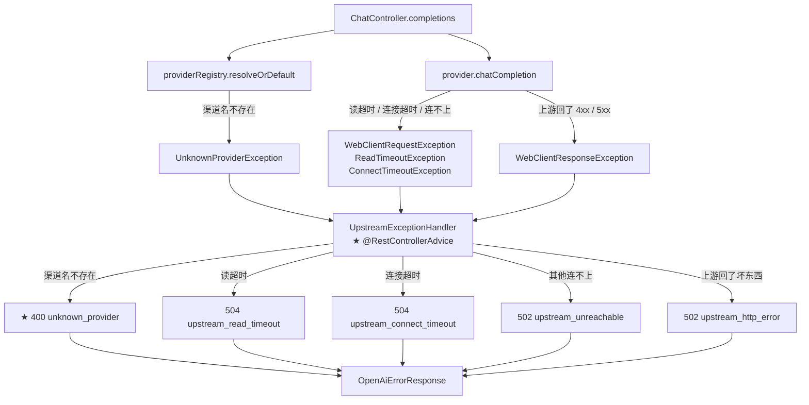

# 非流式请求处理流程

> **本页速览**
> - 一次 `POST /v1/chat/completions`(不带 `stream`),从进网到出网共 **7 步**。
> - ★★ 本流程的**主角不是 Controller,是 `normalize()`** —— 那个把上游私有格式翻译成 OpenAI 契约的方法。
> - ★ 全流程最该记住的一行:**`requestedModel` 而不是 `raw.path("model")`**。
> - ★ 两条出口路径对照:成功走 `ChatController`,失败走 `UpstreamExceptionHandler`(`@RestControllerAdvice`)。
> - ⚠️ 有一个"看起来该有、其实没有"的环节:**网关不重试**。本页讲清为什么。
>
> **导航**:[← 上一页:启动流程](启动流程.md) ｜ [下一页:流式请求处理流程 →](流式请求处理流程.md) ｜ [相关:数据流转](../00-map/架构总览.md)

---
## 触发条件
```bash
curl -X POST http://localhost:8081/v1/chat/completions \
  -H "Content-Type: application/json" -H "X-Client-Id: demo" \
  -d '{"model":"deepseek-chat","messages":[{"role":"user","content":"你好"}]}'
```
**三个前提**:

| 条件 | 说明 |
|---|---|
| —— | ★ **不带 `stream` 或 `stream: false`** —— 带 `true` 走 [流式流程](流式请求处理流程.md) |
| `provider` 可选 | 不传 → 走 `gateway.providers.default-channel` |
| `messages` 必填 | ★ 见下方卡点 1 |

**期望结果**:一个**和 OpenAI 格式完全一致**的 JSON。

---
## 文字版数据流向图
```text
客户端
  │  POST /v1/chat/completions  {model, messages}
  ▼
┌─────────────────────────────────────────────────────────┐
│ RateLimitWebFilter            ★ 只在 enabled=true 时存在 │
│   enabled? → isProtected? → resolveClientId → tryAcquire │
│   放行 → 设 X-RateLimit-* → chain.filter                 │
└─────────────────────────────────────────────────────────┘
  │  ★ 被拒就到此为止:429,Controller 一行都不会执行
  ▼
┌─────────────────────────────────────────────────────────┐
│ DispatcherHandler → ChatController#completions          │
│   providerRegistry.resolveOrDefault(request.provider())  │
│   log.info("收到请求，渠道=…")                            │
│   stream 不为 TRUE → provider.chatCompletion(request)    │
└─────────────────────────────────────────────────────────┘
  ▼
┌─────────────────────────────────────────────────────────┐
│ OpenAiCompatibleProvider#chatCompletion                 │
│   ① model 兜底:StringUtils.hasText(…) ? : defaultModel   │
│   ② 翻译成上游请求体:{model, messages[], stream:false}   │
│   ③ WebClient POST {baseUrl}/chat/completions            │
│      Header: Authorization: Bearer {apiKey}              │
└─────────────────────────────────────────────────────────┘
  │  HTTP / HTTPS
  ▼
┌─────────────────────────────────────────────────────────┐
│ 上游(api.deepseek.com / api.moonshot.cn / …)            │
│   ★ 它回的是【厂商私有格式】:object 可能没有、             │
│     model 可能是 deepseek-flash、字段可能是 camelCase     │
└─────────────────────────────────────────────────────────┘
  │  JsonNode(★ 原始响应,不直接出网)
  ▼
┌─────────────────────────────────────────────────────────┐
│ normalize(raw, requestedModel)   ★★ 本流程的主角         │
│   object  → 钉死 "chat.completion"                       │
│   model   → ★ requestedModel(不是上游报的)                │
│   choices/usage → 逐字段重建                             │
└─────────────────────────────────────────────────────────┘
  │  ChatCompletionResponse(网关自己的 DTO)
  ▼
客户端  ← ★ 看不到任何厂商痕迹
```

---
## 步骤化讲解
### 第 ① 步:`RateLimitWebFilter`(可能不存在)
```java
// 两个快速判断,纯内存,不碰 Redis
if (!properties.enabled() || !isProtected(exchange)) {
    return chain.filter(exchange);      // ★ 直接过
}
```
★ 注意这个 filter 是 `@ConditionalOnProperty` 装配的 —— 限流关闭时,★ 容器里根本没有这个 Bean(不是"有一个不干活的 filter")→ 见 [类-RateLimitConfig](../01-modules/06-限流/类-RateLimitConfig.md)
> ★ 完整的分支逻辑 → [流程-一次被限流的请求](../01-modules/06-限流/流程-一次被限流的请求.md)
### 第 ② 步:`ChatController` 只做一件事:路由
```java
Provider provider = providerRegistry.resolveOrDefault(request.provider());
```
★ 验收物:加第二家厂商时,路由**从头到尾只改这一个表达式** —— 没有 if/else、没有厂商名,判断全在注册表里。

**★ `resolveOrDefault` 的三种输入**:

| 输入 | 结果 | 理由 |
|---|---|---|
| `"moonshot"` | moonshot | 尊重指定 |
| `null` / `"   "` | ★ 默认渠道 | ★ 标准 OpenAI SDK 压根不知道"渠道"这个概念 |
| `"kimi"`(不存在) | ★ **抛异常** | ★★ **绝不静默回落默认** |

> ★★ 第三条最值钱:静默回落的后果是**调用方把渠道名拼错三个月都没人发现** —— 请求全都成功了,日志里一条错误都没有,**只是账单一直出在错误的渠道上**。★ 完整论证 → [测试-路由与注册表](../01-modules/07-测试验证/测试-路由与注册表.md)

**★ 日志先于业务**:
```java
log.info("收到请求，渠道={}（请求指定={}），model={}，stream={}，messages={} 条，处理线程 = {}",
        provider.name(), request.provider(), request.model(), request.stream(),
        request.messages() == null ? 0 : request.messages().size(),
        Thread.currentThread().getName());
```
★★ 为什么两个都要打?客户端指定了渠道却被兜底时,★ 这两者不一样 —— 而那正是需要被看见的情况
> ★★ **规律**:「**日志要能回答"我以为的"和"实际的"差多少**」。★ 只打最终值,你永远不知道它是不是被兜底过的。
### 第 ③ 步:决策 —— 走哪条分支
```java
if (Boolean.TRUE.equals(request.stream())) {
    exchange.getResponse().getHeaders().setContentType(MediaType.TEXT_EVENT_STREAM);
    exchange.getResponse().getHeaders().set(HttpHeaders.CACHE_CONTROL, "no-cache");
    return streamToClient(provider, request);     // → 流式流程
}
return provider.chatCompletion(request);          // ★ 本页走这条
```
> ★ 注意 `Boolean.TRUE.equals(...)` 而不是 `request.stream()` —— **`stream` 是可空的 `Boolean`,直接拆箱会 NPE**。★ 见下方卡点 1。
### 第 ④ 步:翻译 + 发请求
```java
String model = StringUtils.hasText(request.model()) ? request.model() : defaultModel;
Map<String, Object> upstreamBody = Map.of(
        "model", model,
        "messages", request.messages().stream()
                .map(m -> Map.of("role", m.role(), "content", m.content()))
                .toList(),
        "stream", false
);
```
★★ 注意:【我们的 DTO】→【上游的 Map】。★ 为什么重建 Map 而不是直接序列化 DTO 发出去?· 上游要的字段和 DTO ★ 可能不一样(要 stream:false)· ★ "往上传什么"由我们控制,不是"客户端传什么就转发什么"
★★ 这就是"网关"和"代理"的区别:★ 代理透传,网关翻译
> ★★ **规律**:「**"翻译"比"透传"多一层控制权**」。★ 透传的网关,上游一改协议你就挂了;**翻译的网关,改动被关在一个类里**。

★ 这一段的价值:G3b 之后彻底兑现 —— 某家厂商请求结构不一样时,改动被关在"那一个 Provider 类"里,Controller 和 DTO 一行不动。
### 第 ⑤ 步:发出 HTTP 请求
```java
return webClient.post()
        .uri("/chat/completions")                                    // ★ 相对路径
        .header(HttpHeaders.AUTHORIZATION, "Bearer " + apiKey)
        .contentType(MediaType.APPLICATION_JSON)
        .bodyValue(upstreamBody)
        .retrieve()
        .bodyToMono(JsonNode.class)
        .doOnNext(raw -> log.info("[上游原始响应] channel={} {}", name, raw))
        .map(raw -> normalize(raw, model));
```
**★ 四个细节**:

| 细节 | 为什么 |
|---|---|
| `.uri("/chat/completions")` **相对路径** | ★ `baseUrl` 在构造时已 `builder.baseUrl(baseUrl).build()` 注入 |
| `Bearer {apiKey}` | ★ 密钥**只存在内存里,绝不写日志** |
| `.bodyToMono(JsonNode.class)` | ★★ **不直接映射成 DTO** —— 先拿到原始树,归一才有东西可挑 |
| `.doOnNext(… raw)` | ★ 排错用 —— **但它只活在日志里,不出本方法** |

★★ 这是"归一"能成立的前提:直接 `.bodyToMono(ChatCompletionResponse.class)` → 少给 object 则出口 null、给 camelCase 则 Jackson 静默丢弃。★ 先拿 JsonNode 再 `.path()` 自己挑,"出口长什么样"由我们说了算
> ★★ **规律**:「**要让输出可控,就不能让输入直接变成输出**」—— ★ 中间必须有一层"我们自己写的组装代码"。
### ★★ 第 ⑥ 步:`normalize()` —— 本流程的主角
```java
private ChatCompletionResponse normalize(JsonNode raw, String requestedModel) {
    JsonNode choice = raw.path("choices").path(0);
    JsonNode usage  = raw.path("usage");
    return new ChatCompletionResponse(
            raw.path("id").asText(),
            "chat.completion",                    // ★ 钉死:上游给不给都不影响出口
            raw.path("created").asLong(),
            requestedModel,                       // ← ★★ 1c 最该记住的一行
            List.of(new ChatCompletionResponse.Choice(
                    0,
                    new ChatCompletionResponse.Message(
                            choice.path("message").path("role").asText("assistant"),
                            choice.path("message").path("content").asText()),
                    choice.path("finish_reason").asText())),
            new ChatCompletionResponse.Usage(
                    usage.path("prompt_tokens").asInt(),
                    usage.path("completion_tokens").asInt(),
                    usage.path("total_tokens").asInt())
    );
}
```
**★★ 三个归一动作(少一个都不算归一)**:

| # | 动作 | 上游 | 出口 |
|---|---|---|---|
| ① | `object` **由我们钉死** | 可能没有 | ★ 恒为 `"chat.completion"` |
| ② | `model` **报客户端请求的** | `deepseek-flash` | ★ `deepseek-chat` |
| ③ | `choices/usage` **按契约重建** | 多给的字段 | ★ 一律丢弃 |

★ ② 为什么最该记住:`requestedModel`,不是 `raw.path("model")`。★ 实测:请求 deepseek-chat,上游回 deepseek-flash
→ 透传:客户端看到★自己从没请求过的模型名;归一后看到★始终是自己要的。★★ 厂商偷偷换模型是网关内部的事,不该泄漏给客户端
> ★★ **规律**:「**归一不只是"补上缺的字段",还包括"改掉对不上的字段"**」。★ 而后者**更难发现**:字段都在,值也是合法的,**只是不是你要的那个**。

**★ 两个容易忽略的默认值**:
```java
choice.path("message").path("role").asText("assistant")
//                                  ↑ ★ 带默认值的 asText —— 上游没给 role 时兜底
choice.path("finish_reason").asText()
//                                  ↑ ★ 不带默认值 —— 给不出就是空串,不编
```
> ★★ **规律**:「**哪些字段可以有默认值、哪些不能,是个判断题**」:`role` 缺了默认 `assistant` **是安全的**(OpenAI 语义下只有一个答案);`finish_reason` 缺了**不能编** —— 编一个就等于**替上游宣布"说完了"**。
### 第 ⑦ 步:序列化出网
★ `ChatCompletionResponse` 是 record → Jackson 直接序列化;字段名是 snake_case(record 组件名 + `@JsonProperty` 约定)→ 见 [类-ChatCompletionResponse](../01-modules/03-对外契约/类-ChatCompletionResponse.md)
> ★ 这一层**没有额外逻辑** —— 因为归一已经在第 ⑥ 步做完了。★★ **判据**:「**出口层不该有逻辑,有就说明归一没做干净**」。

---
## 失败路径(同一个流程的另一半)

**★ 这张图最该注意的**:★★ 400 是唯一一个"客户端自己错了"的状态码 —— 因为它★压根没轮到上游;其余全是 5xx —— 上游出问题,★就是网关的错,★包括上游返回 401(密钥无效):对客户端仍是★ 502
> ★ 完整推理 → [M5 错误处理](../01-modules/05-错误处理/_index.md) ｜ ★ 走一遍 → [流程-错误如何变成OpenAI格式](../01-modules/05-错误处理/流程-错误如何变成OpenAI格式.md)

---
## ★⚠️ 一个"看起来该有、其实没有"的环节:网关不重试
★ 上游 429(限流)/ 500(抖动)→ 网关★不重试,直接 502 返回客户端。★★ 为什么不做重试?① ★ 破坏幂等承诺:重试让上游收到两次同样请求(调用近似幂等,但★计费不是)
② ★ 非流式重试是"再花一次钱" —— 上游 429 时重试,是把限流激化
③ ★★ "更快地失败并让客户端决定"更诚实:客户端知道自己能承受几次、能等多久,网关不知道
⚠️ 但这是本项目★没做的一块 —— 企业级网关通常要有带退避+抖动的重试、以及熔断降级。见 99-appendix/待深入问题
> ★★ **规律**:「**"没做"和"要做"都该说清楚 —— 最怕的是"以为做了"**」。★ 面试被问"你怎么处理上游故障",**答"我故意不重试,理由是…"比答"我做了重试"更需要想清楚**。

---
## 容易卡住的点
### 卡点 1:★ `stream` 是 `Boolean` 不是 `boolean`
```java
if (Boolean.TRUE.equals(request.stream())) { ... }
```
★ Boolean 可空,客户端不传 stream → null;写成 if (request.stream()) → ★ 拆箱 NPE → 但报错信息完全不提"stream"。★★ 反过来,DTO 里图省事用基本类型 boolean:不传 → ★ 默认 false → "看起来像客户端说了 false",其实它什么都没说 → ★★ 见 [类-ChatCompletionRequest] 的同类讨论
> ★★ **规律**:「**跨边界(Boundary)的数据类型要用装箱类型**」—— ★ 因为**基本类型的默认值会让"缺失"伪装成"明确指定了值"**。
### 卡点 2:★ `messages` 为 null 时 `.stream()` 会 NPE
```java
"messages", request.messages().stream()...
```
★ 客户端发了 {"model":"deepseek-chat"} —— 没有 messages → ★ NPE,而且是在构造 upstreamBody 时炸的 → 被 @RestControllerAdvice 接住 → ★ 但接住的是 NPE,不是"参数校验失败"。⚠️ 当前实现里这一层校验 ★ 靠 DTO 上的注解(见 类-ChatCompletionRequest),★ 而日志那一行特意写了 request.messages() == null ? 0 : ... —— ★★ 说明作者知道它能是 null
### 卡点 3:★ 上游 base-url 结尾有没有 `/` 决定 URL 对不对
```yaml
deepseek:
  base-url: ${DEEPSEEK_BASE_URL:https://api.deepseek.com}      # ★ 结尾没有 /
moonshot:
  base-url: ${MOONSHOT_BASE_URL:https://api.moonshot.cn/v1}    # ★ 结尾是 /v1
```
★ 拼出来分别是 https://api.deepseek.com/chat/completions ✅、https://api.moonshot.cn/v1/chat/completions ✅。★ 也就是说 ★ 版本段(/v1)归 base-url 管,端点名(/chat/completions)归代码管
> ★★ **规律**:「**"哪一段是配置、哪一段是代码"要划清楚**」—— ★ 划错的后果是:**有些厂商的 URL 拼不出来**。
### 卡点 4:⚠️ 这条流程**不经过** `RateLimitWebFilter` 的情况
★ 三种:① 限流 enabled=false(默认)② 路径不在 PROTECTED_PATHS ③ ★ 客户端自己的限流额度没用完(正常情况)。★ 第三种占 99% —— 所以"限流没生效"和"限流生效但没触发"★ 在日志上不一样:没生效 → ★ 连 X-RateLimit-Limit 头都没有;生效了 → ★ 有头,且 Remaining 在递减
> ★ 这是**排查限流问题时最快的判据**。

---
## 涉及的类
| 步骤 | 类 | 页 |
|---|---|---|
| ① | `RateLimitWebFilter` | [类-RateLimitWebFilter](../01-modules/06-限流/类-RateLimitWebFilter.md) |
| ② | `ChatController` | [类-ChatController](../01-modules/04-请求入口/类-ChatController.md) |
| ② | `ProviderRegistry` | [类-ProviderRegistry](../01-modules/02-上游渠道抽象/类-ProviderRegistry.md) |
| ④⑤⑥ | `OpenAiCompatibleProvider` | [类-OpenAiCompatibleProvider](../01-modules/02-上游渠道抽象/类-OpenAiCompatibleProvider.md) |
| ④⑥ | `ChatCompletionRequest` / `ChatCompletionResponse` | [类-ChatCompletionRequest](../01-modules/03-对外契约/类-ChatCompletionRequest.md) · [类-ChatCompletionResponse](../01-modules/03-对外契约/类-ChatCompletionResponse.md) |
| 失败 | `UpstreamExceptionHandler` | [类-UpstreamExceptionHandler](../01-modules/05-错误处理/类-UpstreamExceptionHandler.md) |

---
## 相关页
- 上一步:进程怎么起来的 → [启动流程](启动流程.md)
- 另一条分支:`stream: true` → [流式请求处理流程](流式请求处理流程.md)
- ★ 归一到底承诺了什么 → [契约-OpenAI兼容约定](../01-modules/03-对外契约/契约-OpenAI兼容约定.md)
- ★ 怎么证明归一真的发生了 → [测试-契约测试](../01-modules/07-测试验证/测试-契约测试.md)
- 失败时的完整链路 → [流程-错误如何变成OpenAI格式](../01-modules/05-错误处理/流程-错误如何变成OpenAI格式.md)
- 被限流时长什么样 → [流程-一次被限流的请求](../01-modules/06-限流/流程-一次被限流的请求.md)
- 术语不确定 → [术语表](../03-reference/术语表.md)

> **导航**:[← 上一页:启动流程](启动流程.md) ｜ [下一页:流式请求处理流程 →](流式请求处理流程.md) ｜ [相关:数据流转](../00-map/架构总览.md)
